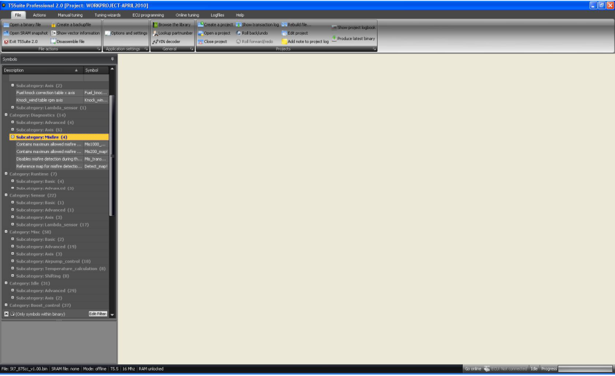

# Purpose and scope

By using this document users are assured to use the correct functionality of the software.
The information from this document should be followed as stated and compared with expected output from the software.

## References

This section references, by identity and title, documents that facts in this document depend upon.
Those documents are not necessarily the latest version.

| Document                         | Title     | Rev  |
|----------------------------------|-----------|------|
| Analyzing Trionic 5 with T5Suite | Trionic 5 | 1.22 |

## General information

Thank you for downloading and installing T5Suite 2.0.
In this manual you will find an overview of the most commonly used functions.
After starting T5Suite 2.0 a splash screen will be displayed and after all components are loaded and the application is initialized the main screen will be displayed.

{width=79%}

{width=100%}

The top menu is a ribbon style menu also found in the latest Microsoft Office environments.
It allows you to navigate through the available options quickly and easily.
This first chapter will show you around the available options one by one.
