# File menu

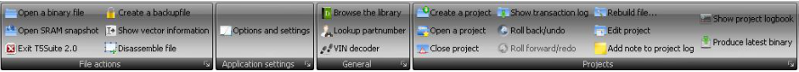{width=100%}

## File actions – Open a binary file

This option allows you to open a binary file.
T5Suite 2.0 will automatically extract all the relevant information from the file after selecting it in the open file dialog.

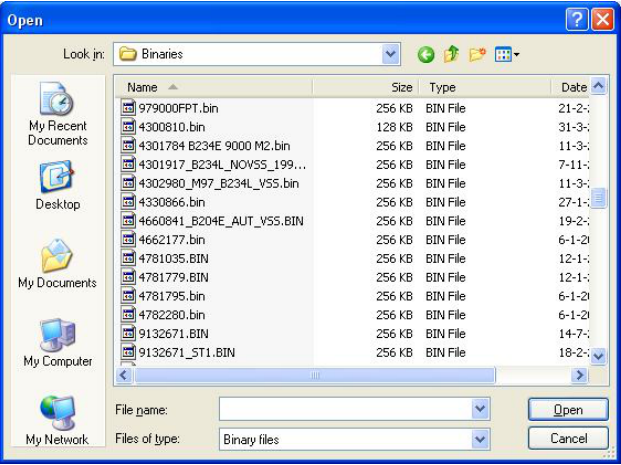{width=70%}

Once the file is opened and all information is extracted the symbol list on the left hand side of the main screen will be filled with information.

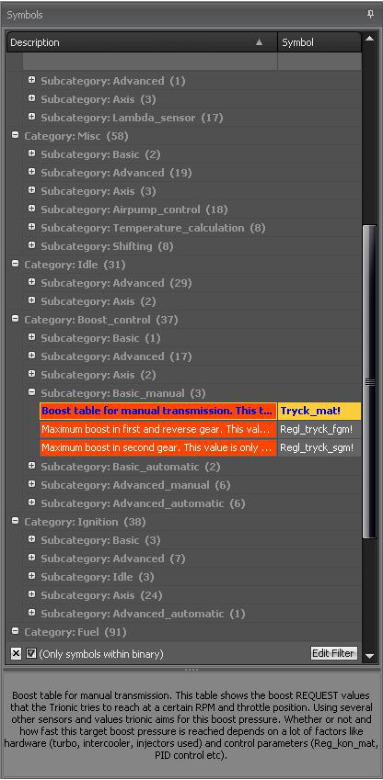{width=43%}

## File actions – Open SRAM snapshot

Lets you open – or activate – a snapshot from the ECUs memory.
This way you can view data that was in SRAM as well as data that is in the flash (bin).
SRAM snapshots can be made by BDM or by CANbus.

## File actions – Exit T5Suite 2.0

Exits the application in a safe manner.

## File actions – Create a backup file

Lets you create a backup file for the binary at this point.
It is wise to create backups before you start to make big changes to your file.
If a project is opened, the backup file will be stored within the project folder otherwise it will be stored in the folder where the bin file is located.

## File actions – Show vector information

This is a little tool for techies.
It shows the start-up vector information for the Motorola MC68332 microprocessor.

## File actions – Disassemble file

Lets you disassemble the binary file into human readable text format also known as assembler language.
If you’re not sure what that means, you don’t need this.

## File actions – Options and settings

This will show the options screen for T5Suite 2.0.

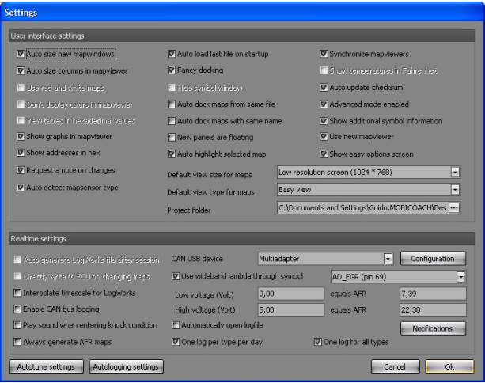{width=69%}

## File actions – Settings – Auto size new mapwindows

Determines whether or not new map windows will automatically be resized to fit their respective contents.

## File actions – Settings – Auto size columns in mapviewer

Determines whether or not the map viewers should try to resize the columns they contain to make the content fit.
As you can imagine ignition advance for example expressed in whole and fractional degrees takes more space than a simple decimal number ranging from 0-10.

## File actions – Settings – Show graphs in mapviewer

To gain performance in lightweight computers you can switch off the graphical display in the mapviewer altogether with this option.

## File actions – Settings – Show addresses in hex

T5Suite 2.0 can display addresses and lengths of symbols in decimal form or in hexadecimal form.
This option allows you to switch between the two.

## File actions – Settings – Auto highlight selected map

You can have T5Suite 2.0 select – and thus highlight the maps open from the tuning menu, so you will learn which maps are located where in the symbol list (only applicable for advanced mode).

## File actions – Settings – Request a note on changes

If you are working in a project you can have T5Suite 2.0 ask you for a comment every time you make a change to one of the maps.
This way, you can keep track of changes very easily.

## File actions – Settings – Auto detect mapsensor type

Most pro made tunes don’t have the T5Suite 2.0 marker for the correct mapsensor type in the binary file.
This option lets you try T5Suite 2.0 to auto detect the correct mapsensor type for use with the current binary file.

## File actions – Settings – Auto load last file on start-up

If you work on one file for a prolonged period of time you might want T5Suite 2.0 to reopen the last file automatically when you start it.
This option allows you to control that behaviour.
If the last opened item was a project, T5Suite 2.0 will automatically reopen that project for you at start-up.

## File actions – Settings – Fancy docking

If the dragging and docking of windows (map viewers) is slow or causes issues, please turn this option off.

## File actions – Settings – Auto dock maps from same file

If you open more than one map from the same file (for example fuel and ignition maps) you can choose to have those docked together using this option.
If the option is turned off, windows will be tiled next to each other.

## File actions – Settings – Auto dock maps with same name

If you open the same maps from different files (for example the main ignition map from 2 files) you can choose to have those docked together using this option.
If the option is turned off, windows will be tiled next to each other.

## File actions – Settings – New panels are floating

Upon opening a new mapviewer you can choose to have this window docked in the main screen or have it floating.

## File actions – Settings – Auto update checksum

Having this checked will rid you of the constant worry whether or not the checksum of your file is valid.
We advise you to keep this turned on!

## File actions – Settings – Synchronize mapviewers

With this enabled, T5Suite 2.0 will try to keep multiple opened mapviewers synchronized with eachother.
Cell selections, graph rotation etc will be done in all open mapviewers.

## File actions – Settings – Advanced mode enabled

This will switch T5Suite 2.0 into advanced mode.
This means you will have access to more options in the application and the symbol list will be visible as well.

## File actions – Settings – Show additional symbol information

If checked, the little panel on the bottom of the symbol list will be visible with information about the selected map in the symbol list.

## File actions – Settings – Use new mapviewer

A new, better looking surface graph has been implemented and you can choose whether you like to use the new one or the old one that was used in T5Suite 1.x.

## File actions – Settings – Show easy options screen

Lets the user decide whether the “old” fashioned firmware options screen should be used or the newer “properties” like options screen.

## File actions – Settings – Default view size for maps

Allows you to adjust the map viewers size for different screen resolutions.

## File actions – Settings – Default view type for maps

Easy view is best if you don’t know what this means ;)

## File actions – Settings – Project folder

Allows you to set an alternate project root folder for creating projects.
You can use this if you want all the projects to be located on a separate disk partition for example.

## File actions – Settings – Auto generate LogWorks file after session

If you run a live session on your ECU with the canbus connection, T5Suite 2.0 can automatically generate a LogWorks file from that session and start LogWorks.

## File actions – Settings – Directly write to ECU on changing maps (obsolete)

Meant for development purposes.
Please keep this turned off.

## File actions – Settings – Enable canbus logging

For debugging purposes only.
Please keep this turned off on normal operation.

## File actions – Settings – Play sound when entering knocking conditions

When the real-time part signals knock conditions in the ECU, a sound will be played.

## File actions – Settings – Always generate AFR maps

To be able to disable AFR map generation this option was created.
Users without a real-time connection will never need the AFR maps of course.

## File actions – Settings – Automatically open log file

For easy access when tuning a vehicle on the road.
After ending a logging session, the log will automatically be opened for reviewing.

## File actions – Settings – One log per type per day

When selected the log file creation will be maximized to one log file per type of logging (depending on the selected tab page in the real-time panel).
If “One log for all types” is also enabled, only one log file will be created per day for all types and sessions.

## File actions – Settings – One log for all types

When selected all the various tab pages in the real-time panel will generate data into the same file instead of recreating a new log file after every tab page change.

## File actions – Settings – CAN USB device

Three devices are currently supported, the Lawicel device ([www.canusb.com](https://www.canusb.com)), the DIY CANUSB and the multi-adapter that has a canbus interface a BDM interface, 5 AD inputs and a thermocouple input, both designed by ecuproject members.
The multi-adapter will require more configuration so when this is selected, the extra configuration button next to the drop down box will be enabled.
By selecting it you can set the extra options.

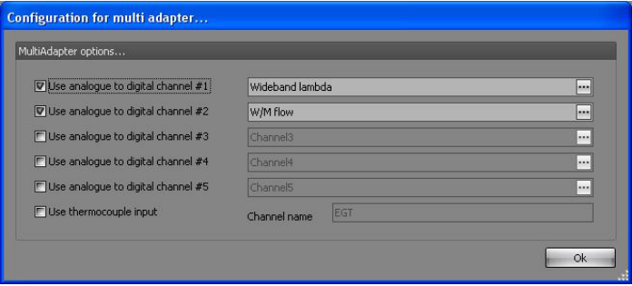{width=78%}

## File actions – Settings – Use wideband lambda through symbol

T5Suite allows you to setup you engine with a wideband lambda sensor like the LC1 from innovate motorsports.
The wideband controller can deliver a linear analogue signal to the ECU.
We advise you to use AD_EGR for that (pin 69).

## File actions – Settings – low voltage, high voltage, low AFR, high AFR

Settings to calibrate the wideband lambda controller input within T5Suite 2.0.

## File actions – Settings – Autotune settings

Lets you choose options for the Autotune fuel function in T5Suite 2.0.
The options screen for Autotune will be shown.
Please note that you need to be running a wideband lambda sensor to be able to use the Autotune function.

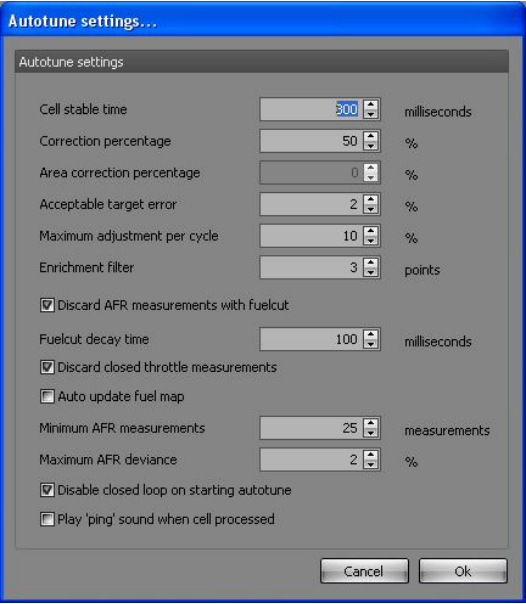{width=59%}

## File actions – Settings – Autotune settings – Cell stable time

Determines how long – in milliseconds – the system should reside in a certain load/rpm cell before T5Suite 2.0 validates the AFR measurement.

## File actions – Settings – Autotune settings – Correction percentage

Determines how much a certain AFR error will be corrected.
Setting this to 50% (default) means 50% of the established AFR error will be corrected for each session.

## File actions – Settings – Autotune settings – Acceptable target error

Determines how big the AFR error is allowed to be without T5Suite 2.0 taking action in that certain load/rpm cell.

## File actions – Settings – Autotune settings – Maximum adjustment per cycle

Determines how big the maximum adjustment will be in percentages measured from the original fuel map.

## File actions – Settings – Autotune settings – Enrichment filter

Determines how big enrichment/enleanment factors are allowed to be while still doing adjustments to the fuel map.

## File actions – Settings – Autotune settings – Discard measurements with fuel cut

Determines whether measurements while the system is in fuel cut will be ignored.

## File actions – Settings – Autotune settings – Fuelcut decay time

Determines how long T5Suite 2.0 must wait after a fuel cut situation before handling measurements as valid.

## File actions – Settings – Autotune settings – Discard closed throttle measurements

Determines whether measurements with closed throttle plate will be discarded.

## File actions – Settings – Autotune settings – Auto update fuel map

This option decides the mode in which Autotune works.
If this is checked the system will try to map the fuelling entirely on its own.
No feedback from the user is requested.
After a Autotune session the user can however revert to the previous fuel map automatically if he/she chooses to do so.
If this is not checked the Autotune function will be more like a question & answer game between T5Suite 2.0 and the user.
After every session a map is prompted in which T5Suite 2.0 shows which cells are to be altered to reach the requested AFR.
The user can select/deselect cells to his/her liking and update the fuel map with the selected cells.

## File actions – Settings – Autotune settings – Minimum AFR measurements

(not used yet).

## File actions – Settings – Autotune settings – Maximum AFR deviance

(not used yet)

## File actions – Settings – Autotune settings – Disable closed loop on starting auto tune

Some advanced users have closed loop operation turned off completely.
In that case you might want to prevent T5Suite 2.0 to disable closed loop operation when starting an auto tune session.

## File actions – Settings – Autotune settings – Play ping sound when cell processed

Allows you to have T5Suite 2.0 play a sound notification to indicate that a cell in the AFR map has been processed.
This way you can proceed to the next cell without having to keep an eye on the computer.

## File actions – Settings – Autologging settings

Lets you choose options for the autologging function in T5Suite 2.0.

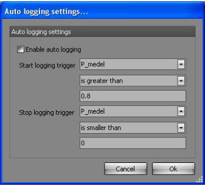{width=38%}

## File actions – Settings – Autologging settings – Enable auto logging

When enabled, the real-time panel will monitor the settings and start / stop sessions based on the remaining options.

## File actions – Settings – Autologging settings – Start logging trigger

Determines what the “start logging session” trigger is.
In the example P_medel (average pressure in the inlet manifold) must be greater than 0.8 bar to start a logging session automatically.

## File actions – Settings – Autologging settings – Stop logging trigger

Determines what the “stop logging session” trigger is.
In the example P_medel (average pressure in the inlet manifold) must be smaller (less) than 0.0 bar to end a logging session automatically.

## File actions – Settings – Notifications

Lets you choose notification options for T5Suite 2.0 real-time.

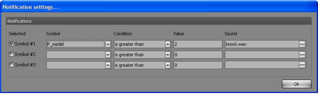{width=73%}

## File general – Lookup partnumber & Browse library

T5Suite 2.0 incorporates a bunch of stock binary files.
Within this ‘library’ you can search for partnumber and even open or compare files.
The lookup partnumber will not open files while the Browse Library function can.

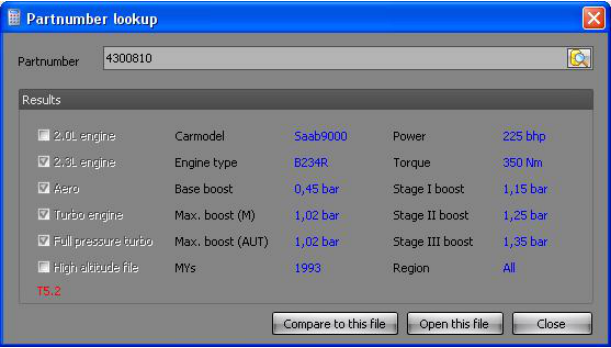{width=68%}

Clicking the little lookup button on the side of the text input field you can browse through the library.

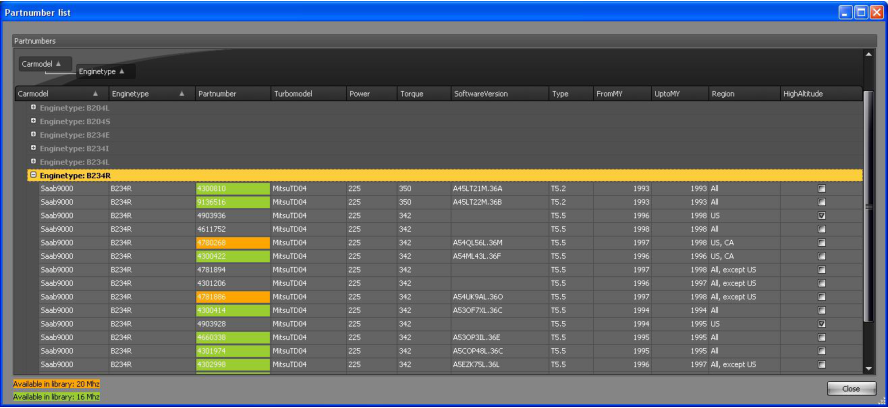{width=100%}

The green cells indicate that the binary file is actually present in the library and that you can use this file to open and compare.
Double clicking such a row will automatically select the given file and close the browse window.

## File general – VIN decoder

T5Suite 2.0 incorporates a VIN decoder which you can access though this button.

## File projects – Create a project

T5Suite 2.0 allows you to work on your tune in a project based fashion.
This option lets you create a new project.
Projects have the advantage of having roll-back and roll-forward functions, having versioning and keeping things tidy and together.
You are advised to work in a project if you do more than simple easy-tune your binary file.

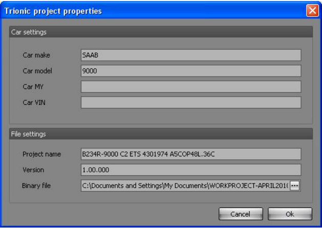{width=70%}

## File projects – Open a project

Lets you select and open a previously created project.
If no projects are available (none were created before) T5Suite 2.0 will notify you with a message box.

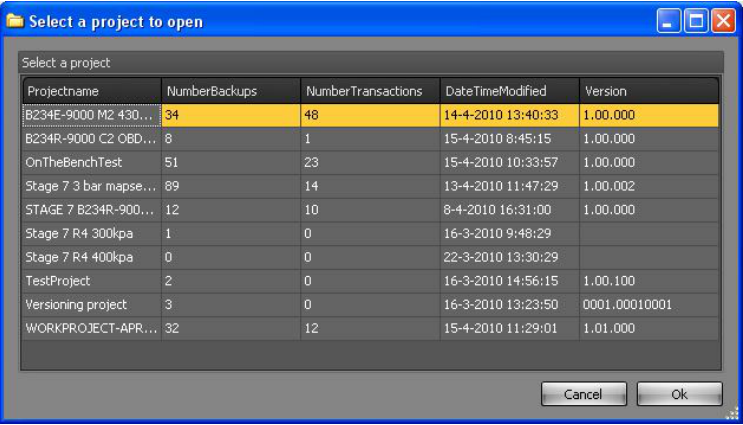{width=83%}

## File projects – Close project

Closed the project and allows you to work on single files again.

## File projects – Show transaction log

Shows the transaction log for the current project.
Since a project contains only one binary file, you could see this as an undo/redo list for the project binary file.

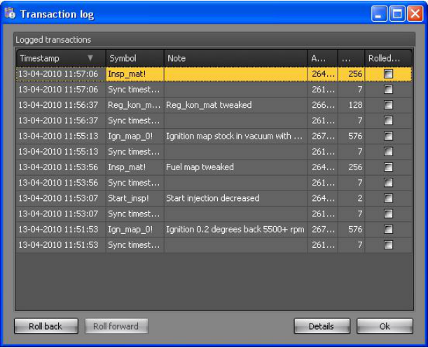{width=69%}

## File projects – Roll back/undo

Lets you rollback the last transaction made to the binary file.
If no transactions are available to rollback, the button will be disabled.

## File projects – Roll forward/redo

Lets you roll forward (redo) the last transaction that was undone/rolled back.
If no transaction are available to roll forward, the button will be disabled.

## File projects – Rebuild file

This enables you to rebuild a project file (binary) up to a certain point in time.
T5Suite 2.0 will ask you for a date and it will restore – if possible – the file that you had at that specific date.

## File projects – Edit project

Lets you edit the project properties for any project.
This enables you to manage your version numbering yourself.
Version numbers are stored, together with all other project properties, in the xml file in the project folder.

## File projects – Add note to project

You can add a note to you project with a timestamp attached to it, so you can keep track of changes you made in your setup.
For example, if you start using different injectors or mount a bigger intercooler, you can enter a note of this into the project log for later reference.

## File projects – Show project logbook

Shows you in details what has happened in your project.

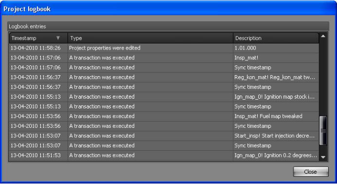{width=74%}

## File projects – Produce latest binary

Lets you export the project binary in its current state so you can save it in another location easily.
