# Actions menu

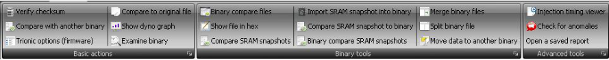{width=100%}

## Actions basic – Verify checksum

This option allows you to manually verify the binary files checksum.
This will not be needed if the auto checksum update function is turned on.

## Actions basic – Trionic options

This option allows you to view and modify a lot of parameters in the ECU.
There are two ways this options screen can be shown and this depends on the settings “Show easy options screen”.

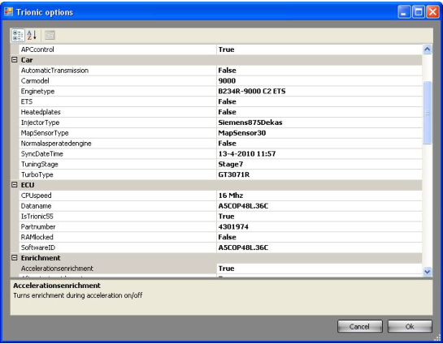{width=61%}

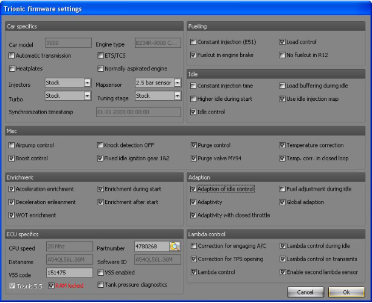{width=69%}

Adaption of idle control
:   Turns adaptive behavior for idle control on/off

Adaptivity
:   Turns fuel adaption on/off (spot adaption?)

Adaptivity with closed throttle
:   Turns adaption with closed throttle plate on/off

Fuel adjusting during idle
:   Turns fuel adaption during idle state on/off

Global adaption
:   Turns adaption on/off on a global level

Airpump control
:   Turns the air pump control (SAI models) on/off

APC Control
:   Turns the boost control valve control on/off

Automatic transmission
:   Sets the car in automatic transmission mode or in manual transmission mode.
    This should match the gearbox you have in your car

Carmodel
:   Information field, showing the car model

Engine type
:   Information field, showing the engine type

ETS
:   Turns the Electronic Throttle System on/off.
    This should match your car.
    If the car is equipped with TCS, turn it on, otherwise turn it off.

Heated plates
:   Some models are equipped with heat plates, located between the head and the intake manifold.

Injector type
:   Information field used as an indicator to T5Suite 2.0 which injectors you have mounted in the car.\
    Options:

    - Stock injectors
    - Green giants
    - Siemens DEKA 630cc/min (60lb/h)
    - Siemens DEKA 875cc/min (80lb/h)
    - Siemens 1000cc/min

Mapsensor type
:   Information field used as an indicator to T5Suite 2.0 which mapsensor type you are using.\
    Options:

    - Mapsensor 2.5 bar (stock, up to 1.45 bar of boost control)
    - Mapsensor 3.0 bar (up to 1.95 bar of boost control)
    - Mapsensor 3.5 bar (up to 2.45 bar of boost control)
    - Mapsensor 4.0 bar (up to 2.95 bar of boost control)

Normal aspirated engine
:   Indicates whether the car has a turbocharger mounted or not

Synchronization date/time
:   Indicates when T5Suite 2.0 has last altered the content of the maps in the file.
    This timestamp is used to determine whether to synchronize maps from the file to the ECU or the other way around.

Tuning stage
:   Information field, used by T5Suite 2.0 to see whether the file has been tuned before or not.

Turbo type
:   Information field used as an indicator to T5Suite 2.0 which type of turbo is mounted in the car.
    Please set to the correct type for good operation.\
    Options:

    - Stock (T25 mostly)
    - TD04-15T
    - TD04-19T
    - GT28BB
    - GT28RS
    - GT3071r (either .86 or .64)
    - Holset HX35w
    - Holset HX40w

CPU Speed
:   Information field showing the CPU speed this bin was designed to run on.

Dataname
:   Information field showing the software identifier called data name.

IsTrionic55
:   Information field showing whether this bin is a T5.5 binary or a T5.2 binary.

Partnumber
:   Information field showing the partnumber of the software.
    Normally this matches the number on the ECU housing.

RAM locked
:   Toggles the RAM lock flag.
    If RAM is locked, no data can be written to it, so no live tuning is possible.
    If you want to alter maps and values in real-time RAM needs to be unlocked.

Software ID
:   Information field showing the software identified for this specific binary file.

Acceleration enrichment
:   Turns mixture enrichment during acceleration on/off

After start enrichment
:   Turns mixture enrichment after starting the engine on/off

Deceleration enleanment
:   Turns mixture enleanment during deceleration on/off

Enrichment during start
:   Turns mixture enrichment during cranking on/off

WOT enrichment
:   Turns mixture enrichment during Wide Open Throttle situations on/off

Constant injection time E51
:   Turns a constant injection time on/off

Fuelcut
:   Turns fuel cut off during engine braking on/off

Load control
:   Turns correction factor for load changes on/off

No fuelcut in R12 (reverse, 1st and 2nd)
:   Turns the fuel cut off during engine braking on/off in 1st, 2nd and reverse gears.

Constant injection time during idle
:   Turns a constant injection duration during idle on/off

Higher idle during start
:   Turns a higher idle rpm during starting on/off

Idle control
:   Turns separate idle control on/off

Load buffer during idle
:   Turns load buffering during idle on/off

Use separate injection map during idle
:   Turns the usage of a separate injection map during idle situation on/off

Constant idle ignition angle during gear one and two
:   Turns the usage of a fixed, constant ignition angle in first and second gear on/off

Knock regulating disable
:   Turns off the knock detection algorithms in Trionic 5.
    Use with caution.

Factor to lambda when AC is engaged
:   Determines whether an extra correction factor should be applied to the closed loop operation when the airco is engaged.
    This allows for other AFRs then 14.7 to be targeted when engine load it higher due to the airco components being activated.

Factor to lambda when throttle opening
:   Determines whether an extra correction factor should be applied to the closed loop operation when the throttle plate is opening.
    Opening the throttle plate results in an extra air rush, while the fuelling particles cannot keep up with this sudden airflow change resulting in a lean mixture.
    This option allows for other than 14.7 AFRs to be targeted in these conditions.

Lambda control
:   Turns closed loop operation on/off.
    If closed loop is activated the system will be in closed loop when certain criteria are met.
    If closed loop is deactivated here, the system will never enter closed loop and mixture will be determines by fuelling settings only.

Lambda control during idle
:   Determines whether closed loop operation should be active during idle conditions.

Lambda control during transients
:   Determines whether closed loop operation should stay active even when transients occur in the engine load or throttle plate opening.

Second O2 sensor enable
:   If your car is fitted with two lambda sensors (one pre-cat and one post-cat sensor) this should be enabled.
    Most models only have one lambda sensor and therefore should have this option turned off.

Purge
:   Turns the purging function on/off

Purge valve MY94
:   Turns the specific purge function for MY94 valves on/off

Temperature correction with active lambda control
:   Turns the temperature correction in closed loop operation on/off

Temperature compensation
:   Determines whether the system should compensate for temperature differences or not.

VSS Active
:   Turns VSS (Vehicle Security System) on/off

VSS Code
:   The VSS code to use for this car (if VSS is active)

Tank pressure diagnostics
:   Turns fuel tank pressure diagnostics on/off

## Actions basic – Compare to another binary

Comparing binary files (actually the maps inside them) is a very educational activity.
Whilst comparing files you will see which maps are different in for example B234L and B234R engine types.
The compare function asks you to select a binary file to compare the one to that you have already opened.
If you select a binary file this will result in a list of maps/values that are different.
Double clicking a symbol in this result list will open two map views, one for each binary file.
If you would like to see both graphs overlaid in one viewer, you can right click on the symbol in the compare list and select “View differences map”.
This will look something like this:

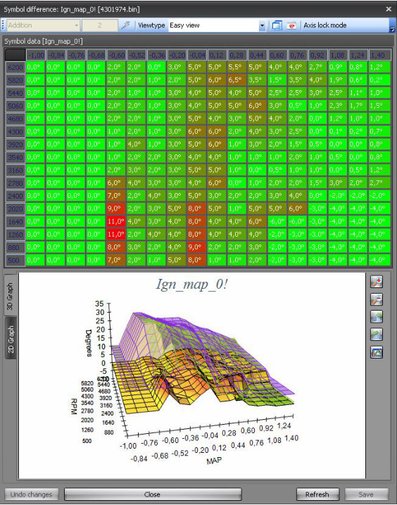{width=63%}

## Actions basic – Examine binary

This option will run a examination process on the opened binary file and T5Suite 2.0 will generate a report of its findings.
This examination is not 100% fool-proof but it will give you a pretty accurate idea on what an unknown binary file was intended to be used for hardware wise.

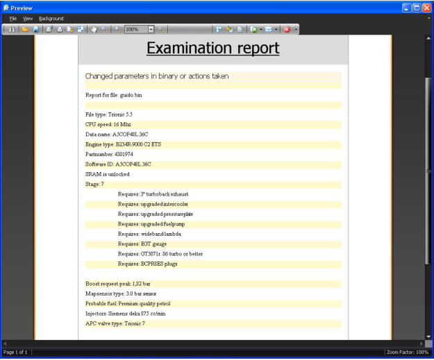{width=70%}

## Actions basic – Compare to original file

If T5Suite 2.0 has the original file matching your specific binary it will allow you to quickly compare your file with the original.

## Actions basic – Show dyno graph

This will show you a rough indication of what your dyno graph should look like based on the current binary.
The result of this graph largely depends on whether the boost request can be met.

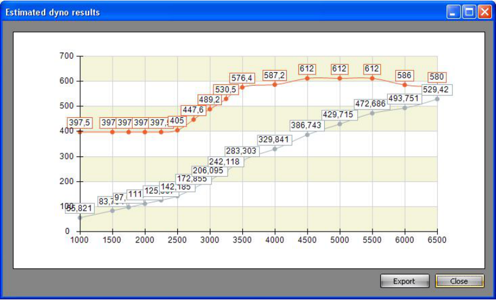{width=91%}

## Actions basic – Show compressor map

This will show you a rough indication of where you will land in the compressor map with your current boost request.
This of course assumes that you can actually reach your requested boost.

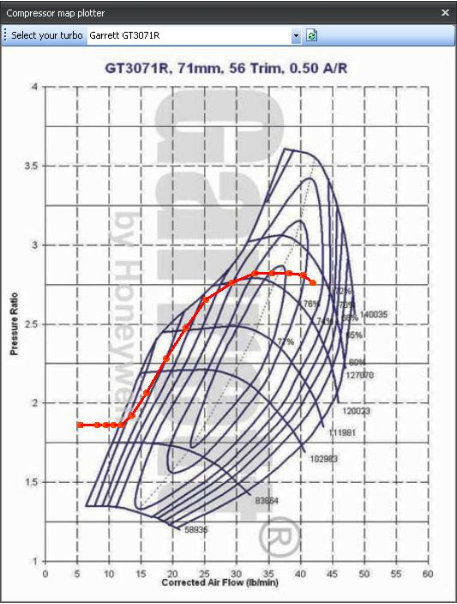{width=51%}

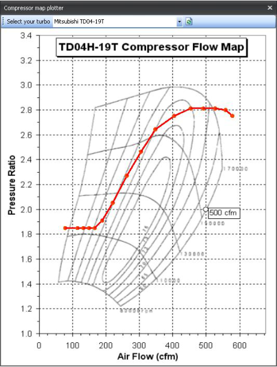{width=52%}

## Actions binary tools – Binary compare files

Lets you do a binary (byte-by-byte) compare of two files.
This is a good tool to verify whether a programming session was successful or not.
Sequences of steps would be:

1. Program ECU
2. Read file from ECU
3. Compare original and downloaded file with Binary compare.

If the result screen is empty the files are identical (successful programming).

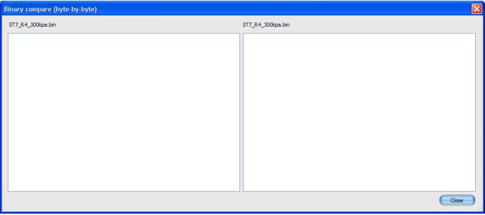{width=77%}

## Actions binary tools – Show file in hex

Lets you explore the binary file in hexadecimal form (advanced users!)

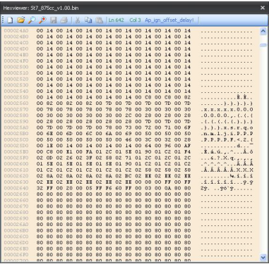{width=43%}

## Actions binary tools – Compare SRAM snapshots

Lets you compare two different SRAM dumps from the ECU to see which settings where altered, either by you or the ECU itself (adaption).
The result is a difference list from which you can choose to view the separate maps/parameters.

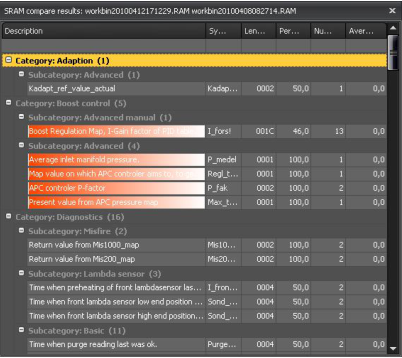{width=45%}

## Actions binary tools – Import SRAM snapshot into binary

This allows you to import the most important adaption data into the binary file from a SRAM dump that you made from the ECU after is has been allowed to adapt.
You can choose which items to import (use with caution, advanced users only!)

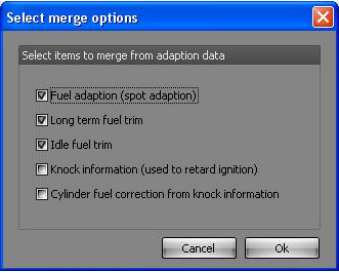{width=38%}

## Actions binary tools – Compare SRAM snapshot to binary

Mostly the same as comparing SRAM files but now you can compare the current binary file to a SRAM dump and see what the ECU has learned (adapted) so far OR which changes you’ve made in real-time to the ECU which are still stored in SRAM (or at least the SRAM snapshot that you took at that time).

## Actions binary tools – Binary compare SRAM files

Mostly for exploration of SRAM dump files.
You can use this function to find the differences in two SRAM files.

## Actions binary tools – Merge binary files

Only useful when you have two binary files (one for each flash chip in the ECU) and you want to stitch them together (advanced users).

## Actions binary tools – Split binary file

Only useful when you want to have two binary files (one for each flash chip in the ECU) created from the current binary file (advanced users).

## Actions binary tools – Move data to another binary

If you have a set of tuned maps in one binary file and you want to have them transferred to a different base file, you can use this function.
Please note that different base files might have different map sizes and T5Suite 2.0 might be unable to transfer them.
[Exchanging data between T5.5 and T5.2 and v.v. is very dangerous!]{.underline}

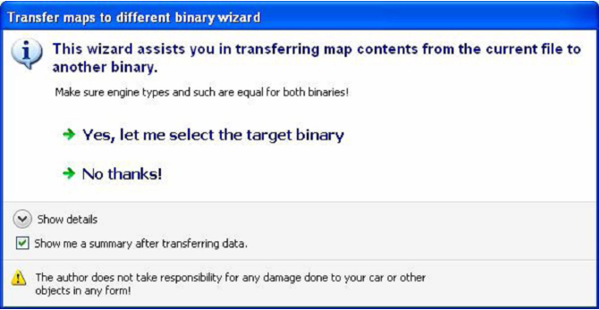{width=75%}

## Actions binary tools – Injection timing viewer

This starts a new screen showing the approximate injection duration figures for each engine speed and load point.
You can use this data to make sure your injectors are big enough and small enough ;)

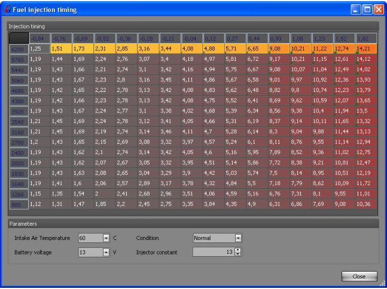{width=73%}

## Actions binary tools – Anomaly report

Builds a report of anomalies (things that should normally not occur) that T5Suite 2.0 finds in the currently opened binary file.

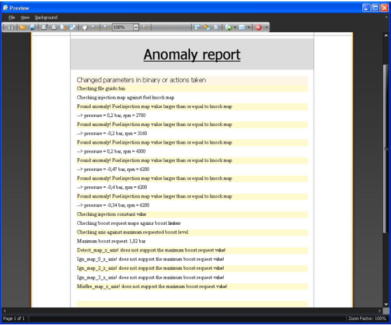{width=63%}

## Actions binary tools – Open a save report

Since reports in T5Suite 2.0 can be saved to hard disk and the report format is not a very common one, this option allows you to review previously saved reports.
