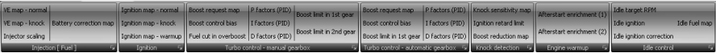
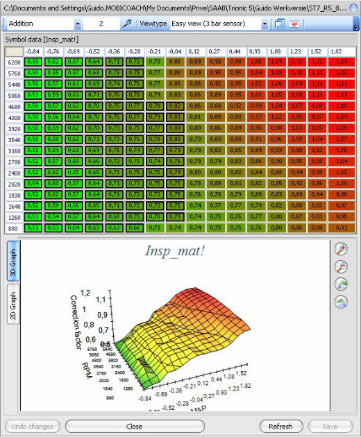
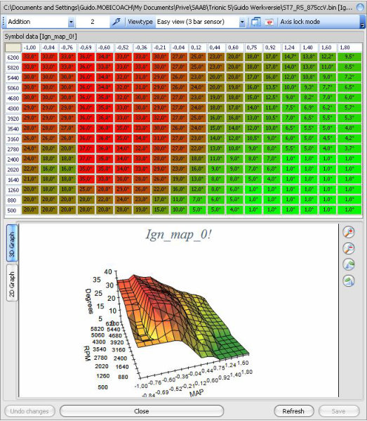
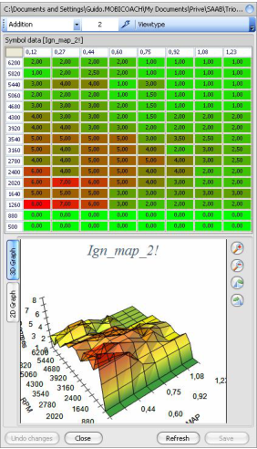
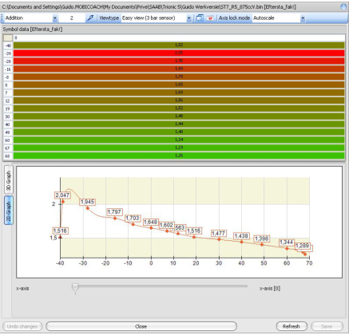
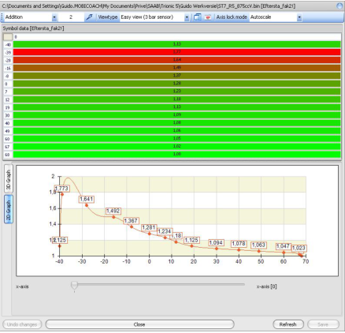
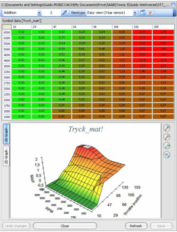

# Manual tuning menu

{width=99%}

## Manual tuning – Injection – Injection (VE) normal

Lets you edit the main injection correction map directly (Insp_mat!)
Please note the black rectangular indicators in the viewer.
These indicate the cells that operate in closed loop.
Blue indicators indicate the knock adaption range and white indicators show the boost adaption range.

{width=58%}

## Manual tuning – Injection – Injection (VE) knock

Lets you edit the knock injection correction map directly (Fuel_knock_mat!)

## Manual tuning – Injection – Injector constant

Lets you edit the main injection constant directly (Inj_konst!)

## Manual tuning – Ignition – Ignition normal

Lets you edit the main ignition map directly (Ign_map_0!)

{width=59%}

## Manual tuning – Ignition – Ignition knock

Lets you edit the ignition knock map (ignition pull values) directly (Ign_map_2!)

{width=32%}

## Manual tuning – Ignition – Ignition warm-up

Lets you edit the warm-up ignition map directly (Ign_map_4!)

## Manual tuning – Engine warm-up – After start enrichment (1)

Lets you view and edit the first after start enrichment factors.
They depend on coolant temperature (y axis).
These are multiplication factors on the final injection time.

{width=49%}

## Manual tuning – Cold start – After start enrichment (2)

Lets you view and edit the first after start enrichment factors.
They depend on coolant temperature (y axis).
These are multiplication factors on the final injection time.

{width=49%}

## Manual tuning – Cold start – Cranking enrichment

Lets you view and edit the cranking enrichment factors.
They depend on coolant temperature (y axis).
These are multiplication factors on the final injection time.

## Manual tuning – Turbo (manual) – Boost request

Lets you view and edit the boost request values for cars with a manual gearbox

{width=39%}

## Manual tuning – Turbo (manual) – 1^st^ and 2^nd^ gear limiters

Lets you view and edit the boost limiter values for 1^st^ and 2^nd^ gear for cars with a manual gearbox.
These limiters can be disabled.

## Manual tuning – Turbo (auto) – Boost request

Lets you view and edit the boost request values for cars with an automatic gearbox.

## Manual tuning – Turbo (auto) – 1^st^ gear limiter

Lets you view and edit the boost limiter values for 1^st^ gear for cars with an automatic gearbox.
These limiters can be disabled.

## Manual tuning – Turbo advanced – PID values

Lets you view and edit the PID values for the boost controller in Trionic 5 for manual as well as automatic gear boxed cars (mind that these are different maps for manual and automatic).
For more information on PID controller functioning please refer to the Trionic 5 documentation also shipped with T5Suite.

## Manual tuning – Turbo advanced – Regulation bias

Lets you view and edit the bias (pretension) values for the boost controller in Trionic 5 for manual as well as automatic gear boxed cars (Please note that these are different maps for manual and automatic).
For more information on PID controller functioning please refer to the Trionic 5 documentation also shipped with T5Suite.

## Manual tuning – Turbo advanced – Fuel cut

Lets you view and edit the fuel cut level.
This map is shared between manual and automatic cars.
Note: 255 (or 1.55 bar in easy view) means the fuel cut function has been turned off.

## Manual tuning – Idle control – Idle target RPM

Lets you set the target idle engine speed values (depending on coolant temperature).

## Manual tuning – Idle control – Idle ignition

Lets you set the default idle ignition advance value.

## Manual tuning – Idle control – Idle ignition correction

Lets you set the ignition control for idle state.
The target rpm value error (actual rpm-target rpm) is the y axis for this map.

## Manual tuning – Idle control – Idle fuel correction

Lets you set the fuelling control values for idle state.
