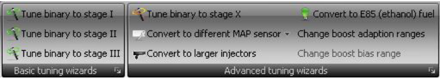
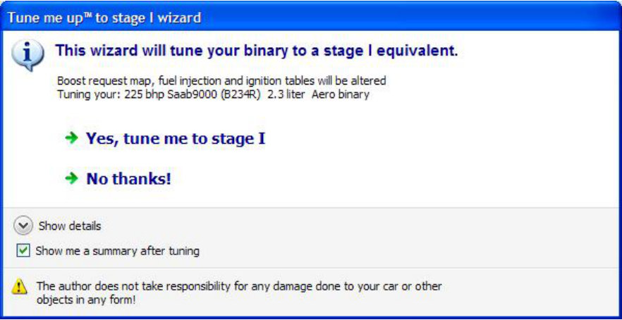
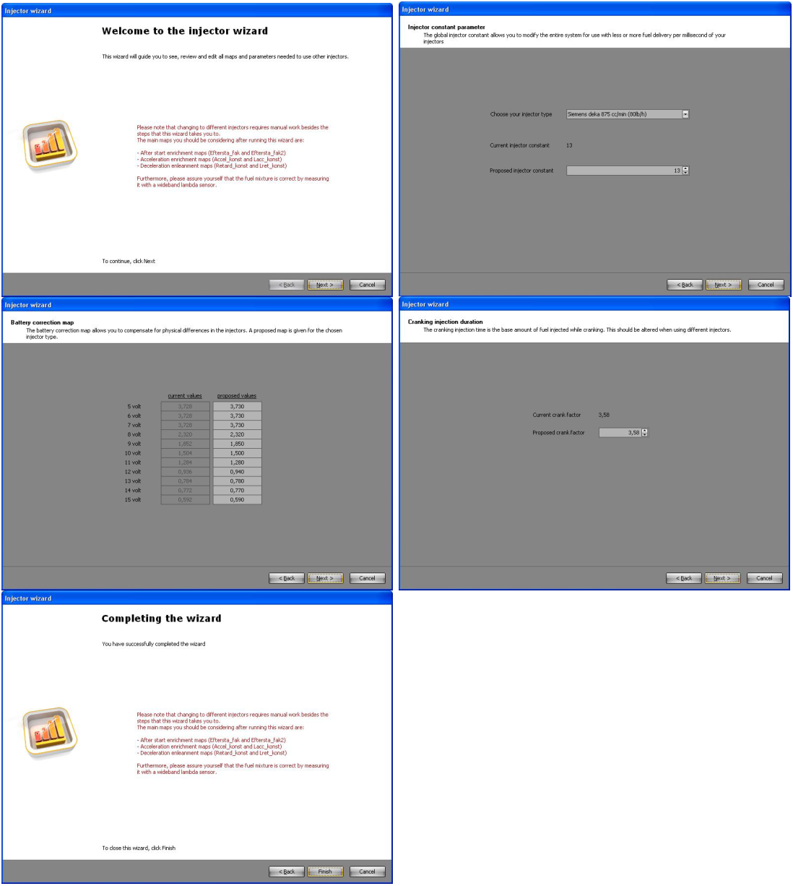
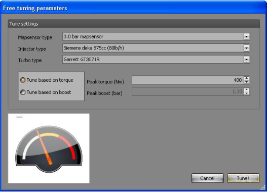
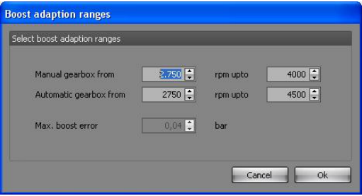
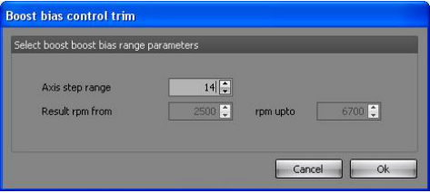
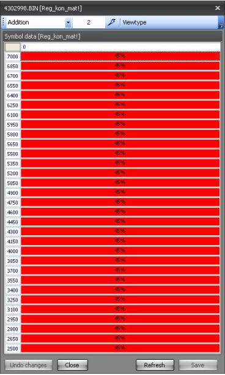

# Tuning wizards menu

{width=84%}

## Tuning wizards – Easy tune to stage I

Lets you convert your stock binary file to stage I equivalent.
The wizard will guide you through a couple of steps and it will also create a report for you afterwards.
A backup of your original file is created in the process before changes are made to it.

{width=99%}

## Tuning wizards – Easy tune to stage II

Lets you convert your stock binary file to stage II equivalent.
The wizard will guide you through a couple of steps and it will also create a report for you afterwards.
A backup of your original file is created in the process before changes are made to it.

## Tuning wizards – Easy tune to stage III

Lets you convert your stock binary file to stage III equivalent.
The wizard will guide you through a couple of steps and it will also create a report for you afterwards.
A backup of your original file is created in the process before changes are made to it.

## Advanced tuning wizards – Convert to different MAP sensor

Lets you convert your stock binary file for usage with a 3/3.5/4 bar mapsensor.
Since this is an advanced topic you will understand that manual checks need to be done and changes need to be made for the file to be optimal for usage in your setup.

## Advanced tuning wizards – Convert to E85 (ethanol) fuel

Lets you convert your binary file for usage with E85 fuel.
Since this is an advanced topic you will understand that manual checks need to be done and changes need to be made for the file to be optimal for usage in your setup.
Maps that are changed by the wizard are: main and warm-up ignition maps, global fuelling (injector constant), cranking- and after-start- enrichment.

## Advanced tuning wizards – Tune for larger injectors

This will start a wizard which will lead you through all the relevant maps and it will make proposals on what to change and where to change it.

{width=92%}

## Advanced tuning wizards – Tune to stage X

This wizard is a little bit more complicated than the easy tune wizards (stage I-III).
Depending on your input T5Suite 2.0 will try to generate a close as possible match to your hardware.
Please do note that tuning beyond stage III will require you to verify AFR settings and knock sensitivity in real-time to make sure everything is working properly.
Mapping for cold- and warm-start are also known issues to address after tuning for larger injectors and/or different mapsensor types.

{width=59%}

## Advanced tuning wizards – Change boost adaption ranges

For bigger turbos, the boost adaption ranges do not match up with what is hardcoded into the binary file (the stock ranges are optimized for T25/TD04 turbo types).
You can adjust these ranges with this feature.
The hardcoded ranges will be altered in your binary file.

{width=57%}

## Advanced tuning wizards – Change boost bias range

In late binaries (probably all OBDII files) the boost bias map (Reg_kon_mat) has hardcoded rpm support point (y-axis points).
Since these support points run only up to 5500 rpm, this is not enough to support good control when using a large turbo which requires more control in higher rpm ranges as well.
You can alter the code in the binary using this option and stretch the support points range.

{width=53%}

The original map with stock support points:

{width=42%}

Once the changes are applied, the reg_kon_mat will look something like this:

{width=41%}
