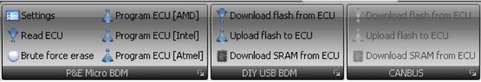
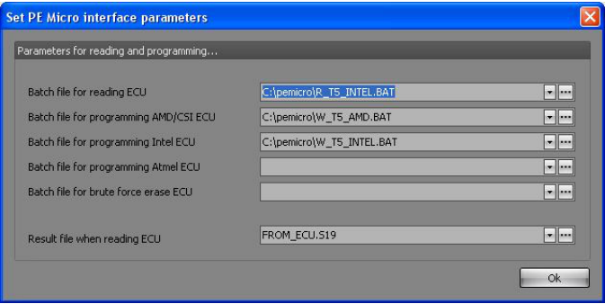

# ECU Programming menu

{width=91%}

## Programmer (PE micro) – Settings

{width=75%}

Lets you customize the settings needed for interfacing with the PE micro software.
Please refer to the PE micro manuals for setting up the batch files needed to program the ECU.

## Programmer (PE micro) – Read ECU/Brute force erase/Program ECU

Allows you to spawn one of the batch files assigned to T5Suite 2.0 in the settings options screen.

[Writing:]{.underline}

The application only runs a batch file which must program the ECU by itself.
The binary file will be converted to Motorola S19 format (PE micro does not accept bin files) and this S19 file will be placed in the same directory as the batch file which is set in the parameters in T5Suite.
The write batch file will be started every time you hit the “program ECU” button in T5Suite.
T5Suite will not wait for the cycle to finish and continue directly after launching the batch file.
The batch file must program the file name TO_ECU.S19.

[Reading:]{.underline}

The application only runs the batch file which must read the firmware from the ECU by itself.
The S19 file will be converted afterwards to binary format and imported into T5Suite.
For this to happen, T5Suite must wait for the batch file to finish.
In the meantime in stands in “hold” and you cannot use the application.
The resulting S19 file from the read-batch file must be placed in the same directory as the batch file itself and must be name FROM_ECU.S19.

## USBBDM programming – Download flash from ECU

If you have connected the ECU via the USB BDM adapter you can download the firmware from the ECU by running this function.
It will ask you where to store the binary file.

## USBBDM programming – Upload flash to ECU

If you have connected the ECU via the USB BDM adapter you can upload new firmware to the ECU by running this function.
It will ask you which binary file to program in the ECU.

## USBBDM programming – Download SRAM from ECU

Lets you create a SRAM snapshot from the ECU.

## Canbus programming – Download flash from ECU

If you have connected the ECU via the canbus (Lawicel) adapter you can download the firmware from the ECU by running this function.
It will ask you where to store the binary file.

## Canbus programming – Upload flash to ECU

If you have connected the ECU via the canbus (Lawicel) adapter you can upload new firmware to the ECU by running this function.
It will ask you which binary file to program in the ECU.

## Canbus programming – Download SRAM from ECU

Lets you create a SRAM snapshot from the ECU.
