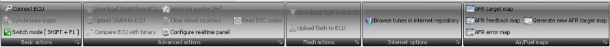
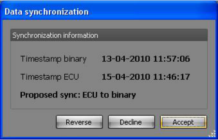
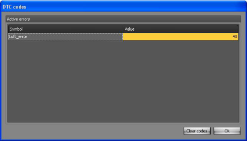
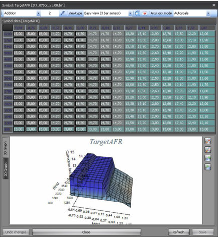
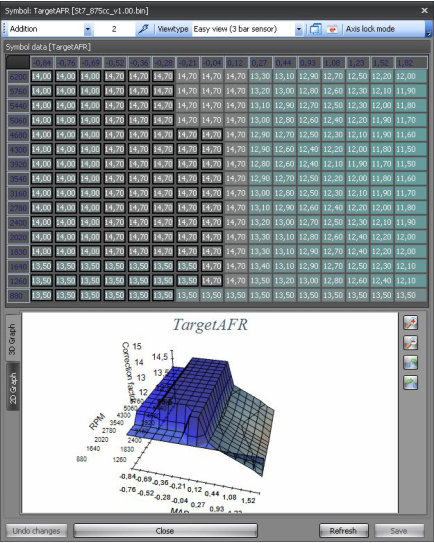
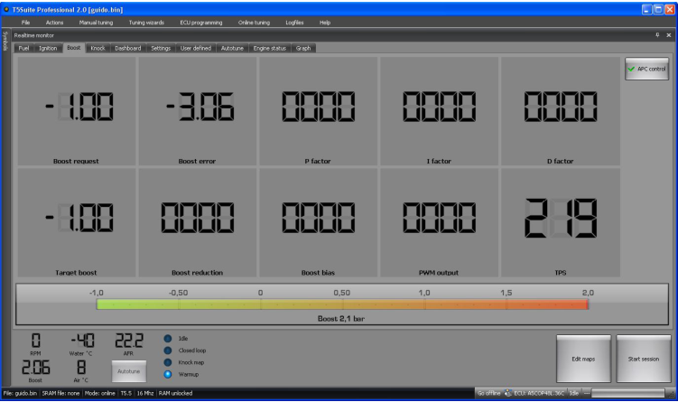
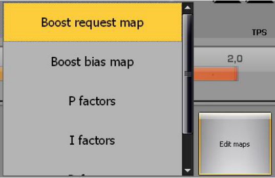
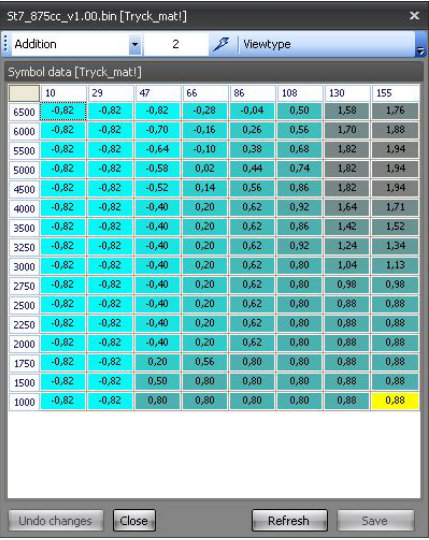
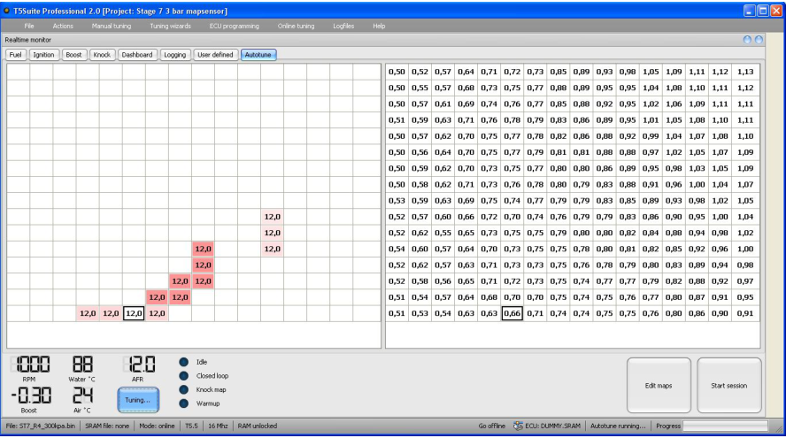
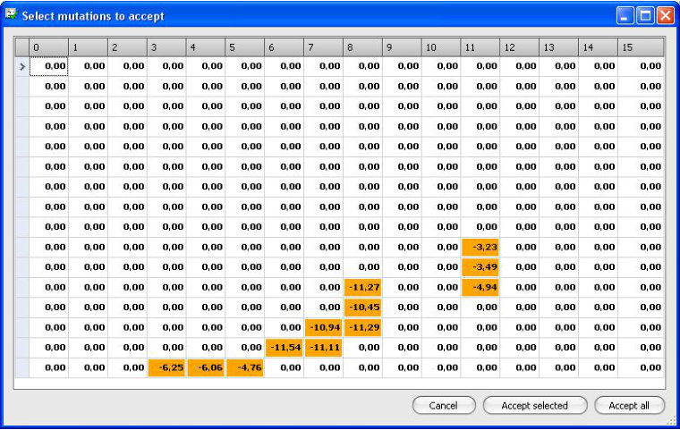

# Online tuning menu

{width=100%}

## Online tuning – basic – Connect ECU

This options starts a real-time session with the ECU.
Once connected you can monitor, edit, download and upload data from and to the ECU.
Choosing this option automatically opens the real-time panel which shows a default set of data to monitor.
You can alter the layout of this panel as well as the data shown in it.
NOTE: Real-time sessions can only run through canbus, not through BDM!!!
If the ECU and the binary file are not in sync, T5Suite 2.0 will ask you if you want to resynchronize.

{width=50%}

## Online tuning – basic – Synchronize maps

Lets you synchronize maps between the binary file and the connected ECU.

## Online tuning – basic – Switch mode

Lets you switch between online and offline mode.

## Online tuning – advanced – Download SRAM from ECU

This option allows you to download a snapshot of the ECUs SRAM (working memory) for later analysis or reference.

## Online tuning – advanced – Upload SRAM from ECU

This option allows you to upload a snapshot of the ECUs SRAM (working memory) back into the ECU.
This works like a sort of system restore point you can make.

## Online tuning – advanced – Compare ECU with binary

This option check all differences between the ECU and the binary you’ve loaded.

## Online tuning – advanced – Write log marker (F6)

Allows you to write a marker in the log.
This way, you can easily find the timestamp when something happened later on when analyzing the logs.

## Online tuning – advanced – Clear knock counters

Allows you to reset all the knock counters in the ECU to zero.

## Online tuning – advanced – Configure real-time panel

Allows you to configure the real-time panel in offline mode.
This way you can pre-configure the panel before even starting your car.

## Online tuning – advanced – Read DTC codes

Reads all the error code counters in the ECU and displays which error counter holds values greater than zero.
It also lets you clear the error counters (reset to zero).

{width=55%}

## Online tuning – Flash – Download flash from ECU

If you have connected the ECU via the canbus (Lawicel) adapter you can download the firmware from the ECU by running this function.
It will ask you where to store the binary file.

## Online tuning – Flash – Upload flash to ECU

If you have connected the ECU via the canbus (Lawicel) adapter you can upload new firmware to the ECU by running this function.
It will ask you which binary file to program in the ECU.

## Online tuning – Internet – Browse tunes in internet repository

If you are connected to the internet, you can browse generic tunes that are available on a web server.
These tunes are made by ecuproject members.

## Online tuning – AirFuel – AFR target map

Lets you set your desired AFR values for each load and rpm point for this binary file.
After logging with a wideband lambda sensor you can compare the target values to the feedback values.

{width=49%}

## Online tuning – AirFuel – AFR feedback map

Shows you the measured average values from the real-time sessions you have done for this binary file.

## Online tuning – AirFuel – AFR error map

Shows you the difference between the target AFR values you have entered – or the default ones – and the measured feedback values.

## Online tuning – AirFuel – Generate new AFR target map

Lets you generate a new default AFR target map based on certain properties in the binary.
If you use big injectors, the target for low rpm and low load will be richer for example.

{width=49%}

## Online tuning – the real-time screen

Once you’ve switch to online mode and the canbus connection is running, T5Suite 2.0 will behave a little bit differently.
You can switch to the real-time panel for monitoring, logging and tuning and maps viewers will show SRAM content by default.
The real-time panel should look something like this:

{width=84%}

You can edit maps which hold a relation to tuning boost in the boost tab.
The ignition tab will get you access to ignition related maps etc.
You can directly start a mapviewer by clicking the “Edit maps” button.
This will popup a selection of maps.

{width=60%}

Selecting one of these entries will start a mapviewer over the real-time panel.

{width=48%}

Note that because of performance, the graph is off by default and data is displayed in blue to denote that the data is volatile (present in SRAM).

[Autotune criteria]{.underline}

For Autotune to become available you will have to meet certain criteria.

- You will have to be in advanced mode
- SRAM should be unlocked in the ECU
- Engine temperature should be over 70 degrees Celcius

If you get to the point where all Autotune criteria are met, the Autotune button will be enabled.
If you click it, an Autotune session will commence and the tab will be switched to “Autotune”.
Here you can see which cell in the fuel map is active and which cells are measured by Autotune with what AFR value.
The moment Autotune is activated the software switches off closed loop control in the ECU by altering the pgm_mod symbol accordingly.
This also switches off purge control because purging will occur only when the system is running in closed loop.
While running the Autotune algorithm constantly checks whether all runtime criteria for making adjustments are met.
These criteria are:

- No enrichment after fuelcut is allowed
- System is not allowed to run in the idle map (this might be changed in future releases)
- Purge is not active
- Cooling water temperature enrichment is finished
- Afterstart enrichment is finished
- Closed loop control is inactive
- Engine should be warmed up
- Fuelcut is not active
- Knock map is not active

Optionally when Discard fuelcut measurements is active in the Autotune settings:

- Cylinder 1-4 should not be in fuelcut mode

Optionally when Discard closed throttle measurements is active in the Autotune settings:

- Throttle plate is not allowed to be fully closed

If all runtime criteria are met the algorithm measures AFR values through the wideband lambda input and determines the cell in which it should average this value by means of current engine speed and manifold pressure.
Depending on the mode in which Autotune is running (direct update or user approve) it updates the fuel map in the ECU [or]{.underline} it stores the averaged value in memory.
In the latter case it shows the user a proposal for adjustments to be made after the Autotune session is ended.

{width=100%}

After the Autotune session, the software will show you a map in which the cells to be corrected are highlighted and showing the percentages to correct the fuel map.

{width=85%}

You can cancel this session, accept all selected cells (after selecting the cells you want to correct) or you can accept all suggested correction.
T5Suite 2.0 will save all mutated data into the ECU.
