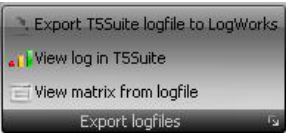

# Logfile analysis menu

{width=32%}

## Export T5Suite log file to LogWorks

Will convert and export a T5Suite log file to LogWorks format and automatically start LogWorks to view the file.

## View log in T5Suite

Load and shows the log file in the viewer inside T5Suite 2.0.

## View matrix from log file

Lets you view three channels in a log file displayed as a surface graph (matrix).
