# The menu

T7Suite can be controlled by the menu and the symbollist shown on the left hand side of the screen.
This chapter will elaborate a little bit on the menus and their functions.

## File menu

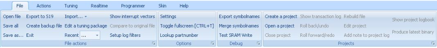{width=100%}

### File menu – Open file

This lets you choose a Trionic 7 binary file on your computer.
Once opened, T7Suite will automatically extract the symbolic information contained in the binary file.

### File menu – Save all

Normally T7Suite will automatically save changes for you when you close a mapviewer and update the checksum in the file.
If you have open mapviewers you can save all the pending changes to the file using this option.

### File menu – Save as

This lets you choose a different location and/or filename for the binary file you currently have open.

### File menu – Export to S19

This allows you to save the binary file in Motorola S19 format which can be used to program the ECU with a BDM interface.

### File menu – Create backup file

Lets you create a binary backup of you file with a click of a button.
It is recommended to create backup files whenever you start to make major changes to the file.

### File menu – Exit

Come on Einstein, what would that do?

### File menu – Import XML descriptor

Lets you import a symboltable from an existing XML file.
Binaries without a symboltable can be user-described and if you have an XML file for your binary file you can import it with this function.

### File menu – Import tuning package

Lets you import a tuning package which holds generic map information.

### File menu – Edit a tuning package

If you want to remove maps from a tuning package or you want to add maps, you can edit the tuning package with this option.

### File menu – Recent

Shows you a list of recently opened binary files for easy access.

### File menu – Compare to original file

If you have a file opened and T7Suite knows the original file (when it is in the library) this option will be enabled.
It allows quick access to the changes that were made to the opened binary file.

### File menu – Setup logfilters

The realtime section of T7Suite allows you to create logfiles of realtime data.
With this item you can setup logging filters to make sure you only log what’s relevant.

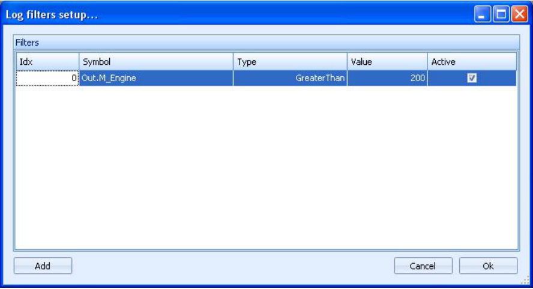{width=100%}

### File menu – Settings

This option will let you alter default settings to control the behavior of the application.

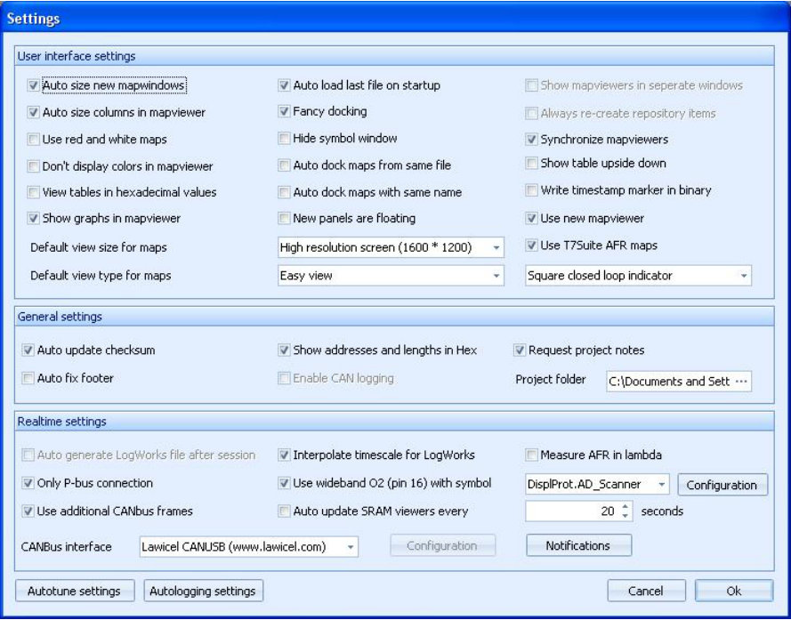{width=100%}

#### File menu – Settings – Auto size new mapwindows

Determines whether or not new mapwindows will automatically be resized to fit their respective contents.

#### File menu – Settings – Auto size columns in mapviewer

Determines whether or not the mapviewers should try to resize the columns they contain to make the content fit.
As you can imagine ignition advance for example expressed in whole and fractional degrees takes more space than a simple decimal number ranging from 0-10.

#### File menu – Settings – Use red and white maps

If this is turned on the mapviewers will display transparent and red only.
In the off position the mapviewers will display the normal colours ranging from green to red.

#### File menu – Settings – Don’t display colours in mapviewer

To gain in performance the entire colouring in the mapviewers can be switched off with this option.

#### File menu – Settings – View tables in hexadecimal values (obsolete)

Determines whether tables are displayed in decimal or hexadecimal numbers.

#### File menu – Settings – Show graphs in mapviewer

To gain performance in lightweight computers you can switch off the graphical display in the mapviewer altogether with this option.

#### File menu – Settings – Auto load last file on start-up

If you work on one file for a prolonged period of time you might want T7Suite to reopen the last file automatically when you start it.
This option allows you to control that behaviour.

#### File menu – Settings – Fancy docking

If the dragging and docking of windows (mapviewers) is slow or causes issues, please turn this option off.

#### File menu – Settings – Hide symbol window

To gain more space on the main screen you can switch off the symbollist that is displayed on the left hand side.
Alternatively you can set the window to ‘auto hide’ by clicking the pushpin button in the top right corner of the symbollist.

#### File menu – Settings – Auto dock maps from same file

If you open more than one map from the same file (for example fuel and ignition maps) you can choose to have those docked together using this option.
If the option is turned off, windows will be tiled next to each other.

#### File menu – Settings – Auto dock maps with same name

If you open the same maps from different files (for example the main ignition map from 2 files) you can choose to have those docked together using this option.
If the option is turned off, windows will be tiled next to each other.

#### File menu – Settings – New panels are floating

Upon opening a new mapviewer you can choose to have this window docked in the main screen or have it floating.

#### File menu – Settings – Show mapviewers in separate windows (obsolete)

Allows you to have mapviewers open in ‘real’ windows instead of panel like windows.

#### File menu – Settings – Synchronize mapviewers

If you are selecting or changing things in one mapviewer other mapviewers can be notified of this fact and can adapt dynamically to these changes.
If you – for example – change the viewtype in one viewer you might want to have that automatically done to other open viewers as well.
This option allows you to control just that.

#### File menu – Settings – Show maps upside down

For users who are used to applications that show – for example – rpm axis the other way around.

#### File menu – Settings – Write timestamp marker in binary

If enabled, T7Suite will write a timestamp marker for you in the binary file so you can keep track of when the last changes were made to it.

#### File menu – Settings – Use new mapviewer

Lets you choose between the original mapviewer and the new, sleeker, mapviewer.

#### File menu – Settings – Use T7 AFR Maps

If enabled, T7Suite will automatically generate AFR maps for binaries that you open.

#### File menu – Settings – Closed loop indicator

Lets you choose which – if any – marker you want to be displayed in the mapviewers for cells that are in the closed loop area.

#### File menu – Settings – Default view size for maps

Allows you to adjust the mapviewers size for different screen resolutions.

#### File menu – Settings – Default view type for maps

Easy view is best if you don’t know what this means ;)

#### File menu – Settings – Auto update checksum

Having this checked will rid you of the constant worry whether or not the checksum of your file is valid.
Advised is to keep this turned on!

#### File menu – Settings – Auto fix footer

T7Suite can automatically repair footer information blocks.
These blocks are incomplete for example in TIS binary files.

#### File menu – Settings – Show addresses and lengths in hex

T7Suite can display addresses and lengths of symbols in decimal form or in hexadecimal form.
This option allows you to switch between the two.

#### File menu – Settings – Enable canbus logging

For debugging purposes only.
Please keep this turned off on normal operation.

#### File menu – Settings – Request project notes

If you are working in a project and you save changes to the binary file, T7Suite will prompt you for a note to describe the change made.
If disabled, the prompting will be skipped.

#### File menu – Settings – Project folder

Lets you decide where to store projects that you make in T7Suite (the project root folder).

#### File menu – Settings – Only P-bus connection

If checked, T7Suite will not try to connect on the I-bus when starting a real-time session.
This will improve reliability and connection speed.
Only check when you are sure you are connected on the P-bus.

#### File menu – Settings – Use additional Canbus frames

If checked, T7Suite read and process messages on the canbus that are there by default.
If unchecked T7Suite will only process messages that it requested itself.

#### File menu – Settings – Interpolate timescale for LogWorks

Since LogWorks uses a 125ms interval and the frame rate that T7Suite reaches differs most of the time you can check this option and T7Suite will interpolate value to match the 125ms interval that LogWorks works with.

#### File menu – Settings – Use wideband O2 (pin 16) with symbol

If you have a wideband lambda sensor connected to pin 16 on the T7 ECU you can monitor and log wideband AFR values within T7Suite.
Most binaries work with DisplProt.LambdaScanner but some don’t.
In the latter case you have to select DisplProt.AD_Scanner and fill in the extra option in the additional configuration screen.

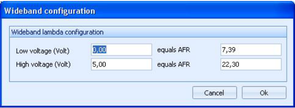{width=68%}

#### File menu – Settings – Auto update SRAM viewer every x seconds

If you have SRAM viewers open in T7Suite you can have the software refresh these viewers every x seconds.
This enables you to keep an eye on for example the knock map.
Don’t set the interval too fast (low value) because it will influence the real-time logging performance.

#### File menu – Settings – CanUSB interface

Lets you choose which canbus to USB interface you have.

- Lawicel
- Multi adapter

If you have the latter (congratulations) you can set additional option for the multi adapter using the configuration button.

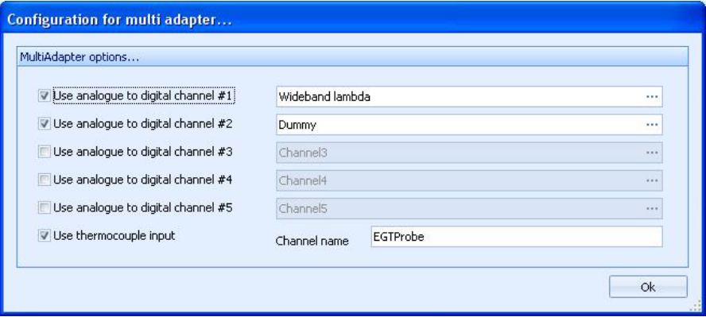{width=100%}

#### File menu – Settings – Notification

Lets you set notification sounds for up to three events that you can define..

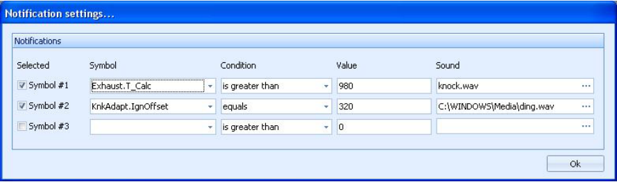{width=100%}

#### File menu – Settings – Autotune settings

Lets you choose options for the Autotune fuel function in T7Suite.
The options screen for Autotune will be shown.
Please note that you need to be running a wideband lambda sensor and an socalled open or development binary to be able to use the Autotune function.

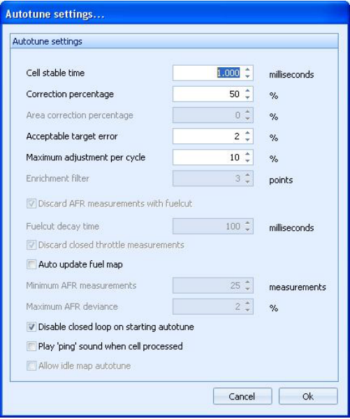{width=56%}

#### File actions – Settings – Autotune settings – Cell stable time

Determines how long – in milliseconds – the system should reside in a certain load/rpm cell before T7Suite validates the AFR measurement.

#### File actions – Settings – Autotune settings – Correction percentage

Determines how much a certain AFR error will be corrected.
Setting this to 50% (default) means 50% of the established AFR error will be corrected for each session.

#### File actions – Settings – Autotune settings – Acceptable target error

Determines how big the AFR error is allowed to be without T7Suite taking action in that certain load/rpm cell.

#### File actions – Settings – Autotune settings – Maximum adjustment per cycle

Determines how big the maximum adjustment will be in percentages measured from the original fuel map.

#### File actions – Settings – Autotune settings – Auto update fuel map

This option decides the mode in which Autotune works.
If this is checked the system will try to map the fuelling entirely on its own.
No feedback from the user is requested.
After a Autotune session the user can however revert to the previous fuel map automatically if he/she chooses to do so.
If this is not checked the Autotune function will be more like a question & answer game between T7Suite and the user.
After every session a map is prompted in which T7Suite shows which cells are to be altered to reach the requested AFR.
The user can select/deselect cells to his/her liking and update the fuel map with the selected cells.

#### File actions – Settings – Autotune settings – Minimum AFR measurements

(not used yet).

#### File actions – Settings – Autotune settings – Maximum AFR deviance

(not used yet)

#### File actions – Settings – Autotune settings – Disable closed loop on starting auto tune

Some advanced users have closed loop operation turned off completely.
In that case you might want to prevent T7Suite to disable closed loop operation when starting an auto tune session.

#### File actions – Settings – Autotune settings – Play ping sound when cell processed

Allows you to have T7Suite play a sound notification to indicate that a cell in the AFR map has been processed.
This way you can proceed to the next cell without having to keep an eye on the computer.

#### File actions – Settings – Autologging settings

Lets you choose options for the autologging function in T7Suite.

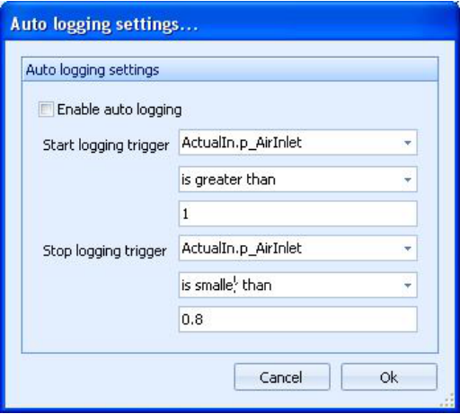{width=57%}

#### File actions – Settings – Autologging settings – Enable auto logging

When enabled, the real-time panel will monitor the settings and start / stop sessions based on the remaining options.

#### File actions – Settings – Autologging settings – Start logging trigger

Determines what the “start logging session” trigger is.
In the example ActualIn.p_AirInlet (average pressure in the inlet manifold) must be greater than 1.0 bar to start a logging session automatically.

#### File actions – Settings – Autologging settings – Stop logging trigger

Determines what the “stop logging session” trigger is.
In the example ActualIn.p_AirInlet (average pressure in the inlet manifold) must be smaller (less) than 0.8 bar to end a logging session automatically.

### File menu – Toggle full screen

Lets you run T7Suite full screen for maximum usage of screen space.

### File menu – Lookup partnumber

Lets you browse through the available binaries in the library.

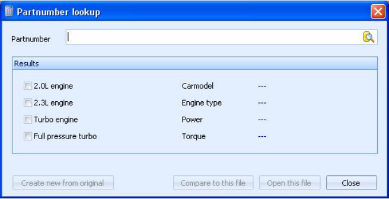{width=74%}

In this screen you can either enter a known partnumber or click on the browse button.
A library browser will be shown.

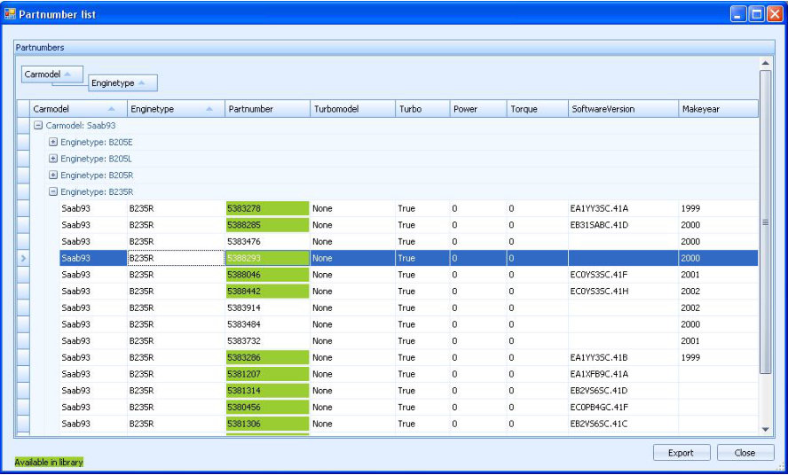{width=100%}

### File projects – Create a project

T7Suite allows you to work on your tune in a project based fashion.
This option lets you create a new project.
Projects have the advantage of having roll-back and roll-forward functions, having versioning and keeping things tidy and together.
You are advised to work in a project if you do more than simple easy-tune your binary file.

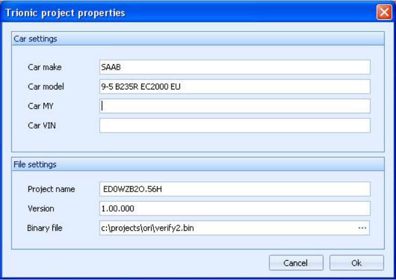{width=87%}

### File projects – Open a project

Lets you select and open a previously created project.
If no projects are available (none were created before) T7Suite will notify you with a message box.

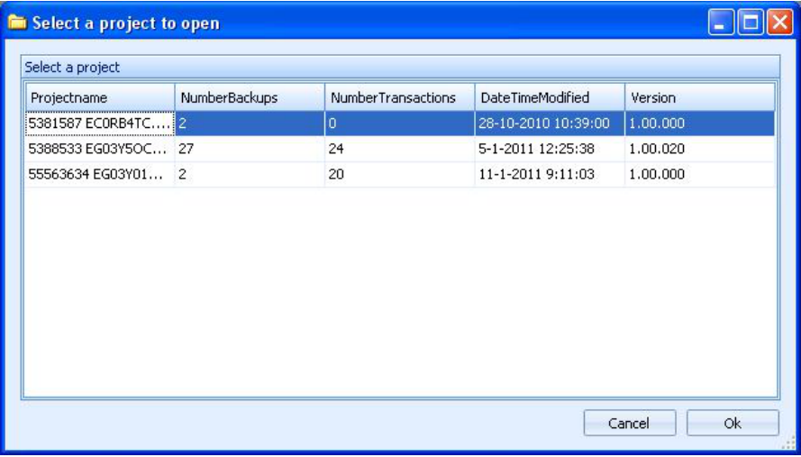{width=100%}

### File projects – Close project

Closed the project and allows you to work on single files again.

### File projects – Show transaction log

Shows the transaction log for the current project.
Since a project contains only one binary file, you could see this as an undo/redo list for the project binary file.

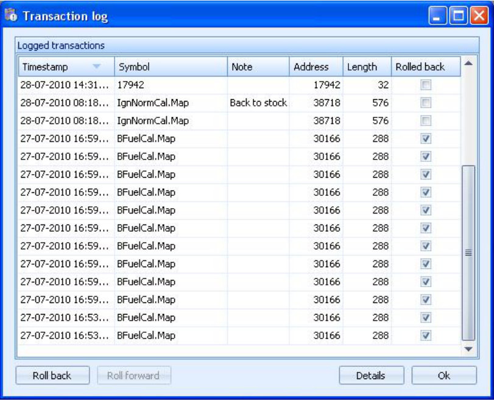{width=91%}

### File projects – Roll back/undo

Lets you rollback the last transaction made to the binary file.
If no transactions are available to rollback, the button will be disabled.

### File projects – Roll forward/redo

Lets you roll forward (redo) the last transaction that was undone/rolled back.
If no transaction are available to roll forward, the button will be disabled.

### File projects – Rebuild file

This enables you to rebuild a project file (binary) up to a certain point in time.
T7Suite will ask you for a date and it will restore – if possible – the file that you had at that specific date.

### File projects – Edit project

Lets you edit the project properties for any project.
This enables you to manage your version numbering yourself.
Version numbers are stored, together with all other project properties, in the xml file in the project folder.

### File projects – Add note to project

You can add a note to you project with a timestamp attached to it, so you can keep track of changes you made in your setup.
For example, if you start using different injectors or mount a bigger intercooler, you can enter a note of this into the project log for later reference.

### File projects – Show project logbook

Shows you in details what has happened in your project.

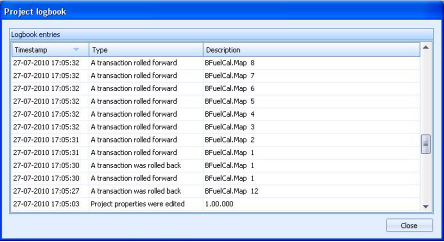{width=100%}

### File projects – Produce latest binary

Lets you export the project binary in its current state so you can save it in another location easily.

## Actions menu

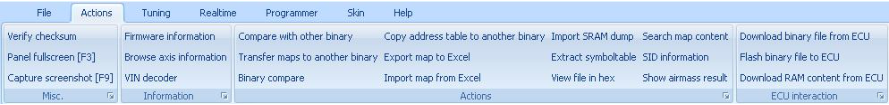{width=100%}

### Actions menu – Verify checksum

If you don’t have the automatic checksum routine turned on, you can manually verify and correct the files checksum with this option.

### Actions menu – Panel full screen [F3]

Lets you toggle the selected (focused) panel to full screen mode.
You can revert the panel to normal mode by double clicking on its header (caption bar).

### Actions menu – Capture snapshot [F9]

You can capture a screenshot of the selected (focused) panel by pressing F9 or by clicking this button.
T7Suite will ask you for a location and filename to save the snapshot to.
It will be saved in JPG format.

### Actions menu – Firmware information

Lets you alter the settings for the current binary file.

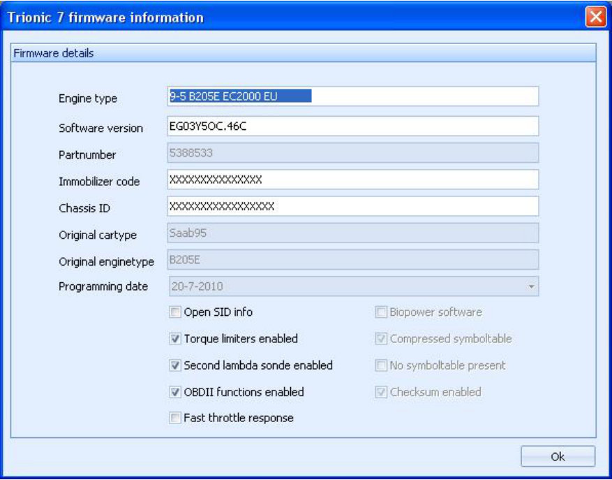{width=98%}

#### Actions menu – Firmware information – Engine type

Descriptive text for the current binary file.

#### Actions menu – Firmware information – Software version

Default software version numbering for the current binary file.

#### Actions menu – Firmware information – Immobilizer code

Current immobilizer code for this binary file.
For more information about immo code please refer to the saab technical documentation.

#### Actions menu – Firmware information – Chassis ID

Vehicle Identification Number (VIN) for the current binary file.
Should match you cars VIN number.

#### Actions menu – Firmware information – Original Car type

Car type based on the VIN number information.

#### Actions menu – Firmware information – Original enginetype

Engine type based on the VIN number information.

#### Actions menu – Firmware information – Software open

Lets you enable and disabled the SID information.
If this box is checked the car can show live information (realtime) on the SID.
The parameters for this function can also be edited in T7Suite through Actions > SID information.

#### Actions menu – Firmware information – Torque limiters enabled

Lets you enable or disable the major torquelimiters in the file.

#### Actions menu – Firmware information – Second lambda sonde enabled

Lets you disable the entire second (rear) lambda sonde diagnostics.

#### Actions menu – Firmware information – OBDII funcions enabled

Lets you enable or disable the OBDII diagnostics routines.

### Actions menu – Browse axis information

Shows you the relations between maps and axis symbols.
This is very informative to browse and learn.

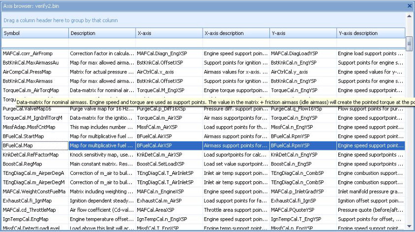{width=95%}

### Actions menu – VIN decoder

Lets you decode SAAB VIN numbers into readable format.

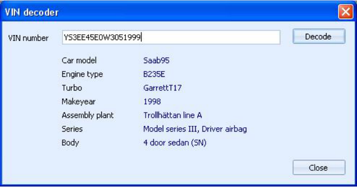{width=81%}

### Actions menu – Compare with another binary

The most time-consuming thing is comparing maps for different firmware versions by hand.
T7Suite gives you the tools to compare maps in different binaries with a click of the mouse.
To do this you must first open the primary binary you want to compare.
Then, select “Compare maps with other binary” from the Actions menu under Actions.
Now, select the secondary binary you wish to compare the first one with.
T7Suite will now display a list of symbols that differ in the selected binaries.

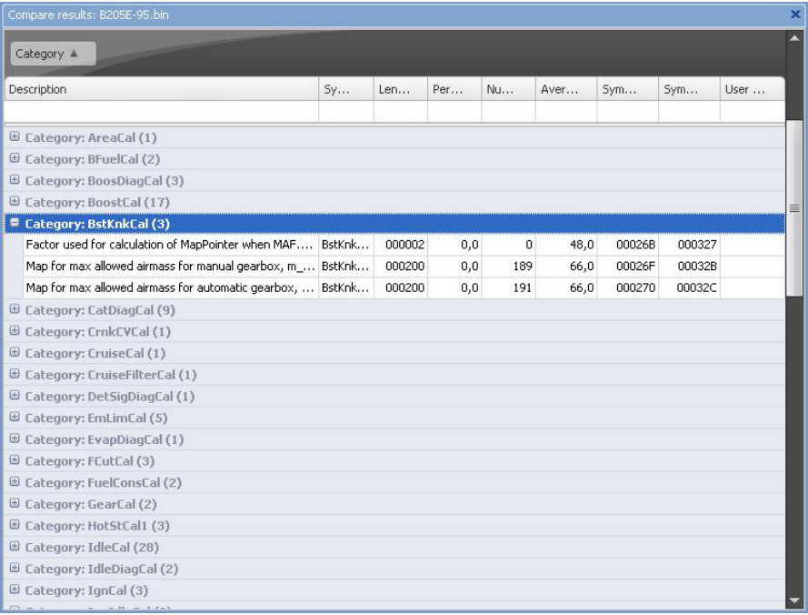{width=100%}

### Actions menu – Transfer maps to another binary

To be able to transfer map contents from a selected binary to another one a wizard has been created to copy all the contents for all symbols in the selected binary to another one that the wizard enables you to select.

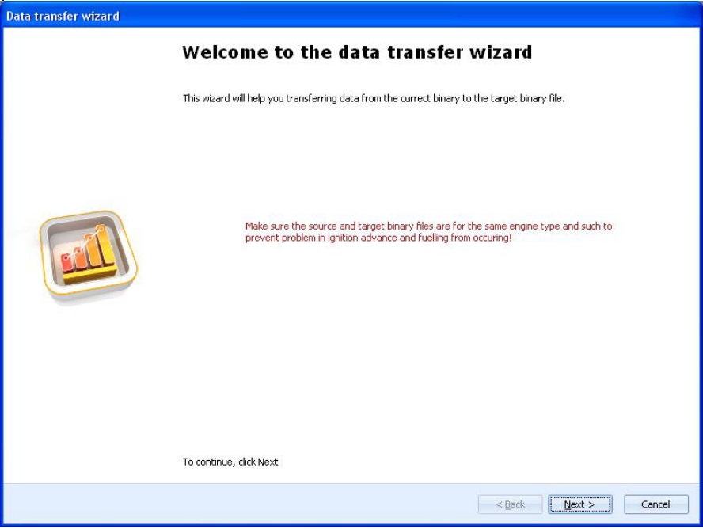{width=100%}

### Actions menu – Binary compare

Lets you do a binary (byte-by-byte) compare of two files.
This is a good tool to verify whether a programming session was successful or not.
Sequences of steps would be:

1. Program ECU
2. Read file from ECU
3. Compare original and downloaded file with Binary compare.

If the result screen is empty the files are identical (successful programming).

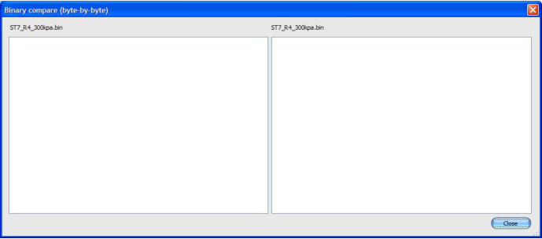{width=77%}

### Actions menu – Copy address table to another binary

Lets you overwrite the address table in another file with the table in the current file.
If you don’t know what this is supposed to do, do not use it!

### Actions menu – Export map to excel

For easy export and import facilities an interface with MS Excel has been implemented into T7Suite.
This option lets you export a selected map to Excel for viewing and editing.

### Actions menu – Import map from excel

For easy export and import facilities an interface with MS Excel has been implemented into T7Suite.
This option lets you import a selected map to Excel.

### Actions menu – Import SRAM dump (not implemented yet)

### Actions menu – Extract symboltable

This option allows you to extract the symbol information from the loaded binary file.
Normally T7Suite will automatically do this for you, but with this option you can force it to (re-) extract the information.

### Actions menu – View file in hex

Lets you explore the binary file in hexadecimal form (advanced users!)

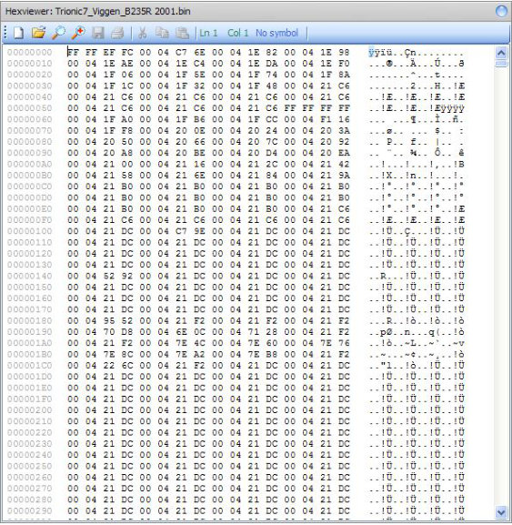{width=63%}

### Actions menu – Search map content

Allows you to search maps for a specific value.
The result will be shown in a list.

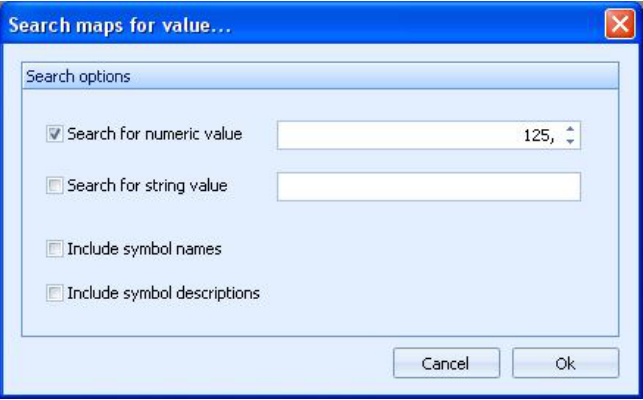{width=72%}

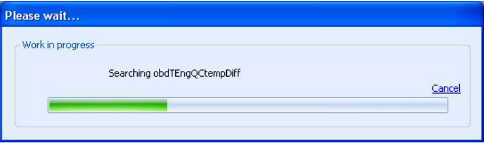{width=89%}

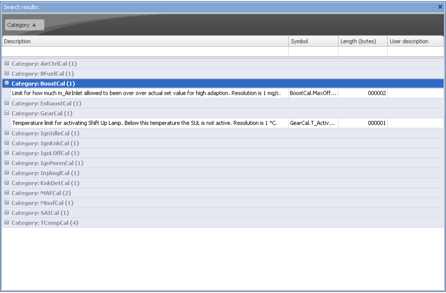{width=100%}

### Actions menu – SID information

Allows you to alter the default settings for realtime display on the SID.

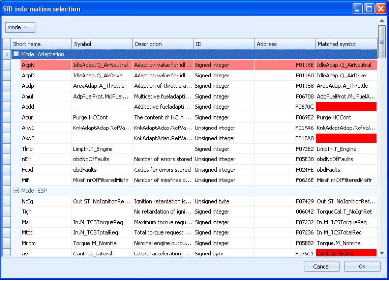{width=89%}

### Actions menu – Show airmass result

T7Suite incorporates a function (from 1.4.2) to verify the final (estimated) airmass results based on the most common airmass and torque limiters).
The result from these calculations are shown in a table that also shows the limiter that is holding more airmass per combustion back.

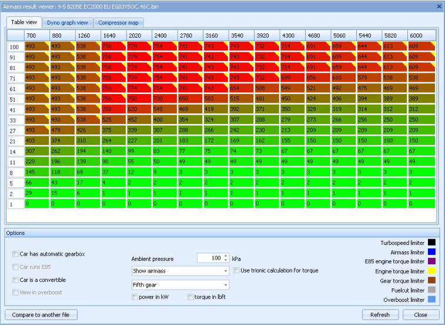{width=85%}

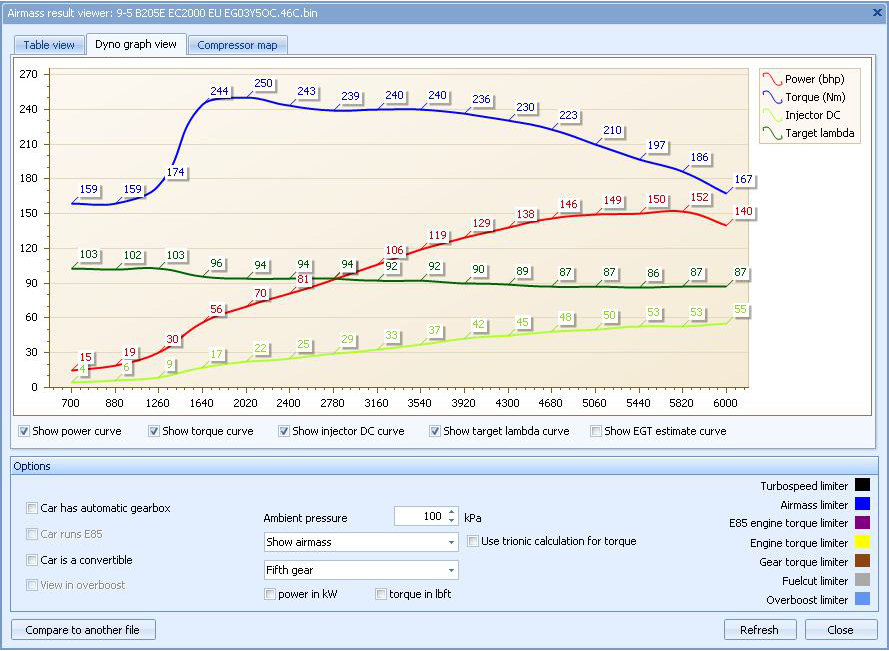{width=100%}

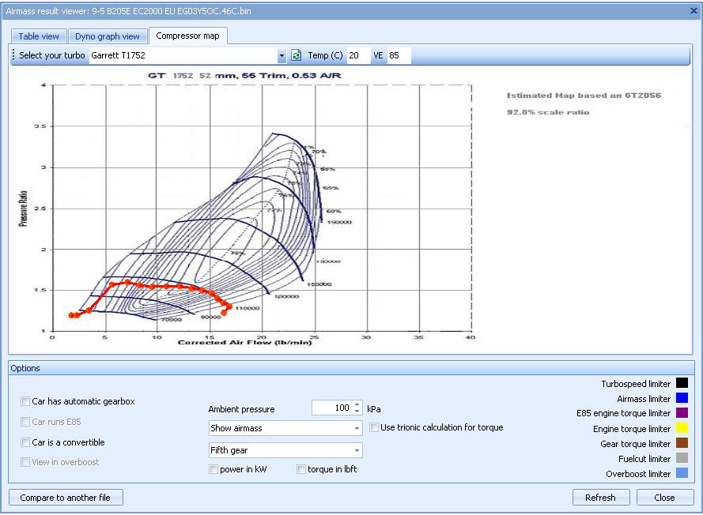{width=100%}

### Actions menu – Download binary file from ECU

If you have a live connection to the ECU with a CANUSB interface (see Trionic 7 documentation for more details) you can download the binary file from an ECU using this option.

### Actions menu – Flash binary file to ECU

If you have a live connection to the ECU with a CANUSB interface (see Trionic 7 documentation for more details) you can flash a binary file to the ECU using this option.

### Actions menu – Download RAM content from ECU

This allows you to download an SRAM snapshot from the ECU.

## Tuning menu

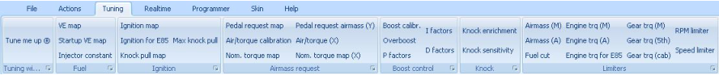{width=99%}

### Actions menu – Tune me up

Lets you alter the binary file to match a certain torque and power.
This is an automated wizard that changes all the relevant maps for you.
Please DO make sure that you have the hardware to support what you enter in the wizards input screen.
If you go above a stage 3 configuration, please also make sure that your AFR values are in range and your EGT does not go over 950 degrees celcius.

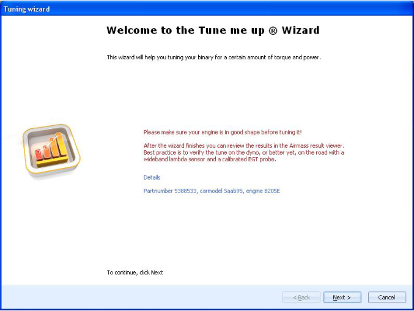{width=76%}

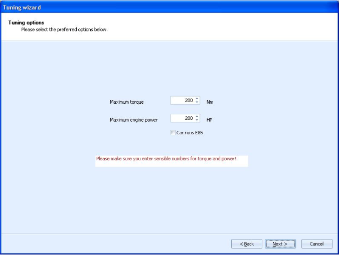{width=76%}

### Actions menu – VE map

Lets you directly start a mapviewer with the Volumetric Efficiency map.

### Actions menu – Startup VE map

Lets you directly start a mapviewer with the Startup Volumetric Efficiency map.

### Actions menu – Injector constant

Lets you directly start a mapviewer with the Injector constant (to compensate for different injectors)

### Actions menu – Ignition map

Lets you directly start a mapviewer with the ignition map.

### Actions menu – Ignition for E85

Lets you directly start a mapviewer with the ignition map for E85 fuel (if present).

### Actions menu – Knock pull map

Lets you directly start a mapviewer with the knock ignition map.

### Actions menu – Max knock pull

Lets you directly start a mapviewer with the maximum ignition pull map.

### Actions menu – Pedal request map

Lets you directly start a mapviewer with pedal position/airmass per combustion map.

### Actions menu – Pedal request map (Y)

Lets you directly start a mapviewer with the Y axis for the pedal position calculcation map.

### Actions menu – Air / torque calibration

Lets you directly start a mapviewer with the air vs torque calibration map.
(Converts torque to airmass per combustion in T7).

### Actions menu – Nom. Torque map

Lets you directly start a mapviewer with the nominal torque map.
(Converts airmass per combustion to estimated torque in T7).

### Actions menu – Boost calibr.

Lets you directly start a mapviewer with the turbo boost calibration (bias) map.

### Actions menu – Overboost

Lets you directly start a mapviewer with the allowed overboost (if enabled).

### Actions menu – P factors

Lets you directly start a mapviewer with the P factors for the PID controller that handles boost.

### Actions menu – I factors

Lets you directly start a mapviewer with the I factors for the PID controller that handles boost.

### Actions menu – D factors

Lets you directly start a mapviewer with the D factors for the PID controller that handles boost.

### Actions menu – Knock enrichment

Lets you directly start a mapviewer with the knock enrichment map (shows how much extra fuel should be injected in case of knock detection).

### Actions menu – Knock sensitivity

Lets you directly start a mapviewer with the knock sensitivity factors (lower values means less sensitive to knock).

### Actions menu – Airmass (M) limiter

Lets you directly start a mapviewer with the maximum airmass limiter for manual gearboxed cars.

### Actions menu – Airmass (A) limiter

Lets you directly start a mapviewer with the maximum airmass limiter for automatic gearboxed cars.

### Actions menu – Fuel cut

Lets you directly start a mapviewer with the fuel cut limiter (running more airmass per combustion that this value results in a complete shutoff of fuel).

### Actions menu – Engine torque (M)

Lets you directly start a mapviewer with the engine torque limiters for manual gearboxed cars.

### Actions menu – Engine torque (A)

Lets you directly start a mapviewer with the engine torque limiters for automatic gearboxed cars.

### Actions menu – Engine torque (E85)

Lets you directly start a mapviewer with the engine torque limiters for cars running E85.

### Actions menu – Gear torque (M)

Lets you directly start a mapviewer with the gear torque limiters for manual gearboxed cars.

### Actions menu – Gear torque 5^th^ (M)

Lets you directly start a mapviewer with the gear torque limiters for manual gearboxed cars for 5^th^ gear.

### Actions menu – Gear torque (cab)

Lets you directly start a mapviewer with the gear torque limiters for convertibale cars.

### Actions menu – RPM limiter

Lets you directly start a mapviewer with the engine speed (RPM) limiter.

### Actions menu – Speed limiter

Lets you directly start a mapviewer with the vehicle speed (km/h) limiter.

## Real-time menu

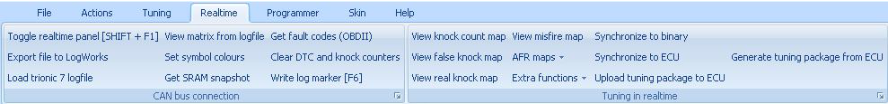{width=100%}

### Real-time – Toggle real-time panel

Allows you to start a real-time session.
If all connections are done well, T7Suite should be able to connect to the ECU and show you real-time information.
You can move symbols up and down in the real-time free-logging list with CTRL-UP and CTRL-DOWN.

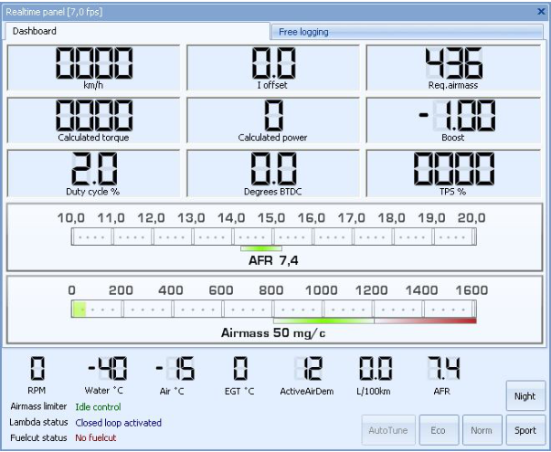{width=68%}

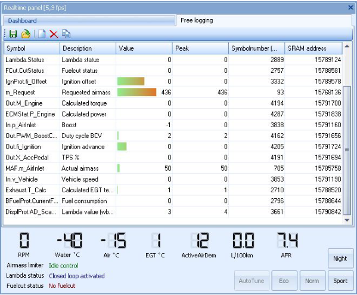{width=67%}

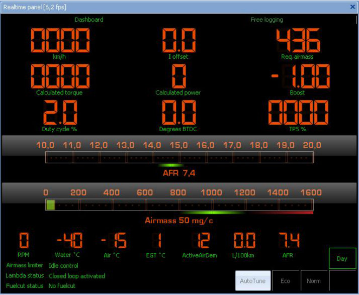{#fig-nightpanel-mode width=80%}

### Realtime – AFR Maps – AFR target map

Lets you set your desired AFR values for each load and rpm point for this binary file.
After logging with a wideband lambda sensor you can compare the target values to the feedback values.

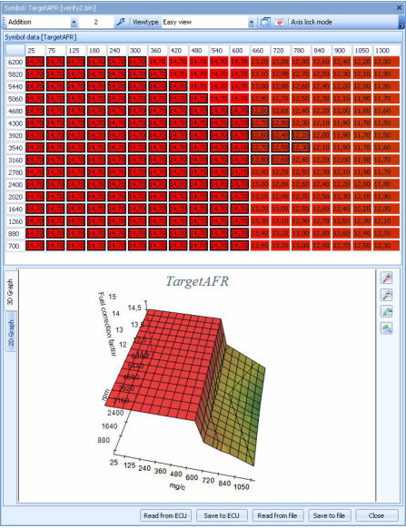{width=50%}

### Realtime – AFR Maps – AFR feedback map

Shows you the measured average values from the real-time sessions you have done for this binary file.

### Real-time – Export file to LogWorks

Will convert and export logged data (a t7l file) to LogWorks format and start LogWorks with that file automatically.

### Real-time – Load Trionic 7 logfile

Loads and shows a t7l file in the internal T7Suite viewer.

### Real-time – View matrix from logfile

Lets you view three channels in a log file displayed as a surface graph (matrix).

### Real-time – Set symbol colours

Lets you select the colour for each symbol for displaying in the internal T7Suite viewer.

### Real-time – Get SRAM snapshot

Lets you download the ECUs working memory as a snapshot for comparing and backup.

### Real-time – Get fault codes (OBDII)

Allows you to fetch active fault codes from the ECU and optionally clear them as well.

### Real-time – Clear DTC and knock counters

Lets you clear all DTCs and the knock counters (maps and counters).

### Real-time – Write log marker

While running a real-time session this enables you to write a marker in the log which you can track back easily later on.

### Real-time – View knock count map/false knock count map/real knock count map

Downloads and displays the current knock counter maps in the ECU.

### Real-time – View misfire map

Downloads and displays the current misfire map in the ECU.

### Real-time – Show AFR feedback map

Shows you the current AFR feedback map.
This map is only filled and updated when you’re working with a wideband lambda sensor.

### Real-time – Clear AFR feedback map

Allows you to clear the AFR feedback map to start a new ‘session’.

### Real-time – Autotuning fuel

[Autotune criteria]{.underline}

For Autotune to become available you will have to meet certain criteria.

- You will have to be using an open/development binary file in your ECU
- Engine temperature should be over 70 degrees Celcius

If you get to the point where all Autotune criteria are met, the Autotune button will be enabled.
If you click it, an Autotune session will commence.
The moment Autotune is activated the software switches off closed loop control in the ECU.

If all runtime criteria are met the algorithm measures AFR values through the wideband lambda input and determines the cell in which it should average this value by means of current engine speed and manifold pressure.
Depending on the mode in which Autotune is running (direct update or user approve) it updates the fuel map in the ECU [or]{.underline} it stores the averaged value in memory.
In the latter case it shows the user a proposal for adjustments to be made after the Autotune session is ended.

After the Autotune session, the software will show you a map in which the cells to be corrected are highlighted and showing the percentages to correct the fuel map.

{width=85%}

You can cancel this session, accept all selected cells (after selecting the cells you want to correct) or you can accept all suggested correction.
T7Suite will save all mutated data into the ECU.

## Programmer menu

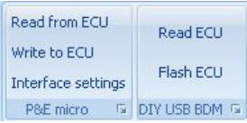{width=31%}

### Programmer menu – Read from ECU

Starts a reading batch file for P&E Micro devices.

### Programmer menu – Write to ECU

Starts a writing batch file for P&E Micro devices.

### Programmer menu – Interface settings

Allows you to set the batch file locations for the P&E Micro device.

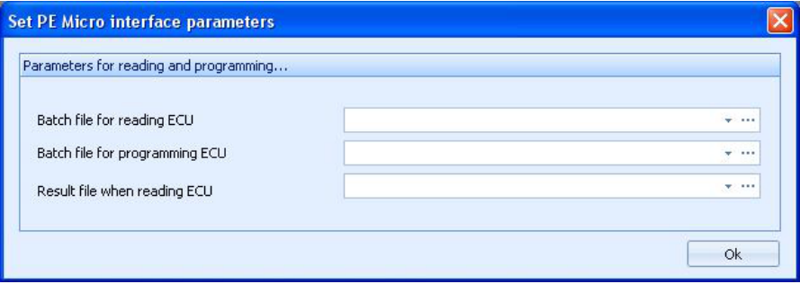{width=100%}

### Programmer menu – Read ECU

Starts a reading session on the ECU using a DIY BDM adapter that is for sale on ecuproject.com

### Programmer menu – Flash ECU

Starts a flashing session on the ECU using a DIY BDM adapter that is for sale on ecuproject.com

## Help menu

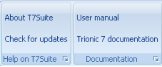{width=37%}
