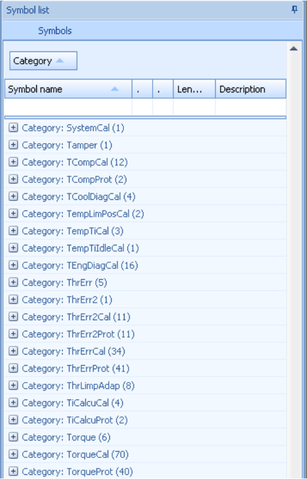

# Loading a file

To load a binary file (or a Motorola S19 file) select “file” from the ribbon menu and click “open”.
If this file is opened for the first time in T7Suite the symboltable will be extracted from the file automatically.
After extraction (this takes 5-20 seconds) the symboltable will be saved for later use.
This way, the extraction doesn’t have to be done every time a file is opened.

After the file is opened the symbol list will be displayed in the symbol list view as shown in @fig-symbol-table.

{#fig-symbol-table width=59%}

Note that by default there is a filter active on the view, showing only the symbol that are actually stored in flash memory (e.g. flash address > 0).
You can disable this filter by clicking the little blue cross in the bottom left hand side of the symbollist.
