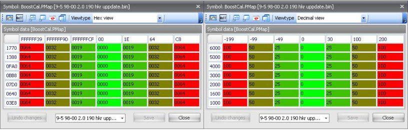
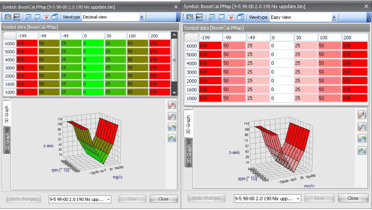

# Editing maps

## hexadecimal mode

When you select “View tables in Hex” in the ribbon menu under Actions, Options all maps will be displayed in hexadecimal values.
If you don’t really know how to interpret hexadecimal number, you can also switch do decimal mode by unchecking the “View tables in Hex” option.
This setting will be stored and retrieved the next time the application is started.
In the images below you can see the difference of viewing in hex or in decimal format.

{width=91%}

## Color indicators

You can adjust how the maps are displayed to some extend.
By default all maps will be displayed having color from green (low values) to red (high values).
If you find this confusing you can check the “Show red and white maps” option in Actions, Options and the maps will be displayed using red only.
In the images below you can see the difference in viewing in red&green and red&white.

{width=82%}

## Adjusting values in a map

To avoid that you have to adjust all values of a “large” map manually some features have been added to the mapeditor.

- Plus key: adds 1 to all selected cells
- Minus key: substracts 1 from all selected cells
- PageUp key: adds 10 to all selected cells
- PageDown key: substracts 10 from all selected cells
- Home key: sets all selected cells to the maximal value
- End key: sets all selected cells to the minimal values

To be able to get your work done faster you can selected one or more cells in a table and copy them to the clipboard by rightclicking and selecting “Copy selected cells”.

To paste the cells select the location where you want to cells to appear – this could be in another map and even in another binary – rightclick and select “paste selected cells” and then “At original position” or “At currently selected location”.
