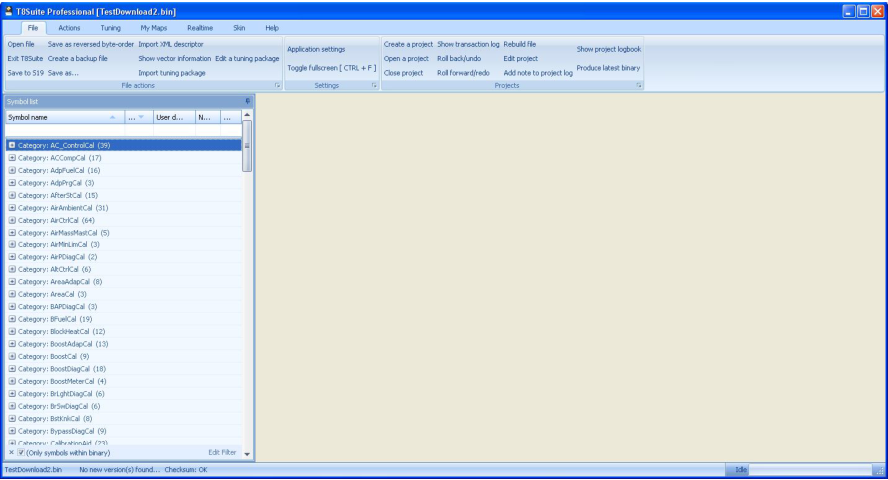

# General information

Thank you for downloading and installing T8Suite.
In this manual you will find an overview of the most commonly used functions.
After starting T8Suite a splash screen will be displayed and after all components are loaded and the application is initialized the main screen will be displayed.

{width=100%}

The top menu is a ribbon style menu also found in the latest Microsoft Office environments.
It allows you to navigate through the available options quickly and easily.
This first chapter will show you around the available options one by one.
