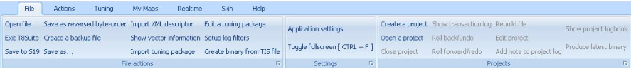
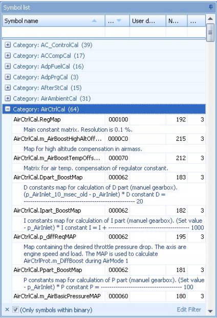
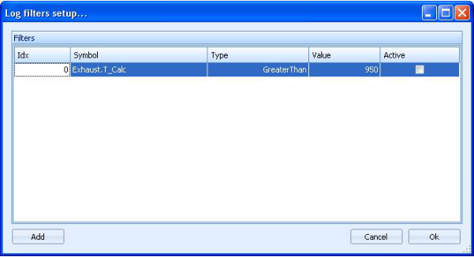
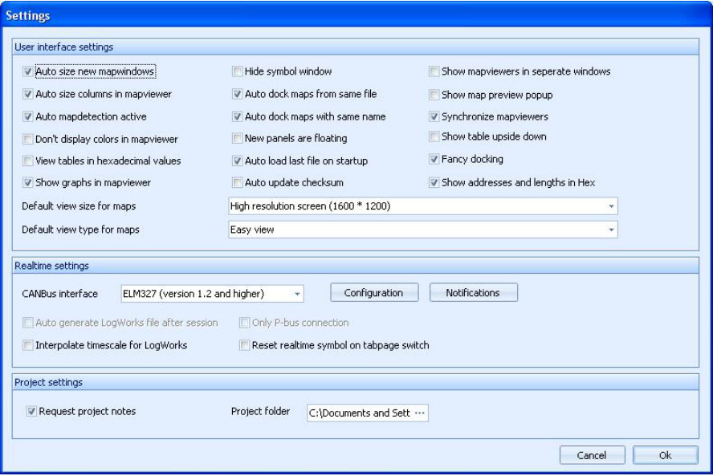
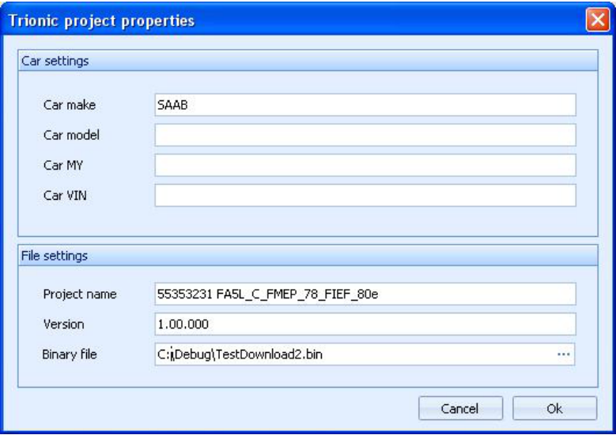
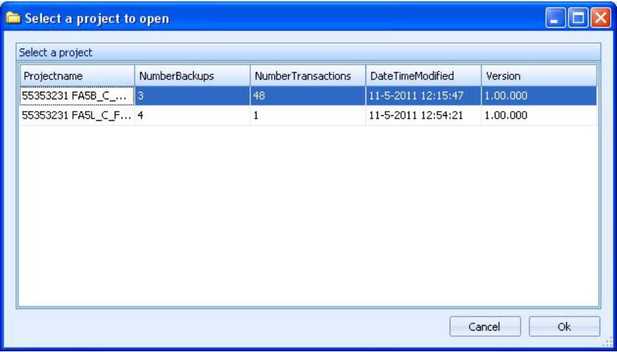
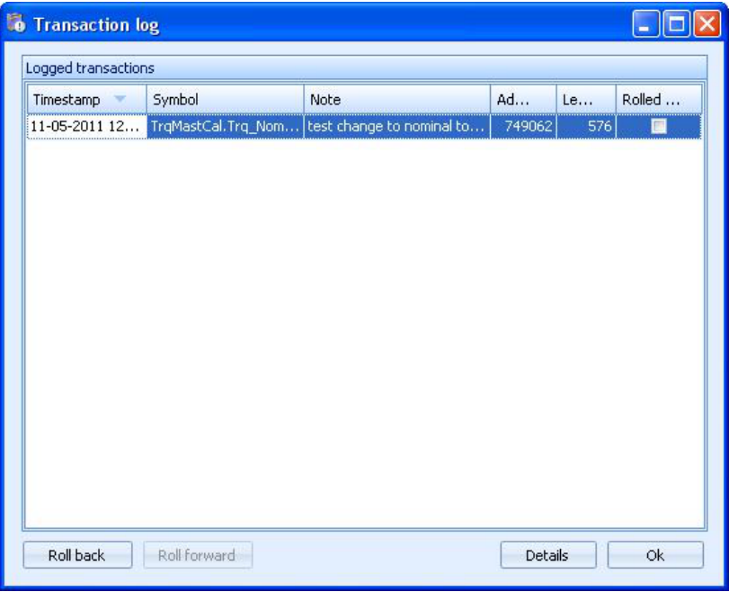
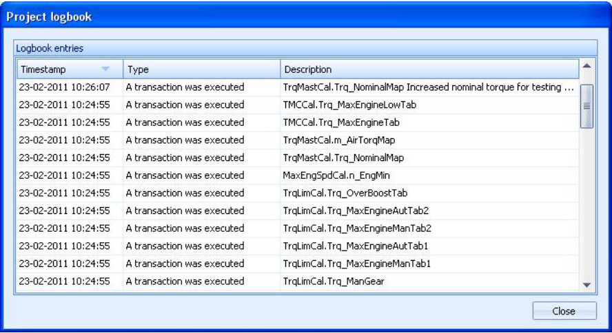

# File menu

{width=99%}

## File actions – Open a binary file

This option allows you to open a binary file.
T8Suite will automatically extract all the relevant information from the file after selecting it in the open file dialog.

Once the file is opened and all information is extracted the symbol list on the left hand side of the main screen will be filled with information.

{width=47%}

Note that by default there is a filter active on the view, showing only the symbol that are actually stored in flash memory (e.g. flash address > 0).
You can disable this filter by clicking the little cross in the bottom left hand side of the symbollist.

## File actions – Exit T8Suite

Exits the application in a safe manner.

## File actions – Save as

This lets you choose a different location and/or filename for the binary file you currently have open.

## File actions – Export to S19

This allows you to save the binary file in Motorola S19 format which can be used to program the ECU with a BDM interface.

## File actions – Create a backup file

Lets you create a backup file for the binary at this point.
It is wise to create backups before you start to make big changes to your file.
If a project is opened, the backup file will be stored within the project folder otherwise it will be stored in the folder where the bin file is located.

## File actions – Show vector information

This is a little tool for techies.
It shows the start-up vector information for the Motorola MC68337 microprocessor.

## File actions – Import XML descriptor

Lets you import a symboltable from an existing XML file.
Binaries without a symboltable can be user-described and if you have an XML file for your binary file you can import it with this function.

## File actions – Import tuning package

Lets you import a tuning package which holds generic map information.

## File actions – Edit a tuning package

If you want to remove maps from a tuning package or you want to add maps, you can edit the tuning package with this option.

## File actions – Setup log filters

This allows you to setup filters for realtime logging.
If you setup filters you can reduce the amount of data logged in the logfiles by telling T8Suite which data to log and which not to log.

{width=67%}

## File actions – Create binary from TIS file

SAAB has stored Trionic 8 application files in its Technical Information System (TIS).
These files have an extension .gbf and they only contain a part of the complete binary file.
To make things worse, these files are encrypted as well.
Lucky for you, T8Suite can decrypt and build a new binary file for you based on another binary file and a compressed gbf file.

## File actions – Settings – Application settings

This will show the options screen for T8Suite.

{width=100%}

## File actions – Settings – Application settings – Auto size new mapwindows

Determines whether or not new map windows will automatically be resized to fit their respective contents.

## File actions – Settings – Application settings – Auto size columns in mapviewer

Determines whether or not the map viewers should try to resize the columns they contain to make the content fit.
As you can imagine ignition advance for example expressed in whole and fractional degrees takes more space than a simple decimal number ranging from 0-10.

## File actions – Settings – Application settings – Show graphs in mapviewer

To gain performance in lightweight computers you can switch off the graphical display in the mapviewer altogether with this option.

## File actions – Settings – Application settings – Show addresses in hex

T8Suite can display addresses and lengths of symbols in decimal form or in hexadecimal form.
This option allows you to switch between the two.

## File actions – Settings – Application settings – Auto load last file on start-up

If you work on one file for a prolonged period of time you might want T8Suite to reopen the last file automatically when you start it.
This option allows you to control that behaviour.
If the last opened item was a project, T8Suite will automatically reopen that project for you at start-up.

## File actions – Settings – Application settings – Fancy docking

If the dragging and docking of windows (map viewers) is slow or causes issues, please turn this option off.

## File actions – Settings – Application settings – Auto dock maps from same file

If you open more than one map from the same file (for example fuel and ignition maps) you can choose to have those docked together using this option.
If the option is turned off, windows will be tiled next to each other.

## File actions – Settings – Application settings – Auto dock maps with same name

If you open the same maps from different files (for example the main ignition map from 2 files) you can choose to have those docked together using this option.
If the option is turned off, windows will be tiled next to each other.

## File actions – Settings – Application settings – New panels are floating

Upon opening a new mapviewer you can choose to have this window docked in the main screen or have it floating.

## File actions – Settings – Application settings – Auto update checksum

Having this checked will rid you of the constant worry whether or not the checksum of your file is valid.
We advise you to keep this turned on!

## File actions – Settings – Application settings – Synchronize mapviewers

With this enabled, T8Suite will try to keep multiple opened mapviewers synchronized with eachother.
Cell selections, graph rotation etc will be done in all open mapviewers.

## File actions – Settings – Application settings – Default view size for maps

Allows you to adjust the map viewers size for different screen resolutions.

## File actions – Settings – Application settings – Default view type for maps

Easy view is best if you don’t know what this means ;)

## File actions – Settings – Application settings – Request a note on changes

If you are working in a project you can have T8Suite ask you for a comment every time you make a change to one of the maps.
This way, you can keep track of changes very easily.

## File actions – Settings – Application settings – Project folder

Allows you to set an alternate project root folder for creating projects.
You can use this if you want all the projects to be located on a separate disk partition for example.

## File actions – Settings – Application settings – Auto generate LogWorks file after session

If you run a live session on your ECU with the canbus connection, T8Suite can automatically generate a LogWorks file from that session and start LogWorks (not yet implemented)

## File actions – Settings – Application settings – CANBus interface

Three devices are currently supported, the Lawicel device (<https://www.canusb.com>), ELM327 v1.2+ devices and the multi-adapter that has a canbus interface a BDM interface, 5 AD inputs and a thermocouple input, both designed by ecuproject members.
The multi-adapter and the ELM327 devices will require more configuration so when one of these is selected, the extra configuration button next to the drop down box will be enabled.
By selecting it you can set the extra options.

## File actions – Toggle full screen

Lets you run T8Suite full screen for maximum usage of screen space.

## File projects – Create a project

T8Suite allows you to work on your tune in a project based fashion.
This option lets you create a new project.
Projects have the advantage of having roll-back and roll-forward functions, having versioning and keeping things tidy and together.
You are advised to work in a project if you do more than simple easy-tune your binary file.

{width=87%}

## File projects – Open a project

Lets you select and open a previously created project.
If no projects are available (none were created before) T8Suite will notify you with a message box.

{width=100%}

## File projects – Close project

Closed the project and allows you to work on single files again.

## File projects – Show transaction log

Shows the transaction log for the current project.
Since a project contains only one binary file, you could see this as an undo/redo list for the project binary file.

{width=91%}

## File projects – Roll back/undo

Lets you rollback the last transaction made to the binary file.
If no transactions are available to rollback, the button will be disabled.

## File projects – Roll forward/redo

Lets you roll forward (redo) the last transaction that was undone/rolled back.
If no transaction are available to roll forward, the button will be disabled.

## File projects – Rebuild file

This enables you to rebuild a project file (binary) up to a certain point in time.
T8Suite will ask you for a date and it will restore – if possible – the file that you had at that specific date.

## File projects – Edit project

Lets you edit the project properties for any project.
This enables you to manage your version numbering yourself.
Version numbers are stored, together with all other project properties, in the xml file in the project folder.

## File projects – Add note to project

You can add a note to you project with a timestamp attached to it, so you can keep track of changes you made in your setup.
For example, if you start using different injectors or mount a bigger intercooler, you can enter a note of this into the project log for later reference.

## File projects – Show project logbook

Shows you in details what has happened in your project.

{width=100%}

## File projects – Produce latest binary

Lets you export the project binary in its current state so you can save it in another location easily.
