# Actions menu

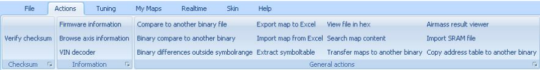{width=100%}

## Actions menu – Verify checksum

If you don’t have the automatic checksum routine turned on, you can manually verify and correct the files checksum with this option.

## Actions menu – Firmware information

Lets you alter the settings for the current binary file.

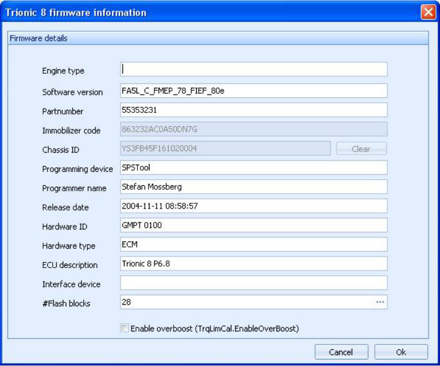{width=98%}

### Actions menu – Firmware information – Engine type

Descriptive text for the current binary file.

### Actions menu – Firmware information – Software version

Default software version numbering for the current binary file.

### Actions menu – Firmware information – Immobilizer code

Current immobilizer code for this binary file.
For more information about immo code please refer to the saab technical documentation.

### Actions menu – Firmware information – Chassis ID

Vehicle Identification Number (VIN) for the current binary file.
Should match you cars VIN number.

## Actions menu – Browse axis information

Shows you the relations between maps and axis symbols.
This is very informative to browse and learn.

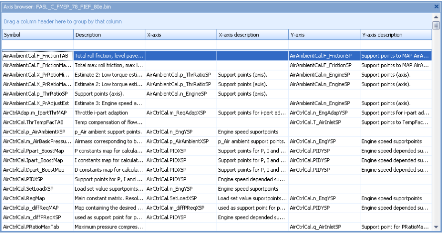{width=100%}

## Actions menu – VIN decoder

Lets you decode SAAB VIN numbers into readable format.

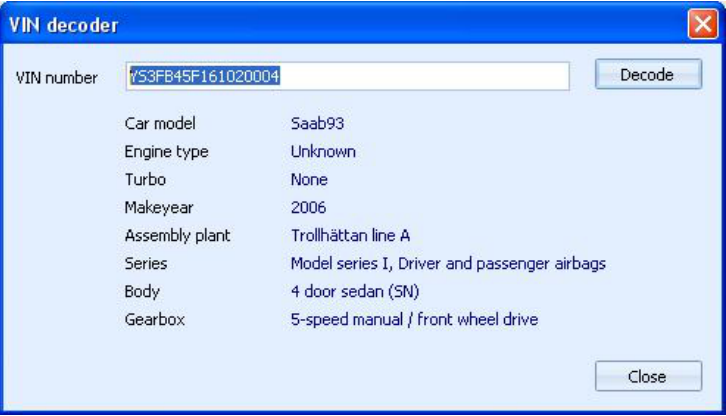{width=81%}

## Actions menu – Compare with another binary

The most time-consuming thing is comparing maps for different firmware versions by hand.
T8Suite gives you the tools to compare maps in different binaries with a click of the mouse.
To do this you must first open the primary binary you want to compare.
Then, select “Compare maps with other binary” from the Actions menu under Actions.
Now, select the secondary binary you wish to compare the first one with.
T8Suite will now display a list of symbols that differ in the selected binaries.

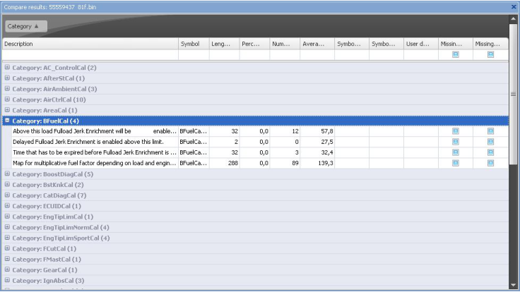{width=82%}

## Actions menu – Transfer maps to another binary

To be able to transfer map contents from a selected binary to another one a wizard has been created to copy all the contents for all symbols in the selected binary to another one that the wizard enables you to select.

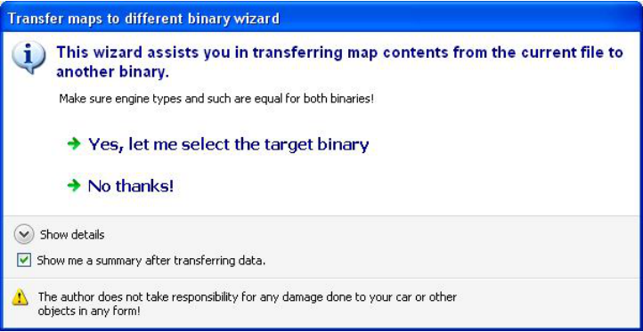{width=81%}

## Actions menu – Binary compare

Lets you do a binary (byte-by-byte) compare of two files.
This is a good tool to verify whether a programming session was successful or not.
Sequences of steps would be:

1. Program ECU
2. Read file from ECU
3. Compare original and downloaded file with Binary compare.

If the result screen is empty the files are identical (successful programming).

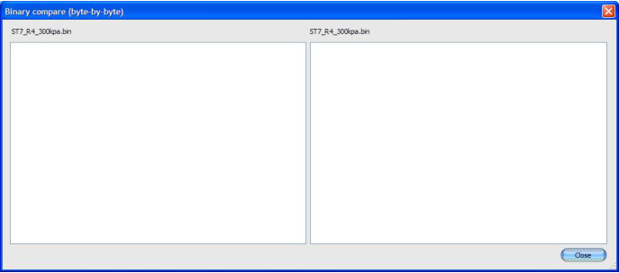{width=77%}

## Actions menu – Export map to Excel

For easy export and import facilities an interface with MS Excel has been implemented into T8Suite.
This option lets you export a selected map to Excel for viewing and editing.

## Actions menu – Import map from Excel

For easy export and import facilities an interface with MS Excel has been implemented into T8Suite.
This option lets you import a selected map to Excel.

## Actions menu – Import SRAM file (not implemented yet)

## Actions menu – Extract symboltable

This option allows you to extract the symbol information from the loaded binary file.
Normally T8Suite will automatically do this for you, but with this option you can force it to (re-) extract the information.

## Actions menu – View file in hex

Lets you explore the binary file in hexadecimal form (advanced users!)

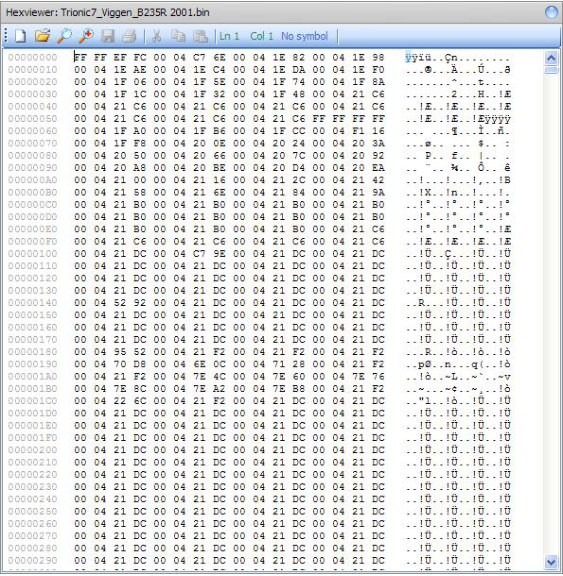{width=63%}

## Actions menu – Search map content

Allows you to search maps for a specific value.
The result will be shown in a list.

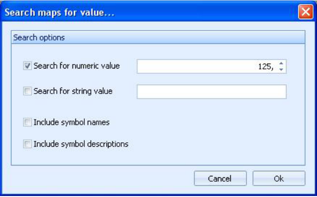{width=72%}

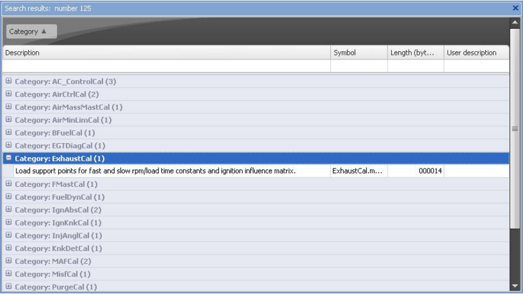{width=100%}

## Actions menu – Show airmass result

T8Suite incorporates a function to verify the final (estimated) airmass results based on the most common airmass and torque limiters).
The result from these calculations are shown in a table that also shows the limiter that is holding more airmass per combustion back.

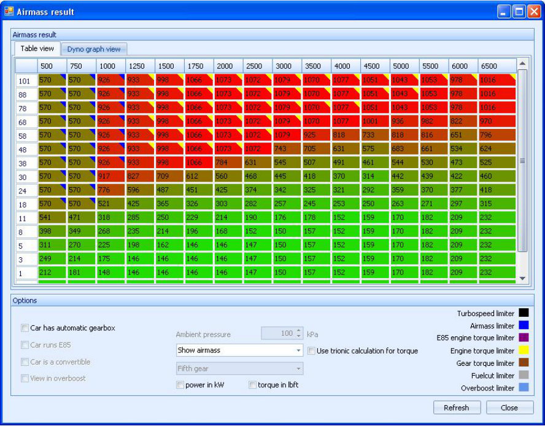{width=100%}

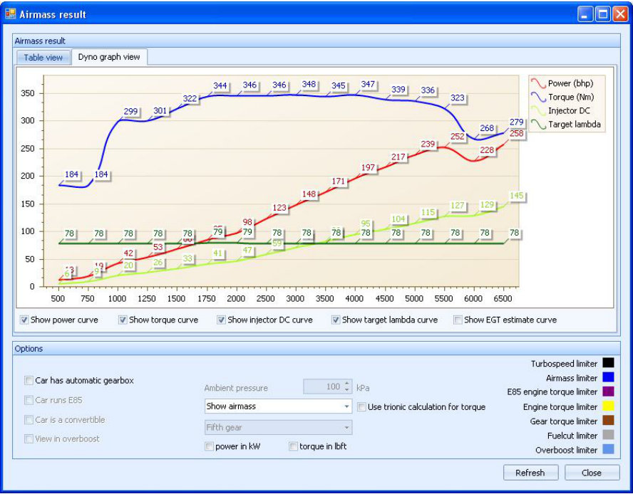{width=100%}

## Actions menu – Copy addresstable to another binary

Some tuning companies choose to damage information inside the binary file to prevent users to have a look at them.
Mostly the addresstable is damaged.
With this option you can easily copy the address table from a MATCHING file (original file) to the corrupted file.
It you don’t know what this is about, please don’t use it!
