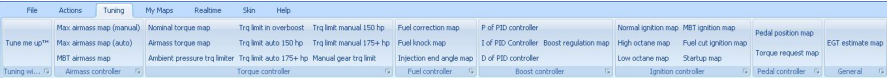
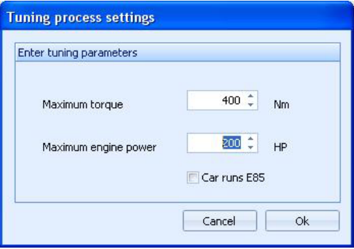

# Tuning menu

{width=99%}

## Actions menu – Tune me up

Lets you alter the binary file to match a certain torque and power.
This is an automated wizard that changes all the relevant maps for you.
Please DO make sure that you have the hardware to support what you enter in the wizards input screen.
If you go above a stage 3 configuration, please also make sure that your AFR values are in range and your EGT does not go over 950 degrees celcius.

{width=57%}

## Actions menu – Maps

Lets you directly start a mapviewer with the specific map for quick access to the most imporant maps.
