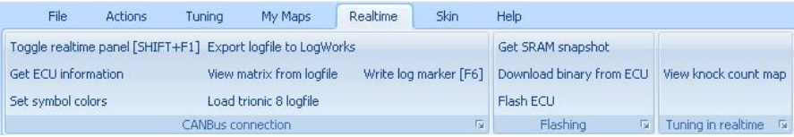
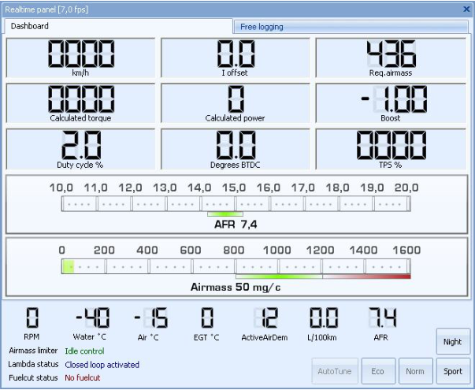
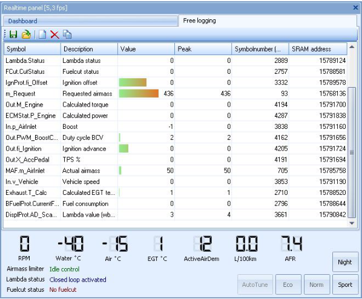
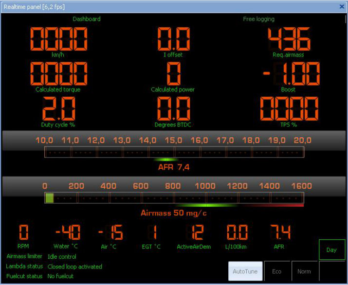
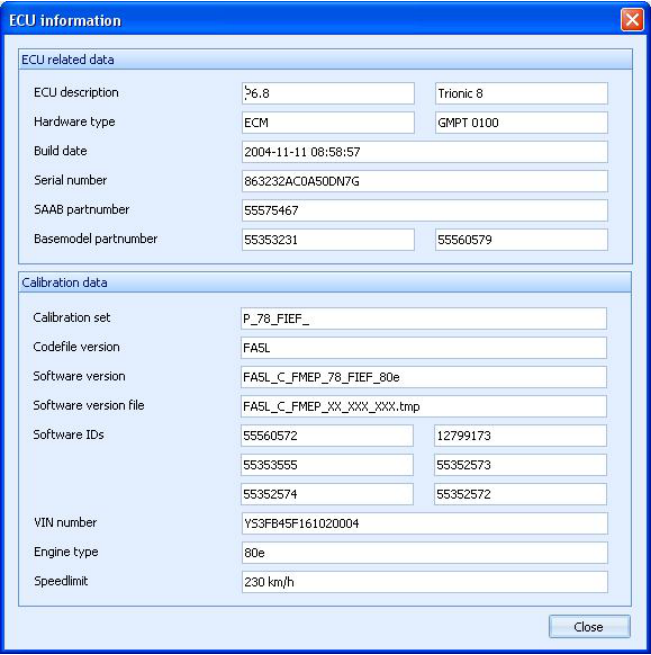
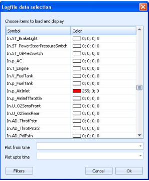

# Realtime menu

{width=99%}

## Realtime – Toggle realtime panel

Allows you to start a real-time session.
If all connections are done well, T8Suite should be able to connect to the ECU and show you real-time information.
You can move symbols up and down in the real-time free-logging list with CTRL-UP and CTRL-DOWN.

{width=68%}

{width=67%}

{width=80%}

nightpanel mode

## Realtime – Get ECU information

Allows you to extract all relevant information from the ECU using the canbus interface.

{width=73%}

## Realtime – Set symbolcolors

Lets you choose the colors that will be used for the symbols that are logged in realtime.

{width=33%}

## Realtime – Export file to LogWorks

Will convert and export logged data (a t8l file) to LogWorks format and start LogWorks with that file automatically.

## Realtime – View matrix from file

Allows you to create a 3D matrix from a logfile for further analysis.

## Realtime – Load Trionic 8 logfile

Loads a logfile into the internal logviewer in T8Suite.

## Realtime – Write log marker

While running a real-time session this enables you to write a marker in the log which you can track back easily later on.

## Realtime – Get SRAM snapshot

Lets you download the ECUs working memory as a snapshot for comparing and backup.

## Realtime – Download binary from ECU

Downloads the flash content from the connected ECU.
Please note that this will take approximately 20 minutes to complete.
Progress will be shown in the lower right corner of T8Suite’s main screen.

## Realtime – Flash ECU

Flashes a given binary file to the connected ECU.
Please note that this will take approximately 10 minutes to complete.
Progress will be shown in the lower right corner of T8Suite’s main screen.

## Realtime – View knock count map

If connected to a T8 ECU, this will read the knock counter map from the ECU and display it in a mapviewer so you can keep track of where (which load/rpm sites) the system has detected knock.
