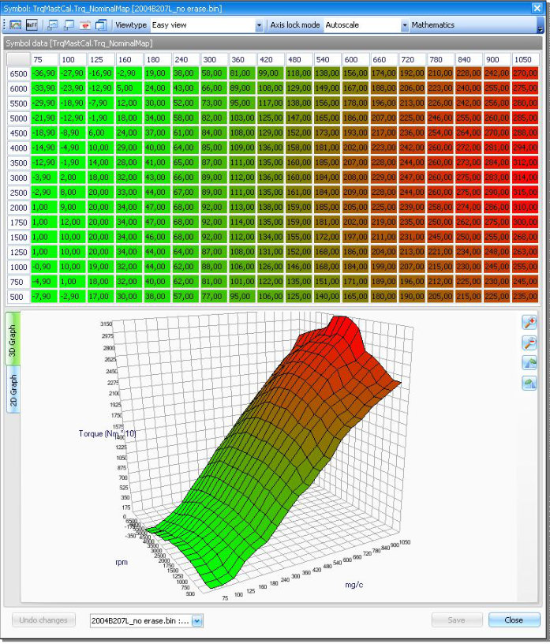

# Selecting symbols

After the symbol list has been displayed you can choose a symbol from the list by double clicking it or by highlighting it and pressing \<enter>.
Whenever you do this a new panel is shown with the detailled information about the symbol in question.

This panel will look something like in @fig-symbol-editor.

{#fig-symbol-editor width=78%}
