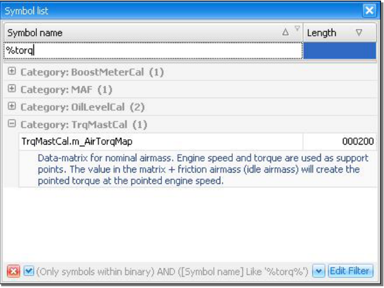

# Searching for information in the views

The used data viewers all support something called “incremental searching”.
If you select a value in one of the views and start typing the name or address you are looking for the view will automatically scroll to the given entry (best match).
You normally should have the column you are searching in as the primary sort column.
To do this just click on the columnheader of the column in question.

{#fig-incremental-search width=72%}
