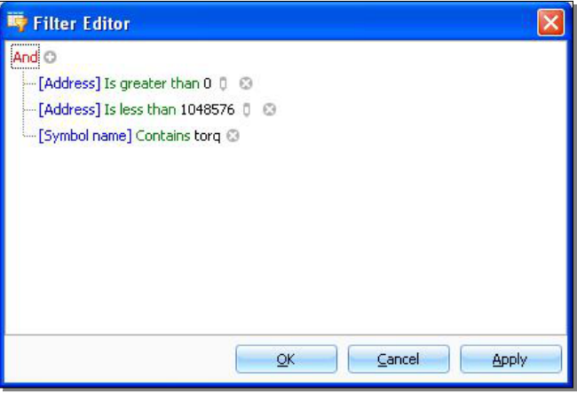

# Filtering information

You can easily filter information in the views by selecting the little filter image in the column header and choosing one of the options.
The most elaborate filters can be defined in “custom” of course.
Here’s a sample.

{#fig-custom-filter width=73%}
