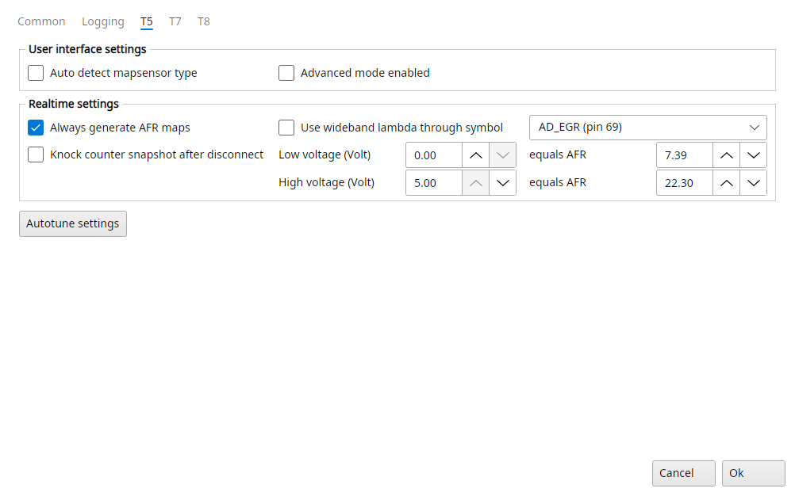
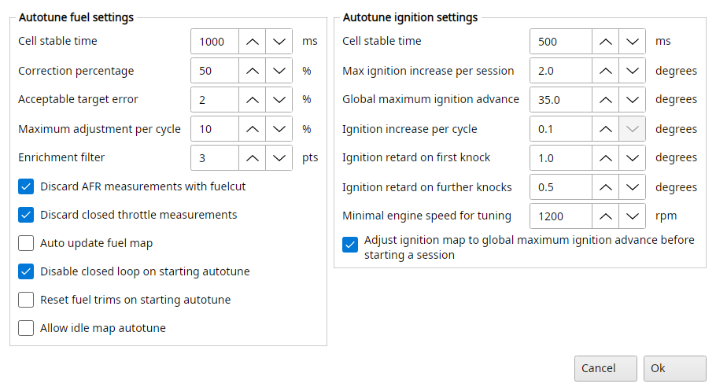

# Trionic 5 settings

The T5 tab of File → Settings has the options only a T5 has.

{#fig-settings-t5 width=100%}

## Settings → T5

### User interface settings

Auto detect mapsensor type
:   Most pro made tunes don't have the marker for the correct mapsensor type in the binary file.
    This option lets TxSuite auto detect the correct mapsensor type for the current binary file by examining certain maps.

Advanced mode enabled
:   This will switch TxSuite into advanced mode for a T5.
    This means you will have access to more options: the advanced tuning wizards, autotune and the advanced tabs of the realtime panel.
    If you are not sure whether you need this, leave it unchecked.

### Realtime settings

Always generate AFR maps
:   TxSuite sets up the AFR maps (target, feedback and counter maps in an `AFRMaps` folder next to the file) as soon as a file is opened, instead of when they are first needed.
    Users without a realtime connection will never need the AFR maps of course.

Knock counter snapshot after disconnect
:   Saves the ECU's knock counter map (Knock_count_map) as a `.KNK` file in the Snapshots folder (the project's, else next to the file) when you stop the realtime panel or disconnect from the ECU.
    T5.5 only, Realtime → Knock map snapshots lists them.

Use wideband lambda through symbol
:   TxSuite allows you to setup your engine with a wideband lambda sensor like the LC1 from Innovate Motorsports.
    The wideband controller can deliver a linear analogue signal to the ECU, read through AD_EGR or AD_cat.
    We advise you to use AD_EGR for that (pin 69).

Low voltage, High voltage, equals AFR
:   Settings to calibrate the wideband lambda controller input: the low voltage equals the AFR next to it, the high voltage the other one, and voltages in between convert on a straight line.

A wideband controller on a serial port is set up on the Common tab instead, Use wideband O2 on com port.

## Settings → T5 → Autotune settings

Lets you choose options for the Autotune fuel and Autotune ignition functions.
Please note that you need to be running a wideband lambda sensor to be able to use Autotune fuel.

{#fig-autotune-settings-t5 width=70%}

### Autotune fuel settings

Cell stable time
:   Determines how long (in milliseconds) the system should reside in a certain load/rpm cell before TxSuite validates the AFR measurement.

Correction percentage
:   Determines how much a certain AFR error will be corrected.
    Setting this to 50% (default) means 50% of the established AFR error will be corrected for each session.

Acceptable target error
:   Determines how big the AFR error is allowed to be without TxSuite taking action in that certain load/rpm cell.

Maximum adjustment per cycle
:   Determines how big the maximum adjustment will be in percentages measured from the original fuel map.

Enrichment filter
:   Determines how big enrichment/enleanment factors are allowed to be while still doing adjustments to the fuel map.

Discard AFR measurements with fuelcut
:   Determines whether measurements while the system is in fuel cut will be ignored.

Discard closed throttle measurements
:   Determines whether measurements with closed throttle plate will be discarded.

Auto update fuel map
:   This option decides the mode in which Autotune works.
    If this is checked the system will try to map the fuelling entirely on its own.
    No feedback from the user is requested.
    After an Autotune session the user can however revert to the previous fuel map if he/she chooses to do so.
    If this is not checked the Autotune function will be more like a question & answer game between TxSuite and the user.
    After every session a map is prompted in which TxSuite shows which cells are to be altered to reach the requested AFR.
    The user can select/deselect cells to his/her liking and update the fuel map with the selected cells.

Disable closed loop on starting autotune
:   Some advanced users have closed loop operation turned off completely.
    In that case you might want to prevent TxSuite to disable closed loop operation when starting an autotune session.

Reset fuel trims on starting autotune
:   Starts the session with the ECU's fuel adaption reset, so it doesn't mix in.

Allow idle map autotune
:   Lets Autotune fuel work on the idle fuel map too.

### Autotune ignition settings

Cell stable time
:   How long (in milliseconds) the engine has to stay in a cell before TxSuite advances or retards it.

Max ignition increase per session
:   How many degrees a cell may be advanced in one session at most.

Global maximum ignition advance
:   No cell is advanced past this.

Ignition increase per cycle
:   How many degrees a cell is advanced each time the engine has been in it long enough without knock.

Ignition retard on first knock and on further knocks
:   How many degrees a cell is retarded when it knocks, the first time and after that.
    A cell that knocked is locked, it is never advanced again.

Minimal engine speed for tuning
:   Below this rpm nothing is tuned.

Adjust ignition map to global maximum ignition advance before starting a session
:   Caps every cell of the ignition map at the global maximum first.
