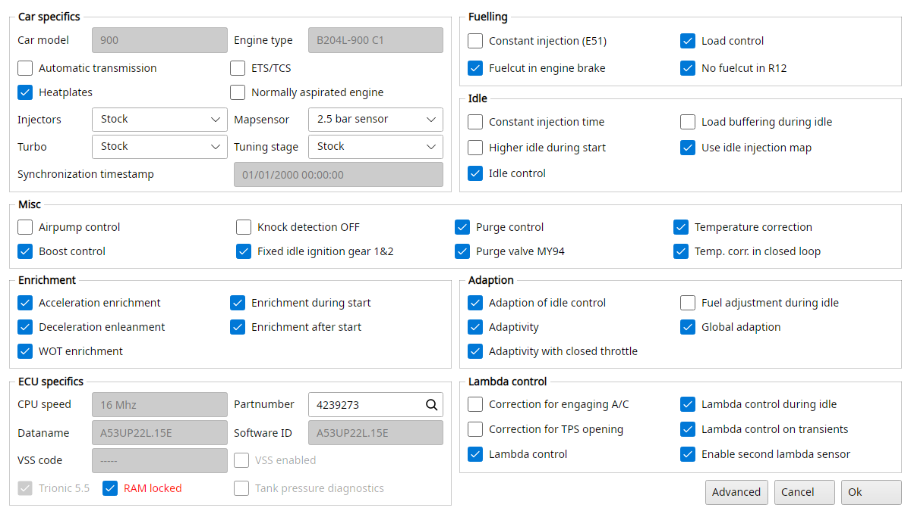

# Firmware information

Actions → Firmware information, T5Suite's Trionic options, allows you to view and modify a lot of parameters in the ECU.
They are stored in the binary: the flags of the program mode (Pgm_mod!) and the markers TxSuite keeps in the file's footer.
Ok writes them, as transactions in a project, and updates the checksum.
Cancel leaves the file alone.

{#fig-firmware-t5 width=100%}

Opening the Pgm_mod! symbol from the symbol list opens this window too.
Options the binary doesn't have are greyed out.

## Car specifics

Car model
:   Information field, showing the car model.

Engine type
:   Information field, showing the engine type.

Automatic transmission
:   Sets the car in automatic transmission mode or in manual transmission mode.
    This should match the gearbox you have in your car.

ETS/TCS
:   Turns the Electronic Throttle System on/off.
    This should match your car.
    If the car is equipped with TCS, turn it on, otherwise turn it off.

Heatplates
:   Some models are equipped with heat plates, located between the head and the intake manifold.

Normally aspirated engine
:   Indicates whether the car has a turbocharger mounted or not.

Injectors
:   Information field used as an indicator to TxSuite which injectors you have mounted in the car: Stock, Green giants, Siemens 630cc/min (60lb/h), Siemens 875cc/min (80lb/h) or Siemens 1000cc/min.

Mapsensor
:   Information field used as an indicator to TxSuite which mapsensor type you are using: 2.5 bar sensor (stock, up to 1.45 bar of boost control), 3.0 bar (up to 1.95 bar), 3.5 bar (up to 2.45 bar), 4.0 bar (up to 2.95 bar) or 5.0 bar.
    The map viewers show the pressure maps scaled for this sensor.

Turbo
:   Information field used as an indicator to TxSuite which type of turbo is mounted in the car.
    Please set to the correct type for good operation: Stock (T25 mostly), GT17, TD04-15T, TD04-19T, GT28BB, GT28RS, GT3071R (either .86 or .64), HX35w, HX40w or S400SX371.

Tuning stage
:   Information field, used by TxSuite to see whether the file has been tuned before or not.

Synchronization timestamp
:   Indicates when TxSuite has last altered the content of the maps in the file.
    This timestamp is used to determine whether to synchronize maps from the file to the ECU or the other way around.

## Fuelling

Constant injection (E51)
:   Turns a constant injection time on/off.

Load control
:   Turns correction factor for load changes on/off.

Fuelcut in engine brake
:   Turns fuel cut off during engine braking on/off.

No fuelcut in R12
:   Turns the fuel cut off during engine braking on/off in reverse, 1st and 2nd gears.

## Idle

Constant injection time
:   Turns a constant injection duration during idle on/off.

Load buffering during idle
:   Turns load buffering during idle on/off.

Higher idle during start
:   Turns a higher idle rpm during starting on/off.

Use idle injection map
:   Turns the usage of a separate injection map during idle situation on/off.

Idle control
:   Turns separate idle control on/off.

## Misc

Airpump control
:   Turns the air pump control (SAI models) on/off.

Knock detection OFF
:   Turns off the knock detection algorithms in Trionic 5.
    Use with caution.

Purge control
:   Turns the purging function on/off.

Temperature correction
:   Determines whether the system should compensate for temperature differences or not.

Boost control
:   Turns the boost control valve control (APC) on/off.

Fixed idle ignition gear 1&2
:   Turns the usage of a fixed, constant ignition angle in first and second gear on/off.

Purge valve MY94
:   Turns the specific purge function for MY94 valves on/off.

Temp. corr. in closed loop
:   Turns the temperature correction in closed loop operation on/off.

## Enrichment

Acceleration enrichment
:   Turns mixture enrichment during acceleration on/off.

Enrichment during start
:   Turns mixture enrichment during cranking on/off.

Deceleration enleanment
:   Turns mixture enleanment during deceleration on/off.

Enrichment after start
:   Turns mixture enrichment after starting the engine on/off.

WOT enrichment
:   Turns mixture enrichment during Wide Open Throttle situations on/off.

## Adaption

Adaption of idle control
:   Turns adaptive behavior for idle control on/off.

Fuel adjustment during idle
:   Turns fuel adaption during idle state on/off.

Adaptivity
:   Turns fuel adaption on/off (spot adaption?).

Global adaption
:   Turns adaption on/off on a global level.

Adaptivity with closed throttle
:   Turns adaption with closed throttle plate on/off.

## ECU specifics

CPU speed
:   Information field showing the CPU speed this bin was designed to run on.

Partnumber
:   The partnumber of the software.
    Normally this matches the number on the ECU housing.
    The magnifier button looks it up as File → Lookup partnumber does.

Dataname
:   Information field showing the software identifier called data name.

Software ID
:   Information field showing the software identifier for this specific binary file.

VSS code and VSS enabled
:   Turns VSS (Vehicle Security System) on/off and the VSS code to use for this car (if VSS is active).

Trionic 5.5
:   Information field showing whether this bin is a T5.5 binary or a T5.2 binary.

RAM locked
:   Toggles the RAM lock flag, red while it's on.
    If RAM is locked, no data can be written to it, so no live tuning is possible.
    If you want to alter maps and values in realtime RAM needs to be unlocked.

Tank pressure diagnostics
:   Turns fuel tank pressure diagnostics on/off.

## Lambda control

Correction for engaging A/C
:   Determines whether an extra correction factor should be applied to the closed loop operation when the airco is engaged.
    This allows for other AFRs than 14.7 to be targeted when engine load is higher due to the airco components being activated.

Correction for TPS opening
:   Determines whether an extra correction factor should be applied to the closed loop operation when the throttle plate is opening.
    Opening the throttle plate results in an extra air rush, while the fuelling particles cannot keep up with this sudden airflow change resulting in a lean mixture.
    This option allows for other than 14.7 AFRs to be targeted in these conditions.

Lambda control
:   Turns closed loop operation on/off.
    If closed loop is activated the system will be in closed loop when certain criteria are met.
    If closed loop is deactivated here, the system will never enter closed loop and mixture will be determined by fuelling settings only.

Lambda control during idle
:   Determines whether closed loop operation should be active during idle conditions.

Lambda control on transients
:   Determines whether closed loop operation should stay active even when transients occur in the engine load or throttle plate opening.

Enable second lambda sensor
:   If your car is fitted with two lambda sensors (one pre-cat and one post-cat sensor) this should be enabled.
    Most models only have one lambda sensor and therefore should have this option turned off.

## Advanced

The Advanced button shows a few more fields: the hardcoded RPM limit, Interpolation of delay, Throttle acc/ret adjust MY95 and Constant angle.
If you don't know what they do, leave them alone.
