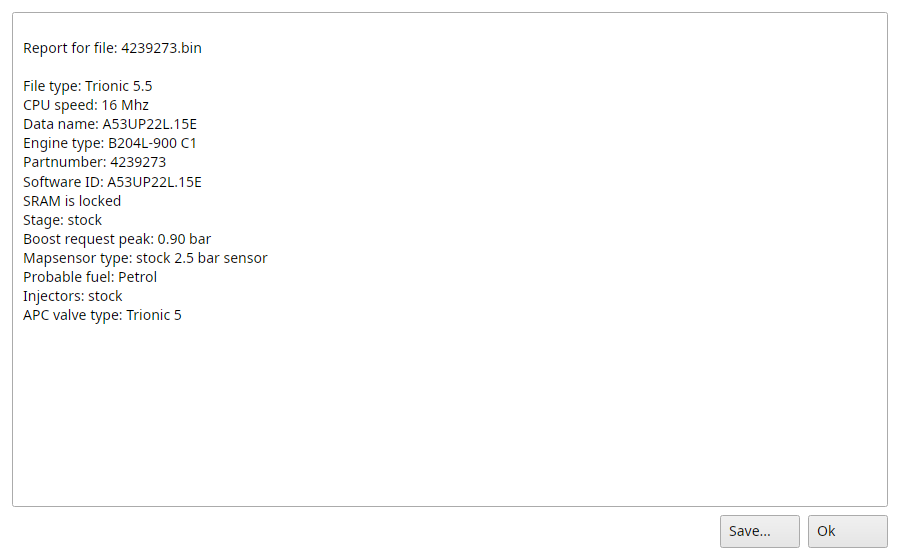
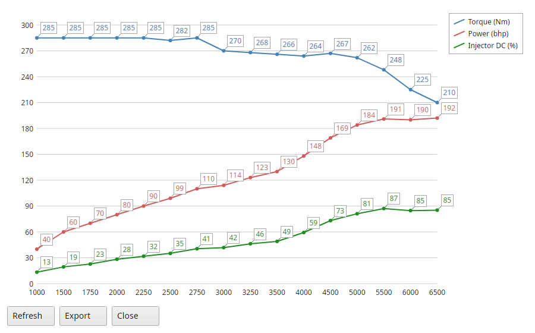
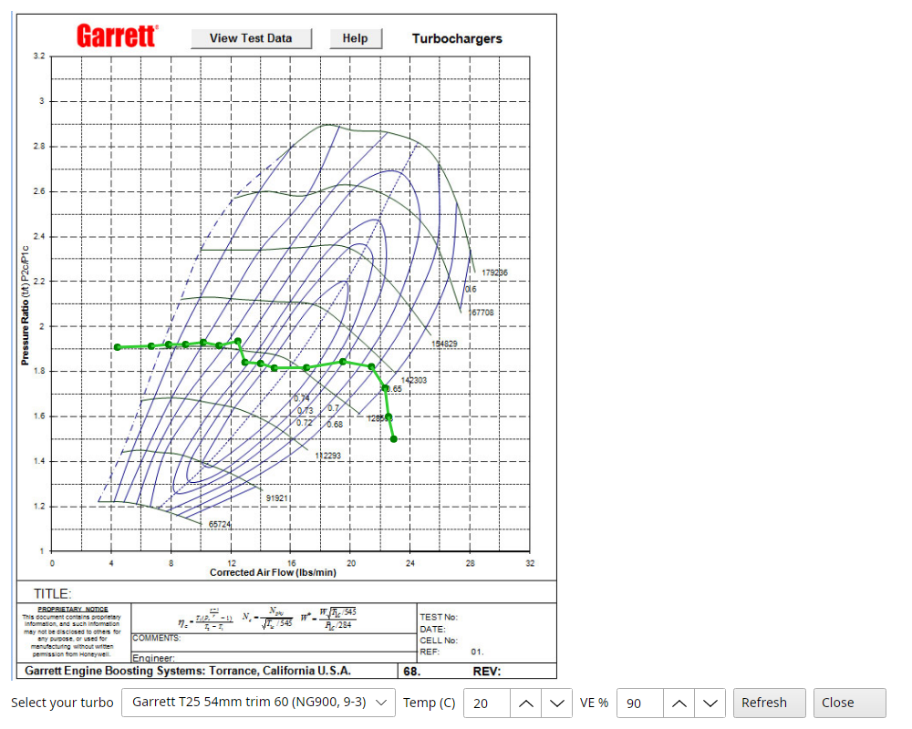
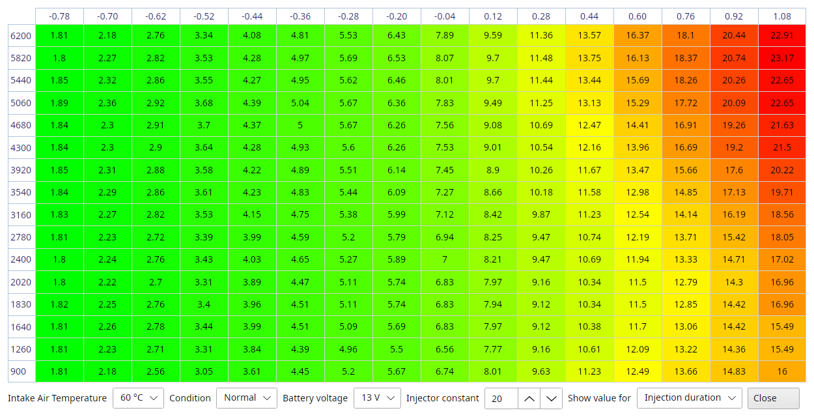

# Trionic 5 tools

The last section of the Actions menu has the tools only a T5 has.

## Actions → Examine binary

This option will run an examination process on the opened binary file and TxSuite will generate a report of its findings.
This examination is not 100% fool-proof but it will give you a pretty accurate idea on what an unknown binary file was intended to be used for hardware wise.

{#fig-examine-report-t5 width=70%}

The report shows in a list, Save stores it as a text file.

## Actions → Check for anomalies

Builds a report of anomalies (things that should normally not occur) that TxSuite finds in the currently opened binary file.

## Actions → Open a saved report

Lets you review previously saved reports.
Reports are text files now, T5Suite's old report format can't be opened.

## Actions → Show dyno graph

This will show you a rough indication of what your dyno graph should look like based on the current binary: torque, power and injector duty cycle.
The result of this graph largely depends on whether the boost request can be met.
Refresh draws it again after you changed a map, Export saves the graph as a PNG picture.

{#fig-dyno-t5 width=80%}

## Actions → Show compressor map

This will show you a rough indication of where you will land in the compressor map with your current boost request.
This of course assumes that you can actually reach your requested boost.
TxSuite guesses the turbo from the file's footer and partnumber, you can pick another and set the volumetric efficiency.

{#fig-compressor-map-t5 width=70%}

## Actions → Injection timing viewer

This starts a new screen showing the approximate injection duration figures for each engine speed and load point.
It shows milliseconds or duty cycle for each cell of the fuel, idle or knock fuel map, at an intake temperature, battery voltage and injector constant you set.
You can use this data to make sure your injectors are big enough and small enough ;)

{#fig-injection-timing-t5 width=90%}

## Actions → Merge binary files

Only useful when you have two binary files (one for each flash chip in the ECU) and you want to stitch them together (advanced users).

## Actions → Split binary file

Only useful when you want to have two binary files (one for each flash chip in the ECU) created from the current binary file (advanced users).
They are written next to the bin as `chip1.bin` and `chip2.bin`, overwriting files with those names.
