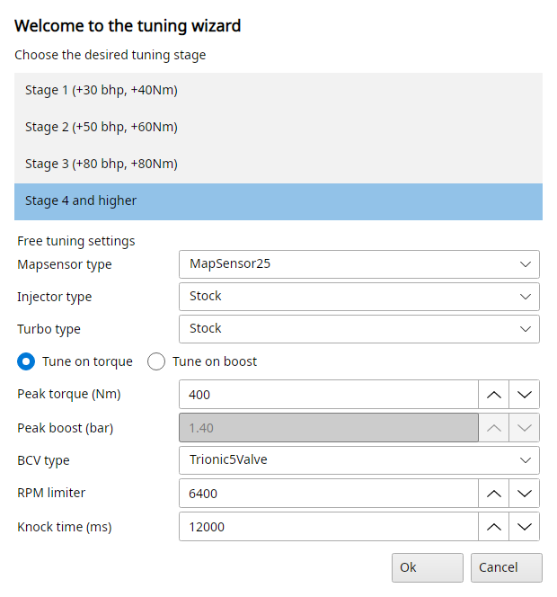
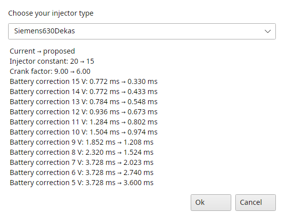

# Tuning menu

The Tuning menu starts with the tuning wizards, the rest gives you direct access to the most important maps, grouped in submenus.
Each map entry opens that map of the open file in a map viewer.
An entry only shows when the binary has the map, so a T5.2 file has no gear limiters and no ignition retard limit.
Point at an entry to see which symbol it opens.

## Tuning → Tuning wizards

Tune me up ® is always there.
The other wizards are advanced and only show with File → Settings → T5 → Advanced mode enabled.
Tune me up, the MAP sensor conversions and Convert to E85 write a report of what they changed, Save... stores it as a text file.

### Tune me up ®

Lets you convert your stock binary file to a stage I, II or III equivalent, or higher.
Choose the desired tuning stage:

- Stage 1 (+30 bhp, +40Nm)
- Stage 2 (+50 bhp, +60Nm)
- Stage 3 (+80 bhp, +80Nm)
- Stage 4 and higher

A backup of your original file is created in the process before changes are made to it.
A file already tuned to a higher stage isn't touched.

{#fig-tune-me-up-t5 width=50%}

Stage 4 and higher uses the free tuning settings: map sensor, injectors, turbo, tune on torque or on boost with the peak torque or peak boost, the boost control valve (BCV) type, the RPM limiter and the knock time.
Depending on your input TxSuite will try to generate a close as possible match to your hardware.
Please do note that tuning beyond stage III will require you to verify AFR settings and knock sensitivity in realtime to make sure everything is working properly.
Mapping for cold- and warm-start are also known issues to address after tuning for larger injectors and/or different mapsensor types.

### Convert to different MAP sensor

Lets you convert your binary file for usage with a 2.5, 3.0, 3.5, 4.0 or 5.0 bar mapsensor, a submenu item each.
All boost related tables are altered so the ECU calculates the right values with the new sensor.
Since this is an advanced topic you will understand that manual checks need to be done and changes need to be made for the file to be optimal for usage in your setup.

### Convert to larger injectors

This will start a wizard which will lead you through the relevant maps and it will make proposals on what to change: choose your injector type, and it shows the current and proposed injector constant, battery correction map and cranking factor.

{#fig-injector-wizard-t5 width=45%}

### Convert to E85 (ethanol) fuel

Lets you convert your binary file for usage with E85 fuel.
Please note that Trionic 5 does not support bi-fuelling, once converted it will no longer run on regular petrol.
Since this is an advanced topic you will understand that manual checks need to be done and changes need to be made for the file to be optimal for usage in your setup.
Maps that are changed by the wizard are: main and warm-up ignition maps, global fuelling (injector constant), cranking- and after-start- enrichment.
Running it twice enriches twice.

### Change boost adaption ranges

For bigger turbos, the boost adaption ranges do not match up with what is hardcoded into the binary file (the stock ranges are optimized for T25/TD04 turbo types).
You can adjust these ranges with this feature, the rpm range for manual and for automatic gearboxes, and the Max. boost error (bar) too.
The hardcoded ranges will be altered in your binary file, this wizard adjusts the actual code!

### Change boost bias range

In late binaries (probably all OBDII files) the boost bias map (Reg_kon_mat!) has hardcoded rpm support points (y-axis points).
Since these support points run only up to 5500 rpm, this is not enough to support good control when using a large turbo which requires more control in higher rpm ranges as well.
You can alter the code in the binary using this option and stretch the support points range.
The axis step range sets it: the support points run from 2500 rpm up to 2500 + 300 × step rpm, 5500 rpm at the stock step of 10.

### Change RPM limit

Sets the software RPM limit (Rpm_max!) and the limit hardcoded in the program, T5.5 only.

## Tuning → Injection [Fuel]

VE map - normal
:   Lets you edit the main injection correction map directly (Insp_mat!).
    Please note the black rectangular indicators in the viewer, see @fig-main-window-t5.
    These indicate the cells that operate in closed loop.
    Blue indicators indicate the knock adaption range and white indicators show the boost adaption range.

VE map - knock
:   Lets you edit the knock injection correction map directly (Fuel_knock_mat!).

Injector scaling
:   Lets you edit the main injection constant directly (Inj_konst!).

Battery correction map
:   The injection time correction for battery voltage (Batt_korr_tab!).

Fuel cut in overboost
:   Lets you view and edit the fuel cut level (Tryck_vakt_tab!).
    This map is shared between manual and automatic cars.
    Note: 255 (or 1.55 bar in easy view) means the fuel cut function has been turned off.

## Tuning → Ignition

Ignition normal
:   Lets you edit the main ignition map directly (Ign_map_0!).

Ignition knock
:   Lets you edit the ignition knock map (ignition pull values) directly (Ign_map_2!).

Ignition warmup
:   Lets you edit the warm-up ignition map directly (Ign_map_4!).

## Tuning → Turbo control [M] and Turbo control [A]

The same maps for cars with a manual gearbox [M] and with an automatic gearbox [A].

Boost request map
:   Lets you view and edit the boost request values (Tryck_mat! and Tryck_mat_a!).

Boost control bias
:   Lets you view and edit the bias (pretension) values for the boost controller (Reg_kon_mat! and Reg_kon_mat_a!).

P factors, I factors and D factors
:   Lets you view and edit the PID values for the boost controller in Trionic 5.
    For more information on PID controller functioning please refer to the Trionic 5 documentation.

Boost limit in 1st gear and Boost limit in 2nd gear
:   Lets you view and edit the boost limiter values for 1^st^ and 2^nd^ gear (only 1^st^ gear for automatic gearboxes).
    These limiters can be disabled.

## Tuning → Knock detection

Knock sensitivity map
:   How sensitive the knock detection is (Knock_ref_matrix!).

Ignition retard limit
:   How far the ignition may be retarded on knock (Knock_lim_tab!), T5.5 only.

Boost reduction map
:   How much boost is taken away on knock (Apc_knock_tab!).

## Tuning → Warmup

Afterstart enrichment (1) and (2)
:   Lets you view and edit the first and second after start enrichment factors.
    They depend on coolant temperature (y axis).
    These are multiplication factors on the final injection time.

## Tuning → Idle

Idle target RPM
:   Lets you set the target idle engine speed values (depending on coolant temperature).

Idle ignition
:   Lets you set the default idle ignition advance value.

Idle ignition correction
:   Lets you set the ignition control for idle state.
    The target rpm value error (actual rpm - target rpm) is the y axis for this map.

Idle fuel map
:   Lets you set the fuelling control values for idle state.
