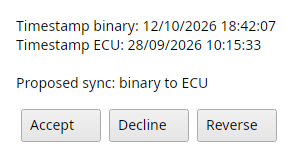
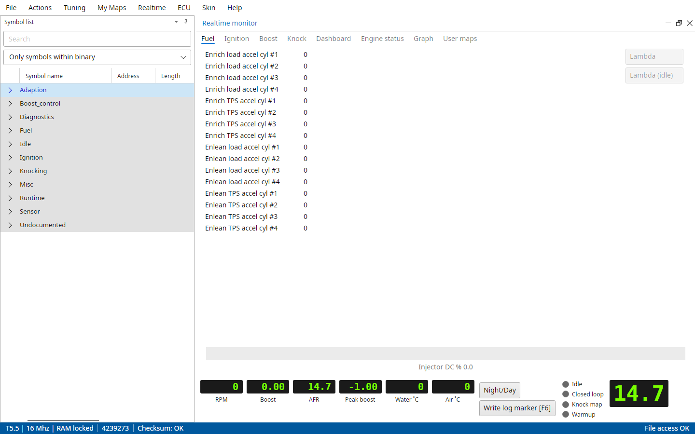
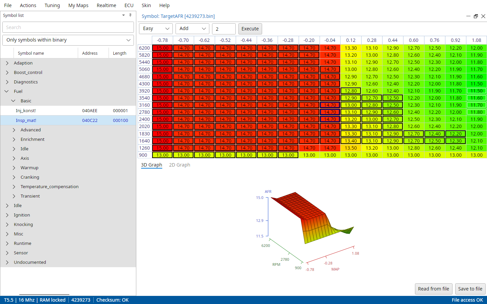
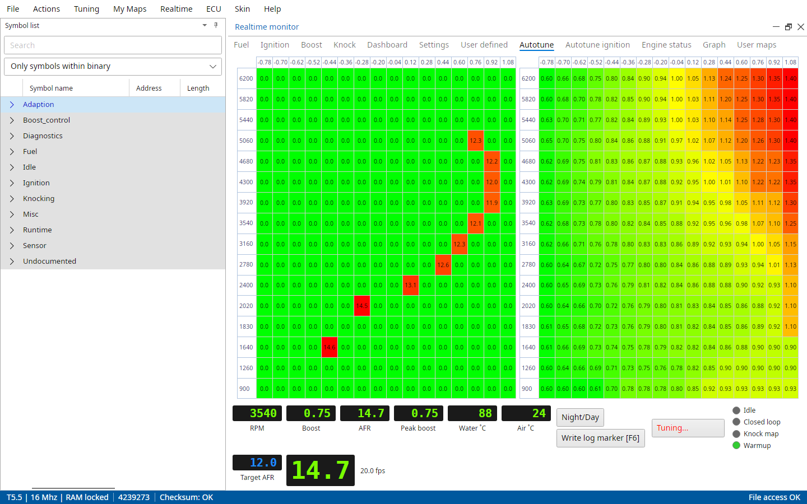
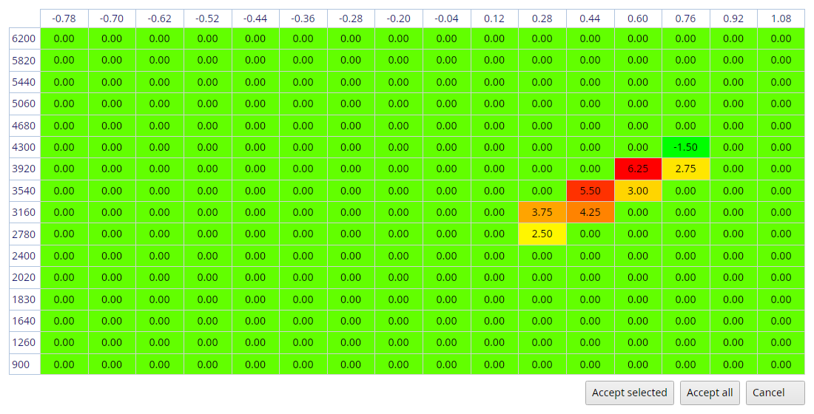

# Trionic 5 realtime

The Realtime menu's items only a T5 has, the T5 realtime panel and Autotune.

Once connected, TxSuite works on the ECU and the file together.
Map viewers show the SRAM content of the ECU, and saving a map writes it into the ECU and the file in one go.

## Data synchronization

When you connect, TxSuite compares when the file and the ECU were last changed.
If the ECU and the binary file are not in sync, it shows "Data synchronization" with both timestamps and the proposed direction, ECU to binary or binary to ECU.

{#fig-data-sync-t5 width=35%}

Accept
:   Synchronizes in the proposed direction.

Decline
:   Does nothing.

Reverse
:   Synchronizes the other way around.

Synchronizing reads every map from the ECU and compares it with the file, that takes a while.
The status bar shows "Sync: N%" and then "Synchronized".

## Realtime → Synchronize maps

Lets you synchronize maps between the binary file and the connected ECU, in the direction the timestamps tell.

## Realtime → Compare ECU with binary

This option checks all differences between the ECU and the binary you've loaded.
It takes an SRAM snapshot first, next to the bin, and shows the differences as Actions → Compare binary to SRAM snapshot does.

## Realtime → Configure realtime panel

Allows you to configure the realtime panel in offline mode.
This way you can pre-configure the panel before even starting your car.
Realtime → Toggle realtime panel then starts it.

## The realtime panel

Once you've started the realtime panel and the canbus connection is running, it should look something like this:

{#fig-realtime-panel-t5 width=100%}

The strip at the top is on every tab: rpm, temperatures, AFR (click it for lambda), boost and peak boost, and the LED's Idle, Closed loop, Knock map and Warmup.
Night/Day switches the panel to dark colours, Write log marker [F6] writes a marker into the log.

You can watch and edit maps which hold a relation to tuning boost in the Boost tab.
The Ignition tab will get you access to ignition related maps etc.
You can directly start a map viewer by clicking the "Edit maps" button, which offers the maps of that tab.

Fuel, Ignition, Boost and Knock
:   The values that matter for each, with switches for Lambda, Lambda (idle), APC control and Knock control.

Dashboard
:   Speed, torque, power and their peaks, ignition and consumption.

Settings
:   Switches for the program mode (Pgm_mod!) flags in the ECU, read back after every change.

User defined
:   Your own list of symbols, as the free logging list of the other ECU's.
    The symbol menu's Add to realtime list adds a symbol from the symbol list.

Autotune and Autotune ignition
:   The autotune sessions, see below.

Engine status
:   The 40 status bits of Pgm_status as LED's.

Graph
:   The values over time, right-click to choose the lines.

User maps
:   Maps you added with the symbol menu's Add to realtime user maps.

Settings, User defined, Autotune and Autotune ignition only show with File → Settings → T5 → Advanced mode enabled.
Each tab only reads the values it shows, so the panel stays fast.

## Realtime → Clear knock counters

Allows you to reset all the knock counters in the ECU to zero.

## Realtime → Knock map snapshots

With File → Settings → T5 → Knock counter snapshot after disconnect TxSuite saves the ECU's knock counter map every time you disconnect or stop the realtime panel (T5.5).
This lists them with their total number of knocks.
Ok shows one, Compare shows the difference between two.

## Realtime → AFR maps

Show AFR target map
:   Lets you set your desired AFR values for each load and rpm point for this binary file.
    After logging with a wideband lambda sensor you can compare the target values to the feedback values.

Show AFR feedback map
:   Shows you the measured average values from the realtime sessions you have done for this binary file.

Show AFR error map
:   Shows you the difference between the target AFR values you have entered (or the default ones) and the measured feedback values.

Show idle AFR target map, Show idle AFR feedback map and Show idle AFR error map
:   The same for the idle fuel map.

Generate AFR target map
:   Lets you generate a new default AFR target map based on certain properties in the binary.
    If you use big injectors, the target for low rpm and low load will be richer for example.

{#fig-afr-target-t5 width=100%}

The maps are kept in an `AFRMaps` folder next to the file.

## Realtime → Toggle Autotune

Starts and stops Autotune fuel [Shift+F5], the same as the Autotune fuel button in the panel.
Advanced mode only.

[Autotune criteria]{.underline}

For Autotune to become available you will have to meet certain criteria.

- You will have to be in advanced mode
- File → Settings → T5 → Use wideband lambda through symbol must be on, a wideband on a com port doesn't count
- Engine temperature should be over 70 degrees Celsius
- RAM should be unlocked, or the ECU won't take the changes

The Autotune fuel button shows in advanced mode.
Click it and the session starts, or TxSuite tells you what's missing.
The tab is then switched to "Autotune".
Here you can see which cell in the fuel map is active and which cells are measured by Autotune with what AFR value.
The moment Autotune is activated the software switches off closed loop control in the ECU by altering the Pgm_mod! symbol accordingly.
This also switches off purge control because purging will occur only when the system is running in closed loop.
While running the Autotune algorithm constantly checks whether all runtime criteria for making adjustments are met.
These criteria are:

- No enrichment after fuelcut is allowed
- System is not allowed to run in the idle map, unless Allow idle map autotune is on
- Purge is not active
- Cooling water temperature enrichment is finished
- Afterstart enrichment is finished
- Closed loop control is inactive
- Engine should be warmed up
- Fuelcut is not active
- Knock map is not active

Optionally when Discard AFR measurements with fuelcut is active in the Autotune settings:

- Cylinder 1-4 should not be in fuelcut mode

Optionally when Discard closed throttle measurements is active in the Autotune settings:

- Throttle plate is not allowed to be fully closed

If all runtime criteria are met the algorithm measures AFR values through the wideband lambda input and determines the cell in which it should average this value by means of current engine speed and manifold pressure.
Depending on the mode in which Autotune is running (direct update or user approve) it updates the fuel map in the ECU [or]{.underline} it stores the averaged value in memory.
In the latter case it shows the user a proposal for adjustments to be made after the Autotune session is ended.

{#fig-realtime-autotune-t5 width=100%}

After the Autotune session, the software will show you a map in which the cells to be corrected are highlighted and showing the percentages to correct the fuel map.

{#fig-autotune-accept-t5 width=85%}

You can cancel this session, accept the selected cells (Accept selected, after selecting the cells you want to correct) or accept all suggested corrections (Accept all).
TxSuite will save all mutated data into the ECU and the file.

With Auto update fuel map on, TxSuite asks "Keep adjusted fuel map?" when the session stops, No puts the original map back.
Closed loop is switched back on when the session stops, also when you disconnect or flash in the middle of it.

## Realtime → Autotune ignition

Starts and stops Autotune ignition, T5.5 and advanced mode only.
It needs the realtime panel running and knock control on, the Knock control switch on the Knock or Settings tab.
It advances the cells of the ignition map (Ign_map_0!) in the ECU step by step while the engine runs without knock, and retards and locks a cell when it knocks.
Cells below the knock pressure limit aren't touched.
The steps and limits are in File → Settings → T5 → Autotune settings.
When the session stops TxSuite asks "Keep adjusted ignition map?", No puts the original map back.

## Realtime → Ignition lock map

Opens the ignition map with a padlock on every cell Autotune ignition locked.

## Realtime → Release locked ignition cells

Unlocks every cell, so the next Autotune ignition session can advance them again.
