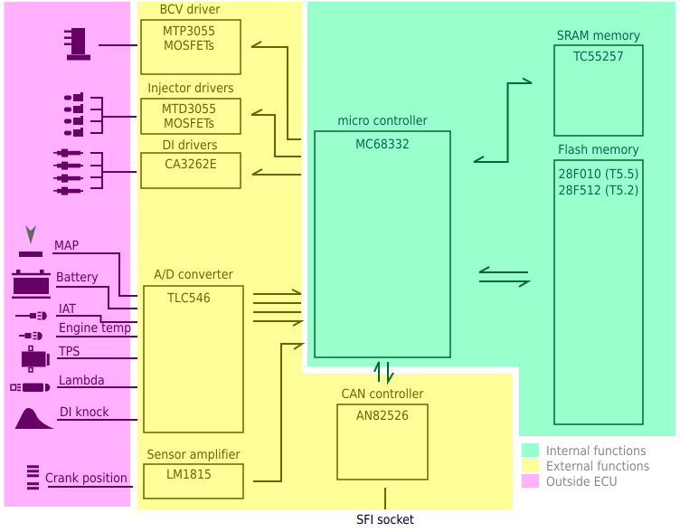
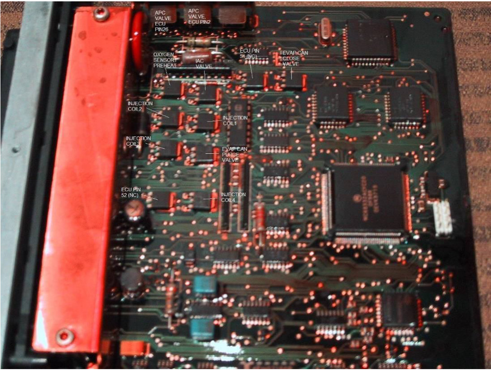
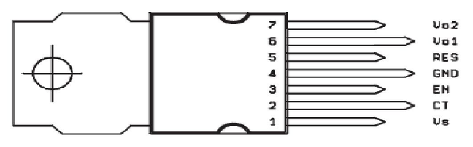
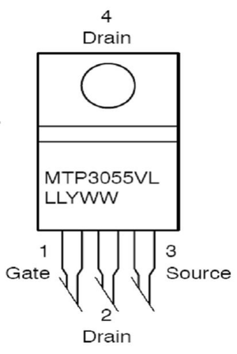
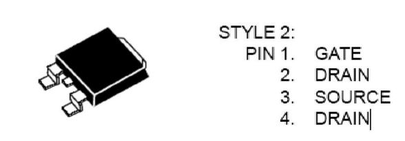
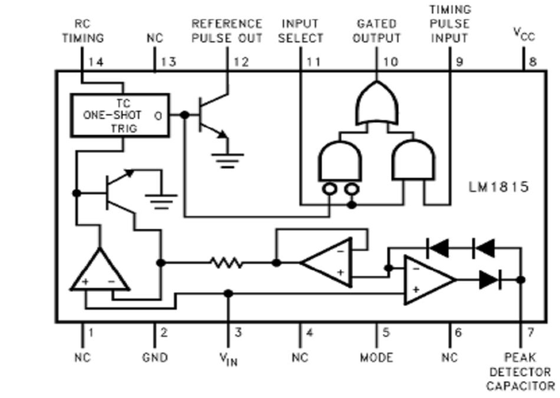

# Hardware {.advanced}

The T5 is build around a Motorola MC68332 microcontroller.
This is a 32 bit controller that handles the entire engine management including fuel injection, ignition timing, knock control, diagnostics and boost pressure control.

The processor has a large 2Mb (256 Kbyte) flash memory (only 1Mb for T5.2) to its disposition for fetching program code and maps.
This memory is divided into two physical flash chips (28F010 for T5.5, 28F512 for T5.2) that each holds half of the program memory.
Saab has made it a little harder to reverse engineer the T5 by having all even bytes of program memory written to one chip and all uneven bytes to the other.
So, byte 0 is in the first chip whereas byte 1 is in the second one, and so on.
Of course some RAM memory is present in the form of a 256 Kbit SRAM TC55257 chip.
This results in 32 Kbyte of RAM.
The board also contains a AN82526 (CAN Controller), a TLC546 (8 bit A/D converter), and a LM1815 (Sensor amplifier).
This sensor amplifier is used for crank shaft position sensing.

## Integrated circuit list

The table below lists almost all IC’s on the board.
This is just to give you an idea on what to expect.

| Partnumber | Function                             | Usage                      | # on board |
|------------|--------------------------------------|----------------------------|------------|
| MC68332    | Main micro controller                | All functions              | 1          |
| 28F010     | 1 Mb flash memory                    | Storage of program         | 2          |
| TC55257    | 256 kb SRAM                          | Runtime memory             | 1          |
| L4937      | Dual multifunction voltage regulator | Power supply on board      | 1          |
| AN82526    | CAN interface                        | Communication              | 1          |
| TLC546     | A/D converter (19 inputs)            | Sensor reading             | 1          |
| LM1815     | Sensor amplifier                     | Crankshaft sensor          | 1          |
| L9842      | Octal Power Driver                   |                            | 2          |
| 74HC00     | Quad positive NAND gate              |                            |            |
| 74HC02     | Quad NOR gate                        |                            |            |
| 74HC03     | Quad NAND gate (open drain)          |                            |            |
| 74HC14     | 6 Hex inverting schmitt triggers     |                            |            |
| 74HC74     | Dual D type flip-flop                |                            |            |
| 74HC123    | Dual monostable multivibrator        |                            |            |
| CA3262E    | Quad 700 mA driver                   | DI triggering              | 1          |
| TLC274     | Quad op-amp                          |                            |            |
| MTP3055V   | N-channel MOSFET TO-220              | BCV drivers (high current) | 3          |
| MTD3055VL  | N-channel MOSFET DPAK SMD            | 4 Injector drivers         | 10         |
|            |                                      | 2 EVAP purge valve drivers |            |
|            |                                      | 1 O2 sensor preheating     |            |
|            |                                      | 1 Vacuum pump driver       |            |
|            |                                      | 1 IAC valve driver         |            |

## Block schematic diagram

{width=100%}

In 1994- Trionic (T5.5) there is a slotted disk attached to crankshaft which is read with an inductive pickup sensor.
Each time a slot and a bridge in the disk moves past the sensor the reluctance of the magnetic circuit variates and thus a signal can be acquired.
There is one bridge missing in this disk and that is used to determine the TDC.
The signal from the sensor is converted to a usable signal for the ECU by the LM1815.

Trionic is an all sequential injection system meaning that each dose of fuel is calculated for each cylinder in ignition sequence.
There is a lot of sensor data (like engine coolant temperature, manifold absolute pressure (MAP), manifold air temperature (MAT)) that is used for calculating the injector open time.
Also, several constants are used like engine volumetric efficiency at a certain point of load (a matrix of rpm and manifold pressure), injector constant, battery voltage table etc.
Even further, this is still adjusted by variables like lambda feedback and throttle position sensor delta from previous position of it (acceleration enrichment and deceleration enleanment).

There are three different hardware versions of T5.
In 1993 Trionic 5.2 was used with engines B324R and B234L.
In 1994 Trionic 5.5 came to all engines (in 9000, NG900 turbo only) and from 1996 on Trionic 5.5 was updated with faster CPU (20 MHz, to cope with ODBII requirements) and flash memories (90 ns access time).

The ignition switch (+15, pin 60) on the Trionic 5 box controls the internal +12 volt regulator.
When you turn off the ignition, the CPU and others will power down too.
There is apparently a delay circuitry on the board which will turn on the box after about 15 minutes for updating adaptive injection tables etc.

## PCB details

The PCB layout is not entirely known of course because SAAB did not release details about this, even in the service manuals.
Finding out how things are setup is not so very difficult though, once you know what the system should do and what hardware components are on the board.

The image will give you some idea on what is what on the board.

{width=87%}

### Power supply

The board is powered by the car battery.
The input voltage (+11V - +14V) is transformed to a usable voltage by the L4937 (Voltage regulator).
The input voltage (from the battery) is supplied to pinnumber 1 on the regulator.
The output voltages (Vo1 and Vo2) are stabilized +5 volt which can sink 50 mA and 500 mA respectively.
The Vo1 is a standby voltage.
If the ignition is turned off an RC network will keep the power supply in operational state for a while and then lets it resume into standby modus in which the power drain is significantly lower.
The maximum standby current the regulator can sink is 50 mA.
Nice to know is that the regulator can supply its +5 volt output when the input ranges from +6V up to +28V (with transient spikes up to +40V).
When starting a car the battery voltage can drop as low as 6-7 volts when the battery is not in tiptop shape.
The regulator is located opposite to the MOSFETs that drive the boost control valve.

{width=59%}

### DI cartridge triggering

The DI cartridge has a trigger input for firing the four individual sparkplugs.
These are triggered by signals from the ECU on pin 9, 10, 11 and 12 which are generated in the power driver IC CA3236 on the Trionic PCB (topside, 16 pin DIL housing).
Internally these four pins are connected as shown in the table and the image below.

| DI cartridge pin | ECU pinnumber | CA3236 pinnumber | Description        |
|------------------|---------------|------------------|--------------------|
| 2                | 9             | 1 (OUT A)        | Trigger cylinder 1 |
| 3                | 10            | 3 (OUT B)        | Trigger cylinder 2 |
| 4                | 11            | 6 (OUT C)        | Trigger cylinder 3 |
| 5                | 12            | 8 (OUT D)        | Trigger cylinder 4 |

{width=30%}

### BPC drivers (MTP3055V)

The ECU pulses the boost control valve in order to bleed air pressure to the wastegate or to the compressor housing and thus controlling the charging pressure of the turbo.
The boost control valve is simply a set of coils that control the position of a metal plate in the valve to determine how much air should pass in one direction and how much air should pass in the other direction.
Driving the coils with enough energy for them to be able to shift the plate to one side or the other needs more current than the microcontroller can deliver by itself.
The outputs of the controller could never sink enough current for the coils so a current amplifier is needed.
The FETs (Field Effect Transistors) used by default don’t conduct current.
When a tiny amount of current starts flowing through the gate suddenly the circuit Source – Drain will conduct current.
In this way we have a current amplifier (also called electronically activated switch, as one could indeed characterize a FET) and the microcontroller can determine when to flow large amount of current (and thus energy) though the coils in the valve.
Pulsing the coils in the right frequency and pulse width now controls the amount of air pressure applied to the wastegate actuator.

The image below shows the FET used for driving the coils in the valve and a schematic diagram of how this is setup to work.

{width=45%}

{width=23%}

### Injector drivers (MTD3055VL)

Since fuel injection also relies on a solenoid valve to open and close the injector Trionic needs power drivers for these too.
These smaller packages can supply the same amount of current as the TO-220 packaged ones that are used for the boost control valve, but the resistance in the conducting state is slightly higher.
The way the MOSFETs are used is very similar to the boost control valve.

{width=45%}

### Crankshaft position sensor (LM1815)

The crankshaft sensor signal needs to be amplified before the microcontroller can interpret it.
This amplification is done by the LM1815.
It is probably used in adaptive mode (mode 1).
In this setup the signal from the VR pickup sensor for the crankshaft position is (filtered) supplied to pin 3 (Vin).
The nice square wave signal is picked up from pin 12 (reference pulse out) and supplied to the microcontroller for timing and counting.

{width=53%}

### Analogue to Digital converter (TLC546)

| input# | HW address | ECU pin | TLC546 pin    | Description                                 |
|--------|------------|---------|---------------|---------------------------------------------|
| 0      |            |         | 1 (INPUTA0)   | AD_trot, Throttle Position, 0-5 volt, 0-255 |
| 1      |            |         | 2 (INPUTA1)   |                                             |
| 2      | 0xFFFD0D   | 68      | 3 (INPUTA2)   | AD_kylv, Coolant temp, 0-5 volt, 0-255      |
| 3      |            |         | 4 (INPUTA3)   |                                             |
| 4      | 0xFFFD0B   | 44      | 5 (INPUTA4)   | AD_knock                                    |
| 5      | 0xFFFD08   | 46      | 6 (INPUTA5)   | AD_lufttemp                                 |
| 6      |            |         | 7 (INPUTA6)   |                                             |
| 7      |            |         | 8 (INPUTA9)   |                                             |
| 8      | 0xFFFD05   | 23      | 9 (INPUTA8)   | AD_sond (0-1.3 volt, 0-80)                  |
| 9      | 0xFFFD07   | 70      | 10 (INPUTA9)  | AD_cat (0-1.3 volt, 0-69)                   |
| 10     |            |         | 11 (INPUTA10) |                                             |
| 11     |            |         | 12 (INPUTA11) |                                             |
| 12     |            |         | 13 (INPUTA12) |                                             |
| 13     |            |         | 15 (INPUTA13) |                                             |
| 14     |            |         | 16 (INPUTA14) |                                             |
| 15     | 0xFFFD03   | 69      | 17 (INPUTA15) | AD_EGR (0-5 volt, 0-255)                    |
| 16     |            |         | 18 (INPUTA16) |                                             |
| 17     |            |         | 19 (INPUTA17) |                                             |
| 18     |            |         | 20 (INPUTA18) |                                             |
