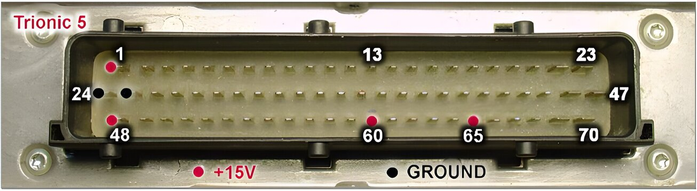
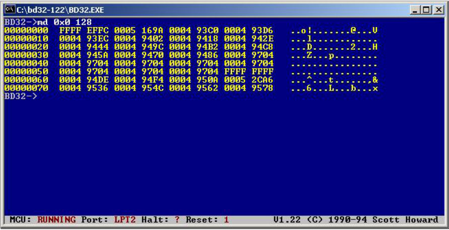
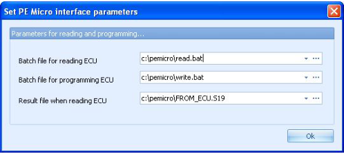
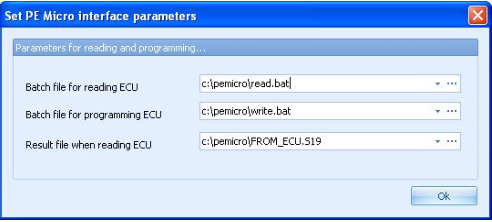

# Flash

***Important note!***

*The flash memories in the T5 ECUs are starting to get old and writing to the flash does not always work.
If this should be the case the ECU will be inoperable and the only way to fix it is to physically replace the flash chips on the board.
Unfortunately there is no way to determine the status of the flash in advance.
Please do not flash if you only have one ECU and you really need it to drive your car.*

The binary file that consists of 256 kilobyte of program code (128 kB for T5.2) can be downloaded from the ECU in several ways.
One option is to remove the PLCC32 flash chips from the board and read the program code from the chips in a programmer (for example the well known Willem programmer).
Because this requires special tools (or a very skillful hand) that are not very common this is not the ideal way.
The advantage is that sockets can be mounted on the board once the chips have been desoldered.
This way, new firmware can be flashed with a normal flash programmer.
The other way to download the code is to hook up a BDM (background debugger module) to the ECU and use BD32.exe to download the code from the flash with the ECU running (not in a car though, on the bench ☺).
Last but not least, the binary file can be downloaded from the ECU through a Canbus interface for which you need an adapter and some wiring.
More will be written about this later in this document.

## Using public domain LPT BDM interface

To download the code you’ll need to have a T5 on your desk, a power supply that can supply +12 volts regulated, some wiring, **a Win9x (!!!) or DOS PC** with a parallel port, a BDM interface (see appendix III for more information), a 8 pin DIL header, a soldering iron, the BDM software (<http://trionic.mobixs.eu/bd32-122.zip>), the T5dumper scripts available from the <http://trionic.mobixs.eu> and some patience.

- Open the ECU by removing the six small torx screws.
- Locate the 8 pin header pads on the top side of the board and solder the 8 pin header onto it.
- Connect the power wires to the ECU as shown in @fig-t55-pinout.
  See appendix II for more information about T5 pinout.
- Connect the BDM interface to your computers parallel port.
- Connect the BDM interface to the 8 pin header you’ve soldered onto the board.
  See appendix III for information about pinout.
- Power up the ECU.

### Prerequisites

- BD32 must be installed and working (see appendix XII).
- The BDM interface must be connected to the T5 ECU and to the computer.
- The T5 ECU must be powered up.

### Install FlashT5

- Download FlashT5 from <http://trionic.mobixs.eu>
- Unpack the files in the same directory as BD32 is installed in.

### Prepare ECU for flash management

- In BD32 give the command: "do prepT5.do".
  This will start a script that prepares the processor in the ECU for flash management.
  Among several things this script will disable the watchdog, set up registers to allow writing to flash and tell BD32 where to load the target resident program.

### Dumping flash memory

This step is not necessary but can be used to verify that the content of the flash really is changed.
It is a good idea to always make a backup of the flash before you start writing to it.

- In BD32 give the command: "dumpT5 filename.bin”.

*filename.bin can be replaced with a file name of your choice as long as you stick with the 8.3 format (so 8 characters for filename and 3 for extension).
BD32 will now download a target resident program that reads from flash and sends the information to BD32.
You will see a number of dots appearing in BD32 during the copying.
When you return to the BD32 prompt you will have successfully downloaded the flash content.*

### Flashing the ECU

- Read Important note above!
- In BD32 give the command: "flashT5 filename.bin"

*filename.bin should be replaced by the name of the binary file that you want to write to flash (stick with 8.3 format here as well).
BD32 will now download a target resident program flashT5.d32 to the processor in the ECU and execute it.
The target resident program and BD32 cooperates during the flashing (BD32 takes care of file handling and the target resident program handles writing to flash).
During the flashing you will see a number of dots being printed in BD32.
This will stop when the flashing is completed and the command prompt of BD32 will appear.*

### If you run into a problem

If you run into problem when you are flashing try this:

- Double the delay parameter.
- The bottom field in BD32 should report "MCU: STOPPED" while you are using flashT5.
  If you for some reason have given the reset command you need to run the prepT5.do script again in order to setup the registers and stop the MCU.
- If you get an Erase Error or Program Error message it is likely that your flash cannot be written to (see Important note above).
  You can try flashing a couple of more times but it's likely that the ECU no longer can be used.

{height=1.2em} *For T5.2 there is a different script (dumpt52) which is available from <http://trionic.mobixs.eu/FLASHT5ANDT52.zip>*

{#fig-t55-pinout width=100%}

{#fig-bd32-memory-display width=100%}

## Downloading with PEMicro USB BDM interface

Install the PEMicro device driver as described in the PEMicro documentation.

Install the PEMicro software as described in the PEMicro documentation.

Create a read batchfile for your settings as shown below in an example.

The read batchfile should be something like this.

```
c:\pemicro\pkg32z\cprog32z.exe c:\pemicro\READ_AMD.CFG Interface=USBMULTILINK Port=USB1 bdm_speed 2 ?
```

The READ_AMG.CFG file should contain these statements:

```
RE
CM c:\pemicro\T5_AMDalgo.32P 0
UM c:\pemicro\FROM_ECU.S19
```

The read batchfile should be tailored to your specific needs.
If you installed the PEMicro software in another location then C:\\Pemicro, the batchfile should be altered likewise.

Once you’ve got the batchfile running you can enter it as a parameter in T5Suite.

The config file tells which filename should be used by the PEMicro software.
In the example the filename is FROM_ECU.S19.
Make sure this result file is the same as in the read batchfile.

{width=56%}

## Flashing with PEMicro USB BDM interface

Create a write batchfile for your settings as shown below in an example.

The write batchfile should be something like:

```
c:\pemicro\pkg32z\cprog32z.exe c:\pemicro\WRITE_AMD.CFG Interface=USBMULTILINK Port=USB1 bdm_speed 2 ?
```

And the WRITE_AMD.CFG file:

```
RE
CM C:\pemicro\T5_AMDalgo.32P 0
EM
BM
SS c:\pemicro\TO_ECU.S19
PM
VM
RE
```

T5Suite creates a TO_ECU.S19 automatically when writing to the ECU so this filename should also be used in the write config file.

{width=55%}

## Checksum {.advanced}

The firmware uses a checksum over the flash contents.

This checksum is a simple 32 bit addition of all bytes in the flash up to the part where the program code ends.
The end of the program code can be found programmatically by reading a footer field with identifier 0xFE.
This field indicates the last byte in the binary that belongs to the program code.
This byte is the last byte that should be calculated in the checksum.

Normally this is immediately after a certain marker.
This marker is 4E FA FB CC for normal binaries.
If you alter any code between 0x00000 and the endmarker the checksum will have to be updated.
The checksum verification and update routines are also implemented in T5Suite.
