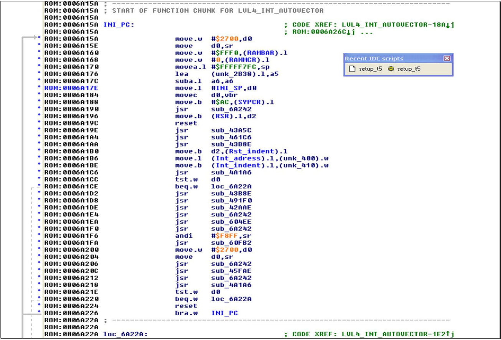

# Firmware {.advanced}

## General

Once you are done with dumping the flash contents and you want to do more than only alter variables and maps you can start analyzing the binary.
This is a difficult task because there are a lot of different firmware versions, stock ones – maybe different per MY and tuned ones that differ for every manufacturer and stage.
In every case the code can be disassembled using a 6833x disassembler like the one in IDAPro.
There are scripts available to automatically disassemble the code and make it more readable by replacing addresses by variable names that are extracted from the symboltable inside the binary.

## Memory map {.advanced}

*T5.5*

```
0x00000 – 0x07FFF = SRAM
0x40000 – 0x7FFFF = FLASH (program memory)
```

{height=1.2em} *T5.2*

```
0x00000 – 0x07FFF = SRAM
0x60000 – 0x7FFFF = FLASH (program memory)
```

## Disassembling the code {.advanced}

To convert the binary flash file to readable assembler language we now have to disassemble the binary.
This can be done by any 68332 disassembler but I recommend using IDA Pro (Interactive Disassembler Professional).

To get the code disassembled in IDA Pro you need to do at least these steps.

- Open the bin file in IDA Pro.
- Select processor type Motorola 68300 series (this tells the program which disassembler to use).
- Set up memory maps for RAM and ROM (offset and length), so RAM = 0x00000 to 0x40000 and ROM 0x40000 to 0x80000.
  ({height=1.2em} for T5.2: 0 – 0x60000 and 0x60000 to 0x80000).
- Look up the second double word (after FFFF F7FC) in hex view in the binary file, this is the boot vector for the binary.
- Go to the address given by the second double word in IDA Pro.
- Press C (starts analysis).

There is an easier way to do this but you will need a script that has been made by sandy_rus which is available from <http://www.ecuproject.com>.

TxSuite's File → Generate Idc file writes an IDC script for the symbol table next to the bin, `<bin>-autogen.idc`, that IDA Pro can run.

Another route is to use the – simpler – disassembler that has been build into TxSuite, Actions → Show disassembly.
It saves the listing next to the bin as `<bin>.asm`.

{#fig-disassembly width=100%}
