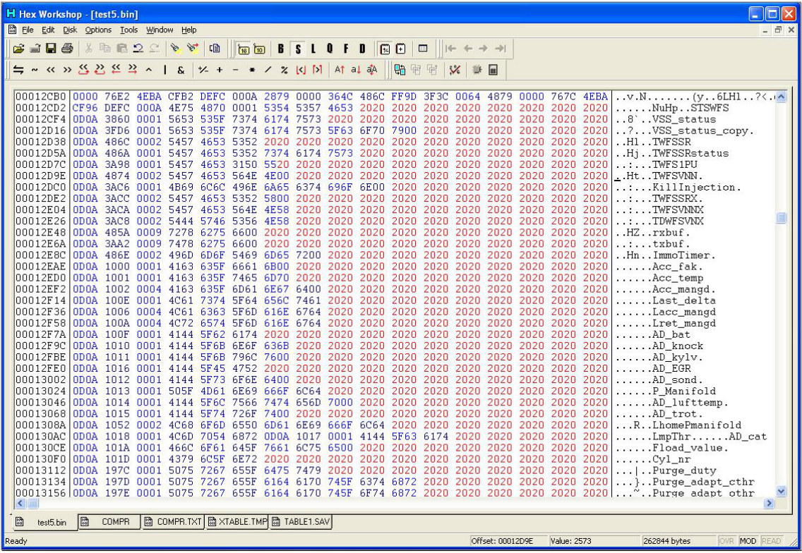
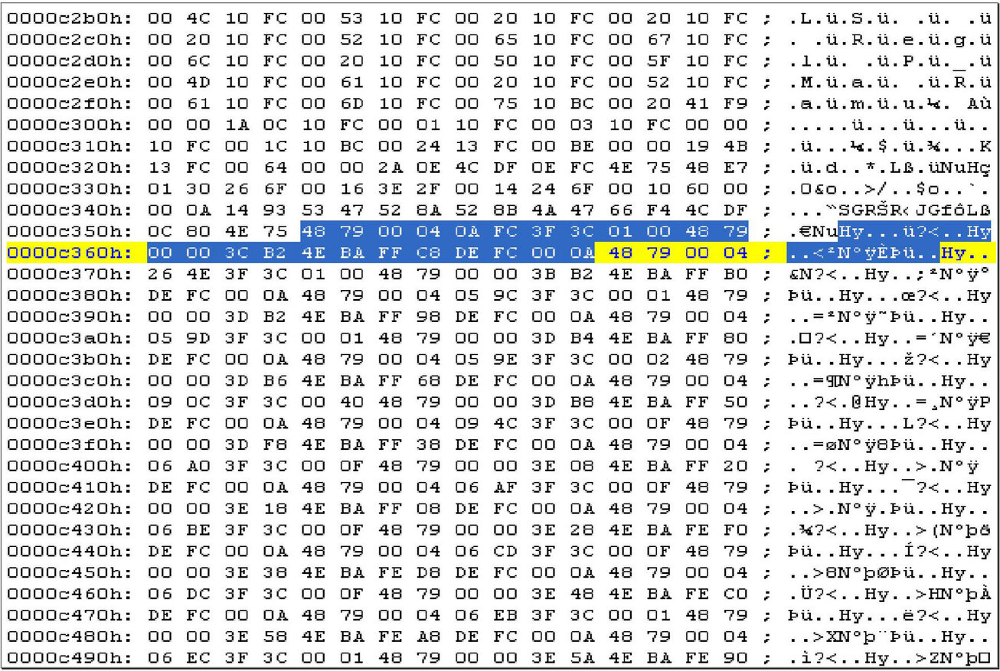
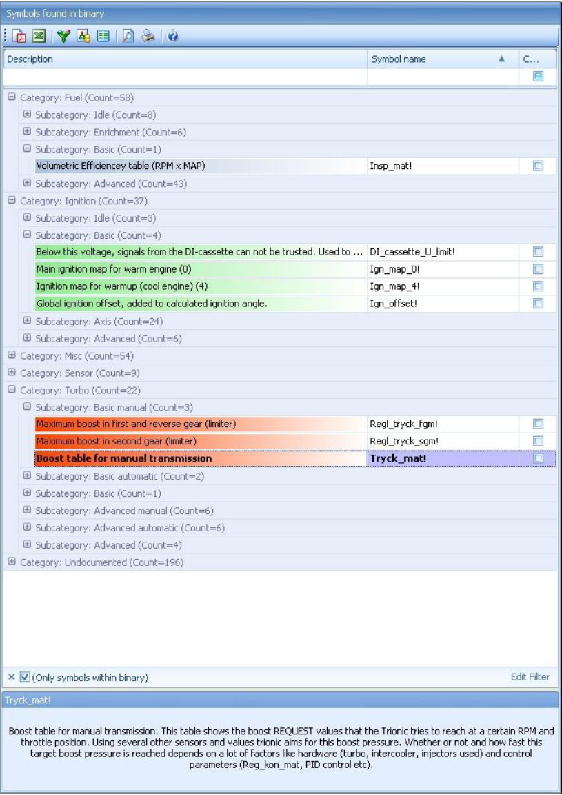

# Symbol tables {.advanced}

## General

Each T5 firmware file contains a symbol table describing data structures in the program.
These symbols can be extracted together with their corresponding memory addresses (ROM and RAM).
The SIM - “System Integration Module” - registers in the MC68332 show how the memory is mapped.
See Motorola user manual for register addresses.
For T5.5 the RAM starts at 0x00000 and the ROM starts at 0x40000.
{height=1.2em} T5.2 ROM start address is 0x60000.
@fig-symbol-table-firmware gives a general idea on what these symbol tables look like.

Column 1: Symbol delimiter (0D0A)\
Column 2: Symbol SRAM address\
Column 3: Symbol Map number of bytes

{#fig-symbol-table-firmware width=100%}

While examining the symbol table you can see that the separator is 0x0d 0x0a.
The next two bytes are the SRAM address where the variable can be found and the two bytes after that are the length of the variable.
You can see this clearly where two variables are sequentially in the symbol table.
For example:

```
00ED5E: 19 BC 00 50 41 4D 4F 53 5F 74 65 78 74 00 - ...PAMOS_text.
00ED6E: 1A 0C 00 05 41 4D 4F 53 5F 73 74 61 74 75 73 00 - ....AMOS_status.
```

First var: AMOS_TEXT, Starts at 0x19BC with length 0x50.

Adding 0x50 to 0x19BC results in 0x1A0C which is exactly the starting address for the next variable: AMOS_Status which has a length of 0x05.

Note that these are the SRAM addresses in which the runtime instance of the symbol can be found.
From a tuning perspective, this is only interesting when we want to alter or view the variables while the car is running.
Otherwise, we need the addresses in flash for each symbol.
This can be done by converting the sram address to flash address using the lookuptable that is actually in the flash.
The conversion is not really complex once you know how to proceed.
The firmware copies a lot of symbols (tables or maps) to SRAM when the ECU is booted.
For the firmware to do this, it needs the addresses for the symbols in SRAM as well as the flash addresses.
So, there is a lookup table in the binary that contains all this information.

[Finding start of symbol table:]{.underline}\
Search binary for string 00 0A 28 79 00.
If the byte after this is a 07 the file is T5.2.
If the byte after that is 00, the file is T5.5.
From the found address find the next 4E 75 record and skip 2 bytes.
This is the start of the symboltable.

[Finding start of addresslookup table:]{.underline}\
Search binary for 4E 75 48 E7 01 30 26 6F 00 16 3E 2F 00 14 24 6F 00 10 60 00 00 0A\
From the found address (+ length) find the first : 4E 75 48 79 and we found the start of the addresslookuptable.\
In your typical hex editor this will look something like this:

{#fig-address-lookup-table width=100%}

The starting address for the selected symbol is 00040AFC which is in the flash address range (see chapter: memory map).
After subtracting 0x040000 ({height=1.2em} T5.2: 0x60000) from it this gives us the address in the binary, 0x0AFC.
The symbol which belongs to this address has SRAM address 0x3CB2.
While writing this document I haven’t figured out what the other information contained in the lookup table means.

To save you the time to lookup all addresses manually the T5Suite application will extract all symbol information in one run.
Symbol name, SRAM address, flash address and length will be displayed all together.
Some symbols don’t have a corresponding flash address although they do have an sram-address.
These are runtime only symbols that are used by Trionic (variables, buffers etc).

This @fig-symbol-table-screenshot will give you an idea of what the symbol table should look like once it has been extracted.
See appendix I for a complete list of known symbols.

{#fig-symbol-table-screenshot width=91%}

When the user double clicks one of the symbols that has a flash address attached to it, T5Suite will display the corresponding symbol in a viewer.
This viewer will display the data in table form was well as in graphical form.
