# Maps

## General

A lot of maps in the T5 are not only made up of a piece of raw data.
It also includes x-axis and y-axis information.
For example, the ignition map is called ign_map_0!.
There are also 2 symbols called ign_map_0_x_axis and ign_map_0_y_axis.
These last two symbols hold the axis configuration for the ignition map.

## Adaption limiting

The system continuously adapts tables that it holds in SRAM to fine-tune the injection, boost and ignition to the current hardware setup, the fuel used etc.

It uses some initial values in adaption tables – mostly 0x80 – to which it adds or from which it subtracts steps to get the engine running as smooth and economically as possible.
To prevent the values to fall or rise too much, mostly a maximum and minimum is set.
This is shown by the symbols “Adapt_injfaktor_low!” and “Adapt_injfaktor_high!” perfectly.

In a sample binary these values are: 0x66 and 0x9A.
The initial adaption value is 0x80 in symbol “Adapt_inj_imat!”.

Another sample is symbol “Adapt_korr!” which holds an entire (initial) adaption map in flash.
It is copied to sram when the system first boots and the table is empty.
It is filled with 0x80 in flash.
The symbols “Adapt_korr_low!” (0x4D) and “Adapt_korr_high!” (0xB3) hold the minimum and maximum values for this adaption map.
If the adaption runs out of its boundaries a CEL (Check Engine Light) will be thrown.

## Fuel

### Fuel injector valves

The fuel injector valves are of a solenoid type with needle and seat.
They are opened by a current flowing through the injectors coil and are closed by a strong spring when the current is switched off.
To ensure as optimal combustion as possible and low exhaust emissions at the same time, the injectors are equipped with four holes, which gives a good distribution of the fuel.
The squirts of fuel are very precisely positioned (two jets on the backside on each inlet valve).
This puts very high demands on the fixation of the injectors.
To secure this fixation the injectors are fixed in pairs by a special retainer between cylinders 1 – 2 and 3 – 4.
The injectors are electrically supplied from the main relay, while the ECU grounds the injectors.

### Pre injection

When the ignition is switched on, the main relay and fuel pump relay are activated during a few seconds.
As soon as the ECU gets the cranking signal (from crankshaft sensor) it initiates a coolant dependant injection with all four injectors simultaneously, this ensures a fast engine start.
If the engine is started, and shortly after is switched off again, a new pre injection is initiated after 45 seconds waiting time with the ignition switched off.

### Maximum torque

The fuel mixture determines (together with other factors like ignition advance) whether or not the engine can produce its maximum power.
The image below shows at what mixtures maximum torque can be achieved and at what mixture maximum economy may be had.

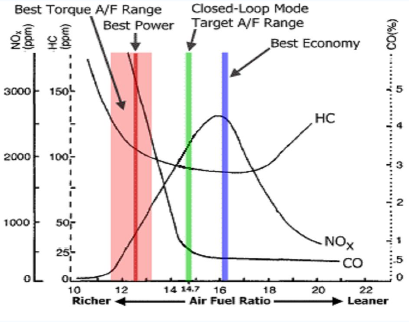{width=53%}

### Calculating of injection time

To decide how much fuel needs to be injected into each intake runner the ECU calculates the air mass that has been drawn into the cylinder.
The calculation makes use of the cylinder volume (B204 has a displacement of 0,5 liters per cylinder), this cylinder volume holds an equal amount of air which has a density and thus a certain mass.
The density is calculated using the absolute pressure and temperature in the intake manifold.
The air mass for combustion has now been calculated and this value is divided by 14,7 (stoichiometric relation for gasoline mass to air mass) to determine the required fuel mass for each combustion to inject.
Since we know the flow capacity of the injector and the density of the fuel (pre programmed values) the ECU can calculate the duration of the injection.

Using the oxygen sensor (front) the injection duration is corrected so we receive Lambda=1 (stoichiometric combustion).
When hard acceleration occurs the lambda correction is masked out and WOT (Wide Open Throttle) enrichment occurs for maximum performance.
When opening the throttle, acceleration enrichment occurs and when closing the throttle deceleration enleanment occurs.
During a cold start and warm up, before lambda correction is activated, coolant temperature dependent fuel enrichment occurs.
With a warm engine and normal battery voltage the duration of injection varies between 2,5 ms at idle and approx. 18 – 20 ms at full torque.

After the calculation for injection time a constant is used to determine the actual time for injector opening time.
This constant is also used for example to compensate for different fuel type (e.g. alcohol based fuels).
When using standard injectors on a turbo engine (should also be used on a N/A engine but according to EPC there are different injectors) with normal displacement the injection constant is 20-21 in easy mode in T5Suite.
The first calculation of injection time is:

$$
\text{Grund\_tid} = \text{Inj\_konst} * (((\text{Lufttemp\_faktor} + 384) * \text{P\_Manifold10}) / 512)
$$

Finally the volumetric efficiency table is drawn into the equation.
This table holds correction values for different manifold pressures and rpm sites.
This correction value ranges from ~0.5 to ~1.5.
[If a different engine is used, or for example a different turbo charger, this map should be adjusted.]{.underline}
Engine VE is determined by the hardware used (also see chapter: Volumetric efficiency).

You can see that the VE curve is steep, this is due that:

$$
\text{CorrectedValue} = \text{Grund\_tid} * ((\text{matrixvalue} + 128) / 256)
$$

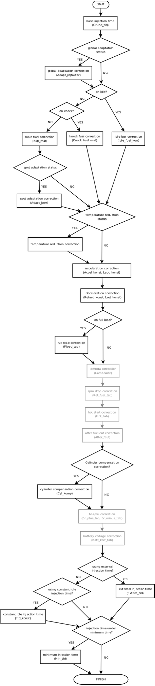{width=35%}

Note that the minimum injection duration is determined by the variable Min_tid!.
This variable normally has a value of 250. (1 ms) and that the battery voltage will adjust final duration through table Batt_korr!.

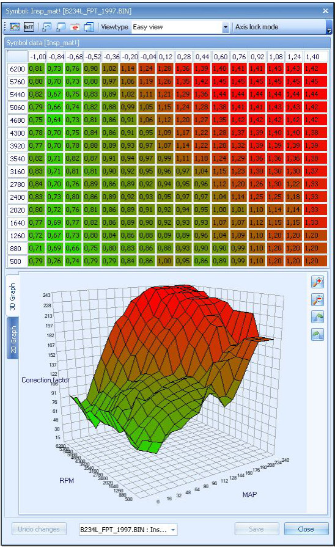{width=50%}

### Cranking enrichment

To facilitate a better start cranking enrichment is needed.
The factor that compensates which is coolant temperature dependant is stored in Startvev_fak! (what’s in a name).

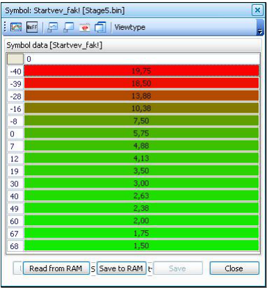{width=37%}

### Lambda correction

The catalyst requires that the fuel/air mixture is stoichiometric.
This means that the mixture is neither rich nor lean, it is exactly 14,7 kg air to 1 kg gasoline (Lambda=1).
That is why the system is equipped with an oxygen sensor in the forward part of the exhaust system.
The sensor is connected to pin 23 in the ECU and is grounded in the ECU via pin 47.
The exhaust fumes pass the oxygen sensor.
The content of oxygen in the exhaust fumes is measured through a chemical reaction, this results in an output voltage.
If the engine runs rich (Lambda lower than 1) the output voltage would be approx. 0,9 V and if the engine runs lean (Lambda higher than 1) the output voltage would be 0,1 V.
The output voltage swings when Lambda passes 1.
The ECU continuously corrects the injection duration so that Lambda=1 is always met.
To be able to function, the oxygen sensor needs to be hot, this requirement is met by electrically preheating the sensor.
The preheating element is fed by B+ via fuse 38 and the main relay, the sensor is grounded in the ECU via pin 50.
The ECU estimates the temperature on the exhaust gases (EGT) based on engine load and engine speed (RPM).
At high EGT the electrical pre heating is disconnected.
The lambda correction is masked during the engines first 640 revolutions after start if the coolant temperature exceeds 18˚C (64F) at load ranges over idle and under WOT, or 32˚C (90F) at idle.
Operation can be divided into two parts, open loop mode and closed loop mode.
In closed loop mode the feedback signal from the lambda sensor is used to keep the mixture stoichiometric (approx. 14.7 : 1) while in open loop mode the system only depends on the maps, no feedback from the lambda sensor is used to compensate for lean or rich mixture.
The point where the system switches from closed to open loop mode is determined by a couple of maps of which the most important one is: Open_loop!
This map indicates the load levels for each rpm site from which the system should run in open loop mode.
This is also indicated in T5Suite in the main injection map and the fuel knock map.
The load levels in knock mode are different from the ones for normal mode operation and are stored in Open_loop_knock!

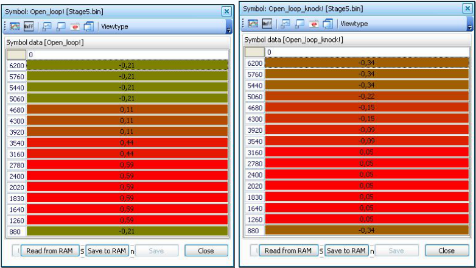{width=94%}

### Acceleration and deceleration

When going into transients for pedal position the throttle opening changes fast.
Suppose we floor the pedal suddenly while cruising at 2500 rpm.
The sudden opening of the throttle draws much more air into the engine but because of the sudden ‘rush’ the fuel which is hanging in the air cannot follow in the same rate.
Hence, the mixture goes lean even if we supply enough fuel.
This is why we need acceleration enrichment (and deceleration enleanment).
When pressing down or releasing the accelerator pedal Trionic tries to maintain Lambda at 1.
This is done by fetching values from an acceleration or deceleration table (Lacc_konst, Accel_konst, Lret_konst and Retard_konst).
When the accelerator pedal is pressed down or engine load increases the system checks both acceleration tables (Lacc_konst and Accel_konst).
Lacc_konst is a function of engine load while Accel_konst is a function of throttle position (how far the throttle body is opened and hence how much air is entering the engine).
Both tables result in an enrichment factor.
The enrichment factor that is the largest is the one that will be applied.
The same goes for enleanment.
Whenever the accelerator pedal is released or engine load decreases the system checks both Lret_konst and Retard_konst.
Lret_konst is a function of engine load and Retard_konst is a function of throttle position.
Both tables result in an enleanment factor.
The largest value is the value that will be applied.

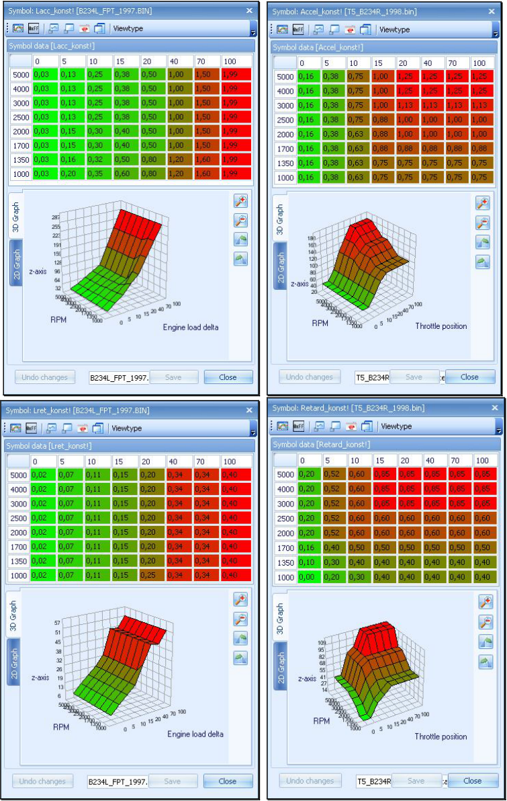{width=59%}

### Idle correction

To be able to maintain a steady idle state a separate idle fuel map is used (Idle_fuel_korr).
This table aids in keeping the idle rpm smooth by correcting fuel injection a bit.

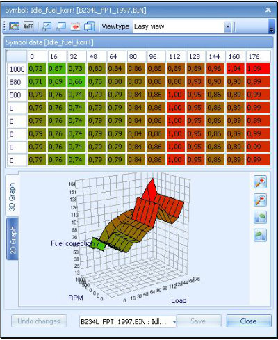{width=45%}

### Knocking

When knocking occurs inside the engine (sensed through the DI cartridge) evenly in all cylinders a tiny bit of extra fuel will be injected.
When the manifold pressure (MAP) is over 140 kPa (0.4 bar) the normal injection map will be overruled by another map: the knocking fuel map.
This map enriches the fuel mixture so that the engine cools down (extra fuel means cooler mixture).
If the knocking map kicks in, something is actually wrong in the rest of the mapping (ignition, injection etc).
Try to prevent entering the knocking map at all times!

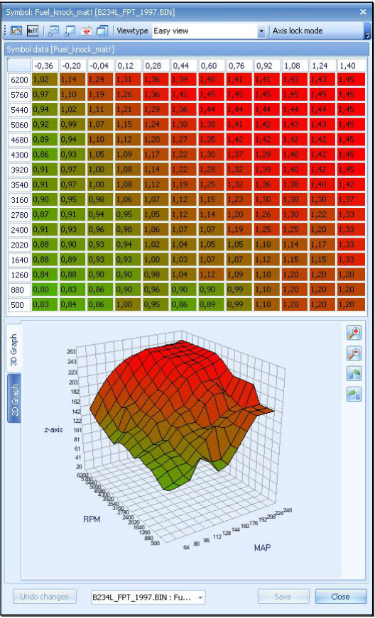{width=42%}

### Knock sensitivity

For Trionic to be able to determine what received knock signals from the DI cassette are actually knock and which are not, it looks up reference signals from several maps.
The most important one is Knock_ref_matrix! shown below.

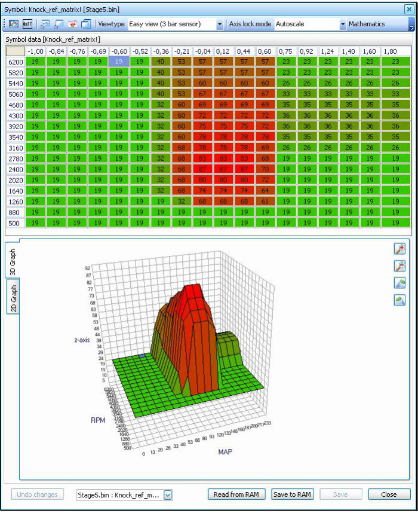{width=59%}

If knock is detected and adding extra fuel and pulling ignition timing doesn’t help, Trionic starts to decrease boost.
The steps in which this is done are listed in the map “ Apc_knock_tab!”.
In the map shown below all values are 8 which means that every increase will pull 0.08 bar of boost pressure.
The current value for this (boost reduction) is stored in Apc_decrese which can be monitored using the CAN bus connection.

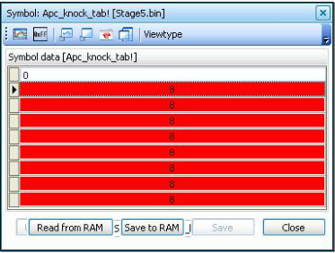{width=42%}

Knock detection is only active above a preset level of boost.
These levels are stored in Knock_press_tab!.

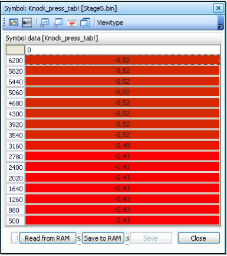{width=37%}

### Altering VE map

To tune the ECU regarding the fuel injection you must install a wide band lambda sensor to make sure that you hit your desired lambda value when under WOT (Wide Open Throttle).
You can make use of an EGT meter here to verify that your desired WOT lambda is enough to keep the EGT below: 1795° F (~980° C) on the SAAB T5 engine.
When using alcohol fuel the EGT seldom reaches these temperatures.
This means that by using a 3” down pipe and a fairly sized turbine the EGT meter can be redundant.

The VE-map must be tuned to make the engine run at lambda 1 in all load/RPM points that don’t need a richer mixture.
In wide open throttle situations an AFR of 12 or even a bit richer are required.
This job is already done by the ECU when it regulates the fuel injection in respect of lambda and storing the result in the Adapt_korr!.
To be able to use adaption maps you must be able to pull this data from your ECU without disconnecting the power and use it to adapt the initial VE map (see chapter CAN Bus).

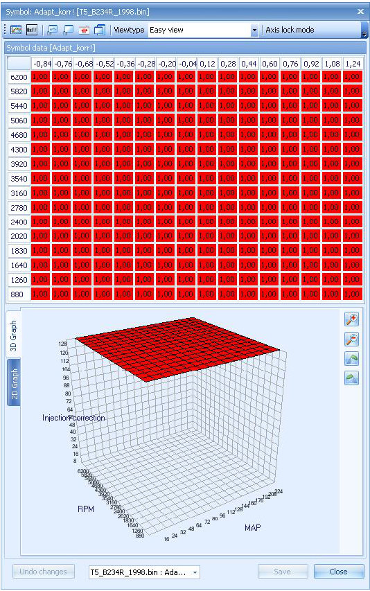{width=47%}

When the engine is run at WOT conditions, Fload_throttle_tab! indicates when the throttle is considered to be wide open and full load enrichment is activated.
The WOT enrichment map Fload_tab! is used to add more fuel to the calculated amount of fuel to be injected.
Note the interesting original Fload_tab!
Over 2400 RPM the lambda is masked when the throttle is fully pressed down but there is no additional fuel than what is allowed from the VE matrix.
Below 2400 RPM the lambda is masked and extra fuel is injected.
Here are the right tables for adding fuel to cool your exhaust gases.

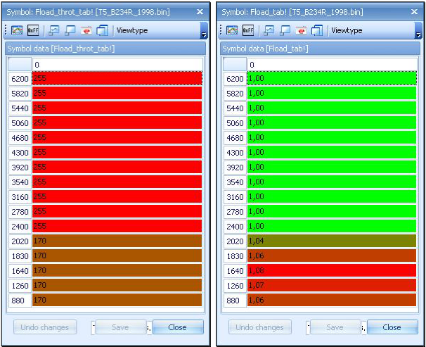{width=66%}

The values shown in Fload_throt_tab are throttle position sensor values and in Fload_tab the values are values to add to the fuel calculation.

The EGT can be allowed for up to 1795° F (~980° C), it is up to you how you will be using it.
A quarter mile (402 m) dragster can be allowed for hitting that temperature after about 11 seconds.
A more useful temperature will be ~1652° F (900° C) at WOT when every day driving.
If you must go below AFR 11 when driving on gasoline to prevent a high EGT something is wrong.
Upgrade your turbine and add a 3” down pipe, the EGT rises if there is a bottleneck in the passage for the exhaust gases or if the ignition is too late (not enough advance).

When tuning the fuel maps make sure that you are tuning the right maps.
When accelerating and decelerating there are enrichment and leaning tables that starts to function to let you hit Lambda 1.
But between idle and 2400 RPM this is overtaken by the WOT enrichment to get maximum power without pinging when accelerating.
The downside is that the catalyst stops to oxidise HC and CO fractions in the exhaust gases.
If you are over 140 kPa you could be running on the knock map (Fuel_knock_mat!) because the engine had started to knock.
When this happens the engine should stop accelerating due to the simultaneous change of ignition map (Ign_map_2).
Further tuning of the normal map is then useless.
This could be indicated that the boost request map must be altered to “ridiculous” levels to make the engine continue to accelerate.
A second point of view is that the knock matrix must be changed according to the changes made in the normal VE-table, strive to keep the proportional differences of the maps.

Always make sanity checks of what you are doing so that your engine can deliver maximum power without excessive emissions and with a minimum risk of mechanical failures.

Finally, give thought to the engine not being lean when cold by: verifying that the normal (stock) warm up enrichments are enough, using OBD II or the Canbus to check the short term fuel trim during warm up to a coolant temperature of 85° C.

A short list of what has been discussed:

- Always strive for Lambda 1 when using the engine in normal traffic.
- Let the ECU do the boring job for you.
- Keep your EGT with margins for overheating the turbine.
- Make changes in all necessary maps but think of the WOT maps.
- Don’t forget the Fuel_knock_mat!
- Don’t let the engine run lean.

### Adaption

The ECU calculates the injection duration based on MAP and intake temperature.
Injection duration is then corrected by multiplication of a correction factor, which is fetched from the main fuel matrix (Insp_mat!) which depends on MAP and RPM.
The need to correct the injection duration is due to the fact that the volumetric efficiency of the engine is dependent on the engine speed (RPM).
The last correction is made with the lambda correction, this results in a stoichiometric combustion (Lambda=1).
The lambda correction is allowed to adjust the calculated injection duration by ±25 %.
The ECU can change the correction factors in the main fuel matrix based on the lambda correction.
This ensures good drivability, fuel consumption and emissions when lambda correction isn’t activated.
This is called Adaption.

### Pointed adaption

If the ECU calculates the injection duration to be 8 ms but the lambda correction adjusts it to 9 ms due low fuel pressure, the ECU will “learn” the new injection duration.
This is done by changing the correction factor for that particular RPM and load point in the main fuel matrix to a new correction factor resulting in 9 ms injection duration.
The correction factor in this example will be raised by 9/8 (+12 %).
The pointed adaption can change the points in the main fuel matrix by ±25 %.
Adaption occurs every fifth minute and takes 30 seconds to finish, the criteria for the adaption are: Lambda correction is activated and the coolant temperature is above 64˚C (147F).
During the adaption the ventilation valve on the carbon canister is held closed.

### Global adaption

The global adaption on OBDII variants occurs during driving.
On non OBDII variants the global adaption occurs 15 minutes after engine shut down.
When the engine is inside a defined load and RPM range (60 – 120 kPa and 2000 – 3000 RPM) no pointed adaption will occur.
Instead, all points in the fuel matrix will be changed by a multiplication factor.
Global adaption can change the points in the main fuel matrix by ±25 % (Tech2 shows ±100 %).
Adaption occurs every fifth minute and takes 30 seconds to finish, the criteria for the adaption are: Lambda correction is activated and the coolant temperature is above 64˚C (147F).
During the adaption the ventilation valve on the carbon canister is held closed.

### Fuel save

With fully closed throttle and engine RPM over 1900 RPM when in third, fourth and fifth gear, a fuel shutoff will occur after a small delay.
On automobiles with automatic transmission fuel shutoff is active in all stages.
The injectors are reactivated when the RPM hits 1400 RPM.

### Converting to E85 fuel

If you want to setup your car for E85 fuel use, you will need to inject 30% - 40% more fuel.
Change the inj_konst! to reach the 30% to 40 % more fuel needed for E85 regardless of what injectors you are currently using.
If the injectors that you plan to mount are flowing the desired percentage of fuel more, you will not need to change the Inj_konst!

The Ethanol fuel E85 has different combustion characteristics resulting in more ignition timing advance at low RPM´s and less ignition advance at high RPM´s compared to gasoline.
This is the result of the higher combustion rate of Ethanol and its less initial combustion rate.
I.e. it’s harder to ignite but when it ignites it burns faster than gasoline.
The main error E85 converters do is, advance the timing to restore the torque and not retard the ignition later when needed, thereby putting unnecessary stress to the piston by passing MBT.

Additional information can be found on <http://etanol.nu/forumrecover/index.php>

### Fuel consumption measurement

The wire from the ECU to the third injector is also connected to the main instrument cluster.
The main instrument calculates the fuel consumption based on the injection pulses duration.
The fuel consumption is used to help getting an accurate presentation of the fuel level in the fuel tank and to calculate average fuel consumption in the SID.

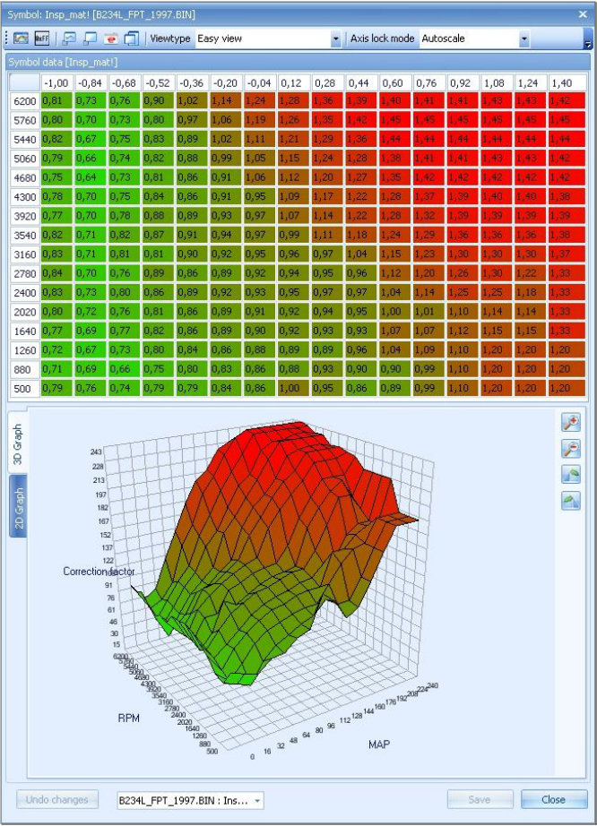{#fig-stock-fuel-table width=75%}

### HOWTO: Get your fuelling under control

If you start tuning for different turbo models, different injectors or anything else that changes either the air path or the fuelling path you will need to remap the fuelling part in Trionic 5.
Trionic 5 will adapt for approx. 25% in fuelling but you don’t want to be on the end of adaption after your changes of course.

#### Targets for mapping

What to map for?
That is the primary question to start with.
Normally, off-boost and a little but on-boost the system will be running in closed loop (lambda signal is taken into account when calculating optimum mixture) and the ECUs target will always be 14.7 AFR (lambda = 1).
The actual mixture will swing a little bit around this target because of the usage of a narrowband lambda sensor (14.x-15.x).
When you go on-boost the system will leave closed loop mode and enter open-loop mode.
In this mode the lambda signal is not used and the system depends only on the fuelling information in the maps that it has.
On full load you will want to have a target of approx. AFR 11.x.
Maximum torque is made at 11.1 AFR but since the curve drops off pretty steep when going richer most tuners aim for 11.5-12.0 at full load.
The path towards full load (on-boost but still not full load) can gradually go from 14.x to 11.x.
Of course you will need a calibrated wideband lambda sensor for mapping for optimum mixtures.

#### Main fueling constant [inj_konst]

To correct the system for different injectors a injector constant variable is present.
It is called Inj_konst!
And is around a value of 20 with stock injectors.
If you go for larger injectors this constant will have to be dropped because the injectors deliver more fuel per millisecond.
Changing from stock to for example 630cc injectors will drop the constant from 20 to 14-16 range.
You can also use this constant to get a little more tuning headroom in the main fuel map since that is mostly mapped to the top (maxed out).
If you increase the injector constant a slightly you can drop the main fuel map a bit to gain more control in the upper regions of this map.

#### Main fuel injection map [insp_mat]

This is a map that determines the corrections to be made at each rpm/load point to the pre-calculated injection duration.
It ranges from 0.5 to 1.5 and the value is a multiplier to the injection duration that was calculated based on manifold pressure, IAT and coolant already.
With this map you can map out flat spots and make sure that every rpm/load site sits at YOUR desired AFR value.

#### Knock fuel injection map [fuel_knock_mat]

If the system detects knock it will inject a different amount of fuel.
This fuel amount is no longer calculated using the main fuel injection map but it takes the correction factor from this map.
So, always make sure that this map has higher values (5-10%) then the main fuel map.

#### Open loop vs. closed loop [open_loop]

If you want the system to leave closed loop at different rpm/load point you can alter the settings in this map.
So, if you want to run different AFR values for a rpm/load point that is actually in the closed loop range (these ranges are indicated in T5Suite by marking the cells in the main fuel map) and would thus be 14.7, you will have to alter the open_loop map.
In this way you can determine the AFR value by changing the values in the main fuel map.
Note that in knocking conditions a different map is used.
You can also switch off closed loop as a whole by changing the firmware settings in the system.
This way you gain full control of the fuelling part but lose the system’s ability to adapt for fuel pump wear etc.

#### Coldstart enrichment [Eftersta_fak\*]

To have the car run properly when the engine is cold (vaporization is worse) it needs to inject more fuel.
These values are coolant temperature dependant so they can also be used for semi-cold start (e.g. coolant = 50 degrees).
The values in the maps are also correction factor like they are in the main fuelling map.

#### Acceleration/deceleration enrichment

If you suddenly open or close the throttle plate the air flow changes dramatically in the intake.
Since air is lighter (weighs less) than petrol vapor/droplets the air will react faster than the petrol in it.
Opening the throttle will therefore result in a lean mixture because the petrol will lag behind on the air.
Closing the throttle will cause the air to stop faster than the petrol because mass reacts slower and hence the mixture will go too rich.
To compensate for these phenomena the acceleration and deceleration maps are there to try to keep the desired AFR when changing throttle or changing load (which amounts to the same actually because load change is airflow change).
Maps are Accel_konst, Lacc_konst, Lret_konst and Retard_konst.

#### Battery correction for injectors [Batt_korr_tab]

Different battery voltages result in different injection durations because the injector opening time varies with the voltage applied to it.
Lower voltage means that the injector valve takes longer to open and hence less fuel is injected in the same injector duration.
This calls for correction factors that depend on battery voltage.

#### Watch out for adaption

When reading the above you might think that the closed loop values in the main fuel map are redundant because the system will use lambda feedback anyway.
This is not true because the system will adjust the adaption trim based on the feedback values from the lambda sensor compared to the values within the closed loop range of the main fuel map.
If you map the closed loop part incorrectly the system will react by adjusting the adaption values (both long term and point adaption – per cell that is).
The horror is in the fact that long term trim is also applied to WOT (wide open throttle, so full load) conditions.
The you map closed loop too rich, the system will trim the fuel down using the long term trim and your WOT mixture will also go leaner… watch out for this!

#### Watch out for LPG/petrol combinations while tuning

One of the main problems with running LPG is that the Trionic adaption system will also adapt when you are running LPG.
Most people tend to run on LPG most of the time, only running petrol on engine start and when LPG runs out.
This means that adaption is done mostly on LPG.
If the LPG manufacturer installs and calibrates the system he will set a multiplier in the LPG computer to correct for the extra amount of fuel needed when running LPG.
If he does this incorrectly – for example he enters a number a bit too big – the fuelling will be a little off when running LPG.
Trionic will adapt to this – in the example it will trim the fuel down (cases are known that Trionic has to adapt so much that the CEL comes on with adaption range errors).
No problem when still running on LPG but when adaption is done (lets assume 10% off) and the driver switches to petrol the engine WILL be running lean.
Indicators are that the engine will not run properly on coldstart (it will start on petrol with the 10% off and thus will not inject the intended amount of fuel).

## Ignition

### Ignition cassette

The ignition cassette is mounted on the valve cover on top of the spark plugs.
The ignition cassette houses four ignition coils/transformers whose secondary coil is direct connected to the spark plugs.
The ignition cassette is electrically supplied with battery voltage from the main relay (B+) and is grounded in an earth point.
When the main relay is activated the battery voltage is transformed to 400 V DC which is stored in a capacitor.
The 400 V voltage is connected to one of the poles of the primary coil in the four spark coils.
To the ignition cassette there are four triggering lines connected from the Trionic ECU, pin 9 (cyl. 1), pin 10 (cyl. 2), pin 11 (cyl. 3) and pin 12 (cyl. 4).
When the ECU is grounding pin 9, the primary coil for the first cylinder is grounded (via the ignition cassettes B+ intake) and 400 V is transformed up to a maximum of 40 kV in the secondary coil for cyl. 1.
The same procedure is used for controlling the ignition on the rest of the cylinders.

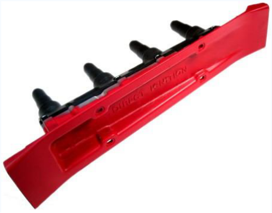{width=39%}

### Ignition regulation

At start the ignition point is 10° BTDC.
To facilitate start when coolant temperature is below 0°C the ECU will ground each trigger line 210 times/second between 10° BTDC and 20° ATDC, at which a “multi spark” will appear.
The function is active up to an engine speed of 900 RPM.
At idle a special ignition matrix is utilized.
Normal ignition point is 6°-8° BTDC.
If the engine stalls e.g. cooling fan activation the ignition point is advanced up to 20 ° BTDC in order to increase the engines torque to restore the idle RPM.
In the same way the ignition is retarded if the engines RPM is increased.
When the TPS senses an increase in throttle opening the ECU leaves the idle ignition timing map and regulates the ignition timing in respect of load and engine speed.

During engine operations the Ignition cassette continuously monitors the ion currents in the cylinders and sends a signal to the Trionic ECU on pin 44, in the event of knocking.
The logic for this function rests solely in the ignition cassette and is adaptive to be able to handle disturbing fuel additives.
The Trionic ECU is well aware of which cylinder that has ignited and could hence cope with the information fed through one pin.
The signal to pin 44 and ion current in the combustion chamber is related to each other.
When this signal reaches a certain level the ECU interprets this as a knocking event and firstly lowers the ignition advance by 1.5° on this cylinder.
If the knocking is repeated the ignition advance is lowered further by 1.5 °, up to 12°.
In case of the same lowering of the ignition timing advance in all cylinders the ECU adds a small amount of fuel to all cylinders.
If knocking occurs when the MAP is over 140 kPa the knocking is regulated by switching both fuel injection matrix and ignition advance matrix.
If this is not sufficient the charging pressure is lowered.
This purpose of this procedure is to maintain good performance.
If the signal between the ignition cassette and the ECU is lost, the charging pressure is lowered to basic charging pressure and the ignition timing advance is retarded by 12° if a risk of knocking exists due to engine load.
Refer to appendix VII for more information about knock detection.

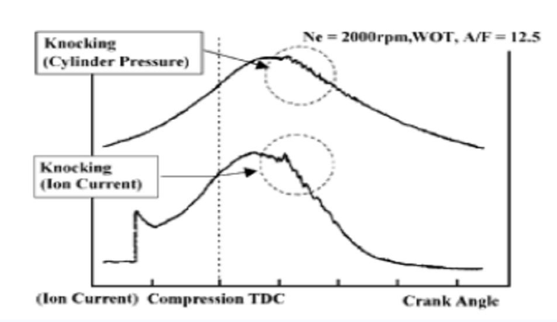{#fig-knocking-detection width=53%}

### Combustion signals

The Trionic system lacks a camshaft position sensor.
This sensor is normally a prerequisite for a sequential pre ignition/pinging regulation and fuel injection.
Saab Trionic must decide whether cylinder one or cylinder four ignites when the crank shaft position sensor indicates that cylinder one and four is at TDC.
This is done by the help of ionization current, one of the poles of the secondary coil of the spark coils is connected to the spark plugs in an ordinary manner.
The other pole isn’t grounded directly but connected to an 80 V voltage.
This means that an 80 V voltage is fielded over the spark gap of the spark plugs, except when the spark is fired.
When combustion has occurred the temperature in the combustion chamber is very high.
The gases are formed as ions and start to conduct electrical current.
This results in a current flowing in the spark plug gap (without resulting in a spark).
The ionization current is measured in pair, cylinder one and two is one pair and cylinder three and four in the other pair.
If combustion occurs in cylinder one or two the ignition cassette is sending a battery voltage (B+) pulse to the ECU, pin 17.
If the combustion takes place in cylinder three or four the B+ pulse is feed to pin 18 in ECU.
If the crankshaft position sensor is indicating that cylinders one and four is at TDC and a B+ pulse enters the ECU via pin 17 simultaneously, then the ECU know that it is cylinder one that has ignited.
At start the ECU doesn’t know which cylinder is in the compression stroke.
Ignition is initiated in both cylinder one and four and 180° crank shaft degrees later sparks in cylinder two and three are fired.
As soon as combustion signals enters the ECU via pin 17 and pin 18 the ignition and fuel injection is synchronized to the engines firing order.
The combustion signals are also used to detect misfires.

### Ignition maps

The ignition timing is vital to achieve MBT (M*aximum Brake Torque*) by using the minimum ignition spark advance.
In theory this is simple: For each RPM and load point, advance the ignition timing until you reach the peak torque, the more ignition advance BTDC (*Before Top Dead Centre*) the more torque you will get until the resulting combustion pressure begins to slow down the upward moving piston and the torque starts to decrease.

The more ignition advance you use the more NOx emissions you will generate resulting from an increase in combustion chamber temperature, this is one factor to take into consideration when establishing the correct ignition advance.
One other factor is the end gases, gases that are formed from deterioration of the fuel present in the combustion chamber from the compression heat.
The end gases can auto ignite when the spark is fired from the spark plug causing two flame fronts in the combustion chamber, these flame fronts collide and form a knocking sound as the resulting flame front is oscillating in the pressure traverse.
This could easily damage the engine internals as the peak pressure can be higher than the pressure occurring during MBT.
The higher combustion chamber temperature from an increased ignition timing can lead to “hot spots” in the combustion chamber and thus ignite the Air/Fuel mixture separate from the spark plug and cause the unwanted knocking.
This detonation can almost instantaneously kill your engine since the ignition may take place at a totally wrong time.
A fuel with higher octane rating is more resistant to these engine damaging phenomena.
This is reflected in the differences between the main ignition maps on B234R and B234L

Also bear in mind that since the emissions controls prevent the engine manufacturers to reach MBT they could save some money and weight on the pistons, thereby giving an ambitious tuner a lighter wallet as a result from broken pistons.
The collapsed piston roof or cracked piston ring is a direct result from high combustion pressure, not necessarily from knocking, but only from the normal increase in pressure resulting from driving at MBT without knocking.
This is not a known problem in engines with T5 though.

The Ethanol fuel E85 has different combustion characteristics resulting in more ignition timing advance at low RPM´s and less ignition advance at high RPM´s compared to gasoline.
This is the result of the higher combustion rate of Ethanol and its less initial combustion rate.
I.e. it’s harder to ignite but when it ignites it burns faster than gasoline.
This is the single most error E85 converters do, advancing the timing to restore the torque and not put the ignition advance later when needed, thereby putting unnecessary stress to the piston by passing MBT.

Different stroke requires different ignition advance since the different length of the piston rod changes the geometry of the piston, piston rod and crank shaft system.
When the piston rod is shorter than infinite length the reciprocating motion doesn’t describe the desired sine curve, rather it is a triangle wave with flat tops.
The different stroke doesn’t change the ignition advance in any easy predictable way.
See the difference between the ignition advance on 2.0 LPT and 2.3 LPT engines.

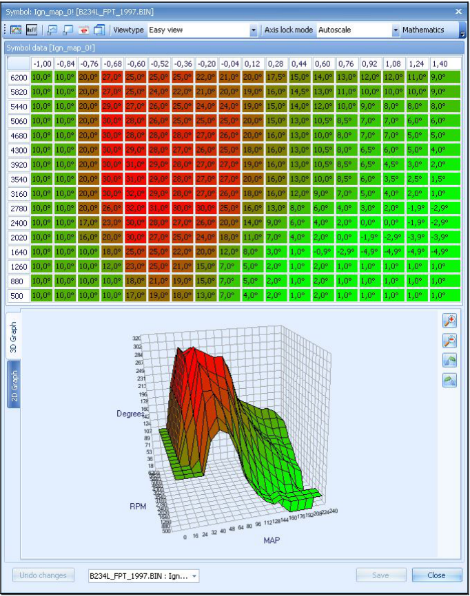{#fig-ign-map-normal width=56%}

On the B204E in NG900 the ignition timing is well advanced in low RPM/Load during warm up to make the engine work harder and inefficient, more heat is generated inside the cylinders.
This inefficiency enables the catalyst to heat up and start working quicker.
The warm up ignition map is Ign_map_4! and the normal ignition map is Ign_map_0!

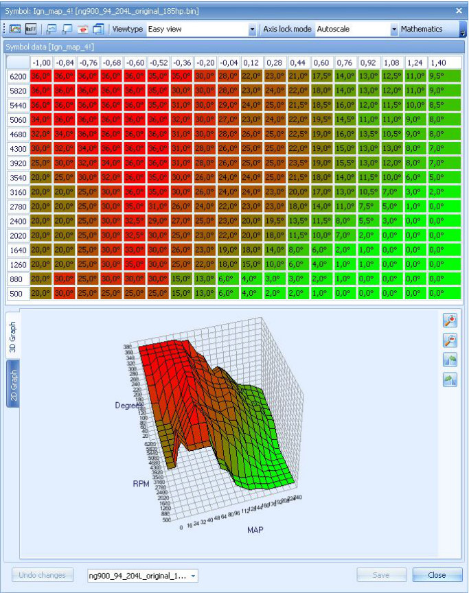{#fig-ign-map-warmup width=59%}

When idling the idle ignition map “Ign_map_1!” is used to control the engine´s torque at idle, this compensates for rough idling.

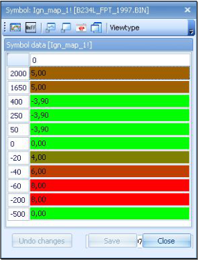{#fig-ign-map-idle width=32%}

In case of detonation/knocking the ignition timing is retarded by 1,5° in steps for that specific cylinder until the knocking stops.
This is done to a maximum retardation of 12°.
In an event of all four cylinders knocking and it´s the same ignition timing retardation, more fuel is injected and ignition timing is restored.
If manifold pressure (MAP) is over 140 kPa when knocking occurs the ignition map is switched to Ign_map_2!
This map indicates how much ignition timing to pull (retard) from the original values as a countermeasure to stop the knocking.

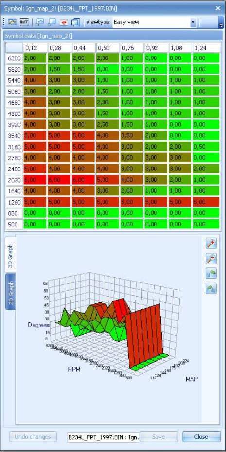{width=52%}

### Altering ignition maps

To be able to tune these maps you must firstly use common sense.
Then you must install an EGT meter.
The Exhaust Gas Temperature is affected on the ignition timing.
The further away from TDC the spark fires, the cooler the exhaust gases will be but as described earlier in the chapter the risk of detonation increases the more you advance the ignition timing.
At high charge pressure you must retard the ignition to avoid detonation, this results in an increase in EGT.
For a SAAB T5 engine the target EGT starts at 930° F (~500° C) and stops at 1795° F (~980° C).
To lower this temperature the ignition can be advanced, as little as 0,5° might be enough.
Adding more fuel at this RPM/Load point is also lowering the EGT.
In addition you might consider using water injection or change fuel to a more fast burning fuel e.g. Ethanol or E85.
To be totally safe when tuning you use a cylinder pressure transducer to find out your maximum pressure but this might be over your budget as a reliable kit costs as much as a few engines.

### Crankshaft position sensor

{height=1.2em} Trionic T5.2 uses a different crankshaft position sensor than Trionic T5.5.
The early (T5.2) models use a HALL effect sensor while the later models (T5.5) uses a variable reluctance sensor.

The HALL effect sensor produces a square wave output while the VR type produces a sine wave output as shown in the picture below.
The VR type output voltage is converted by T5.5 by using the LM1815.
This results in a similar output as the HALL effect sensor.
T5 has 62 pulses per engine rotation from which 2 teeth are missing at 117° BTDC on cylinder 1 to determine TDC.

{width=81%}

### HOWTO: Get your ignition advance under control

After mapping fuel you can start working at optimizing ignition timing.
To get the most of the engine in a safe way you need – of course – at least a wideband lambda controller and an EGT gauge.
The latter is firstly to check if you’re not passing 950° C and secondly to be able to see the effect your ignition trimming has on EGT values.
I find that the easiest way to map ignition timing is to get fuel mapped properly first, then boost control to a very stable level and then request boost to match on of the ignition map columns (for example 1.2 bar).
Do a run and see if knock occurs using T5Suite or the dashboard.
If you have no knock, increase timing a little bit and rerun.
Continue to map all relevant cells until you are at approximately 1 degree timing from knock (so, if knock occurs at 7 degrees, you should map for 6 degrees advance).
Start at a low advance (known to work well) and work your way up from there, not the other way around!
You should not only feel the increase in power this way but also see EGT drop a bit in the process which is good.
If you run the car on RON95 normally you should map for RON95.
If you fuel up on RON98 always you can map for RON98 of course.
Use common sense in this!

Tips: Knock can be seen in either the log files or in the knock_count_map and knock_count_cylx variables.
If you have knock in one specific cylinder only (or the majority at least) deal with that first before proceeding on the main ignition map.
One of the injectors may be off or you might have a fouled up spark plug.
Swap them one by one and see if the knocking travels to the other cylinder as well.

## Boost

### Basic charging pressure

Basic charging pressure is fundamental for charging pressure control.
Basic charging pressure is mechanically adjusted on the actuators pushrod between the actuator and the waste gate.
At too low basic charging pressure the engine doesn’t rev up as expected when the throttle is opened quickly.
At to high basic charging pressure a negative adaption occurs and maximum charging pressure cannot be achieved.
In addition there is a substantial risk of engine damage since the charging pressure can’t be lowered enough when regulating with attention to pre ignition/pinging.
Basic charging pressure shall be 0,40 ±0,03 bar (5,80 ±0,43 PSI).
After adjustment the push rod must have at least three turns (~3 mm) pre tension when connecting to the waste gate lever.
The purpose with that is to make sure that the waste gate is held close when not affected.
On new turbo chargers the basic charging pressure tends to be near or spot on the upper tolerance when the pre tension is two turns.
The pre tension may never be less than three turns (~3 mm).
When checking the basic charging pressure it shall be noted that the pressure decreases at high RPM and increases at low outside temperatures.

### Charging pressure regulation

Charging pressure regulation utilises a two coiled three way solenoid valve pneumatically connected with hoses to the turbo chargers waste gate, the turbo chargers outlet and the compressor’s inlet.
The solenoid valve is electrically supplied from +54 via fuse 13 and is controlled by the ECU via its pin 26 and pin 2.
These pins are driven by MOSFETs.
The control voltage is pulse width modulated (PWM) at 90 Hz below 2500 RPM and 70 Hz above 2500 RPM.
The rationale for this change is to avoid resonance phenomena in the pneumatic hoses.
By grounding pin 2 longer than pin 26 the charging pressure is decreased and vice verse, when pin 26 is grounded longer than pin 2 the charging pressure is increased.
To be able to regulate the charging pressure the ECU must at first calculate a requested pressure, a pressure value that the system must strive for.
This is done by taking a pre programmed value (matrix of values established in respect of RPM and throttle opening).
When one or both of the following criteria are met, a limitation of the charging pressure is set.

- In first, second and reverse gear there is a RPM dependable maximum value.
  The ECU calculates which gear that is in use by comparing the speed of the automobile and the engines RPM.
- When pre ignition/pinging occurs a maximum charge pressure is set on the basis of a mean value from each cylinders retarding of the ignition.

One or both of the following criteria initiates a lowering of the charging boost pressure to basic boost pressure.

- When the brake pedal is pressed down and pin 15 (brake light switch) on the ECU is supplied with battery voltage.
- Certain fault codes are set (Faulty throttle position sensor (TPS), pressure sensor, pre ignition/pinging signal or charging pressure regulation) or low battery voltage.

To be able to electrically regulate the charging pressure we must decide the relationship between the air that is sent to the wastegate as the working media to actuate the wastegate valve.
When driving under ideal conditions this relationship is enough to get a stable charge pressure.
This map is of course not necessary on LPT´s since the wastegate is not electrically/pneumatically actuated.
This map also controls how fast the turbo can reach the desired pressure with some respect to the durability of the transmission.
Tuning this map is necessary when changing turbo charger or its working conditions such as: 3” down pipe, porting the cylinder head or changing intercooler.
The aim when tuning this map is to get a stable pressure build up without any overshoot when reaching the desired pressure.
A calibrated charge pressure meter is a must when undertaking this task.

The regulation table determines the bias (sort of pre-tension) for the pulse width signal to the boost control valve.
It can be considered an offset for the PID controller.
So PID and regulation bias determine the pulse width on the boost control valve taking the pressure error (boost request minus actual boost) as an input value.

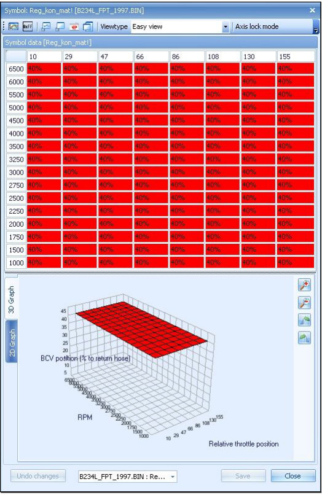{#fig-boost-regulation-table width=48%}

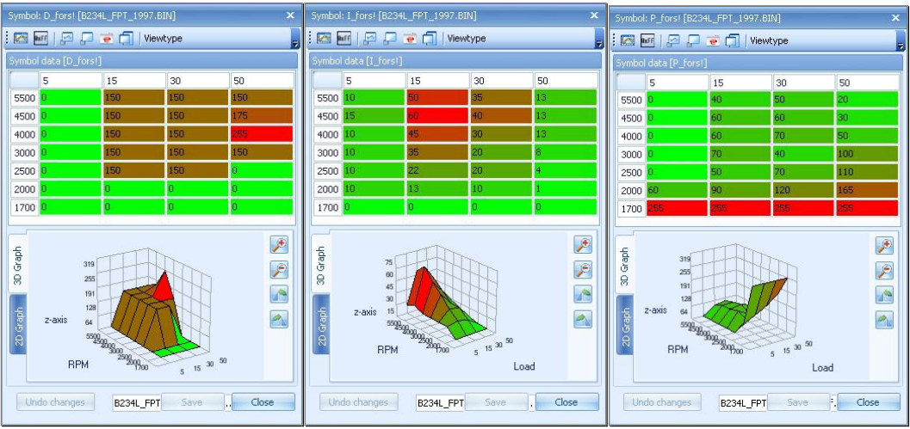{width=94%}

Above you see an example of the PID control tables that are used in a stock firmware.

### Computing adaption

When the required charging pressure has finally been calculated it is converted to the PWM signal that controls the solenoid valve.
The ECU then controls that the actual pressure (measured by the pressure sensor) corresponds with the required pressure.
If needed the PWM is fine tuned by multiplication of a correction factor.
The correction factor (adaption) is then stored in the memory of the ECU and is always used in the calculation of the PWM signal.
The rationale with this is to make sure that the actual pressure will be equal to the required pressure as soon as possible after a change of the load has occurred.

### Boost request

Trionic tries to reach the pressure values for a given RPM and throttle position that is contained in the map “Tryck_mat” (or “Tryck_mat_a” for automatic transmissions).
The stock boost request map for a B234L (200bhp, Garrett T25 turbo) is shown in @fig-boost-request-b234l.
You can see that the requested pressure drops when RPM values go over ~4500.
This is because the little T25 turbo cannot maintain higher pressure values at these engine speeds, it is simply too small for that.
In modified cars containing a larger turbocharger these values will keep rising with engine speed.

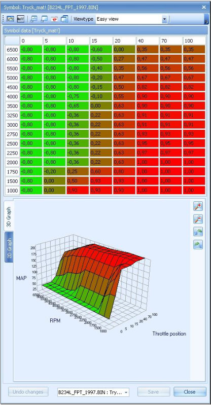{#fig-boost-request-b234l width=47%}

### Limiters

To prevent damage to the gearboxes there is a charge pressure limiter on the reverse, first and second gear on manual gearboxes.
The limiter on automatic transmission is active on the first and reverse stage.
This reduces the engines torque as while the downshift of the RPM on the lower gears is increasing the torque so that we are able to get the car rolling without damaging any transmission details.
Main boost request comes from Tryck_mat.
If the boost request is higher than the value from the limiter, the limiter value will become the actual boost request.

The first and second gear limiters are only present to prevent the ECU to use the main boost request map in first and second gear.
If these limiters are set ABOVE the values in the main request map, the limiters are switched off.

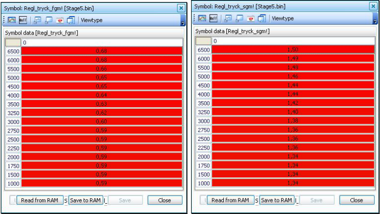{width=81%}

### Fuel cut limiter

To prevent damage to the engine caused by faulty hardware or overshooting boost, fuel will be cut off when charging pressure gets higher than set in the fuel cut map (Tryck_vakt_tab).

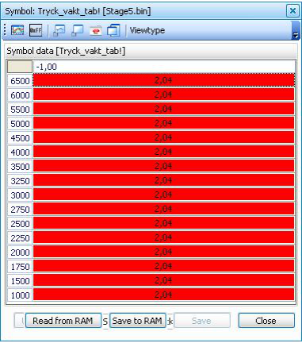{#fig-max-boost-table width=35%}

This example shows that the maximum boost level is always 0xEB, this is the standard cut-off value of 1.35 bar.\
0xFE would be highest possible, around 1.54 bar.\
0xFF would turn off the fuel cut totally.

### HOWTO: Get your boost under control

Boost control in Trionic 5 is quite simple on the one side and very complex on the other.
If you are trying to regulate boost with a turbocharger that is closely related to the stock turbocharger (either T25 or TD04) it is quite simple to alter boost settings by altering the boost request map (Tryck_mat) if you stay within the limits for the turbo.

If you are using a larger than stock turbo (e.g. GT28, TD04-19T, GT3071R, Holset HX35/40w etc) then you might run into trouble getting your boost under control.
There are several known issues that you can encounter here.

- Not getting your requested boost
- Overshooting when running \@WOT from low RPM’s
- Overshooting when running \@WOT from high(er) RPM’s

#### Not getting your requested boost

If you are not getting the amount of boost that you are requesting in Tryck_mat you might be looking at either a hardware problem or a software problem.
To identify which kind you’re having you will need to log information from the ECU through the canbus interface.
Software problems are a fact when “PWM_ut10” is NOT at its maximum value (98%) while you are not getting your request [and]{.underline} you are in an RPM range where the turbo can definitely deliver more boost (test with W-hose disconnected).
If you decide it is a software failure you can start logging P_fak, I_fak, D_fak, Reg_kon_apc, PWM_ut10, Rpm, P_Manifold10, Ign_angle and Apc_decrese.
If you see from the logging that Apc_decrese \> 0 in the area where you’re not getting the requested boost, you’re having knock detection which is lowering boost.
You should also see Ign_angle dropping a bit just before that point.

If Apc_decrese stays 0 and you’re not getting your requested target AND PWM_ut10 \< 98 then you should be able to see that I_fak is pretty low (\<400 anyway).
This could mean that you have to increase either reg_kon_mat values or I_fors values.

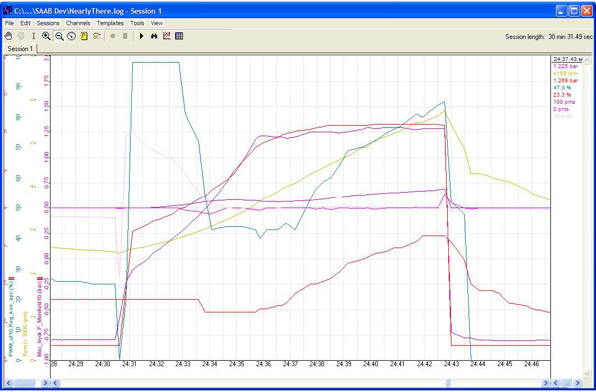{#fig-pid-too-soft width=100%}

If you – on the other hand – see that PWM_ut10 is at its maximum and you’re not getting the amount of boost you’re requesting that means that the software it trying its best to meet you request and the problem should be searched for in the hardware.
It might be vacuum leaks, a wastegate actuator that is too weak, to much backpressure, too large C-port in the APC valve, defective APC valve and then some other options.
Searching for hardware failures is outside of the scope of this FAQ though.

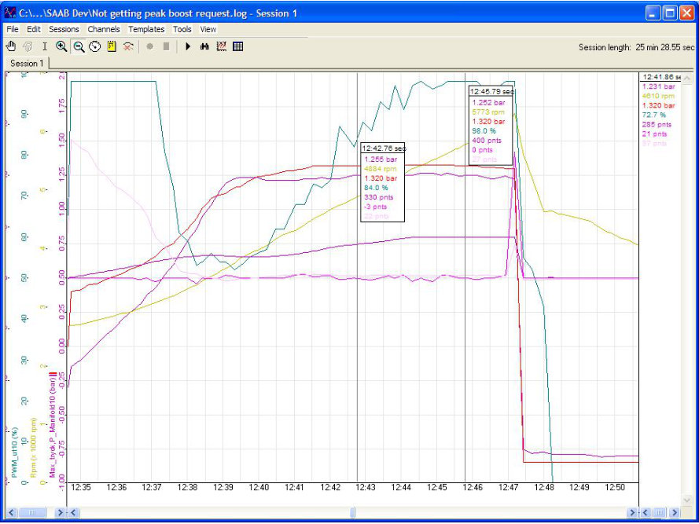{#fig-boost-hardware-issues width=100%}

#### Overshooting when running \@WOT from low RPM’s

If you floor it from 2500 rpm and spool up is starting at 3000 rpm for example you might see a spike in the boost level just when you pass the point where you hit the requested boost.
Let’s assume that you request 1.8 bar and \@ 4200 rpm you reach this level but boost overshoots to 1.9 bar \@ 4250 rpm.
This indicates that the spool characteristics defined in the PID maps are too aggressive.
PID control should be smoother when almost reaching the requested boost.
You can almost certainly map this correctly by decreasing I_fors values in the area below 4200 rpm.

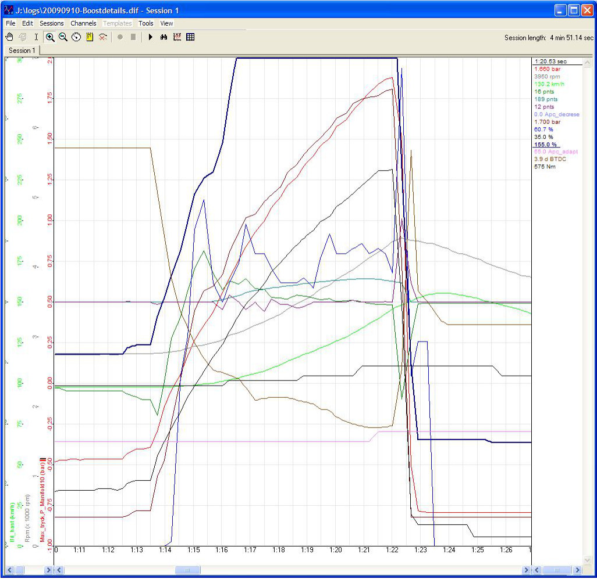{#fig-overshoot-low-rpm width=100%}

#### Overshooting when running \@WOT from high(er) RPM’s

If you floor it from 4500 rpm and the turbo can deliver your requested boost, you might see a spike in the boost level just when you pass the point where you hit the requested boost.
Let’s assume that you request 1.8 bar and \@ 4700 rpm you reach this level but boost overshoots to 1.9 bar \@ 4750 rpm.
This indicates that the spool characteristics defined in the PID maps are too aggressive.
PID control should be smoother when almost reaching the requested boost.
You can almost certainly map this correctly by decreasing P_fors and/or I_fors values in the area between 4500 and 5000 rpm.

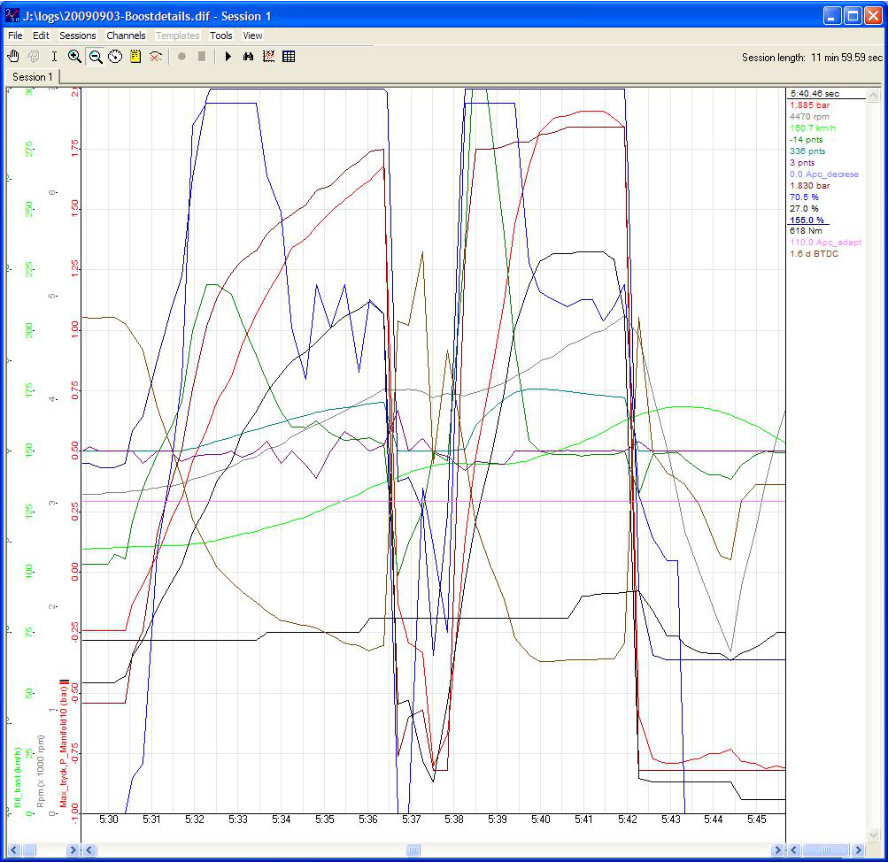{#fig-overshoot-gear-change width=99%}

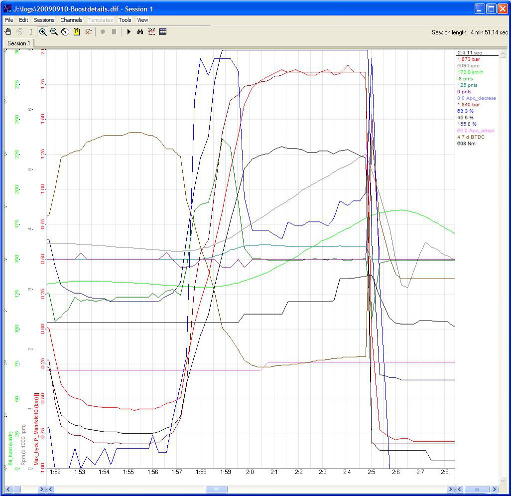{#fig-boost-how-it-should-look width=100%}

#### Things to watch out for

I_fak should not equal I_fak_max (400 by default).
If it does, you will have to raise reg_kon_mat in this area.
Apc_adapt should not equal 250 (its maximum value).
If it does, adaption limits have been reached and something is not right in the PID mapping.

### Gear ratio

Trionic calculates in which gear it is currently driving by using the engine speed, wheel pulses and the number of pulses per wheel revolution.
Combined with the gear ratio settings (maps) in can make a calculation on which gear is currently engaged.
This is important for boost limiting in 1^st^ and 2^nd^ gear.

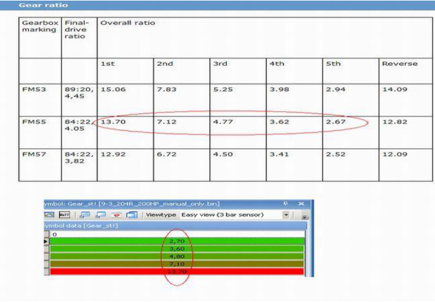{width=81%}

Tables Gear_st and Gear_ratio hold information about the different values for this calculation.
Gear_st is the overall ratio per gear.
In the example above the ratio for first gear is 13.7 according to the service manual for this car and model.
The bottom value show in Gear_st is this exact value.
5^th^ gear shows 2.67 in the service manual and so does the upper value in the table (2.70).
So, what does this figure mean?
It is actually the ratio between engine revolutions and wheel revolutions.
If the engine is running in 5^th^ gear and with 3000 rpm with a gear ratio of 2.7 you will have 3000 / 2.7 wheel revolutions PER MINUTE.
Given a wheel radius of e.g. 300 mm you will travel at a speed:

Wheel revolutions per minute = 3000/2.7 = 1111 rev/m\
Wheel revolutions per second = 1111/60 = 18.5 wheel revs per second.\
The distance traveled for a complete wheel rev is: 2 \* pi \* 300 = 1884 mm = 1.884 meter\
The distance traveled per second will then be: 1.884 \* 18.5 = 34.8 meter\
The speed will be: 125 km/h
