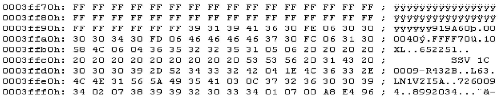

# Variables {.advanced}

## Program mode

This next table gives an overview of “program mode” options for Trionic.
These are stored bitwise (one single bit switches functionality on or off) in the variable “Pgm_mod” and can be changed in TxSuite with Actions → Firmware information.

| Byte | Bit | Mask | Description                                           |
|------|-----|------|-------------------------------------------------------|
| 0    | 0   | 0x01 | Afterstart enrichment                                 |
| 0    | 1   | 0x02 | WOT enrichment                                        |
| 0    | 2   | 0x04 | Interpolation of delay map                            |
| 0    | 3   | 0x08 | Temperature compensation                              |
| 0    | 4   | 0x10 | Lambda control                                        |
| 0    | 5   | 0x20 | Adaptivity                                            |
| 0    | 6   | 0x40 | Idle control                                          |
| 0    | 7   | 0x80 | Enrichment during start                               |
| 1    | 0   | 0x01 | Constant injection time (E51)                         |
| 1    | 1   | 0x02 | Lambda control during transients                      |
| 1    | 2   | 0x04 | Fuelcut                                               |
| 1    | 3   | 0x08 | Constant injection time during idle                   |
| 1    | 4   | 0x10 | Accelerations enrichment                              |
| 1    | 5   | 0x20 | Decelerations enleanment                              |
| 1    | 6   | 0x40 | Car104                                                |
| 1    | 7   | 0x80 | Adaptivity with closed throttle                       |
| 2    | 0   | 0x01 | Factor to lambda when throttle opening                |
| 2    | 1   | 0x02 | Uses separate injection map during idle               |
| 2    | 2   | 0x04 | Factor to lambda when AC is engaged                   |
| 2    | 3   | 0x08 | Throttle Acceleration Deceleration adjust simult MY95 |
| 2    | 4   | 0x10 | Fuel adjusting during idle                            |
| 2    | 5   | 0x20 | Purge control enabled                                 |
| 2    | 6   | 0x40 | Adaption of idle control                              |
| 2    | 7   | 0x80 | Lambda control during idle                            |
| 3    | 0   | 0x01 | Heated plates present                                 |
| 3    | 1   | 0x02 | Automatic transmission                                |
| 3    | 2   | 0x04 | Load control                                          |
| 3    | 3   | 0x08 | ETS                                                   |
| 3    | 4   | 0x10 | APC control                                           |
| 3    | 5   | 0x20 | Higher idle during start                              |
| 3    | 6   | 0x40 | Global adaption enabled                               |
| 3    | 7   | 0x80 | Temperature compensation with active lambda control   |
| 4    | 0   | 0x01 | Load buffer during idle                               |
| 4    | 1   | 0x02 | Constant idle ignition angle during gear one and two  |
| 4    | 2   | 0x04 | No fuelcut in reverse, first and second gear          |
| 4    | 3   | 0x08 | Airpump control                                       |
| 4    | 4   | 0x10 | Normal asperated engine (non turbo)                   |
| 4    | 5   | 0x20 | Knock regulating disabled                             |
| 4    | 6   | 0x40 | Constant ignition angle                               |
| 4    | 7   | 0x80 | Purge valve MY94                                      |
| 5    | 7   | 0x80 | VSS enabled                                           |
| 5    | 4   | 0x10 | Tank pressure diagnostics enabled                     |

Data_namn = Software version (e.g. A5COP47T.35G)

## Footer information {.advanced}

If we look at the footer in the binary (the last page in Actions → View file in hex) we see a set of reversed strings.
Each of these strings contains an identifier.
These identifiers have a hardcoded meaning.

| Identifier | Type       | Description                |
|------------|------------|----------------------------|
| 0x01       | String     | Partnumber                 |
| 0x02       | String     | Software ID                |
| 0x03       | String     | Data name                  |
| 0x04       | String     | Engine type                |
| 0x05       | String     | Immobilizer code           |
| 0x06       | ---        | Unknown                    |
| 0xFC       | ROM end    | Last available ROM address |
| 0xFD       | ROM offset | Offsett in ROM addresses   |
| 0xFE       | Code end   | Last used ROM address      |

{width=99%}

919A60 = Last program address, reversed, actual address is 06A919\
000040 = Program size (size of binary), reversed, actual size is 040000\
FFFF70 = Flash last address, last available ROM address (07FFFF)\
10XL = Unknown value/code (LX10)\
652251 = VSS security code, reversed, actual code is 152256\
SSV 1C 0009-R432B = Engine type & model, reversed, actual is B234R-9000 1C VSS\
L63.LN1VZI5A = Dataname, reversed, actual string is A5IZV1NL.36L\
7260094 = Software ID, reversed, actual code is 4900627\
8992034 = Partnumber, reversed, actual number is 4302998

Watch out with the dataname, this is also a symbol in the binary, they need not always be the same.
