# Tuning the T5

## Engine types

To be able to tune your engine you first have to know what engine type you have.
Saab produced several different engine types with different options.
The engine code will tell you what type it is.

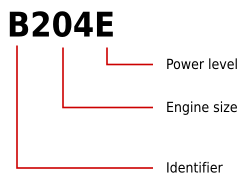{width=36%}

| Engine size | Power level | Turbo           | Output (m)               | Description               |
|-------------|-------------|-----------------|--------------------------|---------------------------|
| 204         | E/S         | Garrett T25     | 150 bhp[^engine-output]  | 2.0 L Low Pressure Turbo  |
| 204         | L           | Garrett T25     | 185 bhp                  | 2.0 L High Pressure Turbo |
| 234         | E           | Garrett T25     | 170 bhp                  | 2.3 L Low Pressure Turbo  |
| 234         | L           | Garrett T25     | 200 bhp                  | 2.3 L High Pressure Turbo |
| 234         | R           | Mitsubishi TD04 | 225 bhp                  | 2.3 L Aero (TD04 turbo)   |

[^engine-output]: 900NG and 9-3 are 154 bhp while 9000 is 150 bhp.

### B204E, B204S and B234E

When tuning an LPT engine like the B204E or B234E you will need a BPC valve (Boost Pressure Control) a.k.a. solenoid valve.
This valve enables the ECU to control the wastegate on the turbo to control boost levels.
The valve comes with three vacuum hoses and should be connected to Wastegate (noted as W on the hoses), Compressor (load side of turbo noted as C on hoses) and Return (resulting unused airflow, noted as R on the hoses).
Cars lacking an intercooler should be fitted with one.
Optional a boost gauge can be mounted in the car to monitor pressure levels.
LPT versions lack a boost gauge (some exceptions are known though).
After altering the hardware, replace the LPT software with FPT (B204L or B234L) software and tuning can begin in the same way as described for an FPT engine (B204L, B234L and B234R).

### B204L, B234L and B234R

Upgrading cars is often expressed in stages.
Stage 1, 2 and 3 are doable without too many costs and hardware modifications.
Over stage 3 serious alterations are needed like a larger intercooler, larger turbocharger, larger injectors etc.
We will only discuss hardware requirements for stages 1 – 3 here.
Stages higher than stage 3 are listed in appendix V.

#### Stage I

Stage I is achievable with all stock hardware.
No modifications needed here.
This does not mean that you cannot replace the stock airfilter with an open airfilter, but it is no requirement for stage 1.

Power gain achievable: ~ 20-30 bhp.\
Torque gain achievable: ~ 50 Nm.

#### Stage II

Stage II needs at least a sport exhaust from the catalyst backwards (cat-back).
Again an open airfilter is optional but not required.

Power gain achievable: ~ 30-50 bhp.\
Torque gain achievable: ~ 80 Nm.

#### Stage III

Stage III needs at least an open airfilter and a complete sport exhaust (turbo-back).
This exhaust must be at least 2.5 inches in diameter.
A sport or race catalyst will help spool-up.

Power gain achievable: ~ 60 - 70 bhp.\
Torque gain achievable: ~ 100 - 120 Nm.

## Tuning in general

To be able to tune the T5 – or any other engine management system for that matter – one has to know about some general issues and terms used in engine management tuning.
This chapter will give the reader some understanding of changes taking place inside an engine and how to interpret these while tuning.

### General information

To tune an engine means that you optimise your engine for its possibilities.
You could be lucky and have the precise right tolerances to make the engine last as long as you want it to.
Unfortunately that cannot be achieved during mass production of engines so there will be tolerances that can both be luckily cooperating or opposing each other.
These tolerances will decide how much power the engine can produce with safety.
Ovalities on the big ends on the connecting rods and the crankshafts bearing surfaces are one possible source for disaster when the engines output rises.
Secondly the diameters on the crankshaft’s journals are not to be trusted even if the shaft is unused.
The bearing shells in the engine block are prone to engine overheating.
The shells are deformed and they become both oval and reduced in diameter, bearing failure and crankshaft damage may not be far away!
If you are serious about maximising your engine’s performance you must make sure that your engine is in good shape.
Check that

- The hydraulic valve lifters are quiet a few seconds after engine start.
- The engine does not consume an excessive quantity of oil.
- The engine does not consume any coolant.
- Open the valve cover to get an idea of the engines general condition, check if the oil residue build up is normal compared to the engines mileage and if there are large amounts of it.
  If this is the case, remove the oil pan and check if the oil strainer is clogged, clean and assemble.
- If the oil strainer is clogged do the procedures described in TSB: 210-2561 utg. 3.
  (Oil sludge in SAAB 9-5 and 9-3 B205 and B235 engines up to My 2003.
  Briefly described hereunder:
  - Check that the oil pressure is at least 2,7 bar at 2 000 RPM using 10W/30 oil at 80° C (176° F) engine temperature.
  - Remove the tensioner for the camshaft transmission chain by first removing the small hexagon head with the long spring and small plastic piece at the end.
    Remove the tensioner and measure that it hasn’t protruded more than 12 mm.
  - Measure the bearing play at the crank shaft

Even if your engine is in good shape you take a higher risk of engine failure because of the higher stresses related to the higher power output.
The engine manufacturer constructs the engine according to the principle that the average automobile life should be on the far left side of the bell curve of engine failures.
If you put more stress to the engine you are moving the bell curve to the left and thus increase the risk of an engine failure.

Consider changing the pistons and the connecting rods if you plan to reach over ~400 Hp.

### Hardware requirements

To be able to monitor the engine’s condition while tuning and road testing you will need some additional hardware to make sure that you are not actually destroying the engine.
This paragraph will list a couple items that you really need to get things right.

- Knock LED.
  PLEASE install a knock LED so you are alerted when the engine starts to knock!
  Installation of a knock LED is described in appendix XIII.
- EGT meter.
  And exhaust gas temperature meter will indicate whether or not the combustions are getting too hot.
  If this happens, the chance on detonation rises.
  The maximum allowed temperature for the exhaust gases is about 950 ˚C.
  A simple multimeter with a thermocouple can be used as an EGT meter.
- Wideband lambda meter.
  If you are not getting the AFR information from somewhere else you will need a wideband lambda sonde to monitor the air/fuel ratio.

### Knocking

Knocking is a term that means the engine is not igniting in the correct or expected manner.
Knocking can be divided in three categories.
When Trionic detects knocking and MAP is over 140 kPa it switches to the knocking map (Fuel_knock_mat).
When this happens, you actually know that something else in your mapping is not as it should be.
Try to prevent the usage of the knocking map as a “knocking handler” but rather see this map as the ultimate fail-safe.

#### Pinking

Pinking occurs when the ignition is advanced too far for a given environment (engine speed, load etc).
The fuel is ignited too early and therefore the pressure of the ignition reaches too high levels before the piston is at TDC.
The piston gets a ‘blow on the head’ and rattles against the bore as it reaches TDC, resulting in a high pitched, mechanical sort of pinging from the engine.

This type of ignition failure is quite common but should be addressed as soon as possible.
Engine damage will not occur instantly, but the effect is unwanted from a maintenance point of view as well as from a tuning point of view.
Power is of course affected in an undesired way by pinking.

#### Knocking

Knocking occurs when the ‘normally ignited’ fuel creates a flame front though the cylinder and the end-gasses (the mixture furthest away from the spark plug) ignite by themselves.
This can occur when a fuel with a low octane grade is used.

#### Detonation / pre-ignition

Detonation or pre-ignition is the worst of the three.
This term is used when mixture in the cylinder is ignited by anything else but the spark from the ignition system.
This can happen when ‘something’ (mostly the spark plug itself) gets overheated.
The glowing part of the overheated object ignites the fuel at an unwanted moment in time.
This will often instantaniously result in severe engine damage.

### Volumetric Efficiency (VE)

Normally we would assume that all air taken in by the engine (and thus measured by the ECU) will be burnt in the cylinder.
This is very important because this assumption means the amount of fuel to be injected is determined by the amount of air taken in only.
In practice this is not the case.
Some air will travel though the engine, leaving the engine though the exhaust.
Some air will even travel back into the air intake.
This effect is known as the volumetric efficiency of the engine.
To compensate for the air measured but not burnt in the engine, correction maps have been introduced.
These are known as VE maps.

### PID Control

<http://en.wikipedia.org/wiki/PID_controller>

A PID controller is a feedback control system that tries to get an output value for the system equal to a reference value.
It uses a very complex mathematical algorithm to do so which will be described in this chapter.
At any time I will try to give practical information to make the chapter more understandable.
The major part that we are concerned about when tuning a car – as far as PID controllers are involved – is the boost regulation (charging pressure).
When boost is requested – by opening the throttle – the system detects that there is a difference between the requested boost and the actual boost in the inlet manifold.
The example given throughout this chapter will be idling and then requesting maximum boost pressure (at wide open throttle).
The error that the PID controller has to correct is maximal at this point and also includes the problem of overshooting.

There are 6 major values to consider when looking at the PID controller.

1. The actual boost pressure: the boost pressure as measured through the MAP sensor.
2. The requested boost pressure: the value that has been fetched from the boost request table (Tryck_mat or Tryck_mat_a).
3. The controller’s calculated output
4. The controller’s P value (proportional gain)
5. The controller’s I value (integral gain)
6. The controller’s D value (derivative gain)

Since 1 and 2 are quite obvious we will not discuss them any further here.

#### Controller’s calculated output

The PID control scheme is named after its three correcting terms, whose sum constitutes the manipulated variable (MV).
So the amount of correction taking place on the boost pressure depends on three factors: Pout, Iout and Dout.

$$
\mathrm{MV(t)} = P_{\text{out}} + I_{\text{out}} + D_{\text{out}}
$$

where Pout, Iout, and Dout are the contributions to the output from the PID controller from each of the three terms, as defined below.
The PID’s output value is simply a number which indicates what PWM signal to apply to the solenoid valve to correct the difference between requested boost and measured boost.

#### Proportional output (Pout)

The proportional gain makes a change to the controller’s output that is proportional to the current difference between measured boost and boost request.
The proportional response can be adjusted by multiplying the error by a constant Kp, called the proportional gain.

The proportional term is given by:

$$
P_{\text{out}} = K_p \, e(t)
$$

Pout: proportional output\
Kp: proportional gain fetched from P_fors table which depends on RPM and boost error.\
e: error = boost requested minus boost measured\
t: Time or instantaneous time (the present)

A high proportional gain results in a large change in the output for a given change in the error.
If the proportional gain is too high, the system can become unstable.
In contrast, a small gain results in a small output response to a large input error, and a less responsive (or sensitive) controller.
If the proportional gain is too low, the control action may be too small when responding to system disturbances.
In the absence of disturbances, pure proportional control will not settle at its target value, but will retain a steady state error that is a function of the proportional gain and the process gain.
Despite the steady-state offset, both tuning theory and industrial practice indicate that it is the proportional term that should contribute the bulk of the output change.

In more detail the P factor has a result as shown in the image below.

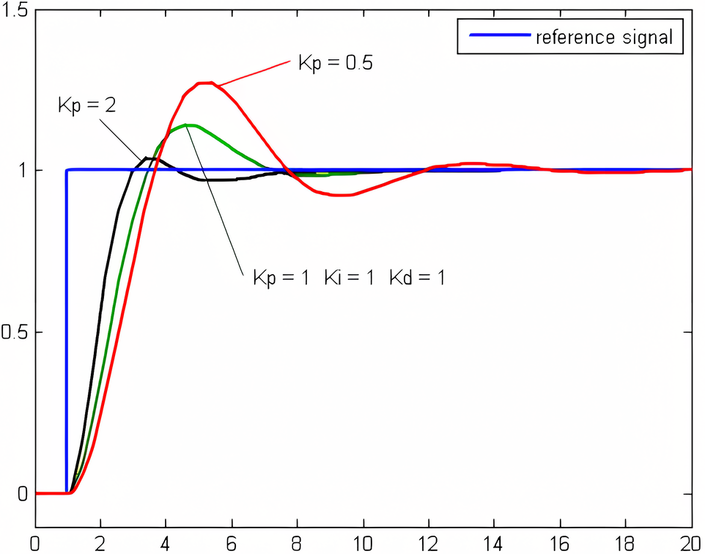{width=54%}

As we can see, the P factor determines the steepness of the inclination of the curve.
In terms of throttle response we would like to have P as high as possible without the system overshooting too much or becoming unstable (hunting for requested boost pressure).

If we try to draw the value of Pout into the graph we would get a result that looks like the yellow line.

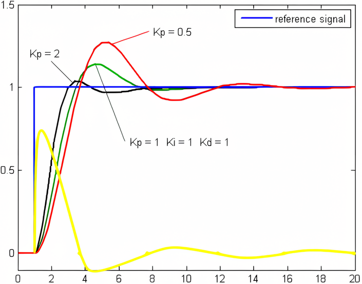{width=54%}

#### Integral output (Iout)

The contribution from the integral term is proportional to both the magnitude of the current error (requested boost minus measured boost) and the duration of the error.
Summing the instantaneous error over time (integrating the error) gives the accumulated offset that should have been corrected previously.
The accumulated error is then multiplied by the integral gain which is fetched from the I_fors table) and added to the controller’s output.
So, the influence of the integral factor depends on the integral gain from I_fors.
The fetched value is called Ki.

$$
I_{\text{out}} = K_i \int_0^t e(\tau) \, d\tau
$$

Iout: Integral output\
Ki: integral gain fetched from I_fors which depends on RPM and boost error\
e: error = boost requested minus boost measured\
τ: time in the past contributing to the integral response

The integral term (when added to the proportional term) accelerates the movement of the process towards the requested boost and eliminates the residual steady-state error that occurs with a proportional only controller.
However, since the integral term is responding to accumulated errors from the past, it can cause the present value to overshoot the requested boost value (create an error in the other direction so that measured boost will be higher than the requested boost).

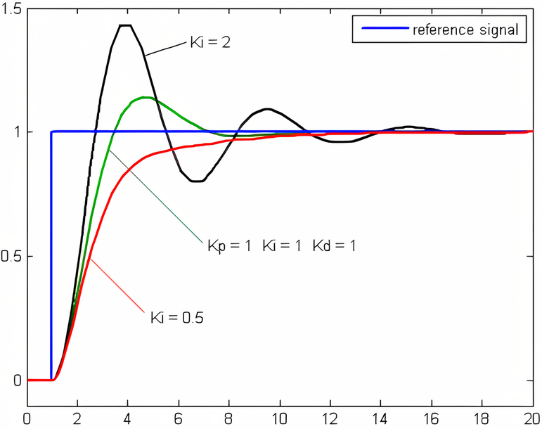{width=59%}

If we draw the Iout value (indicative again) in the image we would get the yellow line in this image.

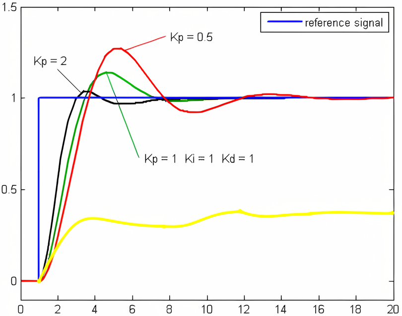{width=62%}

#### Derivative output (Dout)

The rate of change of the boost pressure error is calculated by determining the slope of the error over time (i.e. its first derivative with respect to time) and multiplying this rate of change by the derivative gain Kd.
The magnitude of the contribution of the derivative term to the overall control action is termed the derivative gain, Kd.

$$
D_{\text{out}} = K_d \frac{de}{dt}
$$

Dout: Derivative output\
Kd: Derivative Gain, a tuning parameter\
e: Error = SP − PV\
t: Time or instantaneous time (the present)

The derivative term slows the rate of change of the controller output and this effect is most noticeable close to the controller set point.
Hence, derivative control is used to reduce the magnitude of the overshoot produced by the integral component and improve the combined controller-process stability.
However, differentiation of a signal amplifies noise and thus this term in the controller is highly sensitive to noise in the error term, and can cause a process to become unstable if the noise and the derivative gain are sufficiently large.

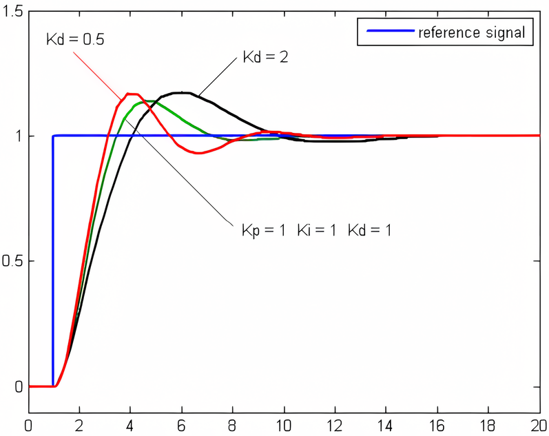{width=61%}

If we look at the graph above we can see that the error starts off as zero (engine = idling).
The moment the boost request changes (throttle opened) The error changes very fast to 1 (blue line).
The change rate is highest at this point.
Where the red line is flat, there is no change in error so Dout will be zero there.
If we look at the next image we can see the rate of change in the yellow line.

We now see that *Dout* is only a factor when boost inclines or declines very fast.
This is shown in the yellow line (indicative) in the image below.

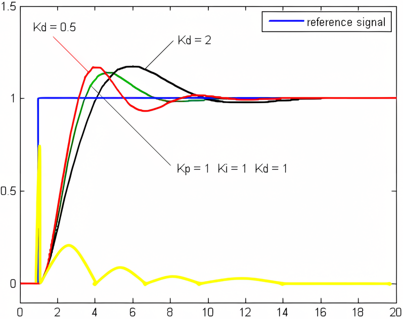{width=61%}

#### PID controller output

The output from the three terms, the proportional, the integral and the derivative terms are summed to calculate the output of the PID controller.
Defining u(t) as the controller output, the final form of the PID algorithm is:

$$
\mathrm{u(t)} = \mathrm{MV(t)} = K_p e(t) + K_i \int_0^t e(\tau) \, d\tau + K_d \frac{de}{dt}
$$

- Kp: Proportional Gain - Larger Kp typically means faster response since the larger the error, the larger the Proportional term compensation.
  An excessively large proportional gain will lead to process instability and oscillation.
- Ki: Integral Gain - Larger Ki implies steady state errors are eliminated quicker.
  The trade-off is larger overshoot: any negative error integrated during transient response must be integrated away by positive error before we reach steady state.
- Kd: Derivative Gain - Larger Kd decreases overshoot, but slows down transient response and may lead to instability due to signal noise amplification in the differentiation of the error.

**Effects of *increasing* parameters**

| Parameter | Rise Time      | Overshoot | Settling Time | Offset Error |
|-----------|----------------|-----------|---------------|--------------|
| Kp        | Decrease       | Increase  | Small Change  | Decrease     |
| Ki        | Decrease       | Increase  | Increase      | Eliminate    |
| Kd        | Small Decrease | Decrease  | Decrease      | None         |

#### Implementation in Trionic 5

If we take a closer look at the parameters in the Trionic software we can see that the factors Kp, Ki and Kd depend on RPM and pressure error.
This makes the already complicated system even more complex because not only is the boost request and measured boost a variable but also the factors in which P, I and D are applied.
This makes tuning these parameter tables very difficult.

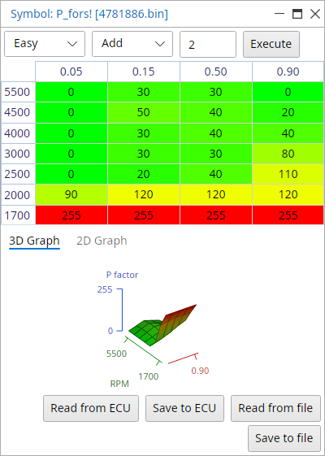{width=40%}

The image above shows a stock P_fors (Kp in out previous paragraphs) table for manual transmission on a B234R engine.
We can clearly see that values differ a lot with RPM and pressure error.
Low pressure errors (0-0.10 bar) are not adjusted over 2500 RPM.
The highest Kp is found in the lowest RPM range.
This is probably because the turbo still needs to spool up on this region so regulation is strong here.

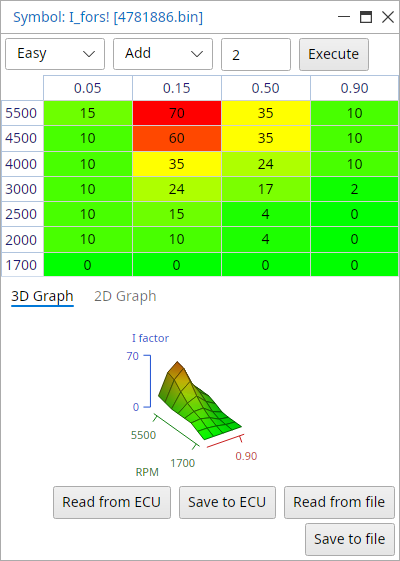{width=40%}

Here we see the Ki factors used in the stock firmware.
What seems kind of strange is that I peaks at a low boost error and high range RPM.

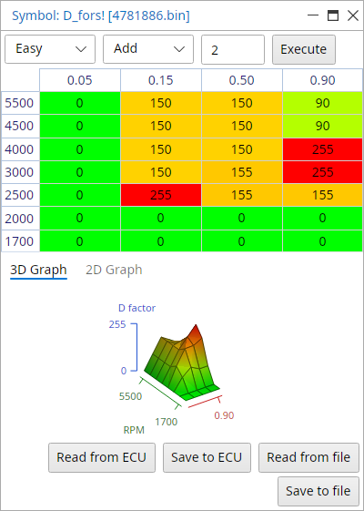{width=40%}

And finally we take a look at the Kd factor in the stock firmware.
It seems kind of dumb to have these strange high values in the table at seemingly random places.
The fact that Kd is low on low error values is quite understandable because we saw earlier that Kd is only an active component when boost pressure changes quickly.

If we step back to our example of idling and then opening the throttle 100%, we can see that the boost error will be large at low RPM.
Looking at the tables we find that Kp starts of high, Ki is zero and Kd is zero.
The system will start to work its way to the requested boost.
While it is doing so, RPM rises and the boost error decreases.
Suppose we pass 2500 RPM and the boost error has decreased to 0.5 bar.
We now have a Kp of 40, Ki of 4 and a Kd of 155.
So, the system is suddenly completely different and will not increase boost so fast anymore because Kp is much lower.
Kd is coming into play to prevent overshoot and Ki is rising to settle to the right requested boost.
We just keep going on WOT and our RPM has climbed up to 4000 RPM and the pressure error is virtually non existing. 0.05 bar.
We now have a Kp of 0, an Ki of 10 and a Kd of 0.
Again the entire system has changed and we now have a situation where boost inclination is very low and we are just keeping at this pressure level.

As you can see, getting familiar with the PID control algorithm is a very time consuming factor.
If you don’t have to alter these settings, please don’t.
**You must know exactly what you are doing and exactly what your goals** are before you change the PID control parameters.
More boost doesn’t require the PID control parameters to be changed, just change the boost request maps and the boost regulation control tables (reg_kon_mat tables) for that.

#### Having a drive

If we drive the car and log RPM, Manifold pressure, P_factor, I_factor and PWM signal we end up with a graph like shown below.

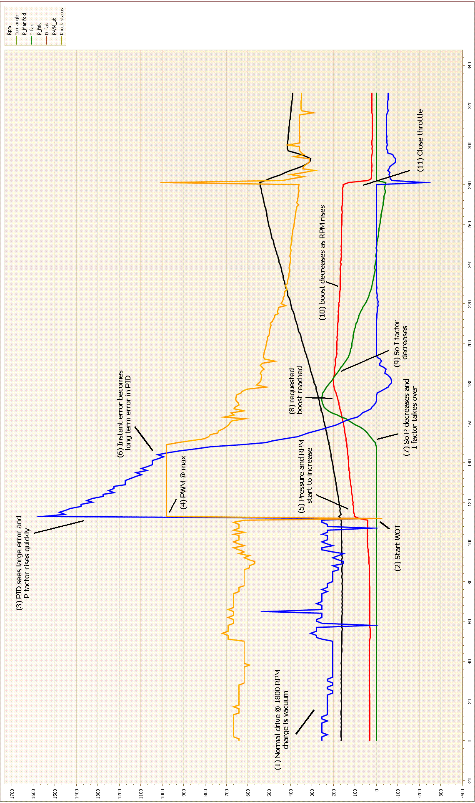{width=80%}

In more detail, throttle response in relation to PID parameters and PWM output can be read from this image.

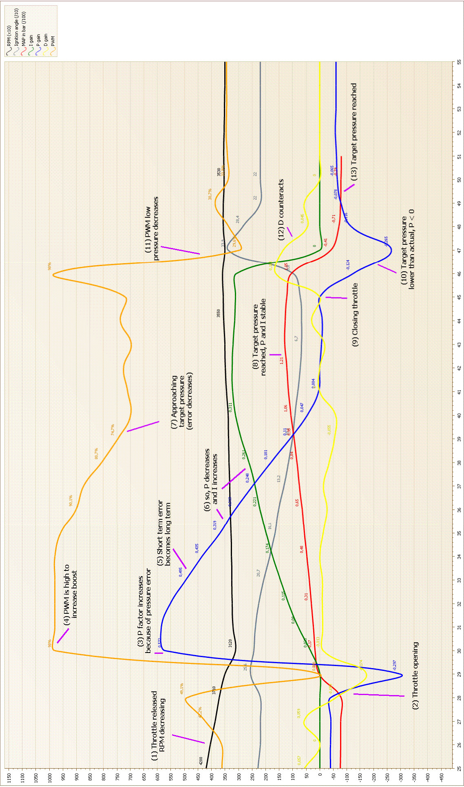{width=85%}

If we WOT the car under load the response can be as shown in this image.

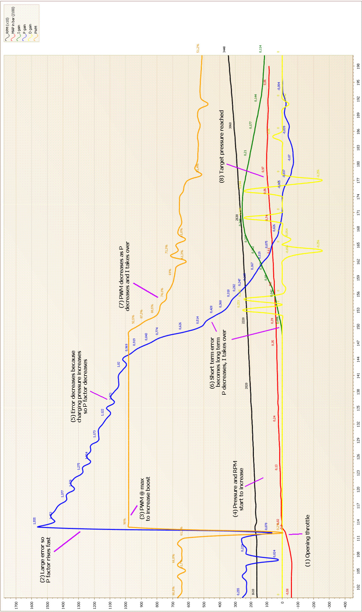{width=85%}

Closing and opening the throttle in respect to the PID/PWM parameters are shown in this last image.

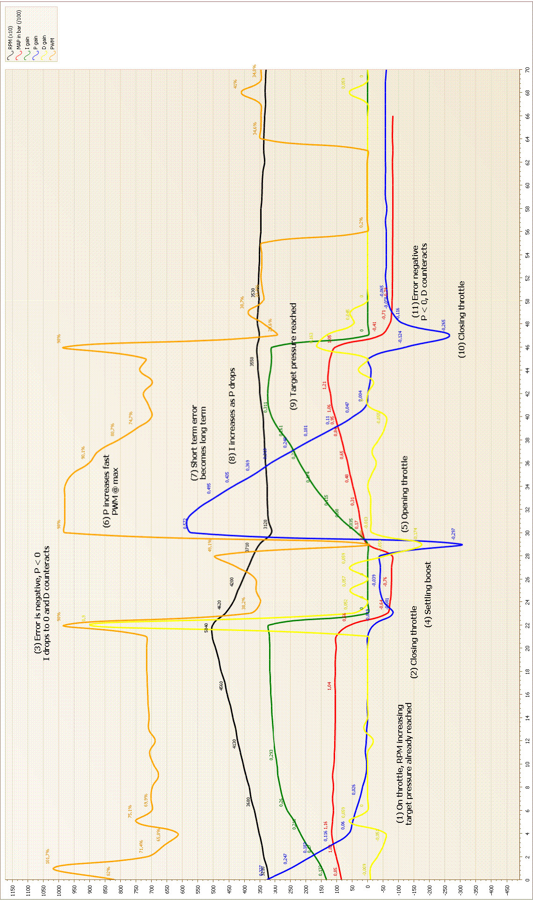{width=88%}

If we add Pout, Iout and Dout and plot it against the PWM output we can see that there is a very strong resemblance.

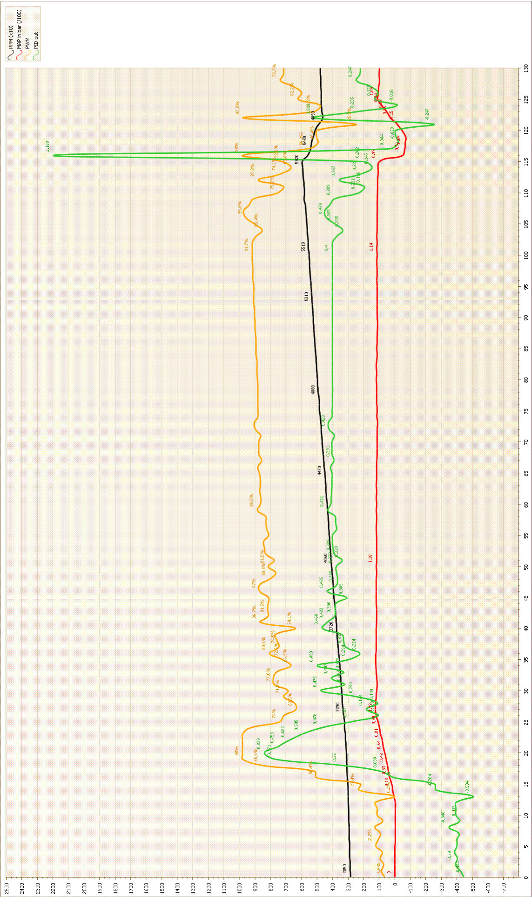{width=86%}

#### Reading the code

Reading the assembler code from the Trionic gives us more insight about the PID behaviour and lets us verify the things we see in practice.
The major formula for the calculation of the PWM signal on the boost control valve is:

$$
\begin{aligned}
\text{PWM\_ut} = \text{APC\_Knock} * (&\text{reg\_kon\_mat} + \text{temperature\_correction} + \text{P\_gain} \\
&+ \text{I\_Gain} + \text{D\_Gain} + \text{Apc\_Adapt})
\end{aligned}
$$

***In which***

*APC knock*

From this we see that knocking can decrease charging pressure (we already knew this, but the formula confirms it) with a certain factor.

APC_Knock = (100 - APC_decrese ) / 100

Where APC_decrese = factor that determines how much boost pressure should be lowered in case of knocking

*Reg_kon_mat*

Reg_kon_mat is an offset table that determines what offset to add to the PID controllers output to get to the PWM output signal.
We can see this in the previous image… the difference in offset between the yellow and the green line is the current reg_kon_mat value.

The percentage found in reg_kon_mat is actually the bias (preset) of PWM signal in a given RPM site.

*Temperature_correction*

| Temperature            | Addition to PWM_ut |
|------------------------|--------------------|
| Below 0 ˚C             | 0                  |
| Between 0 ˚C and 40 ˚C | Temperature \* 2   |
| Over 40 ˚C             | 80                 |

*P_gain*

$$
\text{P\_gain} = \text{P\_factor} * (\text{pressure\_error} / 10)
$$

Where pressure error = 50 when 0.5 bar

*I_gain*

$$
\text{I\_gain} = \text{I\_factor} * (\text{cumulative\_pressure\_error} / 10)
$$

Where cumulative pressure error = I_factor \* pressure_error + previous cumulative error

The cumulative pressure error gets cleared (set to zero) whenever:

The cumulative pressure error > 100 and I_factor > I_fak_max\
The cumulative pressure error \< -100 and I_factor \< -I_fak_max\
on NOT wide open throttle I_gain = 0\
on break I_gain = 0\
on cruise control I_gain = 0

*D_gain*

$$
\text{D\_gain} = (\text{D\_factor} * \text{pressure\_error}) / 2
$$

Where pressure error = 50 when 0.5 bar

*Notes*

Under 1000 rpm PWM_ut = 0.2 %\
PWM_ut maximum = 98%\
PWM_ut minimum = 0.2%

## Tuning with TxSuite

TxSuite incorporates several ways to tune your software to another stage.

### Manual tuning

You can alter maps and parameters within the binary file using TxSuite.
This is done by selecting the desired symbol from the symbollist and double clicking it, or pressing Enter.
Ctrl+P is the quick way, type any part of a symbol's name and Enter opens it.
A map viewer will appear and you can manually alter the values in the map.
The Tuning menu opens the most important maps directly, grouped by injection, ignition, turbo control, knock detection, warmup and idle.

#### Map presentation

You can view the data in a map in several ways: hexadecimal, decimal and easy.
The box at the left of the map viewer's toolbar switches between them (Hex, Decimal, Easy and ASCII, the last one is read only).
File → Settings → Common → Default view type for maps sets the view a map opens in.

In hexadecimal mode the numbers in the map are displayed as hexadecimal numbers (0-F).
If you don’t know how to interpret hexadecimal numbers you can switch the view to decimal numbers (0-9) or even easy view.
Easy view lets you view the map in understandable numbers for as much as the maps are known.
Boost pressure maps for example are converted from numbers ranging from 0 to 255 to actual boost pressure values (-1 bar to 1.55 bar).

With a 3.0, 3.5, 4.0 or 5.0 bar MAP sensor the boost pressure maps and the MAP axes show the pressure for that sensor.
TxSuite takes the sensor from the file, Mapsensor in Actions → Firmware information.
Most pro made tunes don't have that marker, File → Settings → T5 → Auto detect mapsensor type lets TxSuite find the sensor by examining certain maps.

#### Color indicators

The map can be displayed in table form as well as in graphical form, the 3D Graph and 2D Graph tabs under the table.
The values are displayed in colors from green (low values) through yellow to red (high values), over the smallest and largest value of that map.
File → Settings → Common → Color blind mode has other colour scales if you find these hard to tell apart.
The graphs can be switched off for performance reasons, File → Settings → Common → Show graphs in mapviewer.

#### Altering values in a map

To edit a value in a map just point and click on the specific cell and type the new value.
To edit several cells at once you can hold the Ctrl-button on your keyboard then point and click on each individual cell you want to edit the same way.
Finally you can click, hold and drag to select several cells in the same box.
A value typed with several cells selected goes into all of them.
To avoid that you have to adjust all values of a “large” map manually some features have been added to the map editor:

- Plus key: adds 1 to all selected cells
- Minus key: subtracts 1 from all selected cells
- PageUp key: adds 10 to all selected cells (0x10 in hex view)
- PageDown key: subtracts 10 from all selected cells (0x10 in hex view)
- Home key: sets all selected cells to the maximal value
- End key: sets all selected cells to 0

And the toolbar above the table does math on the selected cells, pick one of:

- Fill: a value to fill the selected cells with.
- Add: a value to add to the selected cells.
- Multiply: a value to multiply the selected cells by.
- Divide: a value to divide the selected cells by.

Type the value in the box next to it and click Execute.
Ctrl+Z undoes the last change and Ctrl+Y redoes it, as many steps back as you like.

You can also select one or multiple cells, right click and chose “Copy selected cells” or “Paste selected cells” where you could choose: “At original position” or “At currently selected location”.

Save to file writes the map into the binary and updates the checksum, Read from file throws away the changes.

### Tuning wizard

TxSuite can tune most binaries automatically.
Stages I, II, III are standard.
Tuning → Tuning wizards → Tune me up ® opens the tuning wizard, choose the stage and click Ok.
Please check appendix V for hardware requirements.

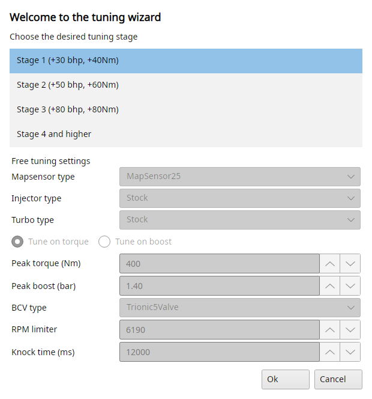{width=55%}

After Ok adaptions will be made to boost request tables, injection table, knocking map tables etc.
After making the changes a report will be generated indicating exactly which changes have been made to your software, Save... stores it as a text file.
Of course a backup of your binary is created before making the changes.
A file that is already tuned to a higher stage isn't touched.

| Stage | Boost B234E/L | Boost B234R, B204E/L/R | Boost B234E/L (AUT) | Boost B234R, B204E/L/R (AUT) |
|-------|---------------|------------------------|---------------------|------------------------------|
| I     | 1.05          | 1.15                   | 0.95                | 1.04                         |
| II    | 1.15          | 1.25                   | 1.04                | 1.13                         |
| III   | 1.25          | 1.35                   | 1.13                | 1.22                         |

Stage 4 and higher enables you to set the parameters for the wizard manually, the free tuning settings under the list.
They are the MAP sensor, injectors and turbo, tune on torque or on boost with the peak torque or peak boost, the boost control valve (BCV) type, the RPM limiter and the knock time.
Depending on your input TxSuite will try to generate a close as possible match to your hardware.
Tuning beyond stage III requires you to verify AFR and knock sensitivity in realtime to make sure everything is working properly.

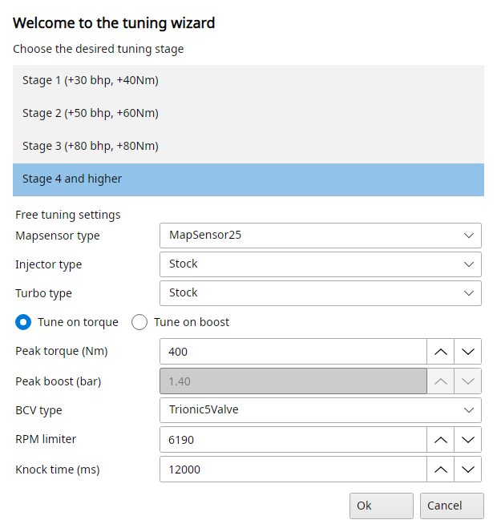{width=55%}

## Converting to 3 bar mapsensor

### Introduction

This chapter will explain the issues that one will encounter when the need for a 3 bar mapsensor rises.
This need surfaces when a tuned car must reach over ~1.4 bar boost pressure.
The standard mapsensor is a 2.5 bar variant and hence will measure correctly to approx. 2.5 bar minus environment pressure (which is ~1 bar) minus saturation level of the sensor ~3% so about 1.4 bar.

Above this boost pressure level the standard mapsensor will not suffice anymore and an upgraded one should be mounted for the Trionic to be able to measure boost pressure correctly.

### Issues

The real issues we’re faced with when doing this conversion are not of the hardware type.
Boost pressure calculation is one of the smaller issues that we encounter.
Suppose we are working on a binary that has the following boost request map (Tryck_mat).

{#fig-boost-request-map width=40%}

The values displayed are the requested boost pressure for a given throttle position and rpm.
The boost requested at 2000 rpm at wide open throttle (WOT) is 1.00 bar.
Trionic will try to reach this requested boost level by controlling the boost control valve (solenoid) using a complex control mechanism.

Suppose we hook up this car with a 3 bar mapsensor and change nothing else.

The Trionic would then measure lower voltages from the sensor for a given boost level.

The output voltage values for the stock 2.5 bar mapsensor are:

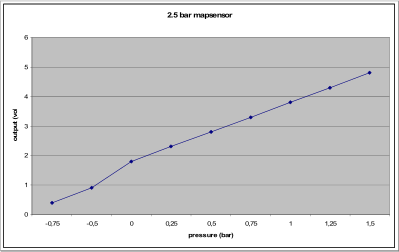{width=93%}

For the 3 bar sensor these are the approximate values:

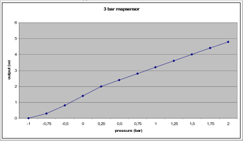{width=93%}

Hence, we could change the map to the boost levels the Trionic would be trying to reach.
TxSuite shows this when you set Mapsensor to 3.0 bar in Actions → Firmware information without converting anything, the map viewers then show the pressure maps and the MAP axes as a 3.0 bar sensor reads them.
@fig-boost-request-map-3bar and @fig-ignition-map-3bar-axis are the same file marked that way.

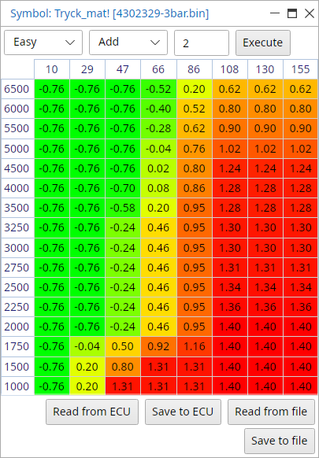{#fig-boost-request-map-3bar width=40%}

Now we can clearly see that the boost levels the Trionic would be trying to reach are way higher.
But… now we come to the real issues…

Imagine the ignition map having boost pressure as x axis.
Normally the most ignition advance will be around a certain boost pressure level.

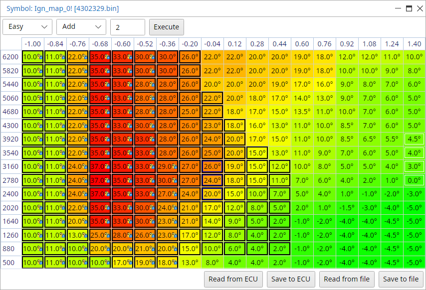{#fig-ignition-map width=80%}

Now let’s change the boost pressure axis to the values the Trionic would be measuring when a 3 bar mapsensor would be installed.

{#fig-ignition-map-3bar-axis width=80%}

Now we can clearly see that the ignition advance shifts over the boost pressure axis.
The 35 degrees advance we see in @fig-ignition-map is set for -0.68 bar boost pressure.
In the 3 bar table (@fig-ignition-map-3bar-axis) this advance point is suddenly shifted to -0.62 bar.

This of course should not happen!!
Ignition advance for -0.68 bar should remain the same.
So, the entire map should be shifted to the left a bit when using a 3 bar sensor.

An example for such an ignition map is given in @fig-ignition-map-3bar.
This is the same table after TxSuite converted the file to a 3.0 bar sensor (see Implementation in TxSuite below).
The axis runs up to 1.80 bar now and the advance stays at the same boost pressure, the 35 degrees are at -0.69 bar, close to the -0.68 bar of @fig-ignition-map.

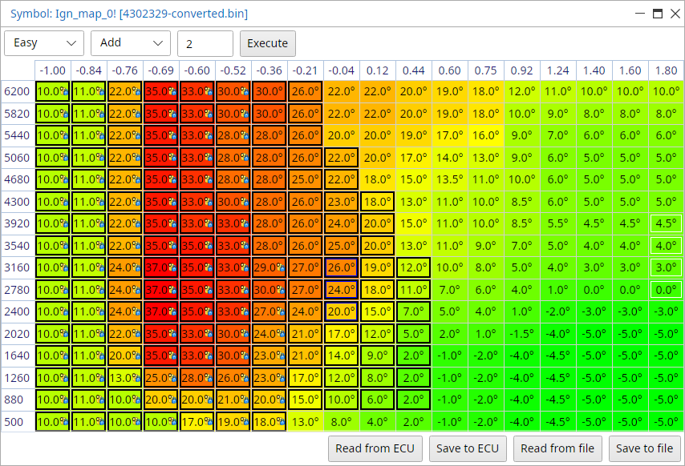{#fig-ignition-map-3bar width=80%}

Now you can see that not only the pressure maps should be altered but also every single table that has a boost pressure dependency.
One can easily understand the complexity of the conversion problem.
In the next chapters a summary will be given for known tables that have this dependency.

### Maps that should be considered when converting to 3 bar sensor

| Symbolname        | Description                                          | Dependency                |
|-------------------|------------------------------------------------------|---------------------------|
| Tryck_mat         | Boost table for manual transmission                  | Values are boost pressure |
| Tryck_mat_a       | Boost table for automatic transmission               | Values are boost pressure |
| Tryck_vakt_tab    | Boost limiter                                        | Values are boost pressure |
| Regl_tryck_fgaut  | Boost limiter 1^st^ gear automatic                   | Values are boost pressure |
| Regl_tryck_fgm    | Boost limiter 1^st^ gear manual                      | Values are boost pressure |
| Regl_tryck_sgm    | Boost limiter 2^nd^ gear manual                      | Values are boost pressure |
| Limp_tryck_konst  | Limp home mode maximum boost                         | Values are boost pressure |
| Idle_tryck        | Boost level on idle                                  | Values are boost pressure |
| Insp_mat          | Fuel injection correction table                      | Boost pressure in x axis  |
| Ign_map_0         | Ignition map for warm engine (main map)              | Boost pressure in x axis  |
| Ign_map_2         | Ignition map for knock detection                     | Boost pressure in x axis  |
| Ign_map_3         | Ignition map transient                               | Boost pressure in x axis  |
| Ign_map_4         | Ignition map for cool engine (warmup map)            | Boost pressure in x axis  |
| Ign_map_6         | Ignition map for torque reduction upshift            | Boost pressure in x axis  |
| Ign_map_7         | Ignition map for torque reduction downshift          | Boost pressure in x axis  |
| Ign_map_8         | Ignition map for idle during speed                   | Boost pressure in x axis  |
| Lambdamatris      | Lambda sensor control factors                        | Boost pressure in y axis  |
| Knock_press_tab   | Pressure limit for knock indication                  | Values are boost pressure |
| Purge_tab         | Purge matrix ( 0 – 100% )                            | Boost pressure in x axis  |
| Del_mat           | Delay map (crankshaft degrees)                       | Boost pressure in x axis  |
| Temp_reduce_mat   | Fuel Injection, Temperature compensation reduction map (open throttle) | Boost pressure in x axis  |
| Temp_reduce_mat_2 | Fuel Injection, Temperature compensation reduction map (closed throttle) | Boost pressure in x axis  |
| Mis1000_map       | Misfire maximum allowed (emission level)             | Boost pressure in x axis  |
| Mis200_map        | Misfire maximum allowed (cat overheating)            | Boost pressure in x axis  |
| Misfire_map       | T5.2 only                                            | Boost pressure in x axis  |
| Detect_map        | Reference map for misfire detection                  | Boost pressure in x axis  |
| Knock_ref_matrix  | Knock reference map                                  | Boost pressure in x axis  |
| Turbo_knock_tab   | Pressure limit for turbo knock regulation            | Values are boost pressure |
| Iv_min_load       | Pressure for which adaption should be adjusted       | Values are boost pressure |
| Min_load_gadapt   | Minimum load for global adaption                     | Values are boost pressure |
| Max_load_gadapt   | Maximum load for global adaption                     | Values are boost pressure |
| Kadapt_load_low   | Pointed adaption minimum load                        | Values are boost pressure |
| Kadapt_load_high  | Pointed adaption maximum load                        | Values are boost pressure |
| Last_cyl_komp     |                                                      | Values are boost pressure |
| Open_loop         | Load limit where system switches to openloop         | Values are boost pressure |
| Open_loop_adapt   | Open loop adaption (not used?)                       | Values are boost pressure |
| Open_loop_knock   | Load limit where system switches to open loop during knock conditions. | Values are boost pressure |
| Lacc_clear_tab    |                                                      | Values are boost pressure |
| Lner_detekt       |                                                      | Values are boost pressure |
| Lupp_detekt       |                                                      | Values are boost pressure |
| Sond_heat_tab     | Load limit for lambda sonde heating                  | Values are boost pressure |
| Grund_last        |                                                      | Values are boost pressure |
| Grund_last_max    |                                                      | Values are boost pressure |

Still investigating tables:

*Overs_tab_xaxis*

### Implementation in TxSuite

TxSuite has a “convert to different MAP sensor” wizard build in that allows you to alter your binary so that all the before mentioned parameters are automatically changed.
It's in Tuning → Tuning wizards → Convert to different MAP sensor, with an item for a 2.5, 3.0, 3.5, 4.0 and 5.0 bar sensor, and only shows with File → Settings → T5 → Advanced mode enabled.
TxSuite asks before it converts (see the picture below), Yes alters the file and shows a report of the changes, Save... stores it as a text file.

NOTE: Converting to a 3 bar mapsensor is a very complex procedure.
You will have to verify all settings after converting the binary and check operation using knock sensing LED, EGT meter and wideband lambda sensor.

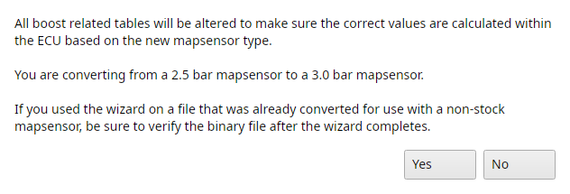{width=65%}

## Converting T5 to larger injectors

This chapter will explain the issues that one will encounter when converting to larger injectors.
The standard injectors deliver 345 cc of fuel \@ 3 bar pressure.

The approximate maximum power achievable with these injectors is ~300 bhp.
When a car is to be tuned over this power, larger injectors are needed to be able to supply the amount of fuel needed for this.

### Injector information

#### Stock injectors on Saab 9000 1993

Brand: Lucas\
Mfd. p/n:D5162EA\
Imp: 15.9 Ohms\
Flow: 286g C7H16 \@ 3 bar / 60s (~408 cc/min)

#### Stock injectors on Saab 9000 1994-1998

345 cc/min \@ 3 bar fuel pressure

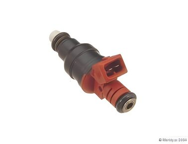{width=29%}

**Static Flow Rate:** 31.6 lb/hr \@ 43.5PSI = 239.4 g/min = 349 cc/min (+/-4%)\
**Dynamic Flow Rate 2.5ms pulse width \@ 100Hz:** 6.68 mg/pulse (+/-6%)\
**Coil Resistance:** 16.2 Ohms (+/-0.35 Ohms)\
**Physical Dimensions:** EV1 Body Type\
**Connector:** Minitimer (Bosch EV6)

Possible upgrades can be:

#### Bosch -968 “Green Giants”

465 cc/min \@ 3.8 bar fuel pressure.\
413 cc/min \@ 3.0 bar fuel pressure.

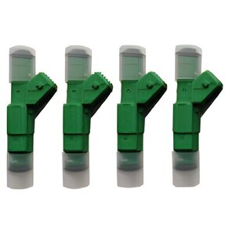{width=22%}

#### Siemens Deka 630 cc/min \@ 3.0 bar fuel pressure.

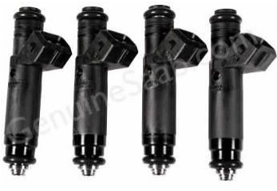{width=27%}

**Static Flow Rate (GAS):** 62.7 lb/hr = 646 cc/min = 474 g/min\
**Dynamic Flow Rate 2.5ms PW \@ 100Hz (GAS):** 20.2mg/pulse\
**Coil Resistance:** 12 Ohms\
**Gain:** 0.11ms/mg\
**Offset:** 0.055ms\
**Turn on time \@ 14VDC:** 1.14ms\
**Turn off time:** 0.85ms \@ 600KPa\
**Factory Tolerance:** +/-6 %\
**Spray Pattern:** Cone (4-Hole)\
**Connector:** Minitimer (Bosch EV1)

#### Siemens Deka 4 875 cc/min \@ 3.0 bar fuel pressure.

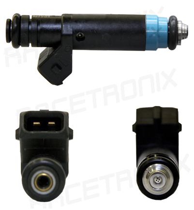{width=33%}

**Static Flow Rate (GAS):** 80 lb/hr = 875 cc/min\
**Dynamic Flow Rate 2.5ms PW \@ 100Hz (GAS):** 18.6 mg/pulse\
**Coil Resistance:** 12 Ohms\
**Spray Pattern:** Pencil\
**Connector:** Minitimer

#### Bosch EV14 920 cc/min \@ 3.0 bar fuel pressure.

**Static Flow Rate (GAS):** 88 lb/hr = 920 cc/min\
**Coil Resistance:** 12 Ohms

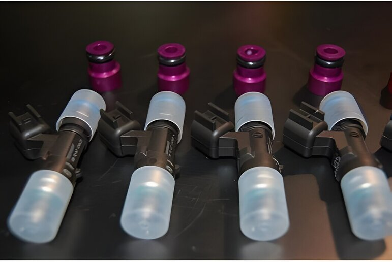{width=59%}

### Technical information

Injectors used in Saabs with Trionic 5 engine management systems are of the high impedance type.
This means the impedance (resistance) is ~12 Ω.
The other type – low impedance - is not used in conjunction with T5.
The low impedance type are ~3 Ω.

Injectors are actually little solenoid valves which open when current flows through them.
By pulsing the injectors the right amount of times per interval the valves are opened and closed in the same frequency as engine RPM.
This way the fuel can be injected at precisely the right moment.

The waveform supplied to a single injector could look something like in @fig-injector-pulse.

{#fig-injector-pulse width=60%}

Theoretically the injector would open at the point where the voltage goes high and close where the voltage goes low.

By changing the width of the pulse the effective opening time per period can be changed and thus the amount of fuel injected per cycle.
When less fuel is needed as shown in @fig-injector-pulse the width is lowered and could result in @fig-injector-pulse-narrow.

{#fig-injector-pulse-narrow width=60%}

When more fuel is needed the waveform will get wider and could look something like @fig-injector-pulse-wide.
This is called Pulse Width Modulation (PWM).

{#fig-injector-pulse-wide width=60%}

In these examples the frequency stays the same (RPM) while the pulse width changes (throttle opening and therefore fuel requirement).
When engine RPM rises the amount of pulses per period of time would simply increase.
This is shown in @fig-injector-pulse-rpm.

{#fig-injector-pulse-rpm width=60%}

This image instantly clarifies why injectors are limited to a certain level of power.
The maximum opening time that can be reached is determined by the maximum rpm value the engine can achieve.
When engine speed rises the duration that the fuel can be injected decreases.
At the point of maximum engine speed this duration will be at its minimum.
The effective injection duration in other rpm sites cannot be higher than at this point.

The PWM duty cycle is the percentage between on and off time.
A typical maximal duty cycle is ~80%.
This means the injectors flow rate \* 0.8 is about the maximum amount of fuel the injector can deliver in action.

### Converting math

When calculating fuel flow rate from one rail pressure to another we’ll have to use this formula:

$$
R_n = \sqrt{P_n / P_o} * R_o
$$

R~n~ = New flow rate for the new rail pressure.\
P~n~ = New pressure on the rail.\
P~o~ = Old pressure on the rail.\
R~o~ = Old flow rate at the old rail pressure.

For example we need to recalculate the flow rate for the green giant injectors for 3 bar rail pressure.
The rated flow \@ 3.8 bar is given by the manufacturer and is 465 cc / minute.

The formula will be:

Rn = √(3.0 / 3.8) \* 465 = ~ 413 cc / minute

When we want to calculate the rail pressure to get a certain flow rate from our injectors we’ll have to use this formula:

$$
P_n = P_o * (R_n / R_o)^2
$$

P~n~ = New pressure that needs to be applied\
P~o~ = Old pressure (current)\
R~n~ = Desired rate of flow for injector\
R~o~ = Old flow (current)

For example we want to get 370 cc of flow from our stock injectors.

The new pressure would then be:

3.0 \* (370/345)\^2 = ~ 3.45 bar

### Real world

In reality injectors don’t open instantly.
They need time to open the valve.
Dramatized a bit the actual opening time will look something like the red line in @fig-injector-open-time.
Opening and closing ramps must be taken into consideration.
In an ideal world the injector would go from closed to open on the exact moment the pulse is applied.
In high resistance injector injection systems, like the T5, this is a factor that must be taken into consideration.

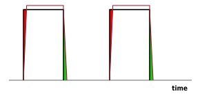{#fig-injector-open-time width=60%}

What is apparent is that fuel starts to flow at the start of the pulse but the injector’s flow rate isn’t reached until a certain time after the pulse was applied.
At the end of the pulse we must take the closing time into account.
Note that the opening and closing ramps are asymmetrical, this means that the ramp faults do not cancel each other out.
The fuel we are missing is denoted by the red colour and the extra fuel is denoted by the green colour.
There can also be differences in the height of the figures due the differences between injectors.
Bosch standard injectors have small manufacturing tolerances so the differences are thereby small.
When dealing with larger injectors, even small differences in percentage leads to large real differences.
In this case we must therefore consider flow matched injectors.
The Siemens 630 cc has a reputation of having large differences in flow rate, especially when measuring on low and mid range duty cycle.
Differences in flow rate could lead to pre ignition/detonation when one cylinder is running lean and the others are running rich because the injectors inject different amount of fuel.
The knock regulation in Trionic 5 should protect the engine from failures but it can result in rough idle and a roller coaster like wideband lambda readout on idle and mid-range RPM.

The opening time is in direct relation to the battery voltage and the relative fuel pressure, the closing time is in direct relation to the relative fuel pressure.
Therefore one idea could be to adjust the Batt_korr_tab! to cancel out the difference in opening time when converting to larger injectors.
The Batt_korr_tab! table regulates the time the injectors are held open in respect of the battery voltage because of the relationship of how fast the injectors open when different voltages are applied.

The most important thing to remember is that larger injectors need more time to open than the stock injectors.
The fuel flow maybe better (more fuel per microsecond passes the valve simply because the opening is larger) but the valve is a bit bigger too and hence needs more time to open.
On low rpm values this might not be a very big issue but on higher rpm ranges the frequency of the waveform is also higher and hence the injectors response time becomes more important (there’s simply less time per cycle to get the fuel into the intake manifold).
If we replace the injectors from @fig-injector-open-time to larger ones the new opening times could look something like @fig-injector-open-time-large.

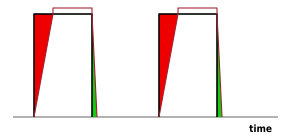{#fig-injector-open-time-large width=60%}

These two images make the concrete problem very visible.
The opening duration multiplied by the flow rate determines the effective amount of fuel injected.
Larger injectors need a little more time to open – hence the actual opening time gets smaller – but the amount of fuel per microsecond is larger.
Setting up the software in such a way that the injectors deliver the required amount of fuel at all RPM and load ranges takes some work.

### Simple conversion

Up to ~25% larger injectors can be used without many problems.
The change in opening times are relative small and can be altered using a constant in the software.
The remainder of the difference in injected fuel can be adapted by the Trionic using the lambda values measured (there’s a limit to this adaption of course).

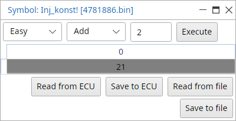{#fig-injector-constant width=40%}

If we look at the Trionic software we find that there’s a constant called Inj_konst present.
This constant lets us influence the factor used in the fuel injection calculation.
In stock software this constant is mostly set to ~20.

When we upgrade to larger injectors we need to decrease this constant (opening time needs to be smaller with larger injectors) by the same percentage that the injectors were increased.

### Examples

#### Fuel pressure upgrade

We upgrade the fuel pressure from 3.0 (44 psi) bar to 3.8 bar (55 psi).

If we use the math on this pressure rise we’ll find out that the stock injectors will deliver:

**R~n~ = √(3.8 / 3.0) \* 345 = 388 cc/min**

The factor of extra fuel will be 388/345 = 1.125

The Inj_konst value in the software used was 21.
Now we divide this value with 1.125 and this results in ~19.
Since we must round the figure to an integer value we might need to fine-tune the injection table (insp_mat) to make sure we don’t have any lean/rich spots using a wideband lambda sensor.

#### Injector upgrade

We upgrade our stock injectors with larger Bosch “green giant” injectors.

We leave the fuel pressure \@ 3 bar.

The larger injectors will deliver 465 cc of fuel \@ 3.8 bar.

At 3 bar these injectors will deliver ~413 cc of fuel per minute.

Our gain factor in this case will be 413/345 = 1.197.

If we recalculate the injector constant (21 / 1.197) = 17.5, we’ll have to enter 18.

Again we have to round the result and we might need fine-tuning of the injection map (insp_mat) to make sure we don’t have any lean/rich spots using a wideband lambda sensor.

### Advanced conversion

If we want to replace our stock injectors with much larger injectors we’ll have to do more than only altering the injector constant.

Trionic won’t be able to adapt the injection time difference that will occur because of the injector opening latency when the difference in injector flow is more than ~25%.

In this case we’ll need to alter the injector constant as well as remap the entire injection map (insp_mat).

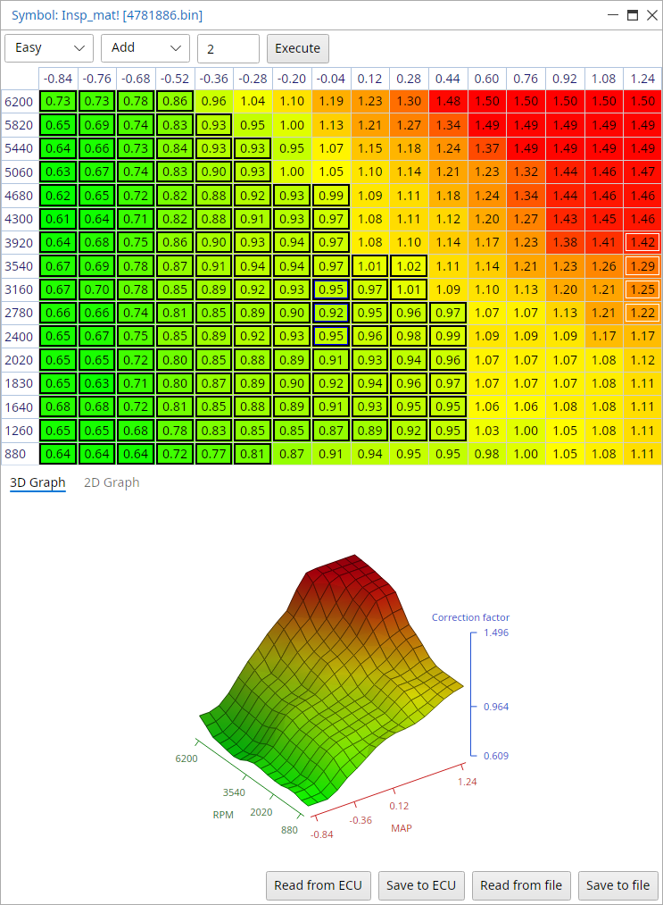{#fig-injection-map width=65%}

Since the injection map is already mapped up to its limit in the stock software we need to make sure that we alter the injector constant in such a way that too much fuel is injected.
That way, we can drop the injection map later on to get the fueling spot on.
If we would change the injector constant to a lower value we might have to increase the injection map which is no longer possible because it is already maxed out in high rpm/high load.

Suppose we get the Siemens injectors instead of our stock injectors.
The injectors will deliver 630 cc of fuel per minute.
This is 630/345 = 1.83 times more than stock.

We’ll have to adjust the injector constant with this factor also.
Because we want to be able to alter the injection map afterwards (and we cannot put higher values in it so we’ll have to get lower) we have to make sure that the injector constant is a bit higher than we calculate.

The new injector constant would be around (21 / 1.83) = 11.4

Because we need to be able to alter the injection map afterwards we would have to enter 12 or 13 for the injector constant.

Now remember the extra time the injector needs to be opened.
Because there’s no standard way of calculating this we need to increase the injector constant from the value we have up to the point where the engine starts to run rich.
I’ve seen 630cc injectors used with an injector constant of 17 (!).

Now we need to remap the injection matrix site by site.
We’ll see that we need to decrease the values in the map because the engine was already running rich.

To be able to remap the injection matrix properly you’d ideally need an exhaust gas temperature meter (EGT), a wide band lambda sensor + display and a rolling road.

The latter is to make sure you can determine on which load and rpm site you are working.

### Implementation in TxSuite

TxSuite has a wizard for this, Tuning → Tuning wizards → Convert to larger injectors, it only shows with File → Settings → T5 → Advanced mode enabled.
Choose your injector type (stock, green giants or Siemens 630, 875 or 1000 cc) and it shows the current and proposed values: the injector constant, the crank factor and the battery correction from 15 V down to 5 V.
The picture below is a stock B234R with the Siemens 630 cc injectors chosen, the injector constant goes from 21 to 16.
Ok writes the proposal into the binary, Cancel leaves it alone.

The wizard doesn't take flow rates or fuel pressure, it moves the injector constant by a fixed step for each injector type.
For a different fuel pressure or other injectors use the formulas above and change Inj_konst! yourself.

<!-- TODO roffe: T5Suite's "Fuel tuning..." calculator (flow rate and fuel pressure in, injector constant out, +1 per 100 cc for latency) is gone in TxSuite. Is "use the formulas above" enough here, or is there a tool to point at? -->

Again: when injectors flow changes by more than 25 percent the injector constant and injection map needs verification too.

NOTE: minimum time for normal idle ~ 1.2 ms.

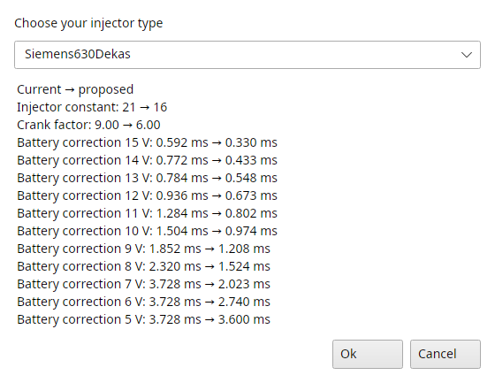{width=55%}

## Adjusting supporting axis

If you want to rescale maps – for example – to support higher engine speeds you need to perform a couple of steps.

Open the map you want the axis changed for.

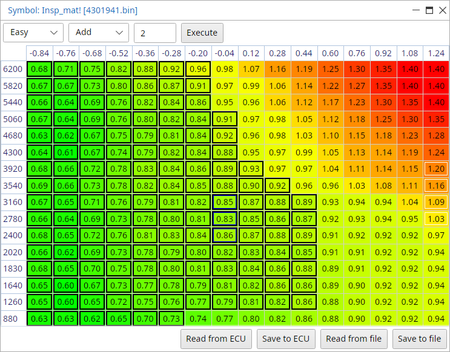{width=71%}

Suppose we want to change the Y-axis (RPM) here.
Right click in the table and select “Edit y-axis”.

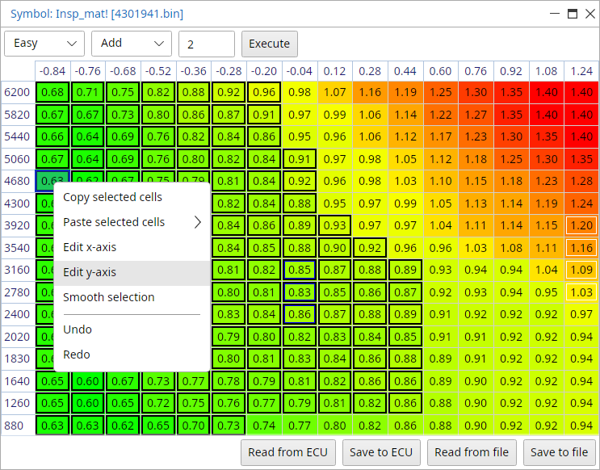{width=71%}

A new map viewer will appear with the map called “Fuel_map_yaxis!”.
This map contains the axis numbers for the given map, the rpm divided by 10 (88 is 880 rpm).

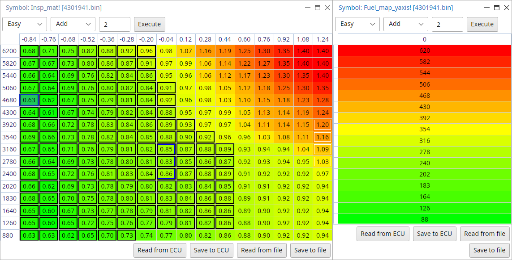{width=95%}

Now you can edit this map with axis values, save it with Save to file, then close the original map (insp_mat in this case) and open it again.
The map will now have the new axis values.
Read from file on the original map isn't enough, it only reads the map's values again, not its axis.

**WARNING**

**NOTE**: Please note that changing the axis values WILL cause Trionic to lookup different cells from a map and so, you will have to rescale the maps content as well (in this case, insp_mat).
If you don’t rescale everything the way it is supposed to be Trionic will fetch the wrong values from the map while the engine is running which may result in engine damage.

**NOTEII:** Also note that support axis may be used by more than one map.
Please check Actions → Browse axis information in TxSuite to confirm that there are no more maps that you need to rescale other than the one you started out with.
