# CAN Bus interface

When interfacing with the Trionic T5.x unit through the CAN bus it is possible to retrieve data from the ECU.
The CAN interface supplies information about runtime variables (symbols) and allows for flashing and reading the flash content (to be developed) in a faster way than the BDM interface does.

## General information

Chip used on Trionic side: Intel AN825256\
Communication speed used: 615 Kbit/s

The most frequently used interface for this is the Lawicel CANUSB interface that can be found on [www.canusb.com](http://www.canusb.com).
This interface can convert CAN signals onto you USB port and vice versa.
The interface has a USB port on one side – that connects to you computer – and an male RS232 (DB9) connector on the other side.
This side connects to the CAN bus of the Trionic.

The Lawicel interface has the following pinout on the DB9 connector.

{width=64%}

## Connecting to CAN bus with ECU on your desk

The CAN bus is connected to the ECU through pin 62 (CANH) and pin 63 (CANL).
Of course ground is also required.
To connect the CAN interface directly to the Trionic, use this schema.
If you want to connect to the Trionic unit in the car please check the next paragraph that handles the SFI test connector.

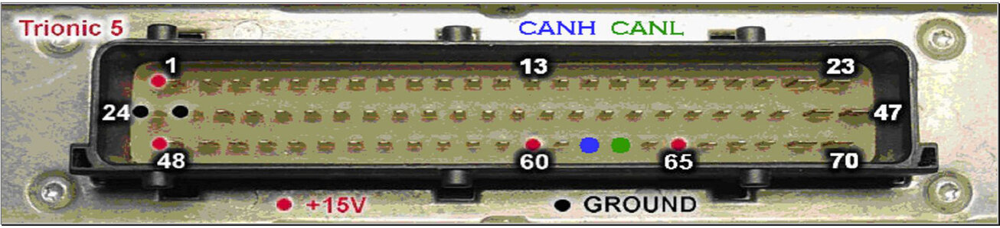{width=100%}

## CAN Bus (SFI) test connector

In most **9000** T5 cars the connection for the CAN Bus is located in an SFI test connector that is located near the ECU.
It is a six pin connector for which the pinning is given below.

| Pinnumber | Description                 | Color       | Trionic pin   |
|-----------|-----------------------------|-------------|---------------|
| 1         | CAN H                       | Grey        | 62            |
| 2         | CAN L                       | Red         | 63            |
| 4         | Ignition + (15)             | Green/white | From fuse box |
| 5         | Ground                      | Black       | 24 & 25       |
| 6         | +15 V (Programming voltage) | Red/white   | 65            |

The location of the pins in the connector housing – looking on the cable side of the connector - is shown in @fig-sfi-connector.
These numbers are also embossed into the plastic on the side of the connector itself.

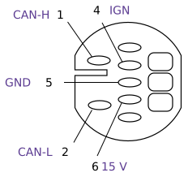{#fig-sfi-connector width=34%}

SFI Connector in-car has partnumber: 44 11 518\
SFI Connector counterpart (that you need) has partnumber: 44 10 510\
SFI Connector terminal (pins) used for this connection are partnumber: 12 79 06 14 from which you will need at least 3 (CAN-H, CAN-L and GND).

In **9^3^ and 900NG** cars the connector is different and looks like the image shown below.

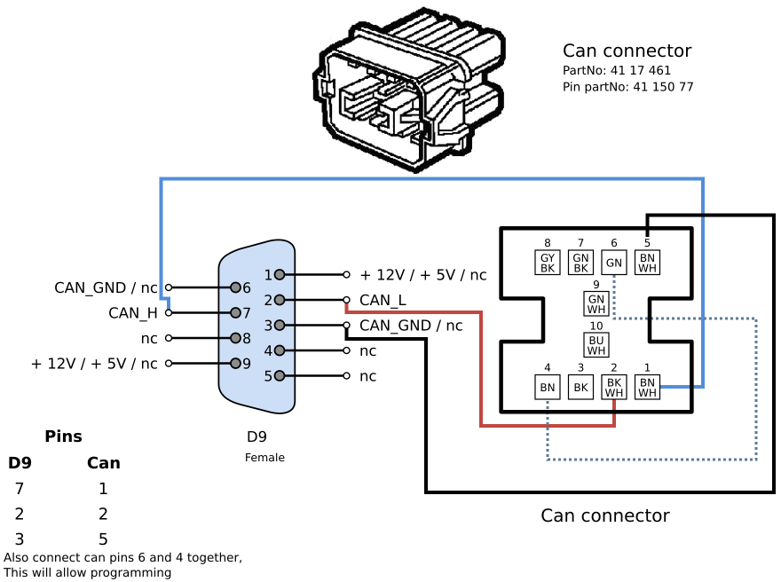{width=100%}

::: {layout-ncol=2}
900NG connector\
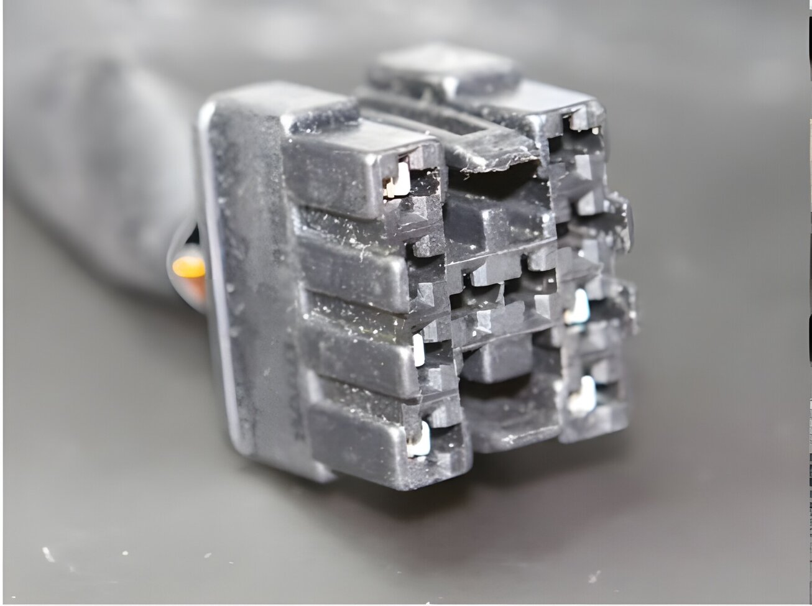

9^3^ connector\
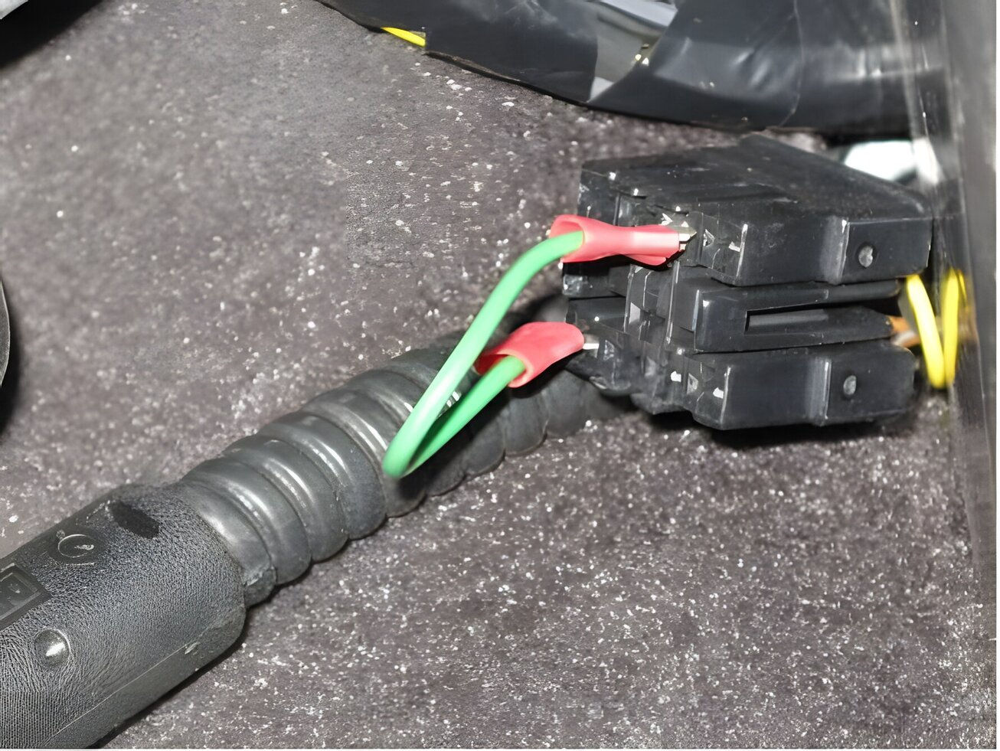
:::

## CAN Bus termination

A CAN bus interface needs to be terminated by 120 Ω on both sides.
This means a resistor should be soldered over CANH and CANL lines as close as possible on either side of the line.

But… Trionic is already terminated internally by 120 Ω.
This is probably done because the CAN interface on Trionic would never be used as a real bus architecture, it would always be a one-to-one connection.
This voids the need for adding a resistor on the Trionic side.

For the best result the cable used should be twisted (CANH and CANL) up to approx. 1 cm from the connectors.

## CAN Bus protocol {.advanced}

SAAB engineers have implemented a proprietary protocol on top of the CAN Bus layer.
The CAN layer is the transport layer in the OSI model while the SAAB protocol is the application layer.

This chapter will describe the message structure used in transferring data to and from Trionic over the CAN Bus.
The protocol for sending and receiving data to and from SRAM is relatively easy.
All CAN messages sent to Trionic have CAN message ID 0xC4 while messages received from Trionic are message ID 0xC6.

### Low level commands

#### Send command byte for read

| Byte | 0    | 1    | 2    | 3    | 4    | 5    | 6   | 7    |
|------|------|------|------|------|------|------|-----|------|
| Data | 0x00 | 0x00 | 0x00 | 0x00 | 0x00 | 0x00 | CMD | 0xC4 |

#### Send command byte

| Byte | 0    | 1    | 2    | 3    | 4    | 5    | 6   | 7    |
|------|------|------|------|------|------|------|-----|------|
| Data | 0xFF | 0xFF | 0xFF | 0xFF | 0xFF | 0xFF | CMD | 0xC4 |

#### Send acknowledge

| Byte | 0    | 1    | 2    | 3    | 4    | 5    | 6    | 7    |
|------|------|------|------|------|------|------|------|------|
| Data | 0x00 | 0x00 | 0x00 | 0x00 | 0x00 | 0x00 | 0x00 | 0xC6 |

#### Set address for uploading bootloader

| Byte | 0    | 1    | 2      | 3      | 4      | 5      | 6      | 7    |
|------|------|------|--------|--------|--------|--------|--------|------|
| Data | 0x00 | 0x00 | LENGTH | ADR_LL | ADR_LH | ADR_HL | ADR_HH | 0xA5 |

#### After set address: \#frames to write data into SRAM

| Byte | 0     | 1     | 2     | 3     | 4     | 5     | 6     | 7     |
|------|-------|-------|-------|-------|-------|-------|-------|-------|
| Data | BYTE7 | BYTE6 | BYTE5 | BYTE4 | BYTE3 | BYTE2 | BYTE1 | INDEX |

Note: INDEX = 0x00 – 0x7F

#### Jump to address (after uploading bootloader, to start executing the bootloader)

| Byte | 0    | 1    | 2    | 3      | 4      | 5      | 6      | 7    |
|------|------|------|------|--------|--------|--------|--------|------|
| Data | 0x00 | 0x00 | 0x00 | ADR_LL | ADR_LH | ADR_HL | ADR_HH | 0xC1 |

#### Get flash end address

| Byte     | 0    | 1    | 2    | 3    | 4    | 5    | 6    | 7    |
|----------|------|------|------|------|------|------|------|------|
| Data     | 0x00 | 0x00 | 0x00 | 0x00 | 0x00 | 0x00 | 0x00 | 0xC3 |
| Response | 0xB8 | 0x89 | 0xFF | 0xFF | 0x07 | 0x00 | 0x00 | 0xC3 |

#### Set Analogue to digital register values

| Byte | 0      | 1   | 2   | 3   | 4   | 5  | 6     | 7    |
|------|--------|-----|-----|-----|-----|----|-------|------|
| Data | STATUS | AD3 | AD2 | AD1 | AD0 | ID | BANK0 | 0xC5 |
| Data | ???    | AD7 | AD6 | AD5 | AD4 | ID | BANK1 | 0xC5 |

Note: BANK = 0x00 or 0x01

#### Read data from SRAM

| Byte     | 0       | 1       | 2       | 3       | 4       | 5      | 6      | 7    |
|----------|---------|---------|---------|---------|---------|--------|--------|------|
| Data     | 0x00    | 0x00    | 0x00    | ADR_LL  | ADR_LH  | ADR_HL | ADR_HH | 0xC7 |
| Response | (ADR+5) | (ADR+4) | (ADR+3) | (ADR+2) | (ADR+1) | B(ADR) | 0x00   | 0xC7 |

### High level commands

#### Request symboltable command (uses send command byte)

To fetch the entire symboltable from the ECU you will need to issue a command ‘S’ \<CR>

So, two frames are send actually:

| Byte | 0    | 1    | 2    | 3    | 4    | 5    | 6    | 7    |
|------|------|------|------|------|------|------|------|------|
| Data | 0xFF | 0xFF | 0xFF | 0xFF | 0xFF | 0xFF | 0x53 | 0xC4 |
| Data | 0xFF | 0xFF | 0xFF | 0xFF | 0xFF | 0xFF | 0x0D | 0xC4 |

#### Request software version command

To fetch the entire symboltable from the ECU you will need to issue a command ‘s’ \<CR>

So, two frames are send actually:

| Byte | 0    | 1    | 2    | 3    | 4    | 5    | 6    | 7    |
|------|------|------|------|------|------|------|------|------|
| Data | 0xFF | 0xFF | 0xFF | 0xFF | 0xFF | 0xFF | 0x73 | 0xC4 |
| Data | 0xFF | 0xFF | 0xFF | 0xFF | 0xFF | 0xFF | 0x0D | 0xC4 |

#### Write to SRAM command

WAAAADD\<CR>\
W = ‘W’ (0x57)\
AAAA = address to write to in hexadecimal form in capitals\
DD = data to write in hexadecimal for in capitals\
\<CR> = carriage return character (0x0D)

To issue a write command all bytes in the command stated above should be transmitted as frames.

Example

To write a value 0x1c to SRAM address 0x107a the command to issue would be W107A1C\<CR>

The frames to send would then be:

| Byte | 0    | 1    | 2    | 3    | 4    | 5    | 6    | 7    |
|------|------|------|------|------|------|------|------|------|
| Data | 0x00 | 0x00 | 0x00 | 0x00 | 0x00 | 0x00 | 0x57 | 0xC4 |
| Data | 0x00 | 0x00 | 0x00 | 0x00 | 0x00 | 0x00 | 0x31 | 0xC4 |
| Data | 0x00 | 0x00 | 0x00 | 0x00 | 0x00 | 0x00 | 0x30 | 0xC4 |
| Data | 0x00 | 0x00 | 0x00 | 0x00 | 0x00 | 0x00 | 0x37 | 0xC4 |
| Data | 0x00 | 0x00 | 0x00 | 0x00 | 0x00 | 0x00 | 0x41 | 0xC4 |
| Data | 0x00 | 0x00 | 0x00 | 0x00 | 0x00 | 0x00 | 0x31 | 0xC4 |
| Data | 0x00 | 0x00 | 0x00 | 0x00 | 0x00 | 0x00 | 0x43 | 0xC4 |
| Data | 0x00 | 0x00 | 0x00 | 0x00 | 0x00 | 0x00 | 0x0D | 0xC4 |

#### Read from SRAM command

| Byte | 0    | 1    | 2    | 3  | 4  | 5    | 6    | 7    |
|------|------|------|------|----|----|------|------|------|
| Data | 0x00 | 0x00 | 0x00 | AH | AL | 0x00 | 0x00 | 0xC7 |

AH = Address High byte and AL = Address Low byte

The response to this message should be a CAN message with ID 0x0C

| Byte | 0     | 1     | 2     | 3     | 4     | 5     | 6    | 7    |
|------|-------|-------|-------|-------|-------|-------|------|------|
| Data | DATA6 | DATA5 | DATA4 | DATA3 | DATA2 | DATA1 | 0x0C | 0xC6 |

## Monitoring real time data

To be able to monitor your engine’s status while driving you can fill the dashboard with gauges (which of course looks very cool) showing you boost pressure, intake air temperature, coolant temperature etc.
Another route is to hook up the CAN bus SFI connector to a laptop using the Lawicel CANUSB converter and monitor all engine parameters on the computer.
This has several trivial advantages.

- You don’t need a gauge for every parameter you want to monitor
- You can monitor much more parameters
- You can rearrange the monitor layout much easier
- You can add logging function for evaluation

T5Suite incorporates a Canbus driver library (for which we owe General Failure lots of gratitude) which enables the application not only to monitor live data from the Trionic, but also to download adaption data from it.
This chapter will address the first while the next chapter will address the latter.
There’s literally hundreds of symbols that can be monitored in Trionic.
We will discuss only the most trivial symbols/parameters here.
You must be aware of the fact that some symbols consist of multiple ‘flags’.
These flags indicate a certain state or event in the ECU.
Flags are bit masked in a byte or multiple bytes.

| Symbol          | Description                                          | Type        |
|-----------------|------------------------------------------------------|-------------|
| P_Manifold      | Current manifold pressure (kPa)                      | Byte        |
| Batt_volt       | Battery voltage (\*10)                               | Byte        |
| Adapt_injfaktor | Long term fuel adaption factor                       | Byte        |
| Rpm             | Current engine speed                                 | Integer     |
| Rpm_pol         | Current engine speed scaled for 1 byte               | Byte        |
| Lufttemp        | Current manifold intake air temperature              | Byte        |
| Kyl_temp        | Current cooling water temperature                    | Byte        |
| Medellast       | Average calculated engine load                       | Byte        |
| Medeltryck      | Average inlet manifold pressure                      | Byte        |
| Medeltrot       | Average TPS value                                    | Byte        |
| Lambdaint       | Current lambda intergator value                      | Byte        |
| PWM_ut          | PWM signal (%) to BPC valve                          | Integer     |
| PWM_ut10        | PWM signal (%) to BPC valve scaled for 1 byte        | Byte        |
| Mis200_tot      | Misfire catalyst overheating counter                 | Integer     |
| Mis1000_tot     | Misfire emission degradation counter                 | Integer     |
| Pgm_status      | Program status flags                                 | 4/5/6 bytes |
| Knock_status    | Program status flags                                 | 4/5/6 bytes |
| Ready           | Flags register indicating ready codes for one trip   | Integer     |
| APC_status      | APC status byte                                      | Integer     |
| APC_adapt       | APC adaption value                                   | Integer     |
| Diag_status     | Diagnose status byte                                 | 12 bytes    |
| \*\_error       | All error counters                                   | Byte        |
| Last            | Current engine load                                  | Byte        |
| Last_delta      | Load change                                          | Byte        |
| Bil_hast        | Current vehicle speed                                | Byte        |
| Batt_korr       | Correction factor for injection depending on voltage | Integer     |
| AD_sond         | A/D value for front lambda sonde                     | Byte        |
| AD_bat          | A/D value for battery voltage                        | Byte        |
| AD_EGR          | A/D value for EGR temperature                        | Byte        |
| AD_knock        | A/D value for knocking detection                     | Byte        |
| AD_trot         | A/D value for Throttle Position Sensor               | Byte        |
| AD_lufttemp     | A/D value for manifold air intake temperature        | Byte        |
| AD_kylv         | A/D value for coolant temperature                    | Byte        |
| U_lambda_eng    | Front lambda value                                   | Integer     |
| P_fak           | APC controller P factor                              | Integer     |
| I_fak           | APC controller I factor                              | Integer     |
| D_fak           | APC controller D factor                              | Integer     |
| Regl_tryck      | Control pressure (target)                            | Byte        |
| Gear            | Current gear                                         | Byte        |

| Symbol         | Byte   | Mask     | Description                                                        |
|----------------|--------|----------|--------------------------------------------------------------------|
| APC_status     | 0      | 0x80     | Car_speed 45-55 km/h                                               |
|                | 0      | 0x40     | Car_speed const. between 45-55 km/h                                |
|                | 0      | 0x20     | I-part for APC regulator activated                                 |
|                | 0      | 0x10     | Overboost enable                                                   |
|                | 0      | 0x08     | Brake                                                              |
|                | 0      | 0x04     | Cruise                                                             |
|                | 0      | 0x02     | New reduce of pressure allowed                                     |
|                | 0      | 0x01     | Allowed to adapt "I_fak_max"                                       |
|                | 1      | 0x80     | Torque reduce automatic                                            |
|                | 1      | 0x40     | APC adaption disable                                               |
| Knock_status   | 0      | 0x80     |                                                                    |
|                | 0      | 0x40     |                                                                    |
|                | 0      | 0x20     |                                                                    |
|                | 0      | 0x10     | Knock indicates to lower boost ?                                   |
|                | 0      | 0x08     | Knock indicates to lower boost ?                                   |
|                | 0      | 0x04     |                                                                    |
|                | 0      | 0x02     |                                                                    |
|                | 0      | 0x01     | Knock_average > Knock_average_limit (knock detected)               |
| Diag_status    | 0      | 0x01     | Idle error                                                         |
|                | 0      | 0x02     | IAT error                                                          |
|                | 0      | 0x04     | Speed error                                                        |
|                | 0      | 0x08     | Front lambda sonde error                                           |
|                | 0      | 0x10     | Throttle error                                                     |
|                | 0      | 0x20     | Pressure error                                                     |
|                | 0      | 0x80     | Water temperature error                                            |
|                | 1      | 0x01     | RPM out error                                                      |
|                | 1      | 0x10     | Front lambda sonde omslag error                                    |
|                | 1      | 0x80     | Rear lambda sonde lean ignition                                    |
|                | 2      | 0x02     | Cat error (rear lambda)                                            |
|                | 2      | 0x04     | Rear lambda sonde lean                                             |
|                | 2      | 0x80     | Cooling water temperature activity test ready                      |
|                | 5      | 0x01     | Start_tryck out of range (mapsensor error?)                        |
|                | 5      | 0x08     | Knock levels within boundaries                                     |
|                | 5      | 0x10     | Use diagnose for front lambda parameters                           |
|                | 6      | 0x01     | Something wrong with front lambda sonde                            |
|                | 6      | 0x04     | Indicates that front lambda sensor transition test has failed      |
|                | 8      | 0x40     | Front lambda sonde transition test ready                           |
|                | 8      | 0x02     | Indicates that OBD2 diagnose part is disabled due to high altitude or low temperature |
|                | 8      | 0x10     | Rear lambda sonde activity test ready                              |
|                | 8      | 0x20     | Rear lambda sonde activity test approved                           |
|                | 8      | 0x40     | Front lambda sonde activity test ready                             |
|                | 9      | 0x20     | Rear lambda sonde heater test ready                                |
|                | 9      | 0x40     | Front lambda sonde heater test ready                               |
|                | 11     | 0x10     | Rear lambda sonde “peak over 400 mV” test ok                       |
|                | 11     | 0x40     | Indicates that OBD2 diagnose part is disabled due to high altitude or low temperature |
|                | 13     | 0x02     | Tank pressure test enabled                                         |
|                | 13     | 0x04     | Tank pressure test ok                                              |
|                | 13     | 0x80     | Tank pressure air inlet closed                                     |
|                | 14     | 0x04     | Indicates tank pressure error                                      |
|                | 14     | 0x20     | Indicates large leakage in tank system                             |
|                | 14     | 0x10     | Indicates small leakage in tank system                             |
|                | 14     | 0x40     | Indicates tank pressure sensor shorted to +5V                      |
|                | 14     | 0x80     | Indicates tank pressure sensor shorted to ground                   |
| Ready          | 0      | 0x8000   | Trip ready                                                         |
|                | 0      | 0x4000   | Warmup cycle ready                                                 |
|                | 0      | 0x2000   | Driving cycle ready                                                |
|                | 0      | 0x0001   | System performed front lambda sonde transition test                |
| Knock_offset   | 0      | 0x7FFF   | Knock flag                                                         |
| Readiness      | 0      | 0x8000   | Indicates catalyst monitor readiness state                         |
|                | 0      | 0x4000   | Indicates EVAP purge monitor readiness state                       |
|                | 0      | 0x2000   | Indicates both oxygen sensor monitor readiness state               |
|                | 0      | 0x1000   | Indicates both oxygen sensor heater monitor readiness state        |
| MError         | 0      | 0x80     | Indicates momentary error on TPS signal                            |
|                | 6      | 0x80     | Indicates momentary error on vehicle speed signal                  |
|                | 12     | 0x80     | Indicates momentary error on water temperature signal              |
|                | 18     | 0x80     | Indicates momentary error on MAP signal                            |
|                | 24     | 0x80     | Indicates momentary error on front lambda sensor                   |
|                | 30     | 0x80     | Indicates momentary error on rear lambda sensor                    |
|                | 36     | 0x80     | Indicates momentary error on battery voltage                       |
|                | 42     | 0x80     | Indicates momentary error on intake air temperature                |
|                | 48     | 0x80     | Indicates momentary error on knock signal                          |
| Cat_status     | 0      | 0x8000   | Set when delta load are within limits                              |
|                | 0      | 0x4000   | Set when cooling water temperature is above limit                  |
|                | 0      | 0x2000   | Set when vehicle speed is within limits                            |
|                | 0      | 0x1000   | Set when fuel system enters closed loop                            |
|                | 0      | 0x0800   | Set when airflow is within limits                                  |
|                | 0      | 0x0400   | Set when warm up data is ok                                        |
|                | 0      | 0x0200   | Set when system disapproves current oxygen sensor 1                |
|                | 0      | 0x0020   | Set when a stage 1 evaluation should start                         |
|                | 0      | 0x0010   | Set if catalyst test fails                                         |
|                | 0      | 0x0008   | Set when catalyst evaluation is ready                              |
|                | 0      | 0x0004   | Used to enable catalyst monitor function                           |
|                | 0      | 0x0001   | Set if one or more of the used input sensors has detected errors. Disables catalyst monitor. |
|                | 2      | 0x8000   | Set if throttle is open                                            |
| PMProt         | 0      | 0x8000   | Purge monitor diagnostic is ready, resets on ignition OFF          |
|                | 0      | 0x4000   | Indicates that purge monitor test is enabled and currently running |
|                | 0      | 0x2000   | Indicates purge monitor test result. Set at ignition OFF. Resets after one successful test. |
|                | 0      | 0x1000   | Indicates "Save Lambda Reference" state.                           |
|                | 0      | 0x0400   | Indicates "Ramp To Start" state.                                   |
|                | 0      | 0x0200   | Indicates "Perform Test Open" state.                               |
|                | 0      | 0x0100   | Indicates "Perform Test Close" state.                              |
|                | 0      | 0x0040   | Indicates that the system has detected idle state.                 |
|                | 0      | 0x0020   | Indicates that vehicle speed equals 0.                             |
|                | 0      | 0x0010   | Indicated that the system has enabled purge control.               |
|                | 0      | 0x0010   | Indicated that the system has enabled purge control.               |
|                | 0      | 0x0008   | Indicates that no failure has been detected on used input sensors. |
|                | 0      | 0x0004   | Indicates that purge monitor has entered halt state.               |
|                | 0      | 0x0002   | Indicates that front lambda transition check is ready.             |
| Diag_mod       | 0      | 0x20     | Tank pressure diagnostics                                          |
| Pgm_status     | 0      | 0x01     | Ignition key on                                                    |
|                | 0      | 0x02     | Afterstart 2 completed                                             |
|                | 0      | 0x04     | Engine is stopped                                                  |
|                | 0      | 0x08     | Engine is started                                                  |
|                | 0      | 0x10     | Engine is warm                                                     |
|                | 0      | 0x20     | Pressure guard triggered (fuel cut)                                |
|                | 0      | 0x40     | Temperature compensation active                                    |
|                | 0      | 0x80     | RPM guard is triggered (RPM limiter)                               |
|                | 1      | 0x01     | Application sync ok                                                |
|                | 1      | 0x02     | Knock fuel map activated (also see: Knock_status)                  |
|                | 1      | 0x04     | Throttle closed                                                    |
|                | 1      | 0x08     | Room temperature start                                             |
|                | 1      | 0x10     | Fuel off cylinder 4                                                |
|                | 1      | 0x20     | Fuel off cylinder 3                                                |
|                | 1      | 0x40     | Fuel off cylinder 2                                                |
|                | 1      | 0x80     | Fuel off cylinder 1                                                |
|                | 2      | 0x01     | Fuel not off (during sync. off ign.)                               |
|                | 2      | 0x02     | Dec.enleanment completed throttledec                               |
|                | 2      | 0x04     | Acc.enrichment completed throttleinc.                              |
|                | 2      | 0x08     | Decrease of retard enrichment allowed                              |
|                | 2      | 0x10     | Start of retard enrichment in progress                             |
|                | 2      | 0x20     | Adaption allowed                                                   |
|                | 2      | 0x40     | Limp-home mode                                                     |
|                | 2      | 0x80     | Always active temp.compensation                                    |
|                | 3      | 0x01     | Restart                                                            |
|                | 3      | 0x02     | Active lambda control                                              |
|                | 3      | 0x04     | Afterstart enrichment completed                                    |
|                | 3      | 0x08     | Init during start completed                                        |
|                | 3      | 0x10     | Cooling water enrichment finished                                  |
|                | 3      | 0x20     | Purge control active (engine running in closed loop)               |
|                | 3      | 0x40     | Separate fuel map during idle                                      |
|                | 3      | 0x80     | Ignition synchronized                                              |
|                | 4      | 0x01     | Sond heating, second sond                                          |
|                | 4      | 0x02     | Sond heating, first sond                                           |
|                | 4      | 0x04     | ETS error                                                          |
|                | 4      | 0x08     | Ordinary idle control disable                                      |
|                | 4      | 0x10     | Fuel cut allowed (Dashpot)                                         |
|                | 4      | 0x20     | Enrichment after fuelcut                                           |
|                | 4      | 0x40     | Fulload enrichment                                                 |
|                | 4      | 0x80     | Fuel syncronized                                                   |
| Idle_status    | 0      | 0x80     | Neutral position                                                   |
|                | 0      | 0x40     | AC off                                                             |
|                | 0      | 0x20     | Engine is running in idle mode                                     |
| Knock_status   | 0      | 0x01     | Knock indicator                                                    |
|                |        | 0x08     | Knock adapted ???                                                  |
| Airpump_status | 0      | 0x80     | Airpump output pin 52 on                                           |
| Restart_status | 0      | 0x08     | Soak five minutes                                                  |

Layout for Error_frame symbol

| Offset  | Content           | Description                      | Example                    | Length   |
|---------|-------------------|----------------------------------|----------------------------|----------|
| 0x00    | Battery_time      | Last battery ok time             | 0x00 0x00 0x03 0xA7        | 4        |
| 0x04    | Diag_tid          | Ignition on timer in seconds     | 0x00 0x00 0x03 0xA8        | 4        |
| 0x08    | Hast_tid_grans    |                                  | 0x00 0x00 0x03 0xA7        | 4        |
| 0x0C    | I_front_time      |                                  | 0x00 0x00 0x03 0xA8        | 4        |
| 0x10    | I_rear_time       |                                  | 0x00 0x00 0x00 0x00        | 4        |
| 0x14    | Ign_counter       | Ignition counter                 | 0x00 0x00 0xEA 0x55        | 4        |
| 0x18    | Knock_time_low    |                                  | 0x00 0x00 0x03 0xA7        | 4        |
| 0x1C    | Kyl_tid_end       | Last time coolant temp test ok.  | 0x00 0x00 0x03 0xA8        | 4        |
| 0x20    | Luft_tid_end      | Last time iat test ok            | 0x00 0x00 0x03 0xA8        | 4        |
| 0x24    | Luft_tid_konst    | Time when constant reading of iat was ok | 0x00 0x00 0x03 0x7D        | 4        |
| 0x28    | Purge_time        | Time when purge reading was last ok | 0x00 0x00 0x03 0xA7        | 4        |
| 0x2C    | Rsond_tid_end     | Time when read sonde reading was last ok | 0x00 0x00 0x00 0x00        | 4        |
| 0x30    | Sond_tid_end      |                                  | 0x00 0x00 0x03 0xA8        | 4        |
| 0x34    | Sond_tid_konst    |                                  | 0x00 0x00 0x03 0x93        | 4        |
| 0x38    | Tid_kylv_ok       |                                  | 0x00 0x00 0x01 0x91        | 4        |
| 0x3C    | Trott_tid_end     |                                  | 0x00 0x00 0x03 0xA8        | 4        |
| 0x40    | Tryck_tid_end     |                                  | 0x00 0x00 0x03 0xA8        | 4        |
| 0x44    | Tryck_tid_konst   |                                  | 0x00 0x00 0x03 0xA7        | 4        |
| 0x48    | unk_34A2          |                                  | 0xFF 0xEF                  | 2        |
| 0x4A    | unk_3478          |                                  | 0x00 0x1F                  | 2        |
| 0x4C    | unk_347A          |                                  | 0x03 0x31                  | 2        |
| 0x4E    | unk_3338          |                                  | 0x00 0x00                  | 2        |
| 0x50    | unk_333A          |                                  | 0x02 0xC3                  | 2        |
| 0x52    | Knock_diag_level  | Knock diagnostic level           | 0x01 0x14                  | 2        |
| 0x54    | Lls_lage          |                                  | 0x01 0x34                  | 2        |
| 0x56    | Mis200_tot        | Misfire catalyst overheat counter (total) | 0x00 0x00                  | 2        |
| 0x58    | Mis200_1          | #cyl1                            | 0x00 0x00                  | 2        |
| 0x5A    | Mis200_2          | #cyl2                            | 0x00 0x00                  | 2        |
| 0x5C    | Mis200_3          | #cyl3                            | 0x00 0x00                  | 2        |
| 0x5E    | Mis200_4          | #cyl4                            | 0x00 0x00                  | 2        |
| 0x60    | Mis1000_tot       | Misfire emission level counter (total) | 0x00 0x00                  | 2        |
| 0x62    | Mis1000_1         | #cyl1                            | 0x00 0x00                  | 2        |
| 0x64    | Mis1000_2         | #cyl2                            | 0x00 0x00                  | 2        |
| 0x66    | Mis1000_3         | #cyl3                            | 0x00 0x00                  | 2        |
| 0x68    | Mis1000_4         | #cyl4                            | 0x00 0x00                  | 2        |
| 0x6A    | R_sond_lean_ign   |                                  | 0x00 0x01                  | 2        |
| 0x6C    | R_sond_rich_ign   |                                  | 0x00 0x00                  | 2        |
| 0x6E    | Rpm               | Engine speed                     | 0x03 0x5C                  | 2        |
| 0x70    | Run_hours         | System uptime hours              | 0x00 0x04                  | 2        |
| 0x72    | Sond_omsl_counter |                                  | 0x00 0x10                  | 2        |
| 0x74    | Ad_sond           | Front lambda AD value            | 0x28                       | 1        |
| 0x75    | Ad_cat            | Rear lambda AD value             | 0x01                       | 1        |
| 0x76    | unk_3474          |                                  | 0x13                       | 1        |
| 0x77    | unk_3472          |                                  | 0x50                       | 1        |
| 0x78    | unk_347C          |                                  | 0x22                       | 1        |
| 0x79    | unk_3476          |                                  | 0x23                       | 1        |
| 0x7A    | unk_348E          |                                  | 0xFF                       | 1        |
| 0x7B    | Adapt_injfaktor   | Long term fuel trim value        | 0x80                       | 1        |
| 0x7C    | Batt_volt         | Battery voltage                  | 0x85                       | 1        |
| 0x7D    | Bil_hast          | Vehicle speed                    | 0x00                       | 1        |
| 0x7E    | Diag_status       |                                  | 0x08 0x00 0x84 0xC0 0x02 0x01 0x00 0x00 0x00 | Length   |
| 0x86    | unk_349E          |                                  | 0x00                       | 1        |
| 0x87    | Lambdaint         | Lambda integrator value          | 0x23                       | 1        |
| 0x88    | Medellast         | Average load                     | 0x00                       | 1        |
| 0x89    | unk_34A0          |                                  | 0x22                       | 1        |
| 0x8A    | P_Manifold        | MAP pressure                     | 0x4F                       | 1        |
| 0x8B    | Purge_value       |                                  | 0x1B                       | 1        |
| 0x8C    | Pgm_status        |                                  | 0x0C 0x01 0xDE 0x93 0x00 0x02 | Length   |
| 0x92    | Run_minutes       | System uptime minutes            | 0x34                       | 1        |
| 0x93    | Run_seconds       | System uptime seconds            | 0xFF                       | 1        |
| 0x92    | Obd_fuel_status   | Bug! Same address as Run_minutes |                            | 1        |
| 0x94    | unk_348A          |                                  | 0x7B                       | 1        |
| 0x95    | unk_348C          |                                  | 0x58                       | 1        |
| 0x96    | Start_tryck       | Starting pressure (ambient?)     | 0x21                       | 1        |
| 0x97    | Trot_min          |                                  | 0x61                       | 1        |
| 0x98    | Kyl_temp          | Coolant temperature              | 0x28                       | 1        |
| 0x99    | Lufttemp          | Intake air temperature           | 0x15                       | 1        |
| 0x9A    | unk_3490          |                                  | 0x00                       | 1        |
| 0x9B    | Airpump_value     |                                  |                            | 1        |

## Downloading adaption data

Besides realtime information about the processes inside the engine, the CAN bus interface can also deliver adaption data.
This adaption data (tables and variables) is downloaded from the Trionic in a batch method.
The user chooses to download the adaption data from the ECU at a given point in time and the adaption data is extracted.
With this data we can determine whether or not our mapping is correct because we can see if the Trionic has adapted (positively or negatively) maps to get a better A/F ratio for example.
In the near future T5Suite can alter – if the user chooses to – the binary file on the computer with this adaption data automatically.
If it turns out that the Trionic has adapted up to its limit something must be wrong and T5Suite will alert the user of this fact.
Remapping of the table at hand will in this case be necessary.

| Symbol           | Description                                                                                  |
|------------------|----------------------------------------------------------------------------------------------|
| Apc_adapt        | APC controller adaption value. Indicates whether or not boost request values are within limits. If the adaption value is larger, more investigation is needed. |
| Adapt_korr       | Fuel injection adaption table. This table can be downloaded to investigate validity of the initial injection table (Insp_mat). If the values in Adapt_korr reach the limits (Adapt_korr_low or Adapt_korr_high) the initial injection matrix should definitely be remapped or there is something wrong hardware-wise, like faulty fuel pump or regulator. |
| Adapt_injfaktor  | Global injection adaption factor. If this values reaches the limits (Adapt_injfaktor_low or Adapt_injfaktor_high) the fuel injection matrix should definitely be remapped or there is something wrong hardware-wise, like faulty fuel pump or regulator. |
| Adapt_ind_mat    | This map indicates where adaptions have been made to the injection adaption matrix.          |
| Ign_offset_adapt | General ignition adaption offset.                                                            |
| Adapt_ggr        | This map contains the number of adaptions made to a certain rpm/load point. If the values in this table are high, Trionic needed to adapt the matrix frequently and something might be wrong. |
| Adapt_error      | Indicates the number of errors detected while adapting.                                      |
| Adapt_inj_imat   | Idle injection map adaption.                                                                 |

## Cable example

The picture below will give you an example of what a homemade interface cable for a **9000** may look like.
Notice that the cable is protected by a plastic wrapper.
Two of the four cables inside the wrapper are twisted as mentioned before in the chapter, CANH and CANL.
The other two are for ground and programming voltage (+15 V).

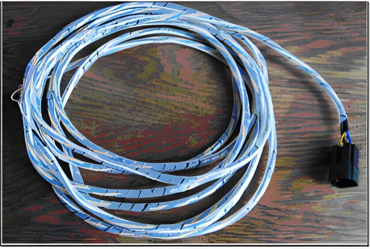{width=47%}

The two picture below show the embossed numbers on the connector housing.
Numbers 1 and 2 are on one side while 3 to 10 are on the other side.

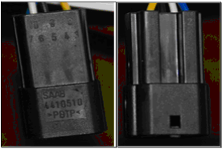{width=45%}

## Downloading and flashing Trionic 5

Trionic 5 supports reading and writing to the flash chips in the ECU.
To be able to download or upload a program to the ECU a so-called bootloader needs to be uploaded to the ECUs SRAM and executed.
Once the bootloader is executed, the program in flash is no longer needed to keep the ECU running and can be erased and reprogrammed.
T5Suite has these functions built-in and they are accessible through the menu “Programming functions” in “Read ECU through CAN bus” and “Write ECU through CAN bus”.

{width=32%}

Once an option has been chosen (assuming all hardware is connected properly) the canbus connection is opened and reading or writing commences.

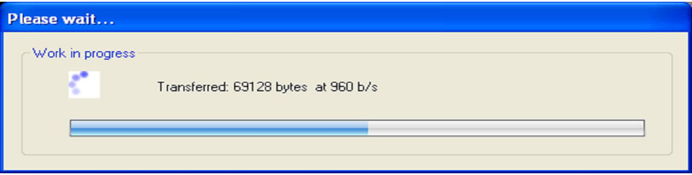{width=89%}

## Implementation in T5Suite

T5Suite can connect to the ECU through the Lawicel CANUSB adapter using the components delivered with the adapter.
The interface implements these functions:

- Retrieving the entire symboltable including SRAM addresses
- Retrieving and saving the adaption data (see paragraph Downloading Adaption data)
- Retrieving specific information at a high update rate (real time viewing and logging)
- Editing variables and tables at runtime in Trionic’s SRAM

All realtime data is displayed in a separate panel.
This panel can be customized in various ways.
The user can select the symbols (variables) to monitor at runtime and the panels entire user interface can be customized.
This mean gauges and views can be added and removed from the panel to the users likings.
The more symbols are monitored, the more time and processor consuming the process will be.
The image below shows the realtime panel in action.

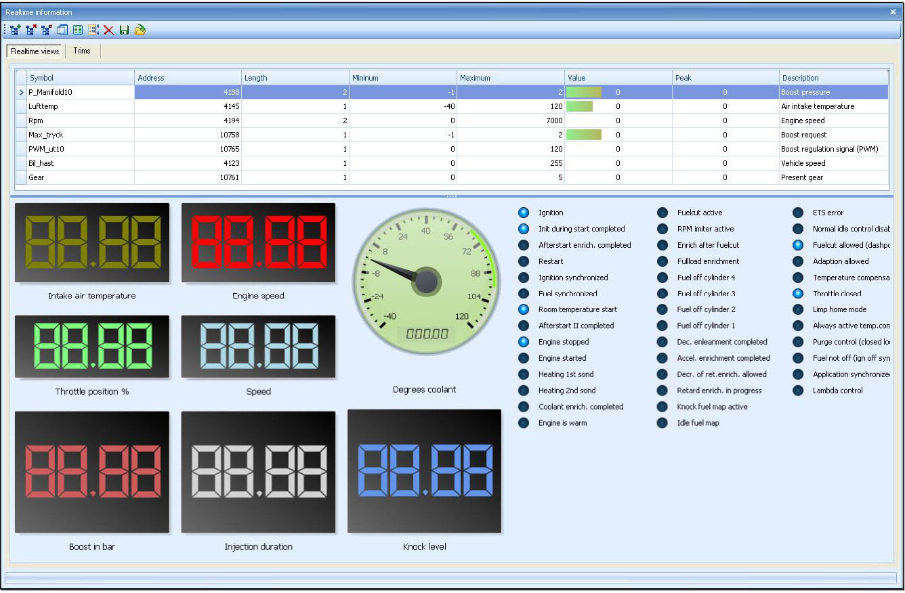{width=95%}

T5Suite also allows for realtime editing of maps in SRAM.
This enables to user to tweak the maps without having to reflash between every modification of the software.
If the CAN bus interface is connected (realtime panel is opened and CAN connection is running) the user can double click on a map in the symbollist and the corresponding mapviewer will appear.

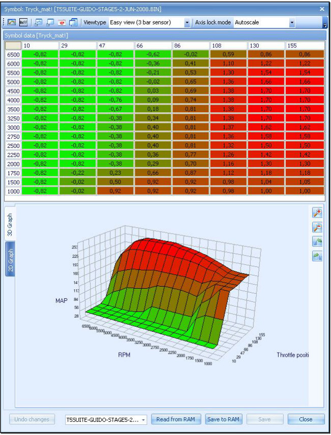{width=54%}

Now we see a set of extra buttons that allows the user to get the maps data from SRAM and write it back again.
Please note that altering maps while driving the car is very, VERY dangerous.
Please only edit maps when the car is parked at a safe spot!!

All data the is requested by the CAN interface (items entered in the realtime view) will also be logged to file.
It is possible to view this data in T5Suite as well as export it to LogWorks (<http://www.innovatemotorsports.com/support.php>).
Within T5Suite the log can look something like the image below.

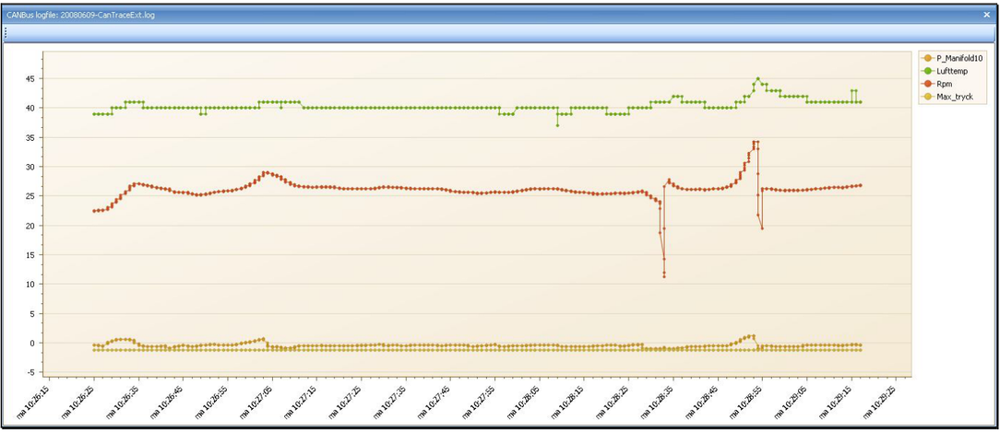{width=83%}
