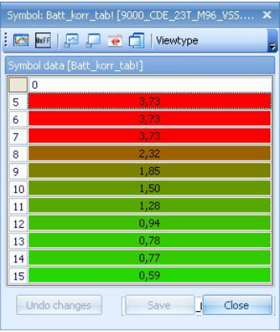
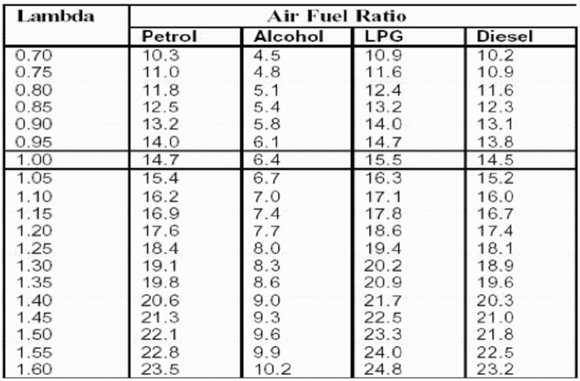
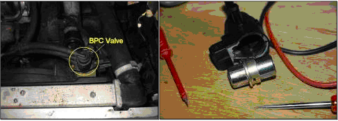
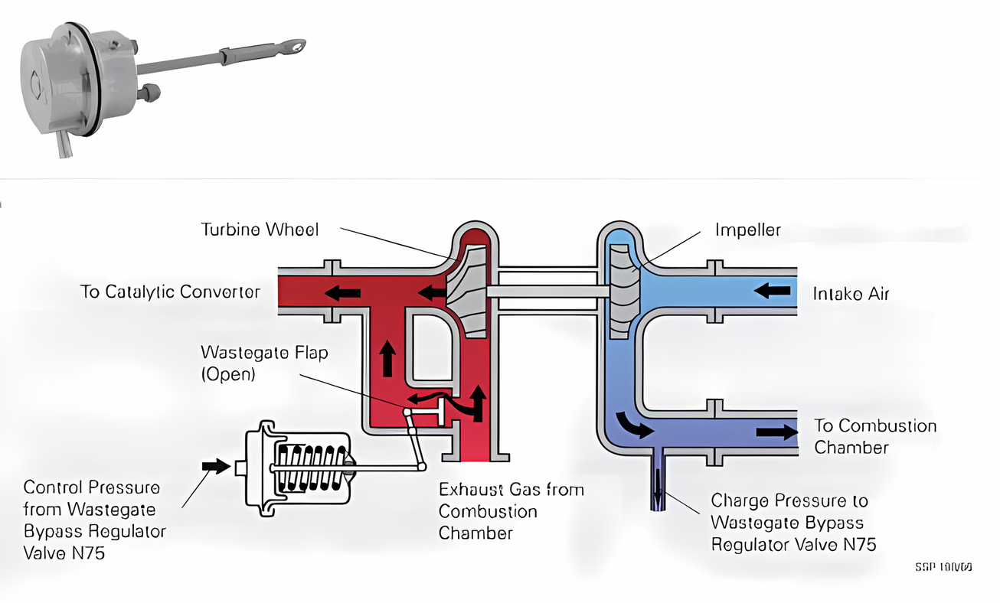
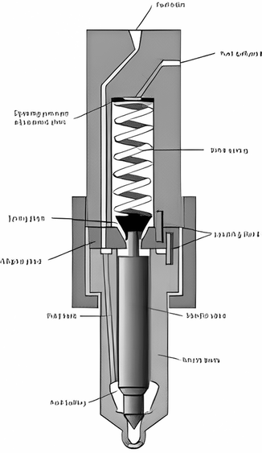
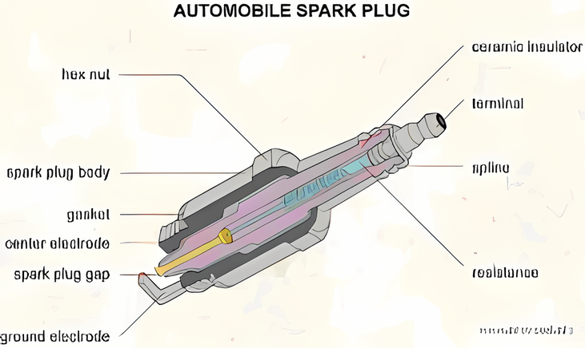
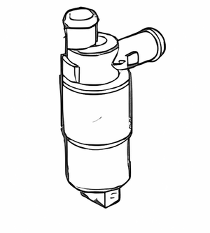

# Appendix VIII: Sensors and actuators

This appendix will list details about the sensors and actuators used in a T5 car.

## General

Sensors are devices used to gather information.
In a Trionic 5 car a lot of sensors are used to determine what actions to take inside the ECU.
These sensors are all analogue, which means they output a signal that has to be converted to digital numbers for the ECU to be able to understand them.
Actuators on the other hand are devices that enable the ECU to interact with the processes in the car.
Actuators are driven (or activated) by the Trionic be it directly or indirectly.

## Sensors

The range of sensors used by Trionic is impressive.
This chapter will list all used sensors with their characteristics ranging from temperature sensors to pressure sensors and crankshaft sensors.

### Intake Air Temperature (IAT) sensor

The intake air temperature sensor is needed to determine the density of the air entering the system.
The density of the air determines the amount of O~2~ molecules in a cubic inch of air and the amount of O~2~ molecules determine how much fuel should be injected into the cylinder to get a stoichiometric burn.
Hence, fuel injection duration depends on IAT.
The IAT sensor outputs a analogue signal between 0 and 5 volts as shown in the table below.
The sensor is located on the air intake tube leading to the throttle body.
Through the holes in the sensor head, the intake air flows past the NTC (negative temperature coefficient) resistor in the sensor.
The ECU applies a voltage across the sensor.
The voltage drop across the sensor drops as temperature rises.
Based on this temperature and the MAP input the air mass can be determined continuously by the ECU.
Pinnumber 1 of the sensor (Black wire) connects to ground while pinnumber 2 (white wire), which carries the output voltage connects to pinnumber 46 on the ECU.
The value for actual intake air temperature can be monitored through CAN bus using symbol *Lufttemp.*

| ˚Celcius | ˚Fahrenheit | Voltage | Resistance Ω |
|:------------------:|:------------------:|:------------------:|:------------------:|
| -30 | -22 | 4.5 | 20-30 |
| -10 | +14 | 3.9 | 8.3-10.6 |
| +20 | +68 | 3.2 | 2.3-2.7 |
| +40 | +104 | 1.5 | 1.0-1.3 |
| +60 | +140 | 0.9 | 0.56-0.67 |
| +80 | +176 | 0.7 | 0.30-0.36 |

### Manifold Air Temperature (MAT) sensor

TODO: Insert description for MAT here.

### Manifold Absolute Pressure (MAP) sensor

For continuous measurement of the pressure in the intake manifold a pressure sensor is present.
It is mounted on the front of the bulkhead compartment and it is connected to the intake manifold by a vacuum hose.
The MAP sensor is a piezo electrical element which reacts to pressure induced to it.
The element converts the pressure to a linear voltage on its output lead in which low pressure results in a low voltage and high pressure results in a high voltage.
This output voltage ranges from 0 to 5 volts.
The sensor has an internal circuit to compensate for temperature fluctuations.
Based on this pressure and the air temperature in the intake manifold the air mass can be determined continuously by the ECU.
The mapsensor needs a supply voltage, ground and has a output voltage and thus has 3 leads on it.
Pinnumber 1 (black wire) connects to ground, pinnumber 2 (blue/white wire) carries the pressure voltage signal and is connected to pinnumber 22 on the ECU while pinnumber 3 (grey wire) connects to pinnumber 43 on the ECU which supplies the sensor with +5 volts.
The table below shows the output voltages for different pressures.

| Pressure (bar) | Output voltage |
|:------------------------------------:|:------------------------------------:|
| -0.75 | 0.4 |
| -0.50 | 0.9 |
| 0.00 | 1.8 |
| +0.25 | 2.3 |
| +0.5 | 2.8 |
| +0.75 | 3.3 |
| +1.00 | 3.8 |
| +1.25 | 4.3 |

The MAP sensor is a 2.5 bar type.
This would theoretically mean that it can measure up to ~1.5 bar boost pressure.
In practice however the sensor saturates before that.
This saturation takes place at about 1.4 bar which would be ~4.75 volts.
If you plan to achieve more boost than 1.4 bar you will have to use a 3 bar MAP sensor which can measure correctly up to ~1.9 bar.
See chapter “Converting to three bar mapsensor” for more information on this subject.
The value for actual pressure in the manifold can be monitored through CAN bus using symbol *P_Manifold* or *P_Manifold10.*

### Coolant Temperature sensor

Trionic uses the coolant temperature sensor to determine the engine’s temperature.
Engine temperature indicates whether – for example – warmup ignition map should be used or what compensation to make for injection (warmup enrichtment) and so on.
The coolant temperature sensor signal is applied to pinnumber 68 on the ECU.
The value for actual coolant temperature can be monitored through CAN bus using symbol *Kyl_temp.*

### Crankshaft position sensor

{height=1.5em} Trionic T5.2 uses a different crankshaft position sensor than Trionic T5.5.
The early (T5.2) models use a HALL effect sensor while the later models (T5.5) uses a variable reluctance sensor.

The HALL effect sensor produces a square wave output while the VR type produces a sine wave output as shown in the picture below.
The VR type output voltage is converted by T5.5 by using the LM1815.
This results in a similar output as the HALL effect sensor.
T5 has 62 pulses per engine rotation from which 2 teeth are missing at 117° BTDC on cylinder 1 to determine TDC.
The crankshaft sensor signal is applied to pinnumber 41 on the ECU.
This sensor also supplies the ECU with engine speed information.
The amount of pulses per second indicates how many rpm the engine is making.
The crankshaft signal is applied to pinnumber 41 on the ECU.
The RPM signal is applied to pin 58.

{width=81%}

### Battery voltage

Trionic uses the battery voltage as an input to compensate for lag in the opening time of the fuel injectors.
Lower battery voltage means that the injectors will open slower and hence injector open time needs to be longer to get the same amount of fuel injected into the cylinders.
The table below shows the battery voltage correction table.

{width=39%}

### Throttle Position sensor (TPS)

The throttle position sensor is used by Trionic to regulate charging pressure, ignition timing and for supplying a richer mixture during acceleration and a leaner mixture during deceleration.
The maximum charging pressure can only be obtained at wide open throttle (WOT).
The sensor is different for cars with and cars without TCS (traction control system).

Cars without TCS obtain the TPS signal from pin 3 of the throttle position sensor and it is applied to pin 45 of the ECU.
Signal voltages range from 0.2 volt while idling up to 4 volts at wide open throttle.
Cars with TCS obtain the TPS signal from pin 26 of the ETS module (this is a PWM signal) and it is applied to pin 57 of the ECU.
Signal voltages range from 0.2 volt while idling up to 4 volts at wide open throttle.
The average throttle position can be monitored through CAN bus through symbol *Medeltrot*.

| % throttle plate open | Output voltage |
|:------------------------------------:|:------------------------------------:|
| 0 | 0.20 |
| 10 | 0.40 |
| 25 | 0.95 |
| 50 | 2.10 |
| 75 | 2.85 |
| 90 | 3.40 |
| 100 | 4.00 |

### Lambda sonde (oxygen sensor)

To be able to measure the result of the combustions in terms of it being stoichiometric Trionic gets input from one or two (depending on make year and market) oxygen sensors a.k.a. lambda sensors or sondes.
These sensors output a voltage that indicates the amount of air (O~2~) left in the exhaust gases.
T5 uses narrowband sensors which means that the output voltage they supply is not very accurate.
The image below shows that the effective zone for a narrowband sensor is from ~14 to 15 AFR.
The Trionic get a signal \< 0.1 volt from the sensor the mixture is too lean while a signal > 0.9 volt means that the mixture is too rich.
Normally the output voltage will swing from one side to the other and thus keeping the average mixture result correct for the catalyst.
The front lambda sensors output voltage is applied to pinnumber 23 on the ECU.

{width=47%}

Please note that different fuels need different mixtures to obtain lambda 1.

{width=55%}

### Knock sensor

As mentioned in appendix VII, Trionic uses the spark plugs via the direct ignition cassette to sense knocking and misfires.
Please refer to this appendix for more information.
The knock signal is applied to pinnumber 44 on the ECU.

### Vehicle speed signal

The ECU needs the vehicle speed signal to determine in which gear we are driving.
This signal is a square wave form which varies in frequency depending on vehicle speed.
The signal is applied to pinnumber 39 on the ECU.

## Actuators

### Boost control valve

To be able to control the charging pressure in the turbo, Trionic utilizes a pneumatic valve to pressurize the wastegate actuator.
The system actually uses charging pressure from the turbo to pressurize the actuator so no charging pressure automatically means no control over the wastegate by Trionic.
This is not a problem because if there is no charge pressure no overboost can occur anyway.
The charging pressure is led to the input of the boost control valve and normally – when no interaction from Trionic occurs – actuates the wastegate so the valve opens.
Normally, Trionic keeps the wastegate shut by activating the valve.
If Trionic decides it is time to open the wastegate (be it a little bit or much) it shifts the valve so that part of the charge pressure is applied to the waste actuator.
This is its turn opens the wastegate valve and lets some of the exhaust gases escape the turbo – to the exhaust – without it spinning the turbine wheel.
This way, the amount of air driving the turbine wheel decreases and of course the compressor wheel spins slower.
As a result the charging pressure decreases as well.
The images below show the position of the valve and the internals.
The ECU controls the BPC through pins 2 and 26 on the ECU.
The value for output duty cycle on the valve can be monitored through CAN bus using symbol *PWM_ut10.*

{width=80%}

### Wastegate actuator

The wastegate actuator is controlled by the airflow from the BPC (see above) and is the physical connection to the wastegate valve.
More airpressure on the actuator means that the wastegate valve opens more.
The wastegate valve is kept shut by a spring that ensures that the valve closes when the air pressure is no longer applied.
Sometimes overshoot problems with charging pressure are due to a worn / weak wastegate spring.
The pictures below show the wastegate actuator and a diagram showing the working of the actuator.
The higher the duty cycle (DC) on the solenoid valve, the more air pressure bleeds off to the compressor inlet side.
If the turbo is not making pressure - e.g. compressor is atm - and the solenoid is not being activated (2% DC) there is no pressure on the actuator and hence the spring in the actuator is not being pushed back (counter pressured).
The wastegate will remain shut by the pressure of the spring.

If the turbo is making boost - say 1.5 bar over atm - and the DC = 2%, the pressure will also be pumped into the wastegate actuator and it will counter act the pressure (tension) of the spring.
The gate will open.
If there's a high DC (98%) on the valve, the majority of the boost pressure from the compressor side will be leaked to the compressor inlet side by the valve and nearly no pressure will arrive in the wastegate actuator.
The valve will be kept shut by the spring tension.

An exception on this is when the pressure drop OVER the turbo is higher than the spring tension in which case the gate will be pushed open from the outside (the exhaust side).
In this case back pressure is too high.
Because the gate will be pushed open, boost pressure will drop and the gate will close again.
Boost pressure will rise again and the cycle will start over again resulting in fluctuating boost.

Disconnecting the W-hose results in 'unlimited' boost because the compressor will not be able to pressurize the actuator and it will therefore keep the gate shut because of the spring tension.
So: low DC means the ECU is not controlling boost pressure OR it tries to lower boost by pressurizing the wastegate actuator.\
high DC means the ECU is trying to raise or maintain a certain boost level.\
If you see a maximum DC (98%) and boost pressure still doesn't reach the requested level you'll have a spring that is too weak or you have too much back pressure pushing the gate open from the outside (which can also mean a spring that is too weak but also an exhaust that is too restrictive).

{width=100%}

### Injectors

The fuel injectors enable the Trionic to inject fuel in neatly dosed amounts into each cylinder.
The injectors are actually small solenoid valves that are controlled by the ECU.
The pressure over the injector is kept stable, normally at three bar.
Opening the injector for a certain amount of time will inject a known amount of fuel into the cylinder.
See chapter “Converting T5 to larger injectors” for more information.
The image below shows how a injector is build up.
The injectors are triggered by pinnumbers 3, 4, 5, and 6 on the ECU for - respectively - injector 1, 2, 3, and 4.
The value for actual injection duration can be monitored through CAN bus using symbol *Insp_tid10.*

{width=25%}

### Spark plugs

The spark plugs enable the Trionic to ignite the fuel mixture inside the combustion chamber.
In a T5 car the sparkplugs are indirectly driven by the ECU which means that the ECU signals the direct ignition cassette to fire a certain spark plug.
See chapter “Ignition” for more information.
The image below shows the internals of a spark plug.
The ECU fires the plugs through pins 9, 10, 11 and 12 for respectively plug 1, 2, 3 and 4.
The value for actual ignition angle can be monitored through CAN bus using symbol *Ign_angle.*

{width=56%}

### DI Cartridge

The Direct Ignition cartridge (DI cassette) had the following pinout on its connector.

| Pinnumber | Description | ECU pinnumber |
|-----------|------------------------------------------------------|---------------|
| 1 | Used for monitoring the charge voltage to the capacitor (T7) |  |
| 2 | Trigger signal cylinder 1 | 9 |
| 3 | Trigger signal cylinder 2 | 10 |
| 4 | Trigger signal cylinder 3 | 11 |
| 5 | Trigger signal cylinder 4 | 12 |
| 6 | Ground |  |
| 7 | Knock sensor function | 44 |
| 8 | Combustion signal cylinders 1+2 | 17 |
| 9 | Combustion signal cylinders 3+4 | 18 |
| 10 | Main power from relay |  |

Cylinder number 4 is the one closest to the connector.
Pin number 1 is used for monitoring the charge voltage to the capacitor (1/100 of the charge voltage gives about 0-4V).
The voltage on the trigger pins is 12V and it triggers on the falling flank when grounded (500mA peak).
The trigger must at least be held low for the discharge time of the coil which is about 500µs.
There must be a 2.5ms charge time between triggers to avoid damage to the cassette.
The recharge of the capacitor starts directly when the trigger goes high again and the charge time is 2.5ms at 12V battery voltage.
It is important to minimize voltage drop in the harness as the charge time will rapidly increase with lower voltage (3ms at 9V).
Charge voltage can be monitored the on pin 1.

The misfire signal is a square wave signal 0-12V.
There are 2 lines for this, one is for cylinders 1&2 and the other is for cylinders 3&4.
SAAB also uses this signal during cranking to find which cylinder is in the compression stroke and which is in the exhaust stroke.
Trionic triggers both partner cylinders until it can detect a combustion in one of the cylinders.
During this time these two coils get half each of the stored energy in the Cap.
You will have a signal some microseconds after a trigger if you have a combustion.
This signal is only for combustion detect and has nothing to do with knock.

The raw ION knock signal is filtered in the DI cassette to a 7kHz +/- 6V sine wave.
The amplitude of the signal reflects the degree of knock.
The charge pulse gives a lot of disturbance so the trigger must be kept low until the knock info is read.
Normally most of this information is found between 10-40º ATDC.
If the spark is 30º BTC and the knock info is at 40º ATDC, this means the trigger signal should be 70º long.
Trionic has a "window" for when reading out the knock which varies in time depending on MAP and RPM.
Knock window timing can be found in Knock_wind_on and Knock_wind_off tables.

There are several different DI cassettes, one red and one black for four cylinder engines.
They have been in production since 1987.
The black ones have AC spark, giving longer spark duration.
This can improve idle stability and lean condition misfire.
There is also a three cylinder cassette, which can be found in 9000 & 900 models with V6 engine.

### Purge valve (carbon canister solenoid valve)

The carbon canister contains active charcoal or active carbon granules.
Most evaporation control systems reduce the emission of fuel vapour during the time the vehicle is idling in traffic, or parked in strong sunshine by absorbing the vapour fumes into the carbon canister.
Once the engine is at its normal operating temperature the stored hydrocarbons are released into the inlet manifold where they become part of the combustible air/fuel mixture.
The control for allowing the hydrocarbons to be released into the inlet manifold through a cut off valve is achieved electrically.
The electronic solenoid is controlled by the Electronic Control Module (ECU) by switching the earth path to ground under specified conditions.
The purge valve is controlled by pinnumber 27 and 28 on the ECU.

### Idle Air Control (IAC) valve

The engine idling speed on Trionic 5 cars is controlled by an electrically operated idle air control (IAC) valve, also referred to as an automatic idle control (IAC) valve on some models.
One end of this valve is connected by a rubber hose to the air filter side of the throttle plate, while the other end is connected by a rubber hose to the engine side of the plate.
By varying the opening of the valve, the engine management system can vary the amount of air (and fuel) supplied and maintain an appropriate idle speed regardless of engine load, for example from the air conditioning system.
The picture below shows the IAC valve.
The valve is controlled by pin 49 on the ECU.

{width=23%}
