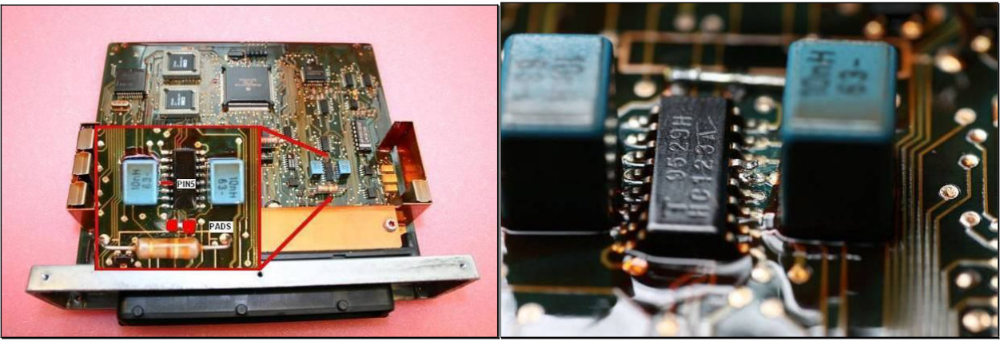
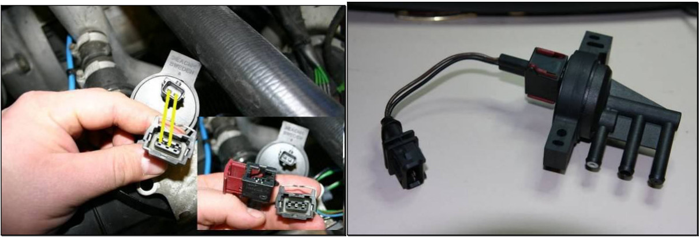
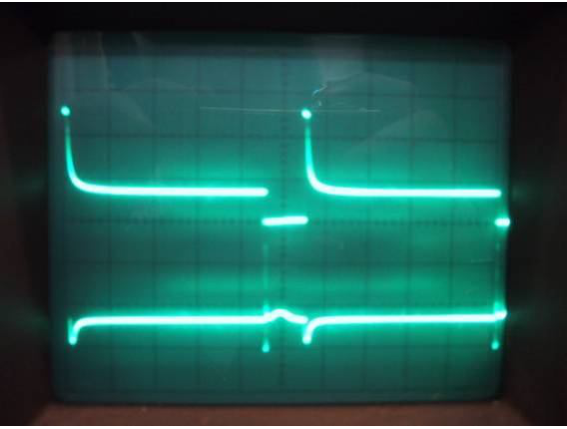
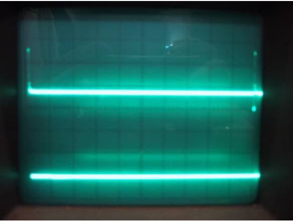
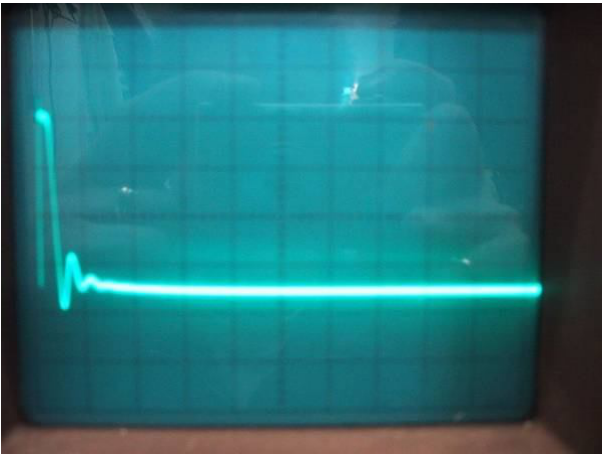

# Appendix IX: Converting to T7 boost control valve

## Short description

This appendix describes the steps necessary to use the Trionic 7 BPC (solenoid valve that controls the wastegate actuator) on a Trionic 5 car with a Trionic 5 ECU.
Normally this is not possible and that is a shame because the valves for T5 are much more expensive and prone to failure simply because of their construction.
The changes needed for this conversion consist of some software and some hardware changes.

The T5 valve has two coils that control the position of a metal sheet which in turn controls the flow of air through the valve.
These two coils are driven by the MOSFET’s inside the ECU.
The T7 valve on the other hand has only one coil and the control frequency for the T7 valve is slightly different.

## Hardware modifications

Lift up pin 5 from 74HC123 shown in picture below.
Chip is a monostable multivibrator which is used to make two PWM-signals from CPU's original one for that original two coiled valve.
Pin 5 is output and pin 12 is inverted output (which we don't need any more).
Pin 5 needs to be lifted because otherwise the 74HC14 driving the 74HC123 would be competing with 74HC123's output and either would fan out.
This would result in no drive to FET at all.
Alternative is to remove the HC123 from the board.
The 74HC123 is used in T5 to shorten PWM pulses to 2 ms length by triggering from PWM signal edges.
This is enough to make the thin disc inside T5 valve to fly to either end of its movement range.
Longer pulses or plain PWM signal could eventually fry a T5 valve.
So actually the T5 valve is not driven with PWM at all but with a kind of pulse position modulation.
If this is fed to a traditional PWM valve nothing would happen.

Secondly connect the two pads (bridge) between the resistor and the chip with some solder or a small wire.
This is connecting pin 5 and pin 11 which is PWM-signal input from CPU.
Now the original PWM-signal from CPU is used to drive valve coil.
CPU's PWM-signal is wide enough to drive T7 valve.
(More resistance > more voltage is needed).
This bridge (B01, if you have silk screen printing in your box) was added by Saab in T5.5 to enable bypassing HC123 as a placement option.
With this bypass the PWM provided by timer unit in 68332 passes directly to one of the FETs.

{width=99%}

Wire the valve as shown in the picture.
The 3-pin connector is the original harness of 9k, the 2-pin connector is in the T7 valve.

{width=95%}

Add a diode over the valve connector pins as a fail-safe mechanism.
Doubt exists about the effectiveness of the internal fly-back diode inside the MOSFETs.
This diode will guide reversed polarized voltages past the MOSFET because the MOSFET would “die” if this was not done.
These reversed voltages do exists because the load the FET is driving is inductive.
This diode must have a reverse recovery time of 75 ns or less and must be able to withstand more than 3 A.

## Software modifications

The changes in the software are limited to changing the APC control frequency for the valve.
The frequency changes at 2500 rpm to prevent resonation in the vacuum hoses so there’s actually to variables to change.
Frek_230! holds the control frequency below 2500 rpm.
Frek_250! holds the control frequency above 2500 rpm.
For the T5 valve these values are set to 90 respectively 70 Hz.
For the T7 valve these should be set to 50 and 32 Hz.

| Parameter | Trionic 5 valve | Trionic 7 valve |
|-----------|-----------------|-----------------|
| Frek_230! | 90 Hz | 50 Hz |
| Frek_250! | 70 Hz | 32 Hz |

## Proving it is possible

To prove the feasibility of this conversion we need to measure the transient voltages on the valve itself.
Using an oscilloscope the transients on both drive wires for the T5 valve are measured and the result is given in the picture.
The upper channel is the leftmost connection on the valve while the lower channel is the rightmost connection on the valve.
Scaling is 20 volts per division (square) vertically and 2 milliseconds per division horizontally.
The car is idling and we can see that the driving frequency is once per (5.5 \* 2) 11 ms = 90 Hz which is exactly what we saw earlier in the software.

{width=45%}

When the hardware conversion is done and we measure on the T7 pin (there is only one, so second channel is ‘dead’) we see this result.
The upper channel shows the T7 valve coil pull (very short compared to T5 pull).
Scaling is the same as the first picture.
We see that the frequency has dropped to (10\* 2 ms = 20 ms) 50 Hz due to the software modifications we did on the Trionic (90 to 50 Hz below 2500 RPM).

{width=46%}

We need to zoom in a little to get a better view on the ‘pull spike’ that is on the coil.

{width=47%}

The valve pull is much shorter (this is what we do by the hardware conversion described in the previous paragraph) but the transient response on the coil is practically the same.
