# Appendix XII: Howto install BD32 with a PD BDM interface

## Overview

This Howto describes how to install BD32 (found at <http://trionic.mobixs.eu>) with a PD (public domain) BDM interface.
The software will also work with an ICD interface but this is not covered in this Howto.

## Steps

### 1. Install BD32

Download bd32-122.zip from <http://trionic.mobixs.eu> and unzip it on your hard drive.

### 2. Connect BDM interface

Connect the BDM interface to the parallel port and to the target device (for example your T5 ECU).
You need to know which port you have connected the interface to (LPT1 or LPT2).

### 3. Edit BD32.CFG

The BD32.CFG contains settings for BD32.EXE.
The first line tells which parallel port the BDM interface is connected to.
The second line sets a delay parameter that adjust the speed of BD32 to the interface (depends on how fast the computer is).
This parameter will be tuned later in this Howto.
For now, set it to 1000.
Your BD32.CFG should now look something like this:

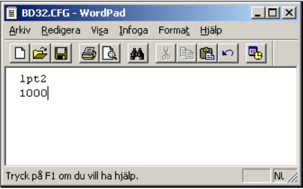{width=55%}

In this case the BDM interface is connected to LPT2.

### 4. Install UserPort

This step is only needed if you are using Windows 2000 or later.

- Download UserPort.zip and unzip it on your hard drive.
- Copy the file UserPort.sys to %windows-base%\\system32\\drivers where %windows-base% is the installation folder of windows (typically c:\\windows).
  Example c:\\windows\\system32\\drivers.
- Start UserPort.exe.
  You will see something like this:

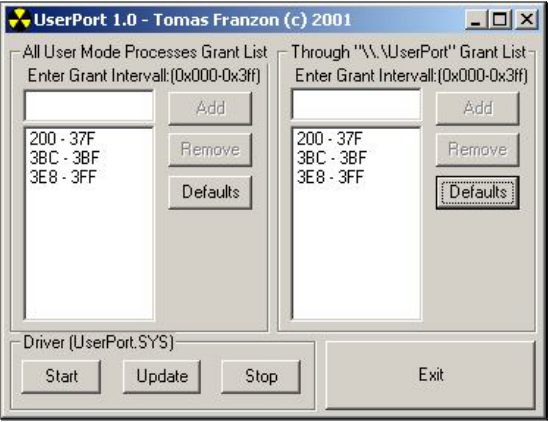{width=61%}

Here you can limit the address range to open up if you know what address your parallel port hardware has.
If you don't know or don't care you can open up the whole range from 0x000 to 0x3ff like this:

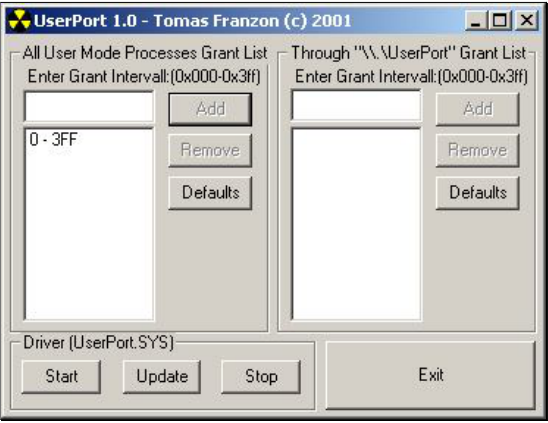{width=61%}

- Now click on Start to activate UserPort.

### 5. Start BD32

- If you haven’t already powered up your target device do it now.
  Then start BD32.EXE.
  If everything works you will see something like this:

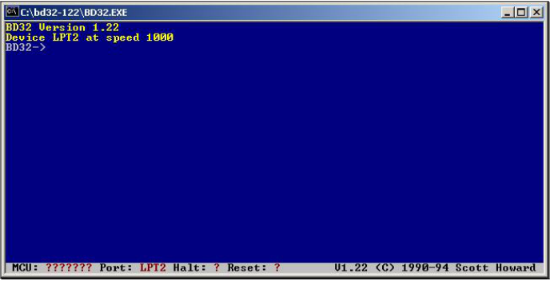{width=77%}

### 6. Set the delay parameter

Now it is time to adjust the timing between the BDM interface and your computer (this is not needed if you use an ICD interface).

- First give the reset command:

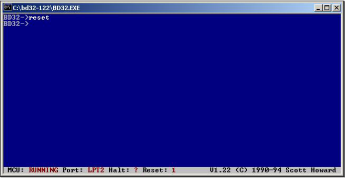{width=77%}

- In BD32 give the command: "md 0x0 128".
  This will print the first 128 bytes of the flash memory.
  If the timing is not correct it might look something like this:

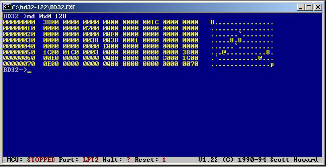{width=74%}

But it should look like this (if you connect to a T7 ECU):

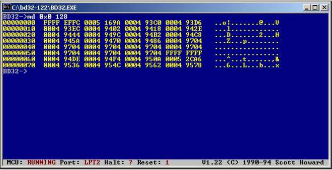{width=74%}

A T7 ECU always starts with "FFFF EFFC" while a T5 always starts with “FFFF F7FC”.
Most important is that each time you give the command “reset” followed by "md 0x0 128" the result should be the same.

Now, if what you see does not start with "FFFF EFFC" or “FFFF F7FC” or if you get different result each time you give the command "md 0x0 128" you need to increase the delay parameter.
The initial value we set to 1000.

- Start by adding a zero to that number by giving the command: "port lptN 10000" (where N is replaced with the port number).
  Then give the command "md 0x0 128".
  For example:

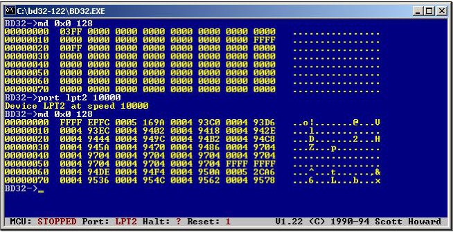{width=73%}

In this case a delay of 10000 seems to be enough but if you have a fast computer you may need to increase this number.

Now it is time to fine tune the delay parameter.
Halving the delay parameter and give the command “reset” and "md 0x0 128".
Repeat this until you get an uncertain result and then increase it again.
Example:

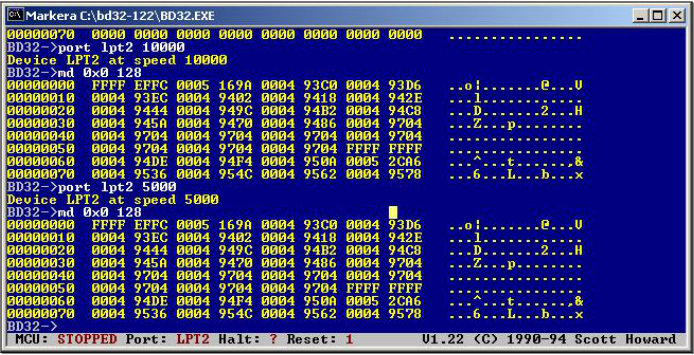{width=78%}

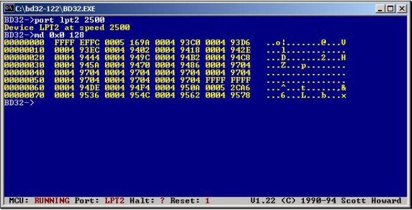{width=78%}

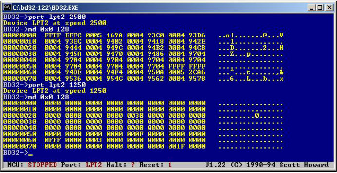{width=78%}

Decreasing the delay parameter to 1250 in this example seems to give a very uncertain result so therefore we set it to 2500.
It is possible to fine tune it even further but don’t try to set it close to the uncertainty level.
Better be safe.

Typical delay values for some computers:

Pentium I 90 MHz: 200\
Pentium III 800 MHz: 2500

### 7. Update BD32.CFG

Update the delay parameter in BD32.CFG with the value that you found in 6.
This will make sure that you get the correct setting every time you start BD32.

### 8. Start using BD32

Now everything is set up for using BD32.
Read the document BD32.DOC if you want to know more about the debugger or start using the flash tools that can be found in the Downloads section of <http://trionic.mobixs.eu>
