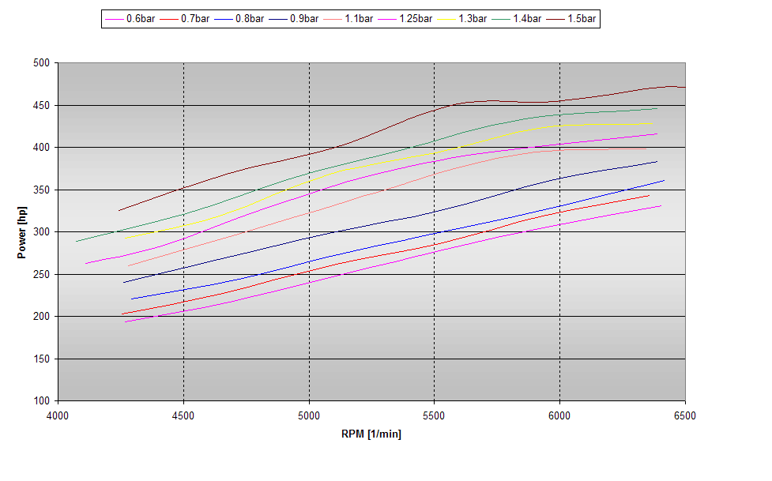
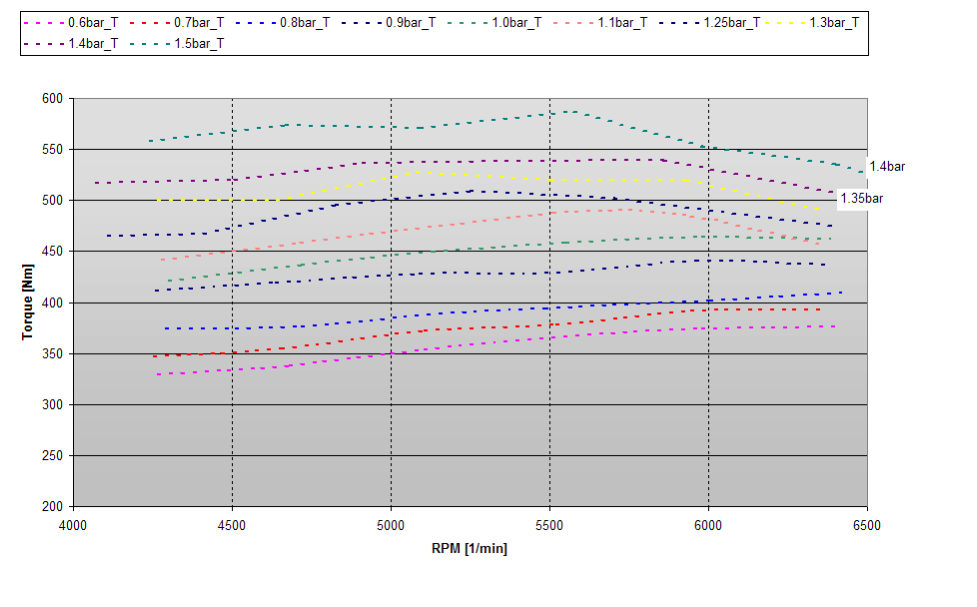
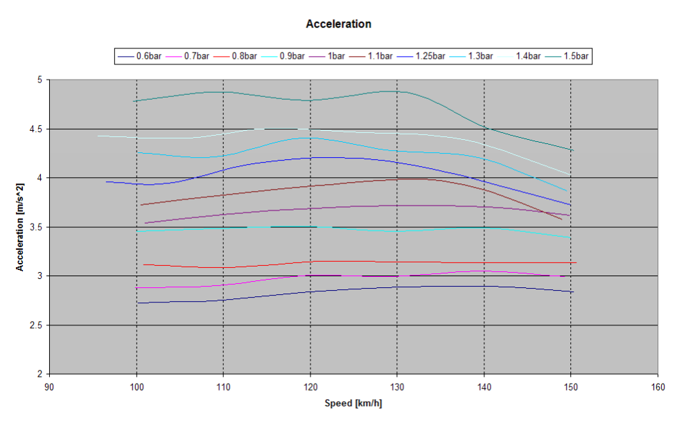

# Appendix XIV: A tuned example on the road

## Description

In this chapter we will see some measured data from a tuned car which will give more insight in how boostlevels relate to power, torque and acceleration.
Please do note that these figures are just give to illustrate and that the results of tuning will vary for every engine and car.

Here we see the power curves in brake horsepower related to different boostvalues…

{width=59%}

and the torque curves in Newton meters related to boost…

{width=59%}

And last but not least the acceleration values from 100-150 km/h related to the same boost levels...

{width=59%}
