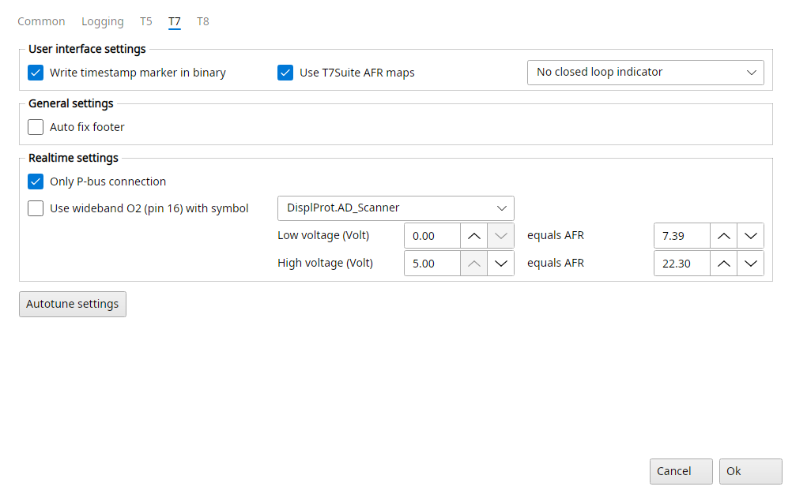
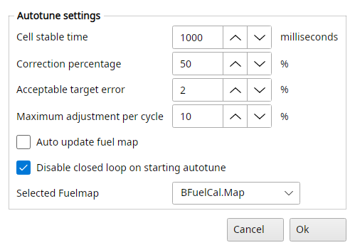

# Trionic 7 settings

The T7 tab of File → Settings has the options only a T7 has.

{#fig-settings-t7 width=100%}

## Settings → T7

### User interface settings

Write timestamp marker in binary
:   If enabled, TxSuite will write a timestamp marker for you in the binary file so you can keep track of when the last changes were made to it.
    It is the programming date in Actions → Firmware information.

Use T7Suite AFR maps
:   If you wish to use the AFR feedback maps, you need to have this checked.
    Only then does the realtime panel log the wideband AFR into them, and only then can they be cleared.
    See AFR maps in the Trionic 7 realtime chapter.

Closed loop indicator
:   Lets you choose which (if any) marker you want to be displayed in the map viewers for cells that are in the closed loop area: No closed loop indicator, Square closed loop indicator or Triangle closed loop indicator.
    The area is where the load stays below LambdaCal.MaxLoadNormTab (LambdaCal.MaxLoadE85Tab for the E85 maps).

### General settings

Auto fix footer
:   TxSuite can automatically repair footer information blocks.
    These blocks are incomplete for example in TIS binary files.
    The footer is repaired when a binary opens, on Verify checksum and whenever the checksum is updated.
    A footer that holds the chassis ID more than once, or lacks the chassis ID or the immobilizer code, is rebuilt with each field once.

### Realtime settings

Only P-bus connection
:   If checked, TxSuite will not try to connect on the I-bus when starting a realtime session.
    This will improve reliability and connection speed.
    Only check when you are sure you are connected on the P-bus.

Use wideband O2 (pin 16) with symbol
:   If you have a wideband lambda sensor connected to pin 16 on the T7 ECU you can monitor and log wideband AFR values within TxSuite.
    Most binaries work with DisplProt.LambdaScanner but some don't.
    In the latter case you have to select DisplProt.AD_Scanner and fill in the voltages below it.

Low voltage, High voltage, equals AFR
:   The wideband controller's analogue output for DisplProt.AD_Scanner: the low voltage equals the AFR next to it, the high voltage the other one, and voltages in between convert on a straight line.
    DisplProt.LambdaScanner gives AFR directly.

A wideband controller on a serial port is set up on the Common tab instead, Use wideband O2 on com port.

## Settings → T7 → Autotune settings

Lets you choose options for the Autotune fuel function.
Please note that you need to be running a wideband lambda sensor and a so-called open or development binary to be able to use the Autotune function.

{#fig-autotune-settings-t7 width=50%}

Cell stable time
:   Determines how long (in milliseconds) the system should reside in a certain load/rpm cell before TxSuite validates the AFR measurement.

Correction percentage
:   Determines how much a certain AFR error will be corrected.
    Setting this to 50% (default) means 50% of the established AFR error will be corrected for each session.

Acceptable target error
:   Determines how big the AFR error is allowed to be without TxSuite taking action in that certain load/rpm cell.

Maximum adjustment per cycle
:   Determines how big the maximum adjustment will be in percentages measured from the original fuel map.

Auto update fuel map
:   This option decides the mode in which Autotune works.
    If this is checked the system will try to map the fuelling entirely on its own.
    No feedback from the user is requested.
    After an Autotune session the user can however revert to the previous fuel map if he/she chooses to do so.
    If this is not checked the Autotune function will be more like a question & answer game between TxSuite and the user.
    After every session a map is prompted in which TxSuite shows which cells are to be altered to reach the requested AFR.
    The user can select/deselect cells to his/her liking and update the fuel map with the selected cells.

Disable closed loop on starting autotune
:   Some advanced users have closed loop operation turned off completely.
    In that case you might want to prevent TxSuite to disable closed loop operation when starting an autotune session.

Selected Fuelmap
:   The fuel map Autotune works on: BFuelCal.Map, BFuelCal.E85Map or BFuelCal.StartMap.
