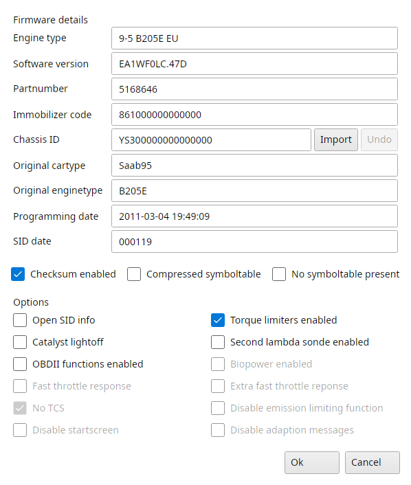

# Firmware information

Actions → Firmware information lets you see and alter the settings stored in the current binary file.
Ok writes the changes and updates the checksum, Cancel leaves the file alone.

{#fig-firmware-t7 width=60%}

## Firmware details

Engine type
:   Descriptive text for the current binary file.

Software version
:   Default software version numbering for the current binary file.

Partnumber
:   The partnumber of the software, read only.

Immobilizer code
:   Current immobilizer code for this binary file.
    For more information about immo code please refer to the SAAB technical documentation.

Chassis ID
:   Vehicle Identification Number (VIN) for the current binary file.
    Should match your car's VIN number.
    Import takes the chassis ID and immobilizer code from another binary, Undo puts the old ones back.
    Actions → VIN decoder decodes it.

Original cartype and Original enginetype
:   Car and engine type the partnumber belongs to, read only.

Programming date
:   When the file was last changed, written with File → Settings → T7 → Write timestamp marker in binary.

SID date
:   The SID date stored in the footer.

Checksum enabled, Compressed symboltable and No symboltable present
:   Information about the file, read only.
    Checksum enabled is off when the file's own checksum checks are switched off.

A TIS file has an incomplete footer.
Changing its chassis ID or immobilizer code makes TxSuite offer to fix the footer, after saving a `.binarybackup` copy, unless File → Settings → T7 → Auto fix footer does that already.

## Options

Options the binary doesn't have are greyed out.

Open SID info
:   Lets you enable and disable the SID information.
    If this box is checked the car can show live information (realtime) on the SID.
    The parameters for this function can also be edited through Actions → SID information.

Torque limiters enabled
:   Lets you enable or disable the major torque limiters in the file.

Catalyst lightoff
:   Turns the catalyst light-off function on or off, the raised idle and late ignition that heat up the catalyst after a cold start.

Second lambda sonde enabled
:   Lets you disable the entire second (rear) lambda sonde diagnostics.

OBDII functions enabled
:   Lets you enable or disable the OBDII diagnostics routines.
    On software that has separate European and other OBD2 tests TxSuite asks which ones to turn on.

Biopower enabled
:   Shows whether the file is BioPower (E85) software, read only.

Fast throttle response and Extra fast throttle reponse
:   Turn off the tip-in and tip-out torque damping for a quicker throttle response, the extra one more of it.
    Only one of the two can be on.

No TCS
:   On BioPower software: turns off the use of the ethanol sensor.

Disable emission limiting function
:   On EU0AF01C software only.

Disable startscreen and Disable adaption messages
:   SID patches for the start screen and the adaption messages, on the software versions that have them.
