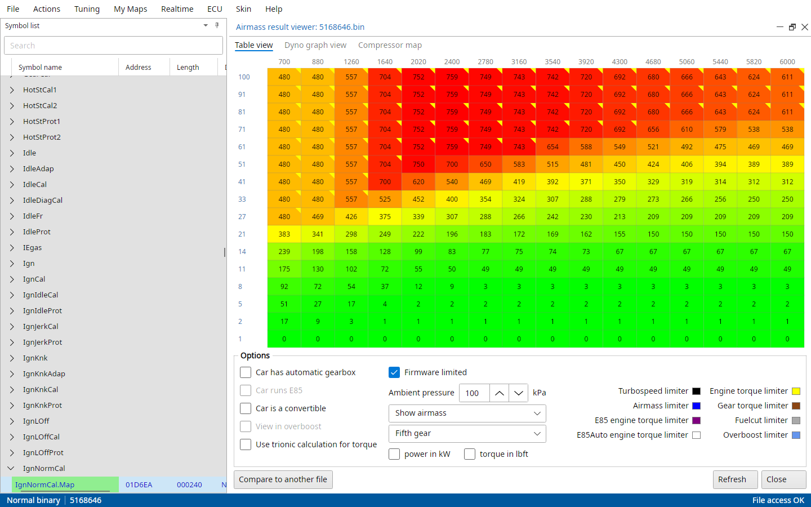
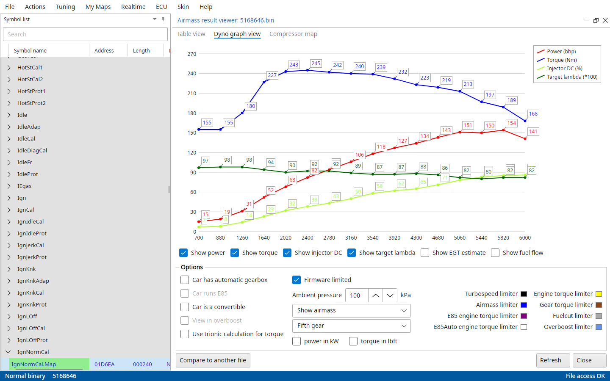
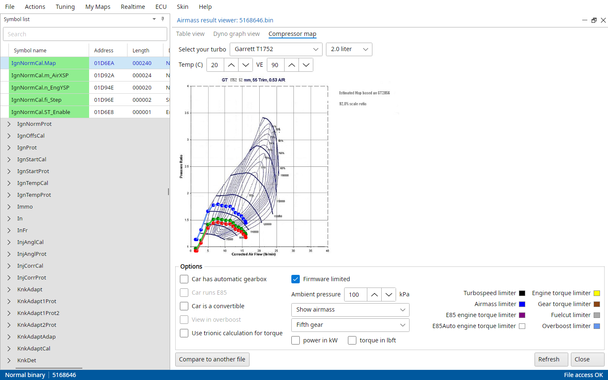
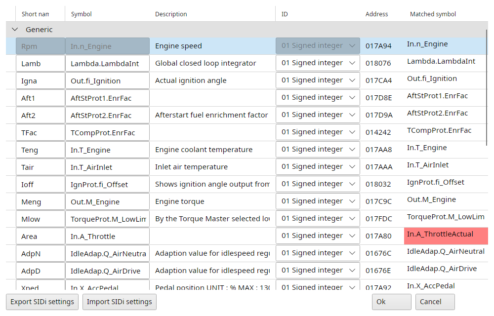

# Trionic 7 tools

The last section of the Actions menu has the tools only a T7 has.

## Actions → Airmass result viewer

TxSuite incorporates a function to verify the final (estimated) airmass results based on the most common airmass and torque limiters.
The result from these calculations are shown in a table that also shows the limiter that is holding more airmass per combustion back.

{#fig-airmass-table-t7 width=100%}

The table has a column per rpm and a row per pedal position, wide open throttle on top.
The coloured triangle in a cell's corner is the limiter that holds it back, the legend says which colour is which.
Click a legend entry to open the maps of that limiter.
The values can be shown as airmass, torque, horsepower, injector duty cycle, target lambda or AFR, EGT or fuel flow.
Power in kW and torque in lbft switch the units of the table and the dyno graph.

The options change the calculation: automatic gearbox, E85, convertible, overboost, the gear, the ambient pressure, Trionic's own torque calculation and whether the firmware limits it.
Compare to another file draws a second file over this one, Refresh calculates again after you changed a map.
Maps the binary doesn't have don't limit anything.

{#fig-airmass-dyno-t7 width=100%}

The Dyno graph view tab draws the result at wide open throttle as power and torque curves, optionally with injector duty cycle, target lambda, the EGT estimate and fuel flow.

The Compressor map tab shows where you will land in the compressor map of your turbo with these airmasses.
TxSuite guesses the turbo from the partnumber, Select your turbo picks another, and the intake temperature and volumetric efficiency can be set.

{#fig-compressor-map-t7 width=100%}

## Actions → SID information

Allows you to alter the default settings for realtime display on the SID.
The tables list what the SID can show in each mode, with a short name (max 4 characters), the symbol, ID and address.
A matched symbol in red differs from what the table holds.
Export SIDi settings and Import SIDi settings save and load the tables as a `.sid` file.
Ok writes the tables into the binary.

{#fig-sid-information-t7 width=100%}

## Actions → Import AFR feedback data

Corrects the fuel map (BFuelCal.Map) with what the AFR feedback map measured.
Every cell with measurements is made richer or leaner by how far the feedback was from the AFR target map.
After that the feedback map is cleared, ready for the next session.
See AFR maps in the Trionic 7 realtime chapter.

## Actions → ESP calibration

Sets the ESP calibration in the binary to match your brakes and engine: 15" brakes B205, 15/16" brakes B235E MY07- and B235R MY00-01, 16" brakes B235L, or 16"+ brakes B235R MY02-.

## Actions → TCM limit

Sets the torque limit for the automatic gearbox (TCM).
TCM MOD v1 is a single threshold, TCM MOD v2 a limit per gear, only one of the two can be on.
The limit goes into VIOSCal.M_TCMOffset.
