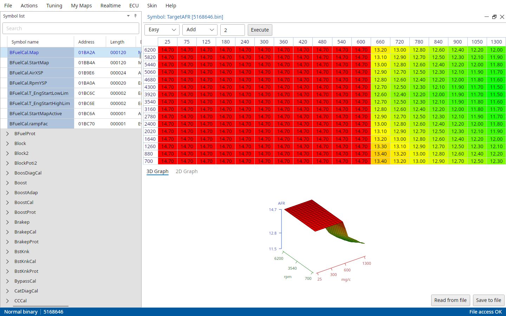
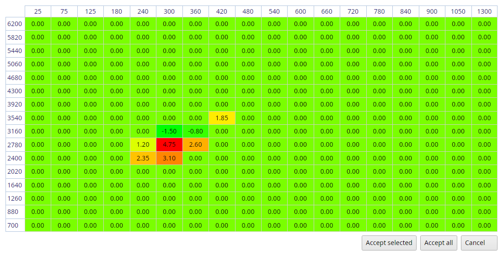

# Trionic 7 realtime

The Realtime menu's items only a T7 has, the T7 parts of the realtime panel and Autotune.

## The realtime panel on a T7

On a T7 the panel's bottom row has two more things:

- Eco, Norm and Sport switch the ECU's performance mode, on software that has one.
- AutoTune starts and stops an Autotune session, see Autotune below. It only shows on an open (development) binary.

## Realtime → Clear DTC and knock counters

Lets you clear all DTC's and the knock counters (maps and counters) in the ECU.

## Realtime → View knock count map, View false knock map and View real knock map

Downloads and displays the current knock counter maps in the ECU.

## Realtime → View misfire map

Downloads and displays the current misfire map in the ECU.

## Realtime → AFR maps

With a wideband lambda sensor TxSuite keeps an AFR target and an AFR feedback map for every binary, in an `AFRMaps` folder next to the file.
The realtime panel adds every wideband reading to the feedback map, in the cell the engine is in, as long as File → Settings → T7 → Use T7Suite AFR maps is on.
With File → Settings → Common → Measure AFR in lambda the items say lambda instead of AFR.

Show AFR feedback map
:   Shows you the measured average values from the realtime sessions you have done for this binary file.
    This map is only filled and updated when you're working with a wideband lambda sensor.

Show feedback counter map
:   How many measurements each cell of the feedback map has.

Clear AFR feedback map
:   Allows you to clear the AFR feedback map to start a new "session".

Show AFR target map
:   Lets you set your desired AFR values for each load and rpm point for this binary file.
    After logging with a wideband lambda sensor you can compare the target values to the feedback values.
    Save it like any other map.

{#fig-afr-target-t7 width=100%}

Actions → Import AFR feedback data corrects the fuel map with the feedback map, see the Trionic 7 tools chapter.

## Realtime → Extra functions

Functions of SaabOpenTech for other modules in the car:

- Set ethanol content
- Set seatbelt ping on, Set seatbelt ping off
- Set double unlocking with remote on, Set double unlocking with remote off
- Get trionic info, Read trionic engine data
- SID display test
- Get SPA info and fault codes
- Get alarm level, and Set alarm level no alarm, glass break sensor, or glass break and tilt sensor

Please note that you will have to be connected to the car's I-bus for these to work!
Any adapter that can do the I-bus works, whatever File → Settings → T7 → Only P-bus connection says.
The answers show in a Communication report.

Set ethanol content is different: it opens the ECU's ethanol adaption value (E85.X_EthAct_Tech2) in a map viewer.

## Realtime → Synchronize to binary

Reads every calibration map from the ECU's RAM into the binary file and updates the checksum.
TxSuite warns first, it overwrites data in your binary file.

## Realtime → Synchronize to ECU

Writes the binary's calibration maps into the ECU's RAM, the other way around.
TxSuite warns first, it overwrites data in your ECU.

## Realtime → Upload tuning package to ECU

Writes the maps of a tuning package (`.t7p`) into the ECU's RAM.

## Realtime → Generate tuning package from ECU

Reads the important maps from the ECU's RAM into a new tuning package.

## Autotune

[Autotune criteria]{.underline}

For Autotune to become available you will have to meet certain criteria.

- You will have to be using an open/development binary file in your ECU
- You need a wideband lambda sensor, see File → Settings
- Engine temperature should be over 70 degrees Celsius

The AutoTune button in the realtime panel only shows with open/development software.
Click it and the session starts once all Autotune criteria are met, otherwise TxSuite tells you which one isn't.
The moment Autotune is activated the software switches off closed loop control in the ECU, unless the Autotune settings say otherwise.

If all runtime criteria are met the algorithm measures AFR values through the wideband lambda input and determines the cell in which it should average this value by means of current engine speed and airmass.
Depending on the mode in which Autotune is running (direct update or user approve) it updates the fuel map in the ECU [or]{.underline} it stores the averaged value in memory.
In the latter case it shows the user a proposal for adjustments to be made after the Autotune session is ended.

After the Autotune session, the software will show you a map in which the cells to be corrected are highlighted and showing the percentages to correct the fuel map.

{#fig-autotune-accept-t7 width=100%}

You can cancel this session, accept the selected cells (Accept selected, after selecting the cells you want to correct) or accept all suggested corrections (Accept all).
TxSuite writes the accepted corrections into the binary file in one go, as one transaction in a project.

With Auto update fuel map on, TxSuite asks "Keep adjusted fuel map?" when the session stops: Yes stores the map from the ECU in the file, No puts the original back into the ECU.

The settings for Autotune are in File → Settings → T7 → Autotune settings.
