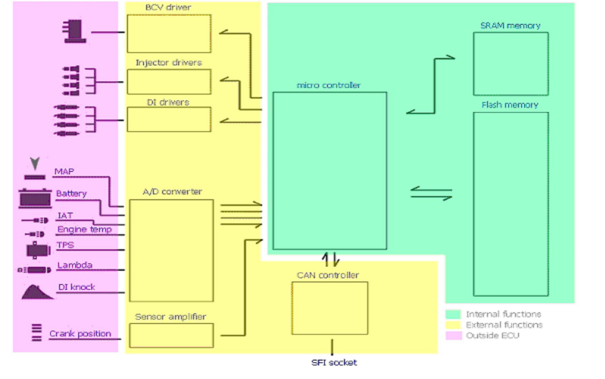
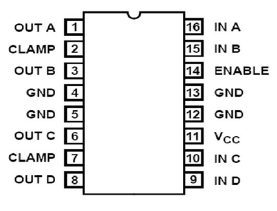

# Hardware {.advanced}

The T7 is build around a Motorola MC68332 (CPU32) microcontroller.
This is a 32 bit controller that handles the entire motor management including fuel injection, ignition timing and boost pressure control.
The processor has a vast 4Mb (512 Kbyte) flash memory for fetching program code and maps.
This flash memory consisting of a AM29F400BT-90SI (AMD) holds the program memory.
There is a coprocessor from Philips, a P83C592FHA/019.
This is a 8-bit 8051-based microcontroller with a CAN (Controller Area Network) module.
As the CAN physical line driver there is an Intel AN82527 (same family as used in Trionic 5).
RAM memory is done by two 32 Kbit SRAM chips (U62H256S1K).
There is also a special component that would appear to be a barometric pressure sensor.

## Integrated circuit list

The table below lists almost all IC’s on the board.
This is just to give you an idea on what to expect.

| Partnumber     | Function                        | Usage             | # on board |
|----------------|---------------------------------|-------------------|------------|
| TC55257DFI-85L | SRAM (working memory)           |                   | 1          |
| 16233970       | Microcontroller                 | Main 32-bit CPU   | 1          |
| PC83C592       | Microcontroller with CAN contr. | 8-bit coprocessor | 1          |
| AM29F400       | Flash memory                    | 4 Mbit            | 1          |
| 51862          | DA converter                    |                   | 1          |
| AN82527        | CAN controller                  | CAN line driver   | 1          |
| 16238669 0H11  | Pressure sensor?                |                   | 1          |

## Block schematic diagram

{width=99%}

## PCB details

The PCB layout is not entirely known of course because SAAB did not release details about this, even in the service manuals.
Finding out how things are setup is not so very difficult though, once you know what the system should do and what hardware components are on the board.
The image will give you some idea on what is what on the board.

### Power supply

### DI cartridge triggering

The DI cartridge has a trigger input for firing the four individual sparkplugs.
These are triggered by signals from the ECU on pin 9, 10, 11 and 12 which are generated in the power driver IC CA3236 on the Trionic PCB (topside, 16 pin DIL housing).
Internally these four pins are connected as shown in the table and the image below.

| DI cartridge pin | ECU pinnumber | CA3236 pinnumber | Description        |
|------------------|---------------|------------------|--------------------|
| 2                | 7             | 1 (OUT A)        | Trigger cylinder 1 |
| 3                | 8             | 3 (OUT B)        | Trigger cylinder 2 |
| 4                | 67            | 6 (OUT C)        | Trigger cylinder 3 |
| 5                | 68            | 8 (OUT D)        | Trigger cylinder 4 |

{width=30%}

### BPC drivers (MTP3055V)

### Injector drivers (MTD3055VL)

### Crankshaft position sensor (LM1815)
