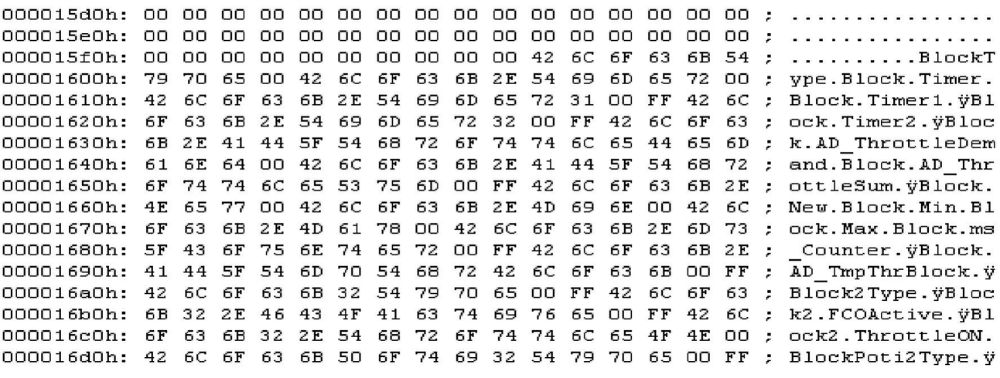
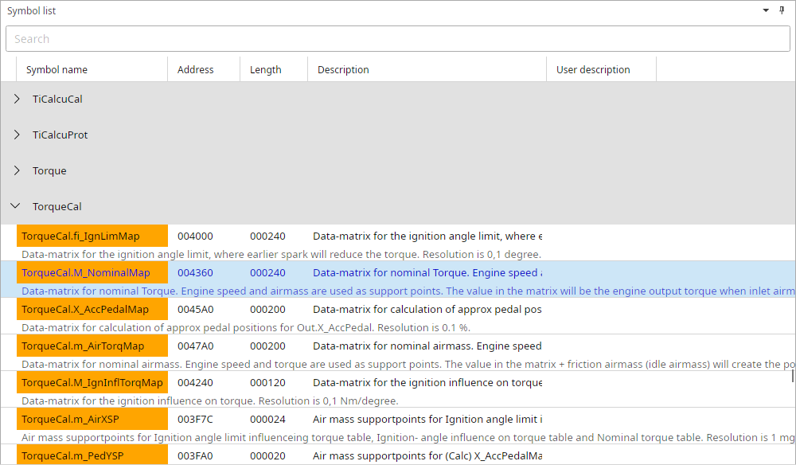

# Symbol tables {.advanced}

## General

Each T7 firmware file contains a symbol table describing data structures in the program.
The major problem is that from some point in time SAAB started to compress the symbol tables in the binary file.
Probably just to save space in the flash memory but it has made tuning a little harder.
We actually need these symbol names because they tell us what a certain memory location means.
For unpacked binaries these symbols can be extracted together with their corresponding memory addresses (ROM and RAM).

@fig-symbol-table gives a general idea on what these symbol tables look like.

{#fig-symbol-table width=99%}

While examining the symbol table you can see that the separator is 0x00.
In contrast to T5 where symbol and SRAM addresses reside in the same table, we now only find the symbol name.
In another table in the binary we can find flash addresses and lengths in the same sequence as the symboltable.

[Finding start of symbol table:]{.underline}\
Search binary for string the first sequence of 15 zeros.

[Finding start of address lookup table:]{.underline}\
Search binary for 20 00 00 00 XX YY 00 F0 where XX YY is the index of the first symbol found in the symbollist.

To save you the time to lookup all addresses manually TxSuite extracts all symbol information in one run when it opens the file.
Symbol name, flash address and length will be displayed all together.

@fig-symbol-list will give you an idea of what the symbol table should look like once it has been extracted.
See appendix I for a complete list of known symbols.
The description line under each symbol name is File → Settings → Common → Show descriptions under symbol names, it's off by default.

{#fig-symbol-list width=100%}

When the user double clicks one of the symbols that has a flash address attached to it, TxSuite will display the corresponding symbol in a map viewer.
This viewer will display the data in table form was well as in graphical form.

{width=83%}
