# Maps

## General

A lot of maps in the T7 are not only made up of a piece of raw data.
It also includes x-axis and y-axis information.
TxSuite will automatically display all known axis information when a map is opened.
In Trionic 7 most symbols have an English name (Trionic 5 has lots of Swedish names) that explains lots about its function.
Also, the symbols are categorized by name, which makes browsing the symbols much easier.
All torque calibration symbols start with “TorqueCal.”.
TxSuite groups all symbols by their respective category by default, every category starts folded.

## Fuel

Fuel calculation in Trionic 7 is based on the Airmass entering the engine.
In rough steps this seems to be the calculation’s flow:

|    | Description                    | Explaination                            |
|----|--------------------------------|-----------------------------------------|
| 1 | Basic calculation of fuel quantity per combustion | The current air mass/combustion is divided by 14.7 and sent to box 2. The unit is now in mg fuel/combustion |
| 2 | Compensation | In case of a cold engine, shortly after starting, rapid load changes, knocking or high loads, the current value is multiplied by a compensation factor |
| 3 | Closed loop | The closed loop value is used as a multiplier. The value is then sent to box 4 |
| 4 | Correction for purge | Multiply by the value for purge adaptation. The value is sent to box 5 |
| 5 | Multiplicative adaptation (long term fuel trim) | The multiplicative adaptation value is used as a multiplier and the new value is sent to box 6 |
| 6 | Additive adaptation | The additive adaptation value is added and the new value is sent to box 7 |
| 7 | Starting fuel quantity | If the engine has not yet started, starting fuel is selected. The value is sent to box 8 |
| 8 | Fuel quantity per combustion to be injected | The fuel quantity per combustion is the amount of petrol to be supplied to the engine. The value is sent to box 9 |
| 9 | Injector opening duration | Converts the value to the time during which the injector must be open and the new value is sent to box 10 |
| 10 | Injection twice per combustion | Injection takes place twice per combustion until the camshaft position has been found. Injection duration is divided by two. The value is sent to box 11 |
| 11 | Voltage dependant needle lift duration added (battery correction) | Adds the injector time delay, which is voltage dependant. The value is sent to box 12 |
| 12 | Fuel cut | The value is sent to box 13 unless fuel cut is active |
| 13 | Activation of injector | At a DETERMINED crank shaft angle, the microprocessor will control the transistor for the injector that is next in the firing order |

The basic fuel quantity is calculated based on Airmass and Injector constant.
This injector constant is called InjCorrCal.InjectorConst.

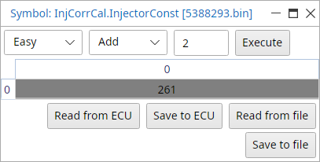{width=41%}

If the engine is not warmed up yet, an alternate fuel map is used called BFuelCal.StartMap.
If the engine has reached operating temperature the normal map “BFuelCal.Map” is used.

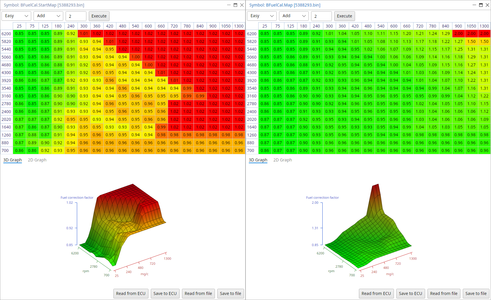{width=100%}

You will see the areas calibrated to be run in closed loop have a value of around 1.00.
It can be .98-1.02 or so.
Then you will notice the high load part of the maps ramp up to enrich the mixture.
The trick is to set the closed loop part of the map first, the areas that are represented by values of 1.00.
You will need to switch closed loop off and drive around with a wideband in the tailpipe.

What you want to achieve is an AFR of 14.7 for petrol while driving around under light loads where the value is 1.00.
What T7 does is calculate the injection time to be say 5ms, if that is not correct it is multiplied by this map.
Say you need to enter a value of 1.1 in the map to get correct AFR it will change injection time to 5.5ms (5ms\*1.1=5.5ms)

The idea is to get closed loop area correct first.
This will stop any negative adaption once the tune is finished and allowed to run in closed loop again.
If the closed loop area of your fuel map is too rich it will negatively adapt over a long period of time.
This will have the effect of leaning your AFR's across the board.

Example: you make a tune, closed loop AFR's are fine (because the O2 is making it fine through feedback) but unknown to you its rich and short term fuel trim is driving negatively 13%.
I.e. is leaning off injection time by 13%.
You don’t notice this and make some full power runs to check AFR its fine at say 12.5 AFR.
After several weeks the multiplicative adaptation (Long term fuel trim) has absorbed some adaption and has earned a value of -13% this will now subtract 13% from whole fuel calculation including full power.
All of a sudden your full power AFR has jumped up to 14.0 AFR, **engine failure happens very easily from here**.

Now back to fuel mapping.
To set closed loop area of fuel map, monitor the AFR in this light load area and if its wrong after adjusting for large injectors, start by just adjusting the Injector constant up and down accordingly instead of altering the closed loop area of BFuelCal.Map.
This will affect the whole map instead of one point.
By doing it this way you can almost get AFR spot on in closed loop area just by a few goes at adjusting the injector constant.
It can be found in InjCorrCal.InjectorConst, the value represents the injectors flow in mg of fuel (not capacity or cc's as injectors are normally rated in).
The injector constant is a calculation factor used by T7 to calculate injection time.

Once closed loop area is done the high load area can be mapped.
If its too lean just increase the values in the relative column relating to what site of the map you are running in.
Once your high load areas are done, activate closed loop again so you can see how it all runs.
Monitor fuel adaptations and AFR etc.

One thing to note is how quickly it drops into open loop under full throttle.
By going into open loop the o2 sensor is "masked" where the ECU listens to what its saying but ignores it, this allows afr's to go beyond 14.7 and injection correction is directly taken from the fuel map we just adjusted allowing much enrichment to cool charge etc.

To alter open loop enrichment you can change at what Airmass flow T7 switches to open loop in LambdaCal.MaxLoadNormTab.
Also, open loop entry (so, leaving closed loop situation) has a delay attached to it.
This way, short overruns of the maximum load will not immediately result in leaving closed loop.
Stock bins often have this set to 2000 milliseconds which seems quite long.
If you want to ECU to leave closed loop faster after overrunning the load limit, just decrease the time in LambdaCal.TimeOpenLoop.

Battery correction values for injector latency

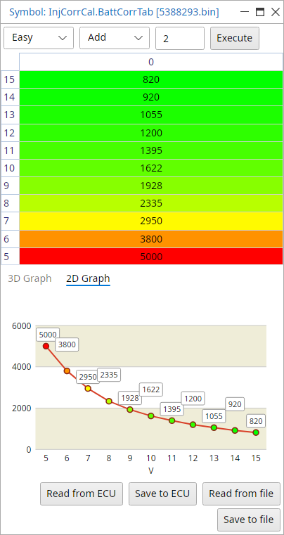{width=40%}

Water temperature correction

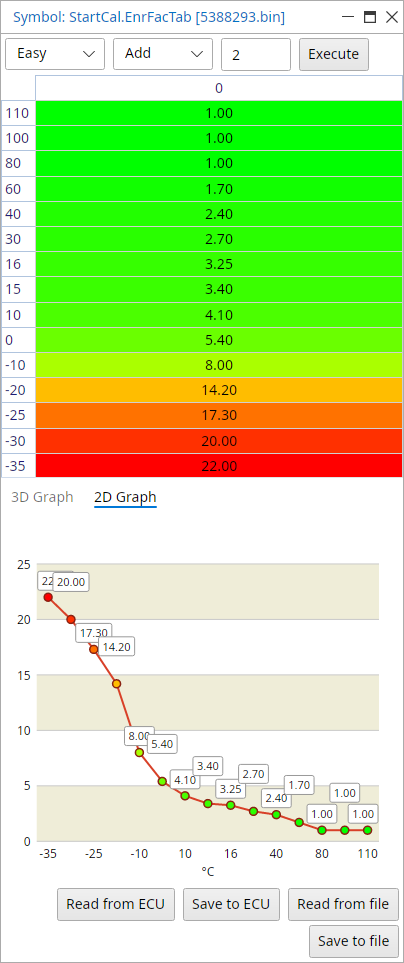{width=40%}

Fuel injection correction map for knock conditions

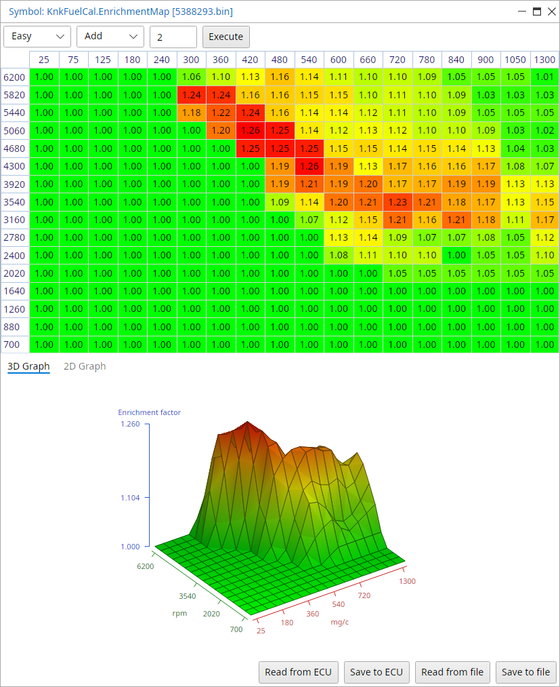{width=83%}

## Ignition

|    | Description                    | Explanation                             |
|----|--------------------------------|-----------------------------------------|
| 1 | Idling speed ignition timing | With idle speed control active, the timing is adjusted to stabilize idle engine speed. The value is sent to box 3 |
| 2 | Normal ignition timing | When idle speed control is inactive, the ignition timing is read from a load and engine speed depending matrix. The value from the matrix is optimized for lowest fuel consumption (best engine torque) and sent to box 3 |
| 3 | Selection of ignition timing | One of the ignition timing calculation is selected depending on which function is active. The value is sent to box 6 |
| 4 | Catalytic converter heating timing | In order to heat up the catalytic converter as fast as possible after start, the ignition will be retarded. This is a compensation matrix that is added to the value in box 3. The matrix is dependent on load and engine speed |
| 5 | Engagement of catalytic converter heating timing | The function is active when coolant temperature is above -10 degrees Celsius and below +64 degrees Celsius |
| 6 | Total | The value from box 5 is added to the value of box 3 |
| 7 | Compensation | The ignition timing is corrected depending on engine coolant temperature and intake air temperature. The value is sent to box 6. |
| 8 | Knock control | If knocking occurs, a timing retardation will be calculated. The value is sent to box 6 |
| 9 | Total | The compensation angle and knock retardation are totalled to give the current ignition timing. The value is sent to box 7 |
| 10 | Selection of ignition timing | Starting ignition timing is selected when the engine has not been started. The value is sent to box 9 |
| 11 | Starting ignition timing | Starting ignition timing is selected when the engine has not yet been started. The value is sent to box 9 |
| 12 | Activate relevant trigger | At the calculated crankshaft angle, the microprocessor controls the transistor for the trigger that is next in firing order |

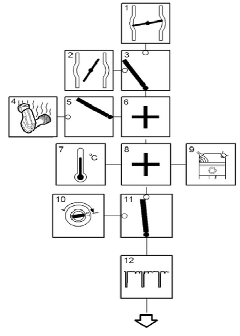{width=36%}

### Ignition cassette

The ignition cassette is mounted on the valve cover on top of the spark plugs.
The ignition cassette houses four ignition coils/transformers whose secondary coil is directly connected to the spark plugs.
The ignition cassette is electrically supplied with battery voltage from the main relay (B+) and is grounded in an earth point.
When the main relay is activated the battery voltage is transformed to 400 V DC which is stored in a capacitor.
The 400 V voltage is connected to one of the poles of the primary coil in the four spark coils.
Connected to the ignition cassette there are four triggering lines (from the Trionic ECU, pin 9 (cyl. 1), pin 10 (cyl. 2), pin 11 (cyl. 3) and pin 12 (cyl. 4)).
When the ECU is grounding pin 9, the primary coil for the first cylinder is grounded (via the ignition cassettes B+ intake) and 400 V is transformed up to a maximum of 40 kV in the secondary coil for cyl. 1.
The same procedure is used for controlling the ignition on the rest of the cylinders.

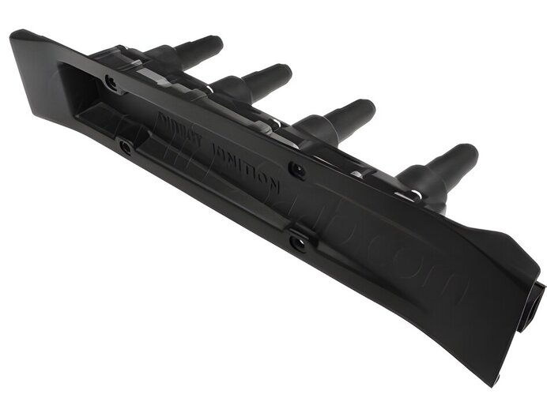{width=53%}

### Idle control

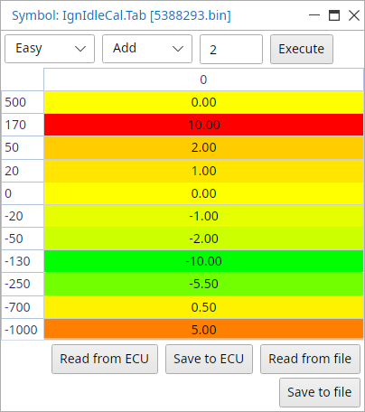{width=40%}

### Normal mode ignition

Ignition is normally controlled by the main ignition matrix: IgnNormCal.Map

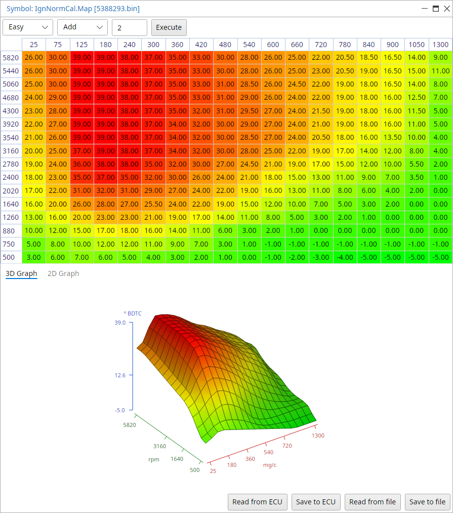{width=90%}

## Torque

Trionic 7 is a torque/Airmass request system instead of a boost request system like Trionic 5 is.
The basic procedure for the Airmass controller is like in the table below.

|    | Description                    | Explaination                            |
|----|--------------------------------|-----------------------------------------|
| 1 | Driver request | The control module reads pedal potentiometer 1 and converts the voltage to Airmass per combustion (mg/c). The value is sent to box 3 |
| 2 | Cruise control request | When cruise control is active, the air mass per combustion required to maintain the set speed is calculated. The value is sent to box 3 |
| 3 | Select highest value | The control module selects the highest of the two values (box 1 or box 2). The value is sent to box 5 |
| 4 | Engine torque limitation | The maximum permissible air mass per combustion varies depending on the engine type. During operation, the maximum permissible mg/c must also be limited to protect the engine, gearbox, brakes and turbo |
| 5 | Select lowest value | The control module selects the lowest value and sends it to box 8 |
| 6 | Compensation request | When the AC compressor is on, and when the heated rear window or radiator fan is on, the mg/c required to compensate for the increased load is calculated. The value is sent to box 8 |
| 7 | Other air request | The control module calculates the mg/c required for idle speed control. The value is sent to box 8 |
| 8 | Totalling values | The control module totals all the values. The total is sent to box 9 |
| 9 | Total requested mg/c |  |
| 10 | Total Airmass request |  |
| 11 | Throttle control | The requested mg/c is converted to requested voltage for throttle position sensor 1. The charge air pressure and intake air temp are used to correct this conversion. The throttle motor rotates the throttle until the current voltage for throttle position sensor 1 corresponds with the requested voltage |
| 12 | Current mg/c | The requested mg/c is also compared with the current mg/c (MAF reading). If needed the requested voltage for throttle position sensor 1 is finely adjusted |
| 13 | Turbo control | If mg/c is too high for throttle alone the turbo control will take over. The excess is converted to a PWM which controls the charge air control valve. The absolute pressure sensor is used to correct the conversion |
| 14 | Current mg/c | The requested mg/c is compared to current mg/c and the charge air control vale PWM is finely adjusted if required |

### Torque request

So, if the driver (or cruise control for that matter) pressed the accelerator pedal he actually requests a certain Airmass from the system.
This value is fetched from the PedalMapCal.m_RequestMap shown below.

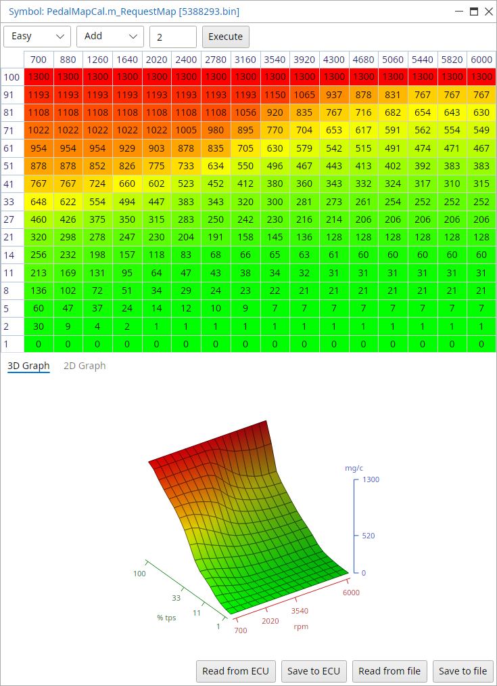{width=74%}

The table holds Airmass values for each position of the accelerator pedal and each rpm site.
Trionic now looks up the estimated engine output (torque) based on Airmass and rpm.
This is done through map “TorqueCal.M_NominalMap” as shown next.

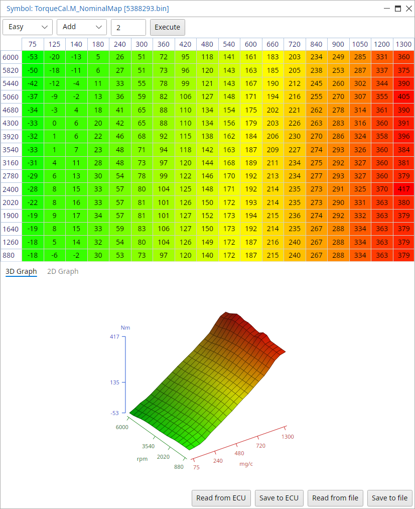{width=83%}

## Second lambda sensor

In the years Trionic 7 was shipped on cars, several things changed in these cars setups.
One of the major changes was the introduction of the second lambda (oxygen, O2) sensor that is placed after the catalyst to ensure the catalyst is working properly.
If you want to run software from a double lambda sensor car in a single lambda car, you have to make some changes in the settings.
This information is courtesy of L4staero.

### Turning off second lambda sensor

You can use this procedure in cars having only one lambda sensor and in cars having two lambda sensors, but with a missing catalyst.

| Map                     | Value | Description                   |
|-------------------------|-------|-------------------------------|
| LambdaCal.ST_AdapEnable | 0     | Second lambda sensor disabled |
| LambdaCal.ST_AdapEnable | 1     | Second lambda sensor enabled  |

### Alternative solution to turning off second lambda

Change low limit on O2HeatPostCal.I_LowLim to 0 mA to disable sensor heater error, and change CatDiagCal.LoadHi and LoadLo to values never seen normally, like 30 and 20.

| Map                    | Value | Description                   |
|------------------------|-------|-------------------------------|
| O2HeatPostCal.I_LowLim | 0     | Second lambda sensor disabled |
| CatDiagCal.LoadLo      | 20    | Second lambda sensor disabled |
| CatDiagCal.LoadHi      | 30    | Second lambda sensor disabled |
| O2HeatPostCal.I_LowLim | 230   | Second lambda sensor enabled  |
| CatDiagCal.LoadLo      | 140   | Second lambda sensor enabled  |
| CatDiagCal.LoadHi      | 425   | Second lambda sensor enabled  |

## Calibration of OBD2 and LEV EVAP systems

If we want to run a file that was developed for OBD2 or a LEV car in an earlier car we run into problems because the early car is missing a second catalyst, a tank pressure sensor and a purge canister behind the fuel tank.
If you have an early B205E/L engine you simply couldn’t run a later B205R software version in it because it would through CEL’s for the missing hardware.
We need to make changes to the file before we can run in on an earlier car (e.g. switch of the control of the new hardware).

OBDCal.OBD2Enabled= This is self explanatory, if car is OBD2 put value at 1 if it's not OBD2 put value at 0.
On this point in later bins(compressed) there is EOBDEnable which is always on in EC2000 EU files and LOBDEnable which is always on in EC2000 RW files.
File type is shown in Actions → Firmware information under Engine type.

OBDCal.EnableOBD2Limit= As above but its a 4 byte value.
If done in Hex value for a OBD2 car is 00000001 and for non-OBD2 car is 00000000.
TxSuite shows it as 2 values.
OBD2 cars top value is 1 and bottom value is 0.
In non OBD2 car both values are 0.

OBDCal.evapEquipmentExist= If car is equipped with a canister at rear of tank and a tank pressure sensor value will be 1.
If neither exist value should be set to 0.

### Info on LEV (Low Emission Vehicle)

For example take a 2001 9-3 Aero (or SE as called in USA) equipped with a B205R, Saab's decision to take all "R" engines and clean them so to speak by developing new emission systems for them leaves them with some differences to their low level engine relatives.
The term LEV(Low emission vehicle) in this sense refers to Saab's decision to add a second catalytic converter and a tank pressure sensor and a large purge canister behind fuel tank, as well as adding a 2nd oxy to monitor condition of first cat.

## Footer information {.advanced}

If we look at the footer in the binary (last page in a hex viewer, Actions → View file in hex in TxSuite) we see a set of reversed strings.
Each of these strings contains an identifier.
These identifiers have a hardcoded meaning.

| Identifier | Length | Description                                  |
|------------|--------|----------------------------------------------|
| 0x91       | 0x09   | Ecuid.vehicleidnr                            |
| 0x94       | 0x07   | Ecuid.ecuhardwversnr                         |
| 0x95       | 0x0C   | Ecuid.ecusoftwnr                             |
| 0x97       | 0x1E   | Ecuid.ecusoftwversnr                         |
| 0x9A       | 0x04   | Ecuid.softwaredate                           |
| 0x9C       | 0x04   | variable name table crc (not really sure)    |
| 0x9B       | 0x04   | Symboltable (packed table with symbol names) |
| 0xF2       | 0x04   | F2 checksum                                  |
| 0xFB       | 0x04   | Romchecksum.piareachecksum                   |
| 0xFC       | 0x04   | Romchecksum.BottomOffFlash                   |
| 0xFD       | 0x04   | RomChecksumType                              |
| 0xFE       | 0x04   | Romchecksum.TopOffFlash                      |
| 0xFA       | 0x05   | Lastmodifiedby                               |
| 0x92       | 0x0F   | Ecuid.partnralphacode (IMMO)                 |
| 0x93       | 0x07   | Ecuid.ecuhardwnr                             |
| 0xF8       | 0x02   | ?                                            |
| 0xF7       | 0x02   | ?                                            |
| 0xF6       | 0x02   | ?                                            |
| 0xF5       | 0x02   | ?                                            |
| 0x90       | 0x11   | Ecuid.scaletable (VIN)                       |
| 0x99       | 0x06   | Ecuid.testerserialnr                         |
| 0x98       | 0x0D   | Ecuid.enginetype                             |
| 0xF9       | 0x01   | Romchecksum.Error                            |

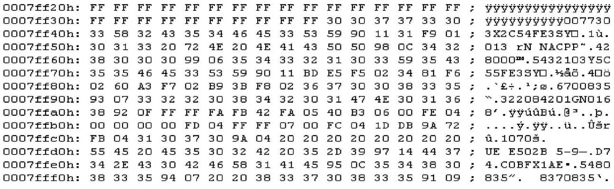{width=99%}
