# Tuning the T7

## Tuning with TxSuite

To get the ECU to produce more engine output, several parameters (maps) have to altered.
This chapter will give you a general idea on what to change – and why – for getting to an approximate stage II equivalent.
The example is a 9-3 B205R.
The pictures are from its stock file 5380480.bin, unless the map viewer's title bar says another file.

The changes are made in TxSuite's map viewer.
Select the cells, pick Add, Multiply, Divide or Fill in the toolbar, type the value and click Execute.
Save to file writes the map into the binary, Ctrl+Z undoes a change.
Where a picture shows a map before and after a change, the map before the change is on the left and the changed one, not saved yet, on the right.
Selected cells show blue.

**AirCtrlCal.m_MaxAirTab**\
*Airmass value from controller where area map has reached max-area and there is no point to increase the I-part.
Resolution is 1 mg/c*

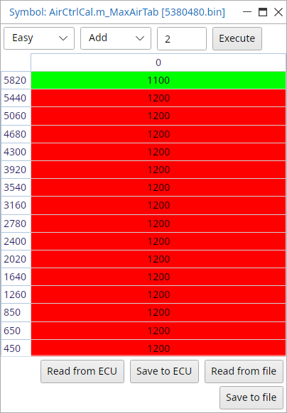{width=40%}

**AirCtrlCal.m_MaxAirE85Ta** ( if running on E85 )\
*Same as above for E85*

**BoostCal.I_LimTab**\
*Load limit tab. to enable the I Part of boost regulator.
If the load request from Airmass master is above this value plus the hysteresis is the I Part enabled and the throttle closed loop is disabled.
If the load request from Airmass master is below this value is the I Part disabled and the throttle is allowed to run in closed loop.*

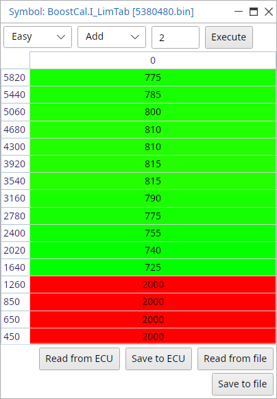{width=40%}

**BoostCal.P_LimTab**\
*Load limit tab. to enable the P Part of boost regulator.
If the load request from Airmass master is above this value plus the hysteresis is the P Part enabled.
If the load request from Airmass master is below this value is the P Part disabled.*

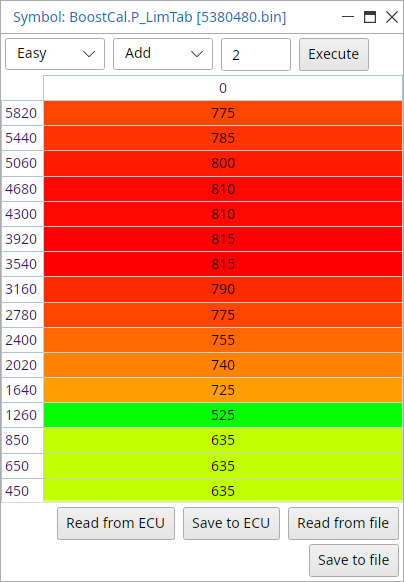{width=40%}

**BoostCal.RegMap**\
*Main constant matrix.
Resolution is 0.1 %.*

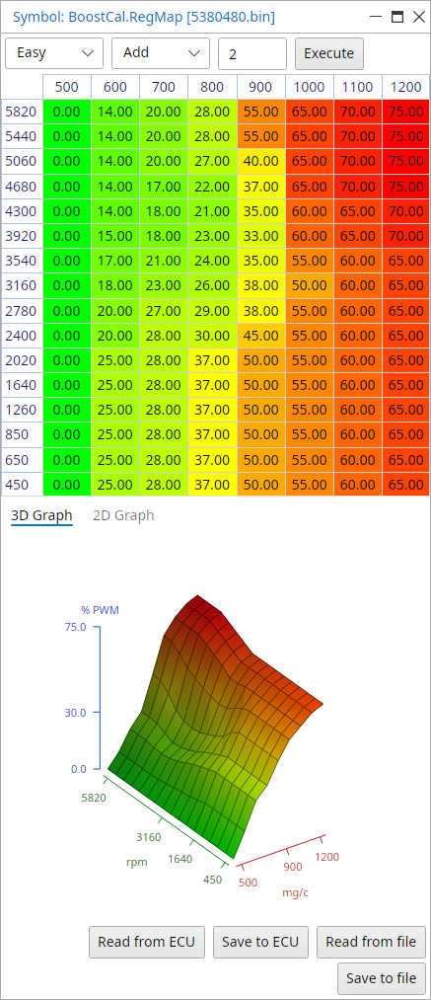{width=44%}

**BstKnkCal.MaxAirmass** (divide by 3,1 for approx torque, ignition, airtemp etc affect this!)\
*Map for max allowed Airmass for manual gearbox, m_nHigh.
Resolution is 1 mg/c.*

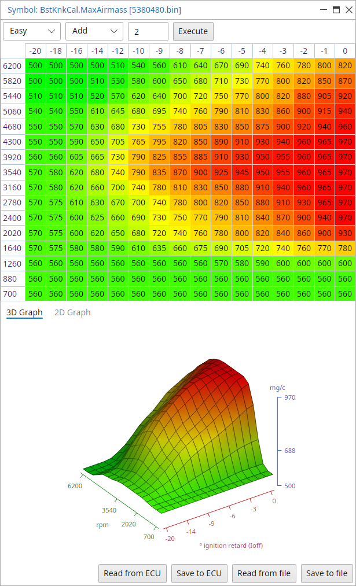{width=62%}

**BstKnkCal.MaxAirmassAu**\
*Map for max allowed Airmass for automatic gearbox, m_nHigh.
Resolution is 1 mg/c.*

**FCutCal.m_AirInletLimit**\
*If the "MAF.m_AirInletFuel" is higher than this limit during m_AirInletTime will the fuelcut be activated ( pressure guard ).*

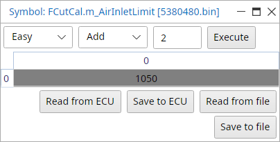{width=40%}

**IgnE85Cal.fi_AbsMap** ( if you want to change the ignition )\
*Ignition map for E85 fuel.
Resolution is 0.1 °.*

**IgnNormCal.Map** ( if you want to change the ignition )\
*Normal ignition map.
Resolution is 0.1 °.*

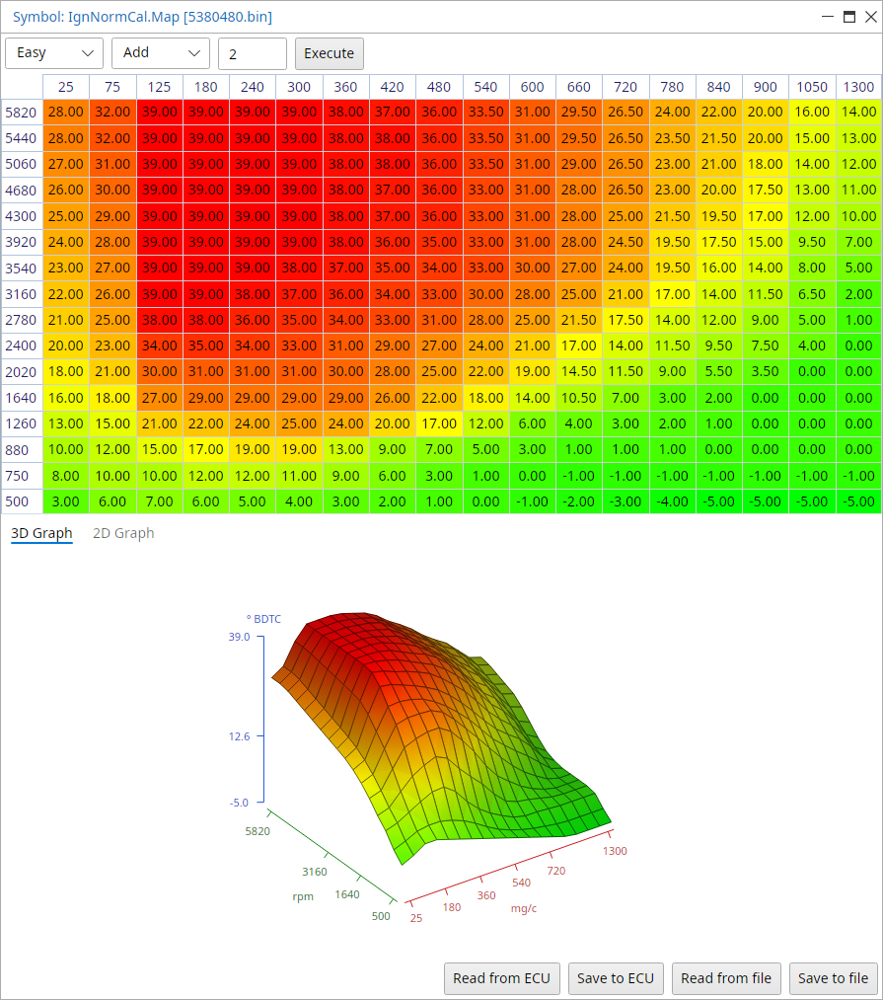{width=90%}

**MapChkCal.CheckSum** (updated automatically every time TxSuite saves a map!)

**MaxVehicCal.v_MaxSpeed**( max speed )

**PedalMapCal.m_RequestMap**\
*Requested Airmass from the driver as a function of rpm and accelerator pedal position.
Resolution is 1 mg/c.*

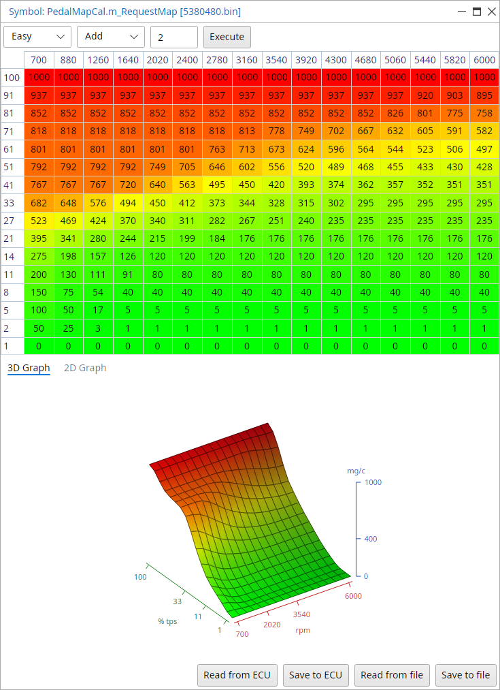{width=74%}

**TorqueCal.M_ManGearLim**\
*Maximum engine torque limit for each gear in the manual gearbox.
Resolution is 1 Nm.*

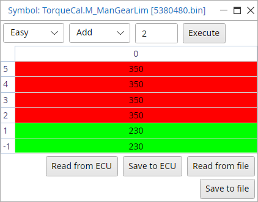{width=42%}

**TorqueCal.m_AirTorqMap** (This is where all torque limiters take their data from and therefore needs to be "fooled" if you are running 400nm+ or an automatic!)\
*Data-matrix for nominal Airmass.
Engine speed and torque are used as support points.
The value in the matrix + friction Airmass (idle Airmass) will create the pointed torque at the pointed engine speed.
Resolution is 1 mg/c.*\
axis to the above map: **TorqueCal.M_EngXSP**

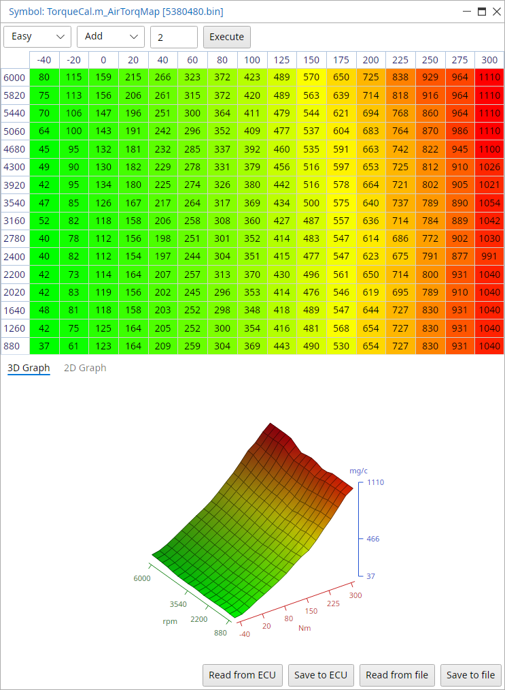{width=74%}

**TorqueCal.M_EngMaxTab**\
*Data-table for maximum engine out put torque for manual cars.
Resolution is 1 Nm.*

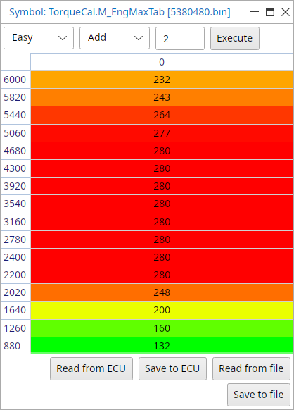{width=42%}

**TorqueCal.M_EngMaxAutTab**\
*Data-table for maximum engine output torque for automatic cars.
Resolution is 1 Nm.*

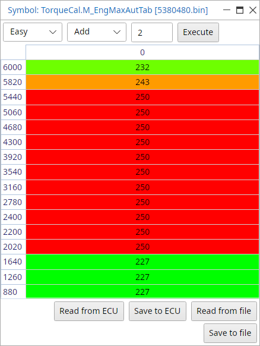{width=44%}

**TorqueCal.M_5GearLimTab**\
*Data-table for maximum engine output torque for manual cars on fifth gear.
Resolution is 1 Nm.*

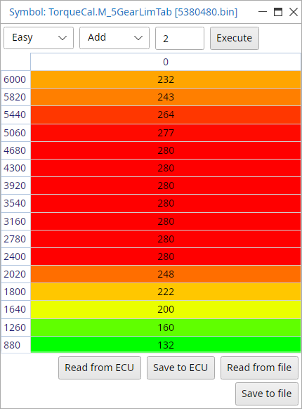{width=43%}

**TorqueCal.M_EngMaxE85Tab** ( if running on E85 )\
*Data-table for maximum engine output torque when running on E85.
Resolution is 1 Nm.*

**TorqueCal.m_PedYSP**\
*Air mass support points for (Calc) X_AccPedalMap.
Resolution is 1 mg/combustion.*

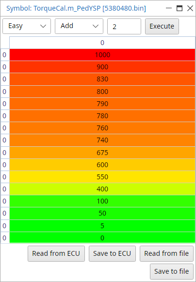{width=40%}

### Tuning Boost calibration

This map holds percentages (0.1% accurate) of how much air should be passed to the return hose of the boost control value.
The higher the value, to more air is bled off and the less the wastegate will open (and thus, the more air the turbo will be spooling).
As you can see, the more Airmass is requested (x – axis) the more the wastegate is held shut and thus, the more Airmass the turbo will be providing.
If we want more Airmass from the turbo, we need to keep the wastegate shut longer and thus we have to enter higher numbers on the right side of the table.
In the picture the 900 to 1200 mg/c columns from 2400 rpm up are multiplied by 1.3.

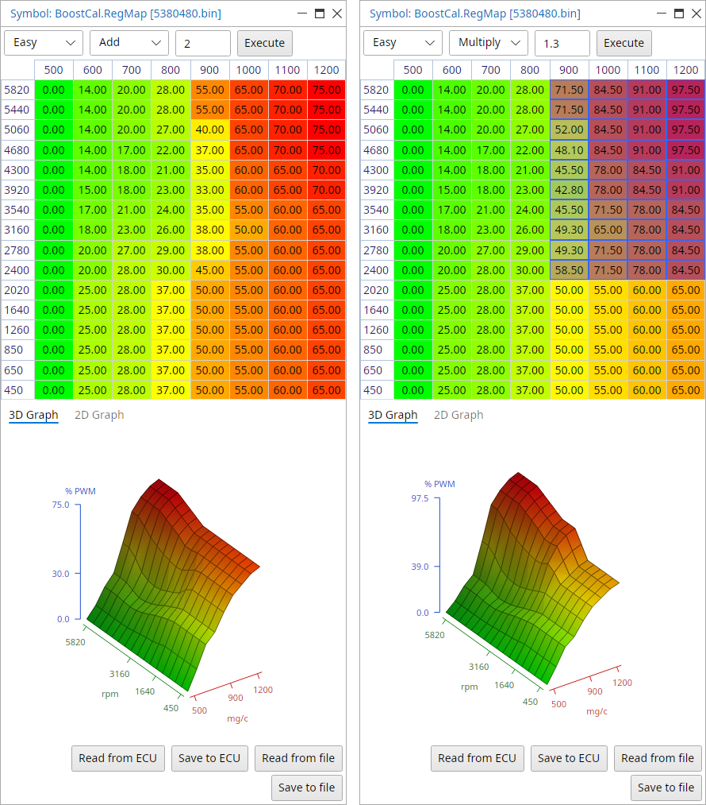{width=89%}

### Altering Airmass limiter

To be able to flow more air though the engine that is allowed in the stock configuration we will have to modify the Airmass limiter tables as well.
Note that there are two different ones, one for manual gearbox and one for automatic gearbox.
This example will only show the manual gearbox table (BstKnkCal.MaxAirmass) but for automatic cars BstKnkCal.MaxAirmassAu needs to be changes.

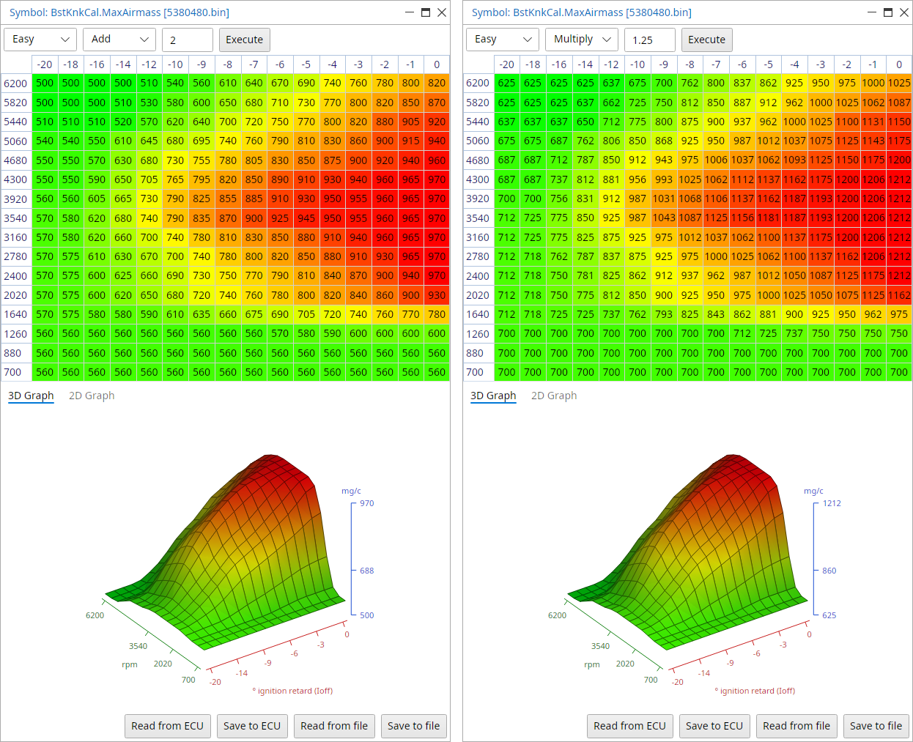{width=100%}

As you can see, the maximum amount of Airmass allowed is approximately 970 mg/c.
We need to change the table so that it will allow more Airmass.
In this case we just up the table with 25% with the math functions in TxSuite.
Select the whole table with Ctrl+A, pick Multiply in the toolbar, type 1.25 and click Execute.
The right side of the picture shows the result, a maximum of 1212 mg/c.

**NOTE**: Please do not simply turn off this limiter by setting it way higher than the actually intended level because it is an important limiter to provide engine safety.

### Altering fuelcut

Then there’s the fuelcut function to worry about.
We need to increase the limit of what the fuel cut function will accept to prevent it from shutting of fuel too early.
In the picture the stock 1050 mg/c goes up to 1400.

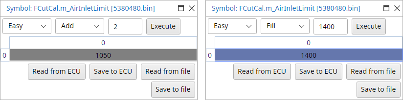{width=82%}

**NOTE**: Please do not simply turn off this limiter by setting it way higher as the actually intended level because it is an important limiter to provide engine safety.

### Engine speed limiter

To prevent the system to reduce Airmass above engine speeds that are still acceptable we need to change MaxSpdCal.n_EngLimAir as well.
Y axis values are engine temperature (coolant).
Please note that 200 rpm above this limit, the fuel cut mechanism will become active!
In the picture the limit at 80 and 100 °C goes from 6100 to 6350 rpm.

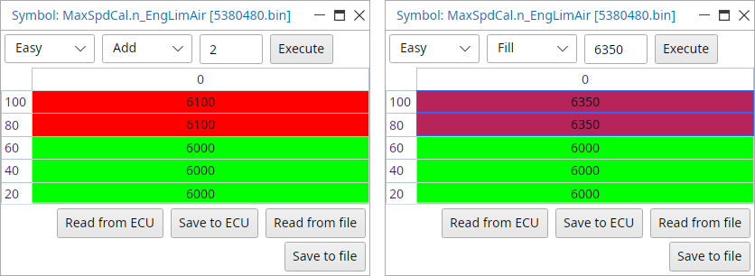{width=84%}

### Vehicle speed limiter

An option is to increase the vehicle speed limiter as well.
In this stock binary the vehicle speed is limited to 240 km/h.
We can change it to – for example 280 km/h.

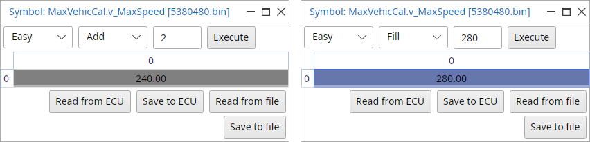{width=85%}

### Airmass request

To get more from the engine than in the stock configuration we need to actually request more Airmass for a certain pedal position and rpm site.
This can be done through PedalMapCal.m_RequestMap.
Because we want more power at wide open throttle (from the drivers perspective) we need to increase the Airmass request at pedal positions in the high percentage range (top of the table).

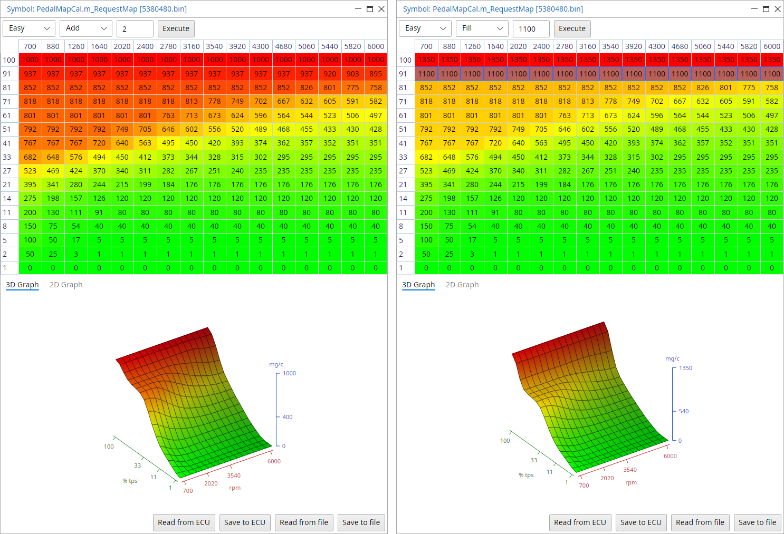{width=100%}

As you can see we increased the top two rows so that a maximum of 1350 mg/c will be requested.
The top row is filled with 1350 and the row below it with 1100.

In addition we need to alter the y axis support point for the pedal map that lets Trionic lookup a pedal position for a given Airmass.
This map is called TorqueCal.m_PedYSP.
This axis map should support the maximum Airmass we’re requesting in the m_Requestmap, so in our case we need to modify the map to match the 1350 mg/c we are requesting as a maximum.

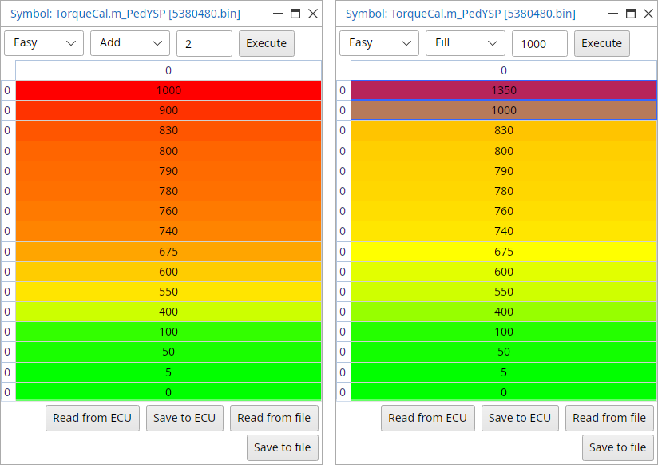{width=82%}

The map that uses this axis is called TorqueCal.X_AccPedalMap.
It it shown below with the altered axis values for clarification.

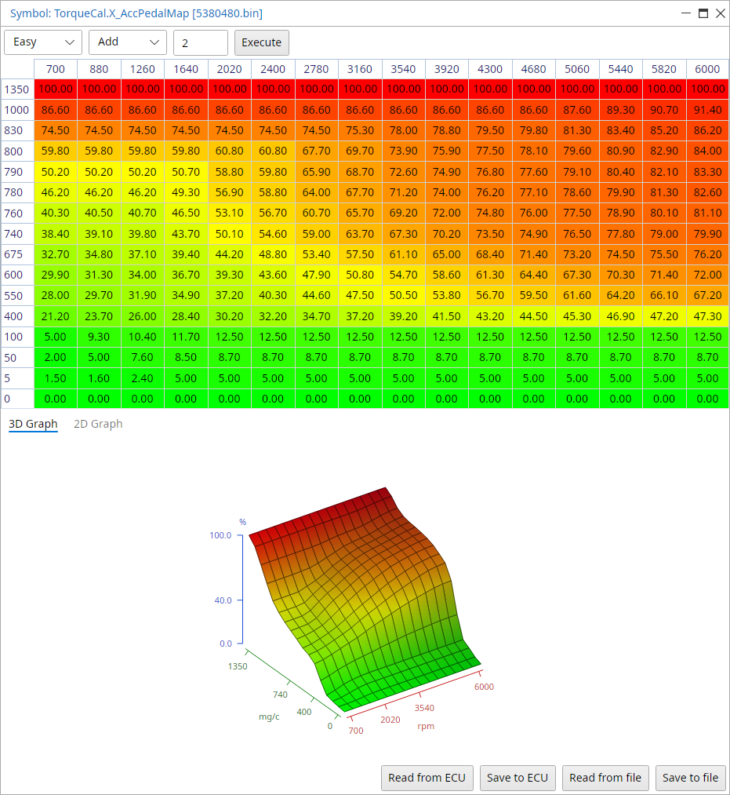{width=93%}

### Torque limiter

To prevent to system to reduce Airmass above a certain engine output, the torque limiter needs to be increased according to expected engine output.
In the picture TorqueCal.M_EngMaxAutTab is filled with 360 Nm from 2020 rpm up and 300 Nm below that.

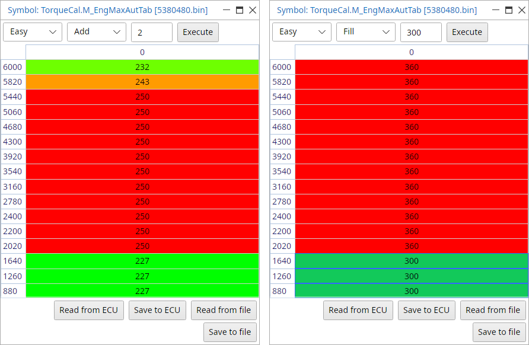{width=89%}

The next four tables are from a tuned 9-5 B205E BioPower file, 55562425-tuned.bin in the title bar.

Torque limiter for E85 fuel

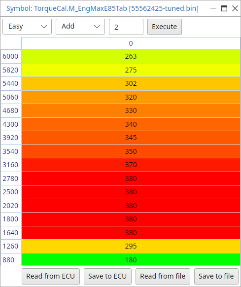{width=49%}

Torque limiter per gear for the manual gearbox

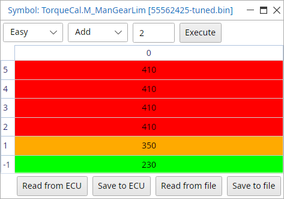{width=47%}

Torque limiter in 5^th^ gear

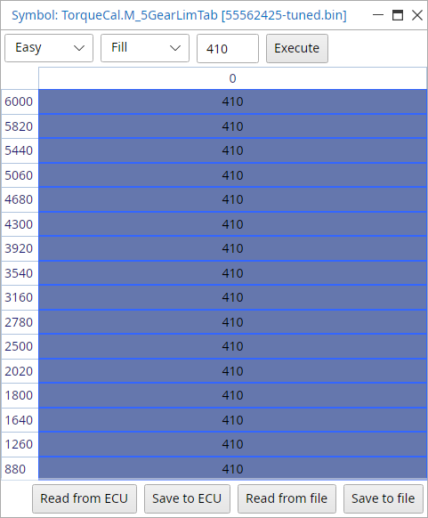{width=48%}

Overboost table

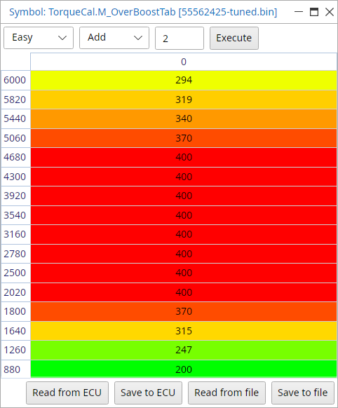{width=48%}

Maximum Airmass for I-part of PID controller (**AirCtrlCal.m_MaxAirTab**)

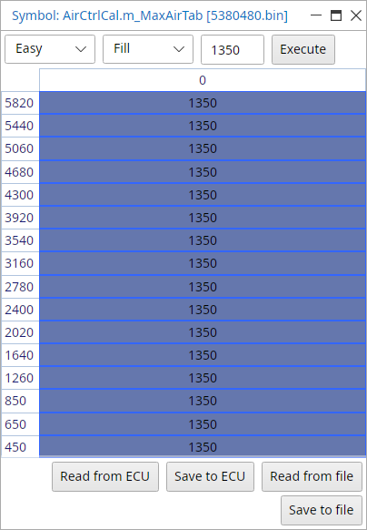{width=40%}

**TorqueCal.m_AirTorqMap** (This is where all torque limiters take their data from and therefore needs to be "fooled" if you are running 400nm+ or an automatic!)\
*Data-matrix for nominal Airmass.
Engine speed and torque are used as support points.
The value in the matrix + friction Airmass (idle Airmass) will create the pointed torque at the pointed engine speed.
Resolution is 1 mg/c.*

In the picture the last torque point of the x axis, TorqueCal.M_EngXSP, is raised from 300 to 350 Nm and the last column is raised to match.
Edit x-axis in the table's right-click menu opens the axis as a map of its own, with its own Save to file.

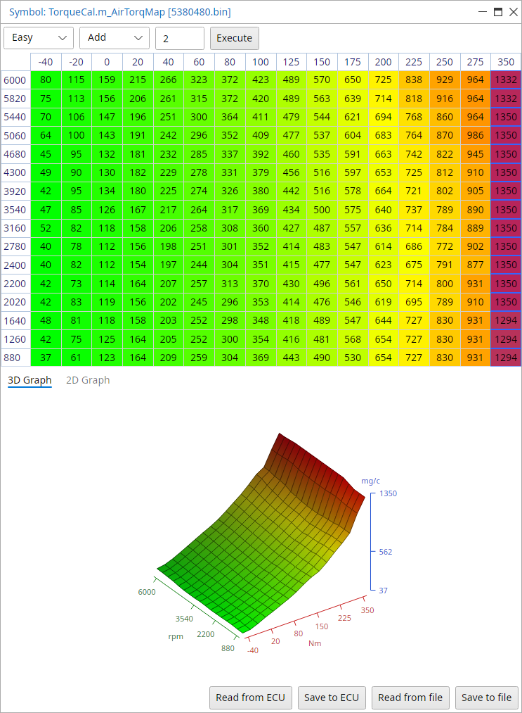{width=74%}

Finally, we’re all done! ☺

## Automatic transmission specifics

In automatic Trionic 7 cars the TCM (Traction Control Module) sends a torque limit over can to the ECU (Trionic).
This means – theoretically - you cannot achieve more torque than the torque limit the TCM dictates.
The only known way around this at present time is to make Trionic THINK it’s not making that much torque, so we have to fool the ECU into thinking it is still below the torque limit set by the TCM.
There are different TCM limits depending on year, engine type, gearbox etc.
A MY01-AERO AUT has a 330NM limiter while a 5 speed automatic gearbox has a 350Nm limit.

<!-- TODO roffe: TxSuite has Actions → TCM limit (TCM MOD v1 / v2, the limit goes into VIOSCal.M_TCMOffset). Worth a few lines here as another way around the TCM limit? I don't know what TCM MOD is well enough to write it. -->

The pictures in this part are from the tuned 9-5 B205E BioPower file again.

To fool the ECU into thinking it is making less torque is to rescale the x-axis for **TorqueCal.m_AirTorqMap** which is **TorqueCal.M_EngXSP**.
The top value in this list must be no more than the TCM limit.

In this case the top three rows have been altered to keep the calculated torque below 330Nm.

| 400 -> 330Nm
| 350 -> 320Nm
| 320 -> 310Nm

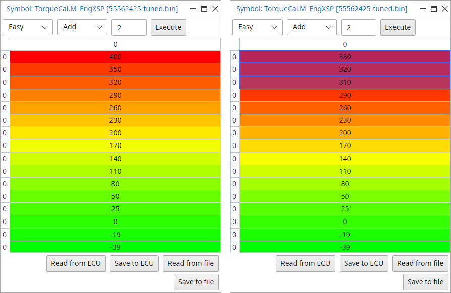{width=89%}

This means that when requesting 330Nm you will actually get 400, 320 will get you 350 and so on.
The torque limiters in **TorqueCal.M_EngMaxAutTab** must be scaled with this in mind...
In this case 400Nm between 2780 and 3920rpm.
Values in between you need to recalculate, at 4300rpm the user wanted 390Nm, (400=330, 350=320) means that 322=360, 324=370, 326=380, 328=390nm

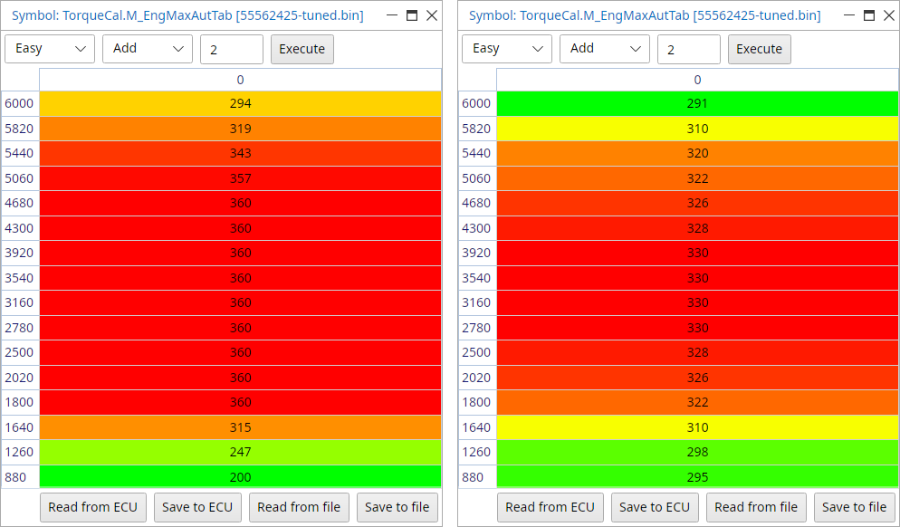{width=99%}

If you want to use the same bin in manual cars all manual limiters must be calculated and set correctly!

**NOTE: In Bio power bins *TorqueCal.M_EngMaxE85Tab*!**

The two pictures below show all seven torque limiters of the file after rescaling, side by side with Skin → Tile windows vertically.

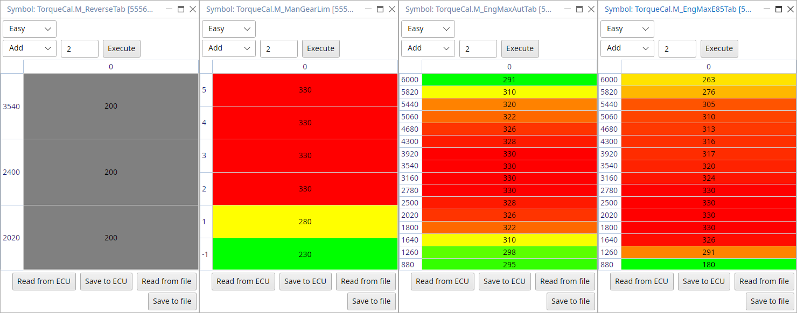{width=100%}

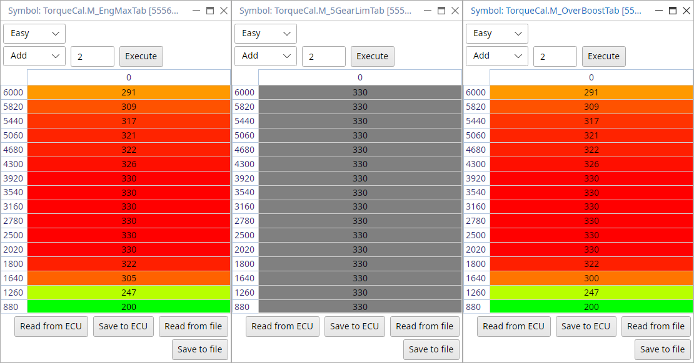{width=75%}

## Tuning to stage I

The old T7Suite had a tuning wizard, “Tuning” > “Easy tune to stage I”, that altered the maps in the binary file to get it to a stage I equivalent file.
TxSuite doesn't have it, the maps are changed by hand in the map viewer as shown in this chapter.

The wizard made a backup of the file, changed these maps and updated the checksum:

- BoostCal.RegMap, the boost calibration map
- BstKnkCal.MaxAirmass and BstKnkCal.MaxAirmassAu, the airmass limiters for manual and automatic gearbox
- FCutCal.m_AirInletLimit, the fuelcut limiter
- PedalMapCal.m_RequestMap, the airmass request map, and TorqueCal.m_PedYSP, its y axis
- TorqueCal.M_EngMaxAutTab and TorqueCal.M_EngMaxTab, the torque limiters for automatic and manual gearbox
- TorqueCal.M_ManGearLim and TorqueCal.M_5GearLimTab, the torque limiters per gear and in 5th gear
- TorqueCal.M_OverBoostTab, the overboost table

All of them are in the Tuning menu: Boost calibration under Tuning → Boost, the request map and its y axis under Tuning → Airmass and the rest under Tuning → Limiters.
Make a backup first with File → Create backup file, Save to file updates the checksum.

## Stuff for SID information display

The Trionic can show information on the SID (System Information Display).
This way you can view real-time information without utilizing the Canbus interface.
You can select the variables you want the SID to display with Actions → SID information, Ok writes them into the binary.

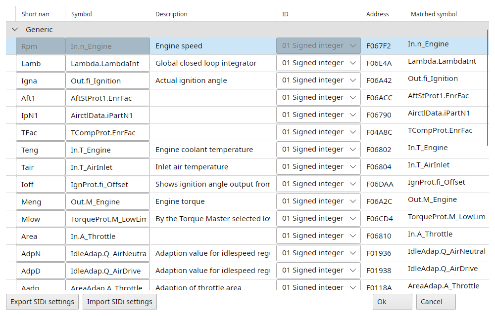{width=100%}

Also, the software should be opened to be able to view the selected data on the SID.
This is done in Actions → Firmware information: tick Open SID info and click Ok.

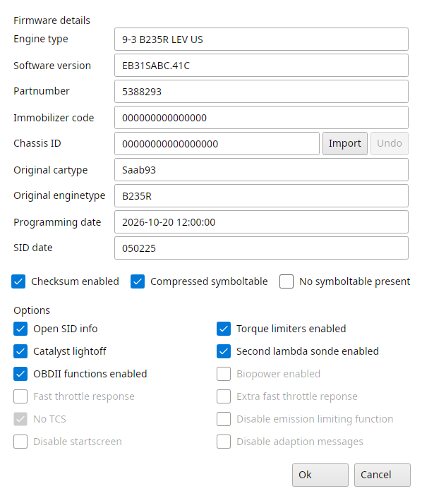{width=60%}

Some tips on how to use the SID information option:

- ECMStat.ST_ActiveAirDem shows the current Airmass limiter
- ECMStat.P_Engine shows calculated engine power (hp)
- ECMStat.AirFuelRatio shows calculated AFR
- ECMStat.p_Diff shows boost pressure (manifold – ambient) in 0.1 kPa units
- BstKnkProt.MapPointer shows the offset in 0.1 degrees for BstKnkCal.MaxAirmass (so, the ignition offset for knock)
- ExhaustCal.ST_Enable allows you to enable and disable the EGT algorithm.
  These algorithms are based on the stock engine and won’t be properly calibrated for a stage 3+ setup.
- KnkDetAdap.KnkCntCyl first 2 bytes show cylinder 1 knock count, next 2 bytes shows cylinder 2 knock count etc.
