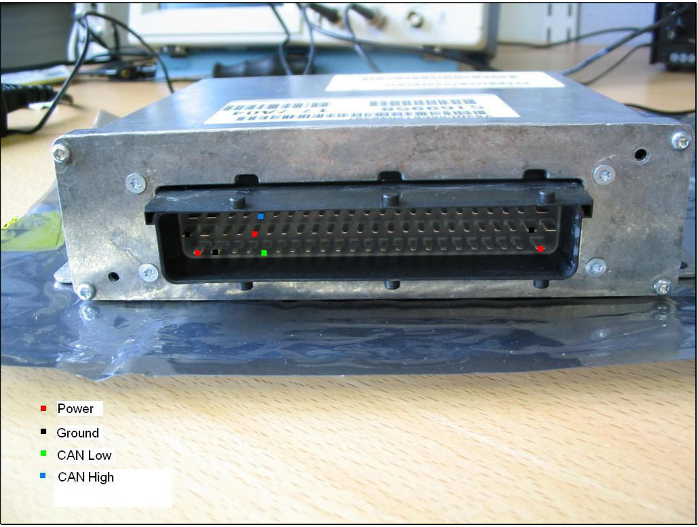

# CAN Bus interface

Interfacing with the Trionic T7 unit through the CAN bus is possible.

## General information

Chip used on Trionic side: Intel AN825257\
Communication speed used: 615 Kbit/s

The most frequently used interface for this is the Lawicel CANUSB interface that can be found on [www.canusb.com](http://www.canusb.com).
This interface can convert CAN signals onto you USB port and vice versa.
The interface has a USB port on one side – that connects to you computer – and an male RS232 (DB9) connector on the other side.
This side connects to the CAN bus of the Trionic.

The Lawicel interface has the following pin out on the DB9 connector.

{width=64%}

## Connecting to CAN bus with ECU on your desk

{width=88%}

## OBDII socket pin out

On some models, the OBDII port enables you to connect to the I bus directly.
On most models, you need to wire into the P-pus (preferably, because data transmission rates are tenfold of that on the I- bus) or into the I-bus directly.
The P-bus can be found at the pins of the ECU (as described on the previous page), the I-bus can be found in a lot of places like the CD changer connector in the trunk (other spots are shown in the table below).

{width=44%}

| Pinnumber | Description                                         |
|-----------|-----------------------------------------------------|
| 1         |                                                     |
| 2         | J1850 Bus+                                          |
| 3         |                                                     |
| 4         | Chassis Ground                                      |
| 5         | Signal Ground                                       |
| 6         | CAN High (J-2284) **Note: not on all models**       |
| 7         | ISO 9141-2 K Line                                   |
| 8         |                                                     |
| 9         |                                                     |
| 10        | J1850 Bus-                                          |
| 11        | Airbag Controller (?)                               |
| 12        | ABS Controller (?)                                  |
| 14        | CAN Low (J-2284) **Note: not on all models**        |
| 15        | ISO 9141-2 L Line                                   |
| 16        | Battery Power                                       |

I-Bus
:   There components are hooked up to the I-Bus (instrumentation bus):

    SID
    :   Saab Information Display

    ACC
    :   Automatic Climate Control

    RADIO
    :   Radion control unit

    CDC
    :   CD-Changer – in trunk

    PSM
    :   Power Seat Memory

    STC
    :   Soft Top Control – for carbios

    Twice
    :   Theft Warning Integrated Control Electronics

    DICE
    :   Dashboard Integrated Control Electronics

P-Bus
:   These components are hooked up to the P-Bus (powertrain bus)

    TC/ABS
    :   Traction Control/ABS – in case of ABS only (without Traction Control) it is connected to MIU

    Trionic 7
    :   Motormanagement for petrol engines

    VP44-PSG16
    :   Motormanagement for diesel engines

    TCM
    :   Transmission Control System – in autmatic geared cars (petrol only)

## Real-time symbols in Trionic 7

This table gives a summary of interesting symbols to monitor in Trionic 7.

| SID name | Symbolname | Description |
|-----------|-------------------------|---------------------------------------|
| Rpm | In.n_Engine | Engine speed UNIT : rpm MAX : 8000 MIN : 25 (set to 10 when engine starts to move) TRANS : V = P. Resolution is 1. Interval is Every combustion / 5 ms when engine is still. |
| Lamb | Lambda.LambdaInt | Global closed loop integrator. Update : every combustion. V6: Bank 1. Resolution is 0.01 %. |
| Igna | Out.fi_Ignition | Actual ignition angle. A positive value is before TDC and a negative value is after TDC. Resolution is 0.1 °. Interval is Every combustion. |
| Teng | In.T_Engine | Engine coolant temperature UNIT : (C MAX : 150 MIN : -40 TRANS : V = P. Resolution is 1. Interval is 1000 ms. |
| STAd | E85Adap.ST_Adap |  |
| Tair | In.T_AirInlet | Inlet air temperature UNIT : (C MAX : 140 MIN : - 40 TRANS : V = P. Resolution is 1. Interval is 1000 ms. |
| Ioff | IgnProt.fi_Offset | Shows ignition angle output from offset functions. Resolution is 0.1 °. |
| Meng | Out.M_Engine | Engine torque UNIT : Nm MAX : 400 MIN : -100 TRANS : V = (P+. Resolution is 1. Interval is 10ms. |
| Mlow | TorqueProt.M_LowLim | By the Torque Master selected lowest torque limit request, corrected with adaption value made at idle. |
| nErr | obdNoOfFaults | Number of errors stored |
| Pbef | In.p_AirBefThrottle | Engine inlet air pressure UNIT : kPa MAX : 300 MIN : 0 TRANS : V = P \* 10. Resolution is 0.1. Interval is Every combustion. |
| Pinl | In.p_AirInlet | Engine inlet air pressure UNIT : kPa MAX : 300 MIN : 0 TRANS : V = P \* 10. Resolution is 0.1. Interval is Every combustion. |
| Pair | In.p_AirAmbient | Barometric air pressure UNIT : kPa MAX : 120 MIN : 50 TRANS : V = P \* 10. Resolution is 0.1. Interval is 250 ms. |
| mReq | m_Request | Requested airmass |
| mAIR | MAF.m_AirInlet | Airmass in milligram per combustion. This airmass is the actual load value in the ECM. (Unfiltered) Calculated from ActualIn.Q_AirInlet. Resolution is 1 mg/c. Interval is every combustion. |
| Miss | Missf.nrOfCountedMisfire | Counts the nr of misfire that has not been filtered or rpm diff filtered. |
| Pfac | BoostProt.PFac | Calculate P part for regulator. load diff \* P const P = 100. Update : every 10 msec. Resolution is 0.1 %. |
| Ifac | BoostProt.IFac | Calculated I part for regulator. load diff \* I const I = I + 1000. Update : every 10 msec. Resolution is 0.1 %. |
| PWM | Out.PWM_BoostCntrl | Duty-cycle for boost pressure valve. Resolution is 0.1 %. Interval is every 20 ms. |
| tSta | ECMStat.t_StartTime | Engine start time, measured by measuring the time from that the battery volatage decreases 1.0V to the time engine speed reached 1000 rpm. |
| LIMP | OBDAdap.ThrLimpHomeNr | Last reported throttle limphome number. |
| Mode | SID.ST_Mode | Mode settings to see different "values" |
| Me85 | In.X_EthanolSensor |  |
| Ad85 | E85.X_EthanolActual |  |
| Ca85 | E85Prot.X_EthanolActual |  |
| Amul | AdpFuelProt.MulFuelAdapt | Multicative fueladaption value. Resolution is ñ 0.01 %. |
| FFac | Purge.FuelFac | The fuelfactor from the purge function. Resolution is 0.01 %. |
| ReFu | E85Adap.ST_ReFuel |  |
| Crnk | CrnkCas.ST_Fuel |  |
| MxLo | LambdaProt.MaxLoadNorm | Max load (airmass) for closed loop during normal conditions. Update : every combustion. Resolution is 1 mg/c. |
| SFuL | E85Adap.V_SavedFuelLevel |  |
| VFue | In.V_FuelTank | Fuel level UNIT : l (litre) MAX : 100 MIN : 0 TRANS : V = P \* 10. Resolution is 0.1. Interval is 1000 ms. |
| Aadd | AdpFuelProt.AddFuelAdapt+2 | Additative fueladaption value. Resolution is 0.01 mg/c. |
| Aadp | AreaAdap.A_Throttle | Adaption of throttle area. Interval is 250ms. |
| AdpD | IdleAdap.Q_AirDrive | Adaption value for idlespeed regulation (drive activated). This value is added to the PID and Constant part of the regulator. If the I-part is limited will the adaption stop. Resolution is 0.01 g/s. |
| AdpN | IdleAdap.Q_AirNeutral | Adaption value for idlespeed regulation (drive not activated). This value is added to the PID and Constant part of the regulator. If the I-part is limited will the adaption stop. Resolution is 0.01 g/s. |
| Akw1 | KnkAdaptAdap.RefValueWind |  |
| Akw2 | KnkAdaptAdap.RefValueWind+2 |  |
| AMR | CanIn.ST_EngineInterv | Engine intervention is requested from ESP (AMR) |
| Apur | Purge.HCCont | The content of HC in the purge air. Resolution is 0.1 %. ay CanIn.a_Lateral Lateral acceleration, only implemented on cars with ESP. Resolution is 0.5 m/s2. |
| Badp | BoostAdap.Adaption | Adaption value for boost control. Interval is Every 100ms. |
| BMR | CanIn.ST_BrakeInterv | Brake intervention is requested from ESP (BMR) |
| CLUi | Out.CMD_CoastLUInhibit | Inhibit coast slip lock up |
| Cmem | EngTip.ST_Active | Status flag showing if tipin is active 0 = Not active 1 = Tip-in active 2 = Tip-out active |
| CSLU | In.ST_TCMCSLU | Coast Lock up slip state 0 = No request 1 = Fuel cut inhibit 2 = Fuel cut allowed |
| DTI | Out.M_DTI | Drivers Torque Intention. The torque that the driver requests converted from air to torque. Limitations from all functions excluding TCM and TCS are included in the signal UNIT : Nm MAX : 400 MIN : -100 |
| Fcod | obdFaults | codes for errors stored |
| FFAd | Purge.m_FuelPrg | Fuel flow from purge. Resolution is 0.01 mg/c. |
| Flow | Purge.Flow | The actual purge flow. Resolution is 1 mg/s. |
| FMXF | PurgeProt.FuelFacMaxFlow | Maximum allowed purge flow in respect to maximum allowed fuel factor at actual load. Resolution is 1 mg/s. |
| Frez | PurgeProt.AdpFreeze | Adaption freeze status. |
| Fuel | BFuelProt.CurrentFuelCons |  |
| Gear | In.X_ActualGear | Actual gear on automatic gearbox. 2 - Reverse 3 - Neutral 5 - Gear 1 6 - Gear 2 7 - Gear 3 8 - Gear 4 11 - Gear 3, lock up 12 - Gear 4, lock up Interval is every 50 ms. |
| GSI | Out.CMD_GearShiftInhibit | Prevent TCM from shifting. |
| HCnt | Purge.HCCont | The content of HC in the purge air. Resolution is 0.1 %. |
| In.X | In.X_AccPedal | Pedal position UNIT : % MAX : 130 MIN : 0 TRANS : V = P \* 10. Resolution is 0.1. Interval is 20 ms. |
| Iput | ActualIn.n_GearBoxIn | Transmission input rpm (turbine speed) Used to detect when the load is changed for the engine when gear is engaged. Resolution is 1 rpm. Interval is every 50 ms. |
| JeLi | JerkProt.JerkFactor | Threshold value for changing shift pattern to "no lockup" |
| Jerk | ECMStat.JerkFactor | This factor describes the jerking of the engine. The formula for calculating this is abs(ECMStat.n_EngineDelta2) \* factor. The factor is for scaling it so it will be possible to filter it. The calibratable value used for filtering is nEngCal.FilterFactor. Since the jerk factor is based on every combustion, it is not possible to compare the numbers for 6 cylinder engines and 4 cylinder. |
| Kph1 | ActualIn.v_Vehicle | Left front wheel speed UNIT : km/h MAX : 300 MIN : 0 (detection of min. 1.0 km/h) TRANS : V = P \* 10. Resolution is 0.1. Interval is 100 ms. |
| Kph2 | ActualIn.v_Vehicle2 | Vehicle speed, measured on the rear wheel, sent from MIU. UNIT : km/h MAX : 300 MIN : 0 TRANS : V = P \* 10. Resolution is 0.1. Interval is 100 ms. LwsI CanIn.fi_SteeringAngle Stearing angle (LwsIn), only implemented on cars with ESP . Resolution is 3 °. |
| mAir | MAF.m_AirInlet | Airmass in milligram per combustion. This airmass is the actual load value in the ECM. (Unfiltered) Calculated from ActualIn.Q_AirInlet. Resolution is 1 mg/c. Interval is every combustion. |
| Mair | In.M_TCSTorqueReq | Maximum torque request from TCS system via CAN. Resolution is 1 Nm. Interval is Every 20 ms. |
| MiFi | Missf.nrOfFilteredMisfire | Number of missfires occurred |
| Mnom | Torque.M_Nominal | Nominal engine output torque at a certain enginespeed and inlet airmass. Read from matrix. |
| MTCM | ActualIn.M_TCMLimitReq | Maximum engine torque request from TCM UNIT : Nm MAX : 400 MIN : -100 TRANS : V = P. Resolution is 1. Interval is 10 ms. |
| Mtot | In.M_TCSTotalReq ' | Total torque request from ESP equiped cars. The differance in torque between In.M_TCSTorqueReq and In.M_TCSTotalReq is taken with ignition retardation. Resolution is 1 Nm. Interval is Every 20 ms. |
| NoIg | Out.ST_NoIgnitionRetard | Ignition retardation is not allowed due to overheating the catalytic converter Oput DiffPSProt.v_GearBoxOut TCM gearbox output speed converted to vehicle speed. Resolution is 0.1 km/h. Interval is Every 100ms. |
| Pdif | ECMStat.p_Diff | Differance between inlet manifold air pressure and external air pressure. Resolution is 0.1 kPa. |
| Peng | ECMStat.P_Engine | Calculated engine power. Measured in horsepower. |
| Perc | PurgeProt.PurgePercent | Purge flow/Air mass flow ratio. Resolution is 0.01 %. |
| PMXF | PurgeProt.PdiffMaxFlow | Maximum flow allowed by the diff. pressure. Resolution is 1 mg/s. |
| Ppwm | Purge.Valve | Purge valve PWM. Resolution is 0.1 %. |
| PrSt | Purge.Status | Status of the purge function. |
| ReqF | PurgeProt.ReqFlow | Requested purge flow. Resolution is 1 mg/s. |
| ShPn | In.ST_TCMShiftPattern | Active TCM shift pattern 0 = ECO 1 = Pwr 2 = Wusp 3 = Wnt 4 = US1 5 = US2 6 = Hot1 7 = Hot2 8 = Jerk 9 = Rep 10 = DS 11 = Tap U/D |
| Tign | TorqueCal.T_NoIgnRet | No retardation of ignition above this exhaust temperature |
| Tlmp | unknown |  |
| TngA | ActualIn.T_Engine | Engine coolant temperature UNIT : (C MAX : 150 MIN : -40 TRANS : V = P. Resolution is 1. Interval is 1000 ms. |
| TTCM | In.T_TCMOil | Oil temperature in automatic gearbox |
| tTCM | In.t_TCMTrqLimDuration | Maximum engine torque duration UNIT : ms MAX : 2500 MIN : 0 TRANS : V = P. Resolution is 1. Interval is 10 ms. |
| vGiF | CanIn.fi_YawVelocity | Yaw velocity (vGiF), only implemented on cars with ESP. Resolution is 0.02 °. |
| vVLF | In.v_Vehicle | Left front wheel speed UNIT : km/h MAX : 300 MIN : 0 (detection of min. 1.0 km/h) TRANS : V = P \* 10. Resolution is 0.1. Interval is 100 ms. |
| vVRF | In.v_Vehicle3 | Right front wheel speed UNIT : km/h MAX : 300 MIN : 0 (detection of min. 1.0 km/h) TRANS : V = P \* 10. Resolution is 0.1. Interval is 100 ms. |
| Xacc | Out.X_AccPedal | Pedal position UNIT : % MAX : 100 MIN : 0 TRANS : V = P\*1. Resolution is 0.1. Interval is 20ms. |

## SAAB I-bus communication

Courtesy of Tomili and General Failure

The I-Bus is an internal bus (Instrumentation Bus) that connects together instruments such as the radio, ACC and the SID (Information Display).
The I-bus is the non-critical bus which means that vehicle critical information is not sent over it.
That is done through the P (powertrain) bus.
The I-bus enables us to communicate with several devices in the car including the TWICE, DICE etc.
Both the I and the P bus are CAN bus based communication buses which enables us to use a normal CAN adapter to interface with them.

The I bus follows the ISO 11898-2 standard which is the high speed variant, although it only implements a maximum communication speed of 47,619 Kbit/s.
Messages on a CAN bus are sent within CAN frames that include an identifier number, number of data bytes, the actual data (called the payload) and checksum (to verify it the data was transferred correctly).
There are two CAN frame formats: the basic frame (referred to as CAN2.0A) and the extended frame (referred to as CAN2.0B).
The basic frame has a 11-bit identifier field, when the extended frame has a 29-bit identifier which makes it possible to extend the number of message types that can be sent over the bus.
The I bus uses two signal (just like any other CAN bus connection) which are called I+ and I-.
These refer to CAN High and CAN Low signals in general CAN terminology.
Details on I bus communication:

Frame type:
:   CAN 2.0A (11-bit identifiers)

Bus speed:
:   47,619 Kbit/s

Timing register settings:
:   BTR0 0xCB, BTR1 0x9A

As an example the engine speed is located as a 16-bit integer value on message ID 460h (hexadecimal) in the second and third bytes (I define first byte as the most significant byte).
Speed is in the same message in fourth and fifth bytes.
The speed value is multiplied by ten, so you have to divide the 16-bit integer by 10 to get the real speed value.
Here's an example ID 460h message: 00 03 9C 00 2A 00 00 00\
Engine rpm is 039Ch (hexadecimal format) = 924 (decimal format) = 942 RPM\
Speed is 002Ah = 42 = 4,2 km/h

### 220h - Trionic data initialization {.unlisted}

This message must be sent before any queries to the Trionic can be sent.
Trionic responds with a 238h message.

| ID   | Byte 0 | Byte 1 | Byte 2 | Byte 3 | Byte 4 | Byte 5 | Byte 6 | Byte 7 |
|------|--------|--------|--------|--------|--------|--------|--------|--------|
| 220h | 3Fh    | 81h    | 01h    | 33h    | 02h    | 40h    | 00h    | 00h    |

### 238h - Trionic data initialization reply {.unlisted}

Trionic sends this message after a 220h message has been sent on the bus.

| ID   | Byte 0 | Byte 1 | Byte 2 | Byte 3 | Byte 4 | Byte 5 | Byte 6 | Byte 7 |
|------|--------|--------|--------|--------|--------|--------|--------|--------|
| 238h | 40h    | BFh    | 21h    | C1h    | 01h    | 11h    | 02h    | 58h    |

### 240h - Trionic data query {.unlisted}

This message is sent as a command to the Trionic.
It can be used to query "OBD-II" information.
I use the quotation marks because basically this information is also available from the OBD-II interface.
The problem with the OBD-II interface is that it's slow.
By using directly the I-Bus (or even better, the P-Bus) you can achieve refresh rates 10 Hz...~50 Hz.
The DATA byte below indicates what data is requested.
The COMMAND byte is 01h for requesting OBD-II information.
With COMMAND byte as 1Ah you can request information from the Trionic software header.
The header comprises of ASCII and hexadecimal data about e.g. Vehicle Identification Number (VIN), Immobilizer code, Software Saab part number, Hardware Saab part number and Software version string.

| ID   | Byte 0 | Byte 1 | Byte 2 | Byte 3  | Byte 4 | Byte 5 | Byte 6 | Byte 7 |
|------|--------|--------|--------|---------|--------|--------|--------|--------|
| 240h | 40h    | A1h    | 02h    | COMMAND | DATA   | 00h    | 00h    | 00h    |

Here's a list of DATA values you can query (that I know of) with the COMMAND byte as 01h.

| DATA | Description                                   | How to handle reply value |
|------|-----------------------------------------------|---------------------------|
| 00h  | Some generic request (requires more research) | ?                         |
| 04h  | Calculated load value                         | unit is %                 |
| 05h  | Coolant temperature                           | subtract 40, unit °C      |
| 0Bh  | Manifold Air Pressure, MAP                    | unit hPa                  |
| 0Ch  | Engine RPM                                    | divide by 4, unit 1/min   |
| 0Eh  | Engine timing advance                         | ?                         |
| 0Fh  | Intake air temperature                        | subtract 40, unit °C      |
| 10h  | Mass Air Flow, MAF                            | divide by 100, unit g/s   |
| 14h  | O2 sensor 1, Bank 1                           | ?                         |
| 15h  | O2 sensor 2, Bank 1                           | ?                         |

When COMMAND is 1Ah, here's what you can get with the DATA byte.

| DATA | Description                        |
|------|------------------------------------|
| 90h  | Vehicle Identification Number, VIN |
| 91h  | Hardware Saab part number          |
| 92h  | Immobilizer code                   |
| 94h  | Software Saab part number          |
| 95h  | Software version                   |
| 97h  | Engine type                        |
| 98h  | Additional info                    |
| 99h  | Software date                      |

Example messages:

```
240h [40 A1 02 01 10 00 00 00]
258h [C1 BF 04 41 00 00 00 00]
266h [40 A1 3F 81 00 00 00 00]
258h [80 BF 10 04 AB 00 00 00]
266h [40 A1 3F 80 00 00 00 00]
```

First, Mass Air Flow value is requested from the Trionic.
It responds with a two row answer, to which both rows are acknowledged.
The MAF value is 4ABh, which translates to 1195dec, so the actual value is 11.95 g/s.

### 258h - Trionic data query reply {.unlisted}

Trionic sends these reply messages after receiving a 240h data query.
There are several different ways the Trionic can respond.
Below are three different ones.
The ROW byte tells the row index of the reply (i.e. how many messages are still coming).
It always seems to have the most significant bit, bit 7 set.
Also, the first row has bit 6 set.
So, a one line reply has a ROW byte of C0h, two line has ROW bytes C1h and 80h, three line has C2h, 81h, 80h, and so on.
The LENGTH byte gives the length of the answer.
However there's something a bit illogical about the LENGTH byte, since in the first response way detailed below, the LENGTH byte is either 03h or 04h.
In the last response way LENGTH is logical, it tells the number of REPLY bytes plus two (5Ah and DATA byte).
The last reply row is padded with 00h's if necessary.

| ID   | Byte 0 | Byte 1 | Byte 2 | Byte 3 | Byte 4   | Byte 5 | Byte 6 | Byte 7 |
|------|--------|--------|--------|--------|----------|--------|--------|--------|
| 258h | ROW    | BFh    | LENGTH | 41h    | 00h      | 00h    | 00h    | 00h    |
| 258h | ROW    | BFh    | DATA   | VALUE1 | [VALUE0] | 00h    | 00h    | 00h    |

Example messages:

```
240h [40 A1 02 01 0B 00 00 00]
258h [C1 BF 03 41 00 00 00 00]
266h [40 A1 3F 81 00 00 00 00]
258h [80 BF 0B 64 00 00 00 00]
266h [40 A1 3F 80 00 00 00 00]
```

Asks Manifold Air Pressure, MAP, from Trionic, with a response of 64h or 100dec (100 hPa).

| ID   | Byte 0 | Byte 1 | Byte 2 | Byte 3 | Byte 4 | Byte 5 | Byte 6   | Byte 7 |
|------|--------|--------|--------|--------|--------|--------|----------|--------|
| 258h | ROW    | BFh    | LENGTH | 41h    | DATA   | VALUE1 | [VALUE0] | 00h    |

Example messages:

```
240h [40 A1 02 01 0C 00 00 00]
258h [C0 BF 04 41 0C 24 DC 00]
266h [40 A1 3F 80 00 00 00 00]
```

Asks Engine RPM from Trionic, with a response of 24DCh or 9436dec.
Divide by 4 and you get 2359 RPM.

| ID   | Byte 0 | Byte 1 | Byte 2 | Byte 3 | Byte 4 | Byte 5 | Byte 6 | Byte 7 |
|------|--------|--------|--------|--------|--------|--------|--------|--------|
| 258h | ROW    | BFh    | LENGTH | 5Ah    | DATA   | REPLY  | REPLY  | REPLY  |
| 258h | ROW    | BFh    | REPLY  | REPLY  | REPLY  | REPLY  | REPLY  | REPLY  |
| 258h | ROW    | BFh    | REPLY  | REPLY  | REPLY  | REPLY  | REPLY  | REPLY  |

Example messages:

```
240h [40 A1 02 1A 90 00 00 00]
258h [C3 BF 13 5A 90 59 53 33] YS3
266h [40 A1 3F 83 00 00 00 00]
258h [82 BF 45 46 35 38 43 39] EF58C9
266h [40 A1 3F 82 00 00 00 00]
258h [81 BF 59 31 32 33 34 35] Y12345
266h [40 A1 3F 81 00 00 00 00]
258h [80 BF 36 37 00 00 00 00] 67
266h [40 A1 3F 80 00 00 00 00]
```

Asks Vehicle Identification Number from Trionic, with a response of YS3EF58C9Y1234567.

### 266h - Trionic reply acknowledgement {.unlisted}

This message must be sent after every Trionic data query reply.
Notice that bit 6 (which tells if this is the first reply row) of ROW byte is cleared in this acknowledgement message.

| ID   | Byte 0 | Byte 1 | Byte 2 | Byte 3 | Byte 4 | Byte 5 | Byte 6 | Byte 7 |
|------|--------|--------|--------|--------|--------|--------|--------|--------|
| 266h | 40h    | A1h    | 3Fh    | ROW    | 00h    | 00h    | 00h    | 00h    |

Example messages:

```
240h [40 A1 02 01 0C 00 00 00]
258h [C1 BF 04 41 00 00 00 00]
266h [40 A1 3F 81 00 00 00 00]
258h [80 BF 0C 17 58 00 00 00]
266h [40 A1 3F 80 00 00 00 00]
```

The first 266h response is with 81h in the ROW byte and the second with 80h.

### 280h - Pedals, reverse gear {.unlisted}

Message is sent with an interval of 1 second and if a value changes.
The most significant bit of the first byte (byte 0) is set if information has changed from the last message.
The GEAR byte is 02h if the reverse gear selected, otherwise the byte is FFh.
When the brake pedal is pressed lightly only bit 1 of the PEDAL byte will be set.
Normal braking will set bits 1, 3 and 4.
The BRAKE/CLUTCH bit will also be set if the clutch is pressed.
The ACTIVE bit in the CRUISE byte is set when cruise control has been activated.
The ?? byte indicates that the engine is running or something like that (needs closer inspection).

| ID   | Byte 0 | Byte 1 | Byte 2 | Byte 3 | Byte 4 | Byte 5 | Byte 6 | Byte 7 |
|------|--------|--------|--------|--------|--------|--------|--------|--------|
| 280h | STATE  | GEAR   | PEDAL  | -      | CRUISE | ??     | -      | -      |

| Byte   | Bit 7   | Bit 6 | Bit 5    | Bit 4 | Bit 3        | Bit 2 | Bit 1 | Bit 0 |
|--------|---------|-------|----------|-------|--------------|-------|-------|-------|
| STATE  | CHANGED | -     | -        | -     | -            | -     | -     | -     |
| PEDAL  | -       | -     | KICKDOWN | BRAKE | BRAKE/CLUTCH | -     | BRAKE | -     |
| CRUISE | -       | -     | ACTIVE   | -     | -            | -     | -     | -     |

Example message:

```
80 FF 0A 00 00 C0 82 00
```

Information has changed from the last message, reverse gear is not selected, brake pedal has been pressed and the engine is running (?).

### 290h - Steering wheel and SID buttons {.unlisted}

Message is sent with an interval of 1 second and if a value changes.
The most significant bit of the first byte (byte 0) is set if information has changed from the last message.
The audio button information and SID button information are duplicated to bytes 4 and 5.

| ID   | Byte 0 | Byte 1 | Byte 2 | Byte 3 | Byte 4 | Byte 5 | Byte 6 | Byte 7 |
|------|--------|--------|--------|--------|--------|--------|--------|--------|
| 290h | STATE  | -      | AUDIO  | SID    | AUDIO  | SID    | -      | -      |

| Byte  | Bit 7   | Bit 6 | Bit 5 | Bit 4 | Bit 3  | Bit 2  | Bit 1  | Bit 0 |
|-------|---------|-------|-------|-------|--------|--------|--------|-------|
| STATE | CHANGED | -     | -     | -     | -      | -      | -      | -     |
| AUDIO | VOL-    | VOL+  | SRC   | SEEK+ | SEEK-  | NXT    | -      | -     |
| SID   | CLR     | SET   | DOWN  | UP    | NPANEL | CLOCK+ | CLOCK- | -     |

Example message:

```
80 00 40 00 40 00 00 00
```

Information has changed from the last message and the Volume Up audio button has been pressed.

### 320h - Doors, central locking and seat belts {.unlisted}

Message is sent with an interval of 1 second and if a value changes.
The most significant bit of the first byte (byte 0) is set if information has changed from the last message.
Bit LOCKED is 1 if doors are locked.
Bit FL reports if the front left door is open, FR reports the same from the front right door (RL and RR bits indicate the rear doors).
Bit TRUNK reports if the trunk is open.
The BULBS byte indicates if there are any broken light bulbs, that the SID should report (Information provided by Magnus Lirell).

| ID   | Byte 0 | Byte 1 | Byte 2 | Byte 3 | Byte 4 | Byte 5 | Byte 6 | Byte 7 |
|------|--------|--------|--------|--------|--------|--------|--------|--------|
| 320h | STATE  | DOOR   | BELT   | -      | BULBS  | -      | -      | -      |

| Byte  | Bit 7   | Bit 6     | Bit 5 | Bit 4 | Bit 3 | Bit 2 | Bit 1 | Bit 0 |
|-------|---------|-----------|-------|-------|-------|-------|-------|-------|
| STATE | CHANGED | -         | -     | -     | -     | -     | -     | -     |
| DOOR  | LOCKED  | FL        | FR    | RL    | RR    | TRUNK | -     | -     |
| BELT  | -       | -         | ??    | ??    | -     | -     | -     | -     |
| BULBS | -       | Left park | -     | -     | -     | -     | -     | -     |

Example message:

```
00 E0 00 00 00 CC 80 00
```

Information has not changed from the last message and both front doors are open.

### 328h - SID audio text {.unlisted}

A group of three messages are sent with an interval of 1 second and if a value changes.
Messages are sent with about 10 milliseconds apart.
The CHANGED bit in the ROW byte will be set if information changes.
The two bits ORD0 and ORD1 in the ORDER byte are for sequence numbering.
A new message group starts with the NEW bit set and both ORD0 and ORD1 bits.
On the second message the NEW and ORD1 bits are cleared and the third message has also the ORD0 bit cleared.
So the ORDER byte will be 42, 01 and 00 for the three sequential messages.
The ROW byte tells to which row of the SID the text will be displayed on.
The byte can have a value of 2 or 1, but in these audio text messages the row number is always 2.
The TEXT4...TEXT0 bytes are plain ASCII coded characters that will be displayed on the SID.

Note that the last message will contain only one normal character in the TEXT4 byte.
The TEXT3 byte should contain a integer value that will be shown as a small number to indicate the selected radio station number.
The last TEXT2...TEXT0 bytes are always zeros.

| ID   | Byte 0 | Byte 1 | Byte 2 | Byte 3 | Byte 4 | Byte 5 | Byte 6 | Byte 7 |
|------|--------|--------|--------|--------|--------|--------|--------|--------|
| 328h | ORDER  | -      | ROW    | TEXT4  | TEXT3  | TEXT2  | TEXT1  | TEXT0  |

| Byte  | Bit 7   | Bit 6 | Bit 5 | Bit 4 | Bit 3 | Bit 2 | Bit 1 | Bit 0 |
|-------|---------|-------|-------|-------|-------|-------|-------|-------|
| ORDER | -       | NEW   | -     | -     | -     | -     | ORD1  | ORD0  |
| ROW   | CHANGED | -     | -     | -     | -     | -     | ROW1  | ROW0  |

Example message group:

```
42 96 02 55 31 20 4B 49 U 1 _ K I
01 96 02 53 53 20 46 4D S S _ F M
00 96 02 20 01 00 00 00 _ 1
```

The text "U1 KISS FM " will be displayed on the SID display and the radio station number is 1.

### 32Ch - ACC to SID text {.unlisted}

This message is identical to the 32Fh message.
The only difference is that this message is sent by the ACC (Automatic Climate Control).

Information provided by Magnus Lirell.

Example message group:

```
45 96 81 53 54 41 52 54 S T A R T
04 96 81 41 20 4D 4F 54 A _ M O T
03 96 81 4F 52 20 20 20 O R
02 96 82 46 D7 52 20 41 F Ö R _ A
01 96 82 43 43 20 20 20 C C
00 96 82 20 20 20 20 20
```

The text "STARTA MOTOR FÖR ACC" will be displayed on the SID display.
This message should come up when press Auto + OFF on the ACC with the ignition turned ON and motor not running.

### 32Fh - TWICE to SID text {.unlisted}

This SID full-screen text message is almost identical to the previous 328h SID audio text message.
This 32Fh message is used by the TWICE (Theft Warning Integrated Central Electronics) to display text on the SID.
The row number can be one in this message.
And the ORDER byte contains an ORD2 bit so that six messages can be sent.
Also the last three bytes of messages #3 and #6 (that's with ORDER bytes 03h and 06h) are 20h, not 00h like in the audio text message.

Example message group:

```
45 96 01 32 20 52 45 4D 2 _ R E M
04 96 01 4F 54 45 20 4B O T E _ K
03 96 01 45 59 20 20 20 E Y
02 96 02 32 20 54 52 41 2 _ T R A
01 96 02 4E 53 50 4F 4E N S P O N
00 96 02 44 52 20 20 20 D R
```

The texts "2 REMOTE KEY" and "2 TRANSPONDR" will be displayed on rows one and two of the SID display.

### 337h - SPA to SID text {.unlisted}

This message is identical to the previous 32Fh message.
The only difference is that this message is sent by the SPA (Saab Park Assist).

Information provided by Magnus Lirell.

Example message group:

```
42 96 01 50 41 52 4B 2E P A R K .
01 96 01 48 4A 15 4C 50 H J Ä L P
00 96 01 20 20 00 00 00 _ _
```

The text "PARK.HJÄLP" will be displayed on row one of the SID display.

### 348h - SID audio text control {.unlisted}

Message is sent with an interval of 1 second.
The normal value (i.e. don't display text) of byte STATUS is FFh.
When a 328h SID audio text message group is sent, the STATUS byte is changed to 04h and immediately after that to 05h for the duration of the messages.
After the 328h messages, the status byte returns to FFh.

Notice that the control messages use a 20h increment relative to the actual text messages in their IDs.
Bytes 0 and 3 probably have something to do with priority (which text is displayed if several texts should be displayed at the same time).

| ID   | Byte 0 | Byte 1 | Byte 2 | Byte 3 | Byte 4 | Byte 5 | Byte 6 | Byte 7 |
|------|--------|--------|--------|--------|--------|--------|--------|--------|
| 348h | 11     | 02     | STATUS | 19     | 00     | 00     | 00     | 00     |

Example message:

```
11 02 FF 19 00 00 00 00
```

SID should not display the text provided with message 328h.

### 34Ch - ACC to SID text control {.unlisted}

Message is sent with an interval of 1 second.
The normal value of byte STATUS is FFh.
When a 32Ch ACC to SID text message group is sent, the STATUS byte changes between 03h and 05h for the duration of the messages.
After the 32Ch messages, the status byte returns to FFh.
Byte UNKNOWN1 seems to stay at 00h and UNKNOWN2 byte at 23h.

Information provided by Magnus Lirell.

| ID   | Byte 0 | Byte 1   | Byte 2 | Byte 3   | Byte 4 | Byte 5 | Byte 6 | Byte 7 |
|------|--------|----------|--------|----------|--------|--------|--------|--------|
| 34Ch | 18     | UNKNOWN1 | STATUS | UNKNOWN2 | 00     | 00     | 00     | 00     |

Example message:

```
18 00 05 23 00 00 00 00
.
.
18 00 FF 23 00 00 00 00
```

First line: requesting SID to display text provided with message 32Ch.
Second line: SID should not display ACC text.

### 34Fh - TWICE to SID text control {.unlisted}

Message is sent with an interval of 1 second.
The normal value of byte STATUS is FFh.
When a 32Fh TWICE to SID text message group is sent, the STATUS byte is changed to 04h and immediately after that to 05h for the duration of the messages.
After the 32Fh messages, the status byte returns to FFh.

| ID   | Byte 0 | Byte 1 | Byte 2 | Byte 3 | Byte 4 | Byte 5 | Byte 6 | Byte 7 |
|------|--------|--------|--------|--------|--------|--------|--------|--------|
| 34Fh | 1B     | 00     | STATUS | 2D     | 00     | 00     | 00     | 00     |

Example message:

```
1B 00 05 2D 00 00 00 00
```

Requesting SID to display text provided with message 32Fh.

### 357h - SPA to SID text control {.unlisted}

Message is sent with an interval of 1 second.
The normal value of byte STATUS is FFh.
When a 337h SPA to SID text message group is sent, the STATUS byte is changed to 04h and immediately after that to 05h for the duration of the messages.
After the 337h messages, the status byte returns to FFh.

Byte UNKNOWN1 is 00h when STATUS is FFh and 01h when STATUS is 05h.
UNKNOWN2 byte also changes from 08h (STATUS is FFh) to 12h (STATUS is 05h).

| ID   | Byte 0 | Byte 1   | Byte 2 | Byte 3   | Byte 4 | Byte 5 | Byte 6 | Byte 7 |
|------|--------|----------|--------|----------|--------|--------|--------|--------|
| 357h | 1F     | UNKNOWN1 | STATUS | UNKNOWN2 | 00     | 00     | 00     | 00     |

Example message:

```
1F 01 05 12 00 00 00 00
.
.
1F 00 05 08 00 00 00 00
```

First line: requesting SID to display text provided with message 337h.
Second line: SID should not display SPA text.

### 368h - SID text priority {.unlisted}

Message is sent with an interval of 1 second and if a value changes.
Message is sent in a group of three messages.
The first byte, ROW, has the values 0h, 1h, 2h corresponding to lines on the SID.
The 0h line needs more research, since as you know the SID has only two lines of text it can display.
If the PRIORITY byte is FFh, there is nothing shown on the SID.
However, when a control unit sends text messages (e.g. messages 337h and 357h), its requested priority is shown on the PRIORITY byte.
If another control unit wants to override the currently shown text message, it needs to send messages with a higher priority, i.e. with a lower PRIORITY byte value.

Information provided by David Goncalves.

| ID   | Byte 0 | Byte 1   | Byte 2 | Byte 3 | Byte 4 | Byte 5 | Byte 6 | Byte 7 |
|------|--------|----------|--------|--------|--------|--------|--------|--------|
| 368h | ROW    | PRIORITY | -      | -      | -      | -      | -      | -      |

Example message group:

```
00 FF 00 00 00 00 00 00
01 FF 00 00 00 00 00 00
02 19 00 00 00 00 00 00
```

SID shows text on row 2 with priority 19h.
No text on row 0 and 1.

### 380h - Audio RDS status {.unlisted}

Message is sent with an interval of 1 second and if a value changes.
This message tells the RDS status of the Audio system.

Information provided by David Goncalves.

| ID   | Byte 0 | Byte 1  | Byte 2 | Byte 3 | Byte 4 | Byte 5 | Byte 6 | Byte 7 |
|------|--------|---------|--------|--------|--------|--------|--------|--------|
| 380h | STATE  | UNKNOWN | STATUS | -      | -      | -      | -      | -      |

| Byte   | Bit 7       | Bit 6        | Bit 5 | Bit 4      | Bit 3       | Bit 2 | Bit 1 | Bit 0         |
|--------|-------------|--------------|-------|------------|-------------|-------|-------|---------------|
| STATE  | CHANGED     | -            | -     | -          | -           | -     | -     | -             |
| STATUS | RDS activ.  | No TP signal | ??    | TP activ.  | PTY activ.  | ??    | ??    | No RDS signal |

Example message group:

```
80 00 D0 00 00 00 00 00
```

RDS has been activated and the radio is receiving a RDS signal, TP has been activated but no TP signal received.

### 3B0h - Head lights {.unlisted}

Message is sent with an interval of 1 second and if a value changes.
The most significant bit of the first byte (byte 0) is set if information has changed from the last message.
LIGHT byte indicates the park and daylight head-lights with the PARK and DAY bits.
When ignition signal is off, the OFF bit is set in the LIGHT byte.
The ?? byte is 20h when ignition signal is off and B8h when the signal is on.

| ID   | Byte 0 | Byte 1 | Byte 2 | Byte 3 | Byte 4 | Byte 5 | Byte 6 | Byte 7 |
|------|--------|--------|--------|--------|--------|--------|--------|--------|
| 3B0h | STATE  | LIGHT  | -      | ??     | -      | -      | -      | -      |

| Byte  | Bit 7   | Bit 6 | Bit 5 | Bit 4 | Bit 3 | Bit 2 | Bit 1 | Bit 0 |
|-------|---------|-------|-------|-------|-------|-------|-------|-------|
| STATE | CHANGED | -     | -     | -     | -     | -     | -     | -     |
| LIGHT | -       | 1     | 1     | 1     | OFF   | 1     | PARK  | DAY   |
| ??    | -       | -     | -     | -     | -     | -     | -     | -     |

Example message:

```
00 76 74 B8 00 00 00 00
```

Information has not changed from the last message and the head-lights are in park mode.

### 3C0h - CD Changer control {.unlisted}

Message is sent with an interval of 1 second.
The most significant bit of the first byte, CHANGED, indicates when information has changed in the message.
Byte 1, COMMAND, specifies what CD Changer controlling button has been pressed.
The PARAM byte is used by "Change to CD" command to inform which CD was selected.

| ID   | Byte 0  | Byte 1  | Byte 2 | Byte 3 | Byte 4 | Byte 5 | Byte 6 | Byte 7 |
|------|---------|---------|--------|--------|--------|--------|--------|--------|
| 3C0h | CHANGED | COMMAND | PARAM  | -      | -      | -      | -      | -      |

| COMMAND | Description                                 |
|---------|---------------------------------------------|
| 59h     | Next (NXT button)                           |
| 35h     | Seek next (Seek+)                           |
| 36h     | Seek previous (Seek-)                       |
| 68h     | Change to CD according to PARAM byte        |
| B0h     | Audio mute (off?)                           |
| B1h     | Audio mute (on?)                            |
| 76h     | Random play (long press of CD/RDM button)   |

Example message:

```
80 68 02 00 00 00 00 00
```

Information has changed since last message and CD 2 has been selected to be played.

### 3C8h - CD Changer information {.unlisted}

Message is sent with an interval of 1 second.
The most significant bit of the first byte, CHANGED, indicates when information has changed in the message.
MAGAZINE byte informs which disc slots are occupied and which are empty.
The lower nibble of DISC byte (DISC3...DISC0) tells which CD disc is being played in BCD coding.
TRACK byte tells the track number being played in BCD coding.
The bytes MIN and SEC tell the play minutes and seconds of the current track, also in BCD coding.
When there's no disc in play, the TRACK, MIN and SEC bytes are FFh.
The STAT0...STAT2 bits indicate the status of the CD changer.
If the STAT value is 0h, the CD changer is inactive (not spinning).
Value 3h means power-up / spin-up, but not ready yet.
And value 4h means that everything is OK - playing disc.
SECURITY byte informs the Audio head unit if the CD Changer has not been married or is married to a different car.
If the byte is D0h, everything is alright.
Values 50h and 10h mean that the CD Changer needs to be married to the car (text "CDC CODE" will be displayed on SID).
Value 90h means the CD Changer has been married to a different car and the VIN doesn't correspond to the one stored in the CD Changer (text "CDC LOCKED" will be display on SID).

| ID   | Byte 0  | Byte 1 | Byte 2   | Byte 3 | Byte 4 | Byte 5 | Byte 6 | Byte 7   |
|------|---------|--------|----------|--------|--------|--------|--------|----------|
| 3C8h | CHANGED | -      | MAGAZINE | DISC   | TRACK  | MIN    | SEC    | SECURITY |

| Byte     | Bit 7   | Bit 6 | Bit 5 | Bit 4 | Bit 3 | Bit 2 | Bit 1 | Bit 0 |
|----------|---------|-------|-------|-------|-------|-------|-------|-------|
| CHANGED  | CHANGED | -     | ??    | -     | -     | -     | -     | -     |
| MAGAZINE | -       | -     | CD6   | CD5   | CD4   | CD3   | CD2   | CD1   |
| DISC     | -       | STAT2 | STAT1 | STAT0 | DISC3 | DISC2 | DISC1 | DISC0 |

Example message:

```
20 00 17 45 33 01 53 D0
```

Information has not changed since last message and CD slots 4 and 6 are empty.
The current track, number 33, is being played from disc 5 and has lasted 1 minute and 53 seconds.
The CD Changer has been married and is operating in the married car.

### 3E0h - Automatic Gearbox {.unlisted}

Message is sent with an interval of 1 second and if a value changes.
The most significant bit of the first byte (byte 0) is set if information has changed from the last message.
The GEAR byte indicates in what state the gearbox is.
Value 05h means Forward, value 03h Neutral and value 02h Reverse.
The GEAR SHIFT byte tells in what position the gear shift is.
Value 01h means Park, value 02h Reverse, value 03h Neutral, value 04h Drive, value 08h "limit to 4", value 07h "limit to 3" and value 06h "low speed gear".

Information provided by Magnus Lirell.

| ID   | Byte 0 | Byte 1  | Byte 2     | Byte 3 | Byte 4      | Byte 5 | Byte 6 | Byte 7 |
|------|--------|---------|------------|--------|-------------|--------|--------|--------|
| 3E0h | STATE  | GEARBOX | GEAR SHIFT | MODE1  | Adaptation? | MODE2  | -      | -      |

| Byte       | Bit 7   | Bit 6 | Bit 5 | Bit 4 | Bit 3 | Bit 2 | Bit 1        | Bit 0        |
|------------|---------|-------|-------|-------|-------|-------|--------------|--------------|
| STATE      | CHANGED | -     | -     | -     | -     | -     | -            | -            |
| GEARBOX    | -       | -     | -     | -     | -     | -     | -            | -            |
| GEAR SHIFT | -       | -     | -     | -     | POS   | POS   | POS          | POS          |
| MODE2      | -       | -     | -     | -     | -     | -     | SPORT/WINTER | SPORT/WINTER |

Example message:

```
00 00 00 00 00 00 00 00
```

Example text...

### 410h - Light dimmer and light sensor {.unlisted}

Message is sent with an interval of 1 second and if a value changes.
The most significant bit of the first byte (byte 0) is set if information has changed from the last message.
DIMM1 and DIMM0 form a 16-bit integer for instrumentation panel dimmer position.
Integer value is between about 4600h and FD00h.
LIGHT1 and LIGHT0 form also a 16-bit integer for the SID light sensor.
Typical values range from about 1800h to 2C00h.
The NPANEL byte indicates if the Night Panel function is on (Information provided by Magnus Lirell).

| ID   | Byte 0 | Byte 1 | Byte 2 | Byte 3 | Byte 4 | Byte 5 | Byte 6 | Byte 7 |
|------|--------|--------|--------|--------|--------|--------|--------|--------|
| 410h | STATE  | DIMM1  | DIMM0  | LIGHT1 | LIGHT0 | NPANEL | -      | -      |

| Byte  | Bit 7   | Bit 6 | Bit 5 | Bit 4 | Bit 3 | Bit 2 | Bit 1 | Bit 0 |
|-------|---------|-------|-------|-------|-------|-------|-------|-------|
| STATE | CHANGED | -     | -     | -     | -     | -     | -     | -     |

Example message:

```
00 46 41 18 04 00 00 00
```

Information has not changed from the last message and dimmer is at minimum position.

### 430h - SID beep request {.unlisted}

This message is sent when the SID is requested to beep (what unit sends this request is still unknown).

| ID   | Byte 0 | Byte 1 | Byte 2 | Byte 3 | Byte 4 | Byte 5 | Byte 6 | Byte 7 |
|------|--------|--------|--------|--------|--------|--------|--------|--------|
| 430h | 80     | 04     | 00     | 00     | 00     | 00     | 00     | 00     |

Example message:

```
80 04 00 00 00 00 00 00
```

Request for the SID to beep.

### 439h - SPA distance {.unlisted}

Message is sent with an interval of ??.
The DIST byte indicates the distance to objects behind the car according to the SPA (Saab Park Assist).

Information provided by Magnus Lirell.

| ID   | Byte 0 | Byte 1 | Byte 2 | Byte 3 | Byte 4 | Byte 5 | Byte 6 | Byte 7 |
|------|--------|--------|--------|--------|--------|--------|--------|--------|
| 439h | STATE  | -      | DIST   | -      | -      | -      | -      | -      |

Example message:

```
00 00 00 00 00 00 00 00
```

Example text...

### 460h - Engine rpm and speed {.unlisted}

Message is sent with an interval of 100 milliseconds.
The ENGOFF bit of the first ENG byte indicates if the engine is off (the bit is 0 when engine is on).
RPM1 and RPM0 form a 16-bit integer for engine speed (in RPM).
Integer value is between 0000h and 1B00h.
SPD1 and SPD0 form also a 16-bit integer for the car speed.
The unit for the value is 100 meters per hour, so in order to get speed in kilometers per hour you must divide the integer value by ten.

| ID   | Byte 0 | Byte 1 | Byte 2 | Byte 3 | Byte 4 | Byte 5 | Byte 6 | Byte 7 |
|------|--------|--------|--------|--------|--------|--------|--------|--------|
| 460h | ENG    | RPM1   | RPM0   | SPD1   | SPD0   | -      | -      | -      |

| Byte | Bit 7  | Bit 6 | Bit 5 | Bit 4 | Bit 3 | Bit 2 | Bit 1 | Bit 0 |
|------|--------|-------|-------|-------|-------|-------|-------|-------|
| ENG  | ENGOFF | -     | -     | -     | -     | -     | -     | -     |

Example message:

```
00 03 9C 00 2A 00 00 00
```

Engine is running, engine speed is 924 RPM and car speed 4,2 km/h.

### 4A0h - Steering wheel, Vehicle Identification Number {.unlisted}

Message is sent with an interval of 1 second and if a value changes.
The most significant bit of the first byte (byte 0) is set if information has changed from the last message.
The WIPER byte indicates the position of the windshield wiper control.
The least significant bit of the WIPER byte indicates that the park lights are on.
The LEFT and RIGHT bits of the SIGNAL byte indicate if a signal light is on.
So when the signal light blinks, so does the bits.
The REARFOG bit indicates if the rear fog light is on.
Vehicle Identification Number, VIN, is transmitted on bytes 4...6 (VIN2...VIN0).
To be more precise, the car serial number part of the VIN is transmitted.
It is coded so that the last number of the VIN, which probably is a checksum, is moved to the upper part of the first (VIN2) byte.
For example if your VIN is YS3DC55C612123456, your serial number part is that in bold, 123456.
The last number, 6, is the checksum number.
Moving it to the upper part of the VIN2 byte, the VIN bytes would be VIN2 = 61h, VIN1 = 23h, VIN0 = 45h.

| ID   | Byte 0 | Byte 1 | Byte 2 | Byte 3 | Byte 4 | Byte 5 | Byte 6 | Byte 7 |
|------|--------|--------|--------|--------|--------|--------|--------|--------|
| 4A0h | STATE  | WIPER  | SIGNAL | -      | VIN2   | VIN1   | VIN0   | -      |

| Byte   | Bit 7   | Bit 6   | Bit 5  | Bit 4 | Bit 3 | Bit 2 | Bit 1 | Bit 0   |
|--------|---------|---------|--------|-------|-------|-------|-------|---------|
| STATE  | CHANGED | -       | -      | -     | -     | -     | -     | -       |
| WIPER  | -       | DRIZZLE | NORMAL | BACK  | -     | -     | -     | PARK    |
| SIGNAL | -       | -       | -      | -     | -     | LEFT  | RIGHT | REARFOG |

Example message:

```
80 41 00 00 61 23 45 00
```

Information has changed from the last message and the windshield wiper is in drizzle mode.
The Vehicle Identification Number's serial number part is 123456.

### 520h - ACC, inside temperature {.unlisted}

Message is sent with an interval of 1 second.
Inside temperature is reported with the 8-bit byte TEMP.
In order to get the correct temperature, the value must be subtracted with 40.
This is done to encode negative temperatures.
So a value of 58 (3Ah) is in fact +18 degrees Celsius and on the other hand a value of 29 (1Dh) would give an temperature of -11 degrees Celsius.
The REARHEAT bit in the ACC byte indicates if the rear window heater is on.

| ID   | Byte 0 | Byte 1 | Byte 2 | Byte 3 | Byte 4 | Byte 5 | Byte 6 | Byte 7 |
|------|--------|--------|--------|--------|--------|--------|--------|--------|
| 520h | -      | ACC    | -      | -      | -      | TEMP   | -      | -      |

| Byte | Bit 7 | Bit 6    | Bit 5 | Bit 4 | Bit 3 | Bit 2 | Bit 1 | Bit 0 |
|------|-------|----------|-------|-------|-------|-------|-------|-------|
| ACC  | -     | REARHEAT | -     | -     | -     | -     | -     | -     |

Example message:

```
00 00 00 00 00 3A 00 00
```

Inside temperature is 18 degrees Celsius.

### 530h - ACC {.unlisted}

Message is sent with an interval of 1 second.
The ACCON bit in the ACC byte tells if the ACC (Automatic Climate Control) is turned on.
When the bit is set, the ACC is on and when the bit is cleared the ACC has been turned off.
ACPRESS byte shows the A/C Pressure (unit is bar).

| ID   | Byte 0 | Byte 1 | Byte 2 | Byte 3  | Byte 4 | Byte 5 | Byte 6 | Byte 7 |
|------|--------|--------|--------|---------|--------|--------|--------|--------|
| 530h | -      | ACC    | -      | ACPRESS | -      | -      | -      | -      |

| Byte | Bit 7 | Bit 6 | Bit 5 | Bit 4 | Bit 3 | Bit 2 | Bit 1 | Bit 0 |
|------|-------|-------|-------|-------|-------|-------|-------|-------|
| ACC  | -     | -     | -     | -     | -     | ACCON | -     | -     |

Example message:

```
00 00 00 00 00 00 00 00
```

Text here.

### 590h - Position Seat Memory {.unlisted}

Message is sent with an interval of 1 second and if a value changes.
The most significant bit of the first byte (byte 0) is set if information has changed from the last message.

Information provided by Magnus Lirell.

| ID   | Byte 0 | Byte 1 | Byte 2 | Byte 3 | Byte 4 | Byte 5 | Byte 6 | Byte 7 |
|------|--------|--------|--------|--------|--------|--------|--------|--------|
| 590h | STATE  | MEM    | -      | -      | -      | -      | -      | -      |

| Byte  | Bit 7   | Bit 6 | Bit 5 | Bit 4 | Bit 3 | Bit 2 | Bit 1 | Bit 0 |
|-------|---------|-------|-------|-------|-------|-------|-------|-------|
| STATE | CHANGED | -     | -     | -     | -     | -     | -     | -     |
| MEM   | -       | -     | -     | -     | -     | STORE | MEM1  | MEM0  |

Example message:

```
80 05 00 0 00 00 00 00
```

Store current seat and mirror positions into memory number 1.

### 5C0h - Coolant temperature, air pressure {.unlisted}

Message is sent with an interval of 1 second.
Temperature is reported with a 8-bit byte.
In order to get the correct coolant temperature, the value must be subtracted with 40.
This is done to encode negative temperatures.
So a value of 58 (3Ah) is in fact +18 degrees Celsius and on the other hand a value of 29 (1Dh) would give an temperature of -11 degrees Celsius.
The 16-bit value combined from PRES1 and PRES0 gives the Ambient air pressure in hehtopascals [hPa].

| ID   | Byte 0 | Byte 1  | Byte 2 | Byte 3 | Byte 4 | Byte 5 | Byte 6 | Byte 7 |
|------|--------|---------|--------|--------|--------|--------|--------|--------|
| 5C0h | -      | COOLANT | PRES1  | PRES0  | -      | -      | -      | -      |

Example message:

```
00 6A 6A 03 F9 00 00 00
```

Coolant temperature is 66 degrees Celsius and air pressure is 1017 hPa.

### 630h - Fuel usage {.unlisted}

Message is sent with an interval of 1 second.
Fuel usage since last start is reported with an 16-bit integer value (bytes FUEL1...FUEL0).
The FUEL1 byte is the most significant byte.
The unit is milliliters of fuel (used since start).
The amount of fuel left in the tank is indicated by 16-bit integer values AVGTANK and TANK.
The TANK value seems to be a raw measurement value and the AVGTANK an averaged value of the raw measurements.
A full tank is about 02A0h and a soon empty tank below 0040h.
Dividing the value by 10 could give the available fuel amount in liters (this is a guess).
The first byte VALID at least informs if the tank values should be disregarded.
For example during a engine start the two least significant bits (TANKVALID) are set, meaning that the AVGTANK and TANK values are not correct (they seem to be zeros).

| ID   | Byte 0 | Byte 1 | Byte 2 | Byte 3   | Byte 4   | Byte 5 | Byte 6 | Byte 7 |
|------|--------|--------|--------|----------|----------|--------|--------|--------|
| 630h | VALID  | FUEL1  | FUEL0  | AVGTANK1 | AVGTANK0 | TANK1  | TANK0  | -      |

| Byte  | Bit 7 | Bit 6 | Bit 5 | Bit 4 | Bit 3 | Bit 2 | Bit 1     | Bit 0     |
|-------|-------|-------|-------|-------|-------|-------|-----------|-----------|
| VALID | -     | -     | -     | -     | ??    | ??    | TANKVALID | TANKVALID |

Example message:

```
00 00 00 00 00 00 00 00
```

Example text here.

### 640h - Mileage {.unlisted}

Message is sent with an interval of 1 second.
Mileage is reported with an 24-bit integer value (bytes MIL2...MIL0).
The unit is 10 meters, so in order to get the mileage in kilometers the value must be divided by a hundred.

| ID   | Byte 0 | Byte 1 | Byte 2 | Byte 3 | Byte 4 | Byte 5 | Byte 6 | Byte 7 |
|------|--------|--------|--------|--------|--------|--------|--------|--------|
| 640h | -      | -      | MIL2   | MIL1   | MIL0   | -      | -      | -      |

Example message:

```
00 00 CA A1 DC 00 00 00
```

Traveled mileage is 132 797,08 kilometers.

### 6A1h - Audio head unit {.unlisted}

The Audio head unit uses messages with ID 6A1h to communicate with the CD changer.
Byte 3 seems to be the command for the CD changer.
Value 13h is power-up / spin-up, value 12h play and 18h power-down / spin-down.

| ID   | Byte 0 | Byte 1 | Byte 2 | Byte 3  | Byte 4 | Byte 5 | Byte 6 | Byte 7 |
|------|--------|--------|--------|---------|--------|--------|--------|--------|
| 6A1h | 21     | 00     | 00     | COMMAND | 01     | ??     | ??     | -      |

Example message:

Example description.

### 6A2h - CD changer {.unlisted}

The CD changer uses messages with ID 6A2h to communicate with the Audio head unit.

| ID   | Byte 0 | Byte 1 | Byte 2 | Byte 3 | Byte 4 | Byte 5 | Byte 6 | Byte 7 |
|------|--------|--------|--------|--------|--------|--------|--------|--------|
| 6A2h | -      | -      | -      | -      | -      | -      | -      | -      |

Example message:

Example description.

### 720h - RDS time {.unlisted}

Message is sent with an interval of 1 second.
The RDSON byte indicates if a RDS signal has been detected.

Information provided by Magnus Lirell.

| ID   | Byte 0 | Byte 1 | Byte 2 | Byte 3 | Byte 4 | Byte 5 | Byte 6 | Byte 7 |
|------|--------|--------|--------|--------|--------|--------|--------|--------|
| 720h | -      | SEC    | MIN    | HOUR   | DAY    | MONTH  | RDSON  | -      |

Example message:

```
00 01 0E 13 0F 02 E1 00
```

The day is the 16th of February and the time is 19:14:01.

### 730h – Clock {.unlisted}

Message is sent with an interval of 8 seconds.
The ENGCOLD byte indicates how many minutes has passed since the ignition was turned off.

| ID   | Byte 0 | Byte 1 | Byte 2 | Byte 3 | Byte 4 | Byte 5 | Byte 6  | Byte 7 |
|------|--------|--------|--------|--------|--------|--------|---------|--------|
| 730h | -      | SEC    | MIN    | HOUR   | DAY    | MONTH  | ENGCOLD | -      |

Example message:

```
00 01 0E 13 0F 02 00 00
```

The day is the 16th of February and the time is 19:14:01.

### 740h 750h - Security {.unlisted}

Messages are sent when the car key is turned to ignition on.
This leads me to believe that these two messages are somehow connected to the anti-theft system.
The CODE bytes seem to have random numbers in them that change after a successful "handshake".

The 750h message is sent first and after about 20 ms the 740h message is sent.
The "reply" can contain zeroed CODE bytes and the STATUS byte as FFh.
In that case after about 190 ms the same 750h message is repeated.
The second 740h "reply" seems to be always ok, since it has something in the CODE bytes and the STATUS byte is 55h.

| ID   | Byte 0 | Byte 1 | Byte 2 | Byte 3 | Byte 4 | Byte 5 | Byte 6 | Byte 7 |
|------|--------|--------|--------|--------|--------|--------|--------|--------|
| 740h | CODE4? | CODE3? | CODE2? | CODE1? | CODE0? | STATUS | 00     | 00     |
| 750h | CODE4? | CODE3? | CODE2? | CODE1? | CODE0? | 00     | 00     | 00     |

Example messages:

```
750 4F C3 11 2A FA 00 00 00
740 FE 91 EA 5C CD 55 00 00

750 7E EE 9B FF 6E 00 00 00
740 00 00 00 00 00 FF 00 00
750 7E EE 9B FF 6E 00 00 00
740 58 67 92 77 4F 55 00 00

750 21 E9 FF F8 4A 00 00 00
740 00 00 00 00 00 FF 00 00
750 21 E9 FF F8 4A 00 00 00
740 2C DB 4A 7E 49 55 00 00

750 14 20 42 C7 C3 00 00 00
740 00 00 00 00 00 FF 00 00
750 14 20 42 C7 C3 00 00 00
740 04 B9 29 D2 03 55 00 00
```

In this example the first column indicates the message ID.
These are real-world examples of the messages.
If someone figures out how these messages work, it could mean that the anti-theft mechanism could be bypassed.

### 7A0h - Outside temperature {.unlisted}

Message is sent with an interval of 1 second.
There are two temperature values: AVGTEMP and RAWTEMP.
AVGTEMP is the averaged outside temperature with a reading accuracy of 1 degree Celsius.
The other temperature, RAWTEMP, shows the raw temperature readings.
It has a reading accuracy of 0.5 degrees Celsius.
Temperatures are reported as 16-bit values.
In order to get the correct temperature, the value must be divided by 10 and subtracted with 40.
In other words, a value of 0235h is first converted to decimal, 565, then divided by 10, so that we get 56.5 and finally subtract 40 to get 16.5 degrees Celsius.
The STATUS byte most likely tells if the temperature readings are inside or outside values.
The SID seems to display the inside temperature for some time.
During this time the STATUS byte is 30h.
After the a while the STATUS bytes changes to first to 80h and then right after to 00h.
This probably means that the temperature readings are outside values.

| ID   | Byte 0 | Byte 1   | Byte 2   | Byte 3   | Byte 4   | Byte 5 | Byte 6 | Byte 7 |
|------|--------|----------|----------|----------|----------|--------|--------|--------|
| 7A0h | STATUS | AVGTEMP1 | AVGTEMP0 | RAWTEMP1 | RAWTEMP0 | -      | -      | -      |

Example message:

```
00 01 72 01 6D 00 00 00
```

Average outside temperature is -4.0 degrees Celsius and raw outside temperature reading is -3.5 degrees Celsius.

## SAAB P-bus communication

Courtesy of Tomili and General Failure

The P-Bus is an internal bus (Powertrain Bus) that connects together ECU, ABS control unit, TCS control unit and DICE.

The I bus follows the ISO 11898-2 standard which is the high speed variant, it implements a maximum communication speed of 500 kbit/s.
Messages on a CAN bus are sent within CAN frames that include an identifier number, number of data bytes, the actual data (called the payload) and checksum (to verify it the data was transferred correctly).
There are two CAN frame formats: the basic frame (referred to as CAN2.0A) and the extended frame (referred to as CAN2.0B).
The basic frame has a 11-bit identifier field, when the extended frame has a 29-bit identifier which makes it possible to extend the number of message types that can be sent over the bus.
The P bus uses two signal (just like any other CAN bus connection) which are called P+ and P-.
These refer to CAN High and CAN Low signals in general CAN terminology.
Details on P bus communication:

Frame type:
:   CAN 2.0A (11-bit identifiers)

Bus speed:
:   500 kbit/s

Timing register settings:
:   BTR0 0x00, BTR1 0x1C

### 1A0h - Engine information {.unlisted}

Message is sent with an interval of 10 milliseconds.
The ENGSTOPPED bit in the STATUS byte indicates if the engine is running or stopped.
Engine RPM is shown as a 16-bit value (RPM1 and RPM0).
MAP shows the Manifold Absolute Pressure in kilopascals.
THROTTLE byte is the throttle pedal position, with a value range of 0...100 percent (0...64hex).
MAF is the reading from Mass Air Flow sensor.

| ID   | Byte 0 | Byte 1 | Byte 2 | Byte 3 | Byte 4 | Byte 5   | Byte 6 | Byte 7 |
|------|--------|--------|--------|--------|--------|----------|--------|--------|
| 1A0h | STATUS | RPM1   | RPM0   | MAP    |        | THROTTLE | -      | MAF    |

| Byte   | Bit 7   | Bit 6 | Bit 5 | Bit 4 | Bit 3      | Bit 2 | Bit 1 | Bit 0 |
|--------|---------|-------|-------|-------|------------|-------|-------|-------|
| STATUS | CHANGED | -     | -     | -     | ENGSTOPPED | -     | -     | -     |

### 2F0h - Vehicle speed {.unlisted}

Message is sent with an interval of 20 milliseconds.
Vehicle speed is indicated by the 16-bit value (bytes SPEED1 and SPEED0).
You will need to divide the value by 10 to get the right scaling, kilometers per hour.
The byte 3 seems to be 80h all the time.

| ID   | Byte 0 | Byte 1 | Byte 2 | Byte 3 | Byte 4 | Byte 5 | Byte 6 | Byte 7 |
|------|--------|--------|--------|--------|--------|--------|--------|--------|
| 2F0h | -      | SPEED1 | SPEED0 | ?      | -      | -      | -      | -      |

### 280h - Pedals, reverse gear {.unlisted}

Message is sent with an interval of 1 second and if a value changes.
The most significant bit of the first byte (byte 0) is set if information has changed from the last message.
The GEAR byte is 02h if the reverse gear selected, otherwise the byte is FFh.
When the brake pedal is pressed lightly only bit 1 of the PEDAL byte will be set.
Normal braking will set bits 1, 3 and 4.
The BRAKE/CLUTCH bit will also be set if the clutch is pressed.
The ACTIVE bit in the CRUISE byte is set when cruise control has been activated.
The ?? byte indicates that the engine is running or something like that (needs closer inspection).

| ID   | Byte 0 | Byte 1 | Byte 2 | Byte 3 | Byte 4 | Byte 5 | Byte 6 | Byte 7 |
|------|--------|--------|--------|--------|--------|--------|--------|--------|
| 280h | STATE  | GEAR   | PEDAL  | -      | CRUISE | ??     | -      | -      |

| Byte   | Bit 7   | Bit 6 | Bit 5    | Bit 4 | Bit 3        | Bit 2 | Bit 1 | Bit 0 |
|--------|---------|-------|----------|-------|--------------|-------|-------|-------|
| STATE  | CHANGED | -     | -        | -     | -            | -     | -     | -     |
| PEDAL  | -       | -     | KICKDOWN | BRAKE | BRAKE/CLUTCH | -     | BRAKE | -     |
| CRUISE | -       | -     | ACTIVE   | -     | -            | -     | -     | -     |

Example message:

```
80 FF 0A 00 00 C0 82 00
```

Information has changed from the last message, reverse gear is not selected, brake pedal has been pressed and the engine is running (?).

### 338h - Trionic to SID text {.unlisted}

A group of three messages are sent with an interval of 1 second and if a value changes.
Messages are sent with about 10 milliseconds apart.
The CHANGED bit in the ROW byte will be set if information changes.
The two bits ORD0 and ORD1 in the ORDER byte are for sequence numbering.
A new message group starts with the NEW bit set and both ORD0 and ORD1 bits.
On the second message the NEW and ORD1 bits are cleared and the third message has also the ORD0 bit cleared.
So the ORDER byte will be 42, 01 and 00 for the three sequential messages.
The ROW byte tells to which row of the SID the text will be displayed on.
The byte can have a value of 2 or 1, but in these audio text messages the row number is always 2.
The TEXT4...TEXT0 bytes are plain ASCII coded characters that will be displayed on the SID.

Note that the last message will contain only one normal character in the TEXT4 byte.
The TEXT3 byte should contain a integer value that will be shown as a small number to indicate the selected radio station number.
The last TEXT2...TEXT0 bytes are always zeros.

| ID   | Byte 0 | Byte 1 | Byte 2 | Byte 3 | Byte 4 | Byte 5 | Byte 6 | Byte 7 |
|------|--------|--------|--------|--------|--------|--------|--------|--------|
| 338h | ORDER  | -      | ROW    | TEXT4  | TEXT3  | TEXT2  | TEXT1  | TEXT0  |

| Byte  | Bit 7   | Bit 6 | Bit 5 | Bit 4 | Bit 3 | Bit 2 | Bit 1 | Bit 0 |
|-------|---------|-------|-------|-------|-------|-------|-------|-------|
| ORDER | -       | NEW   | -     | -     | -     | -     | ORD1  | ORD0  |
| ROW   | CHANGED | -     | -     | -     | -     | -     | ROW1  | ROW0  |

Example message group:

```
42 96 02 55 31 20 4B 49 U 1 _ K I
01 96 02 53 53 20 46 4D S S _ F M
00 96 02 20 01 00 00 00 _ 1
```

The text "U1 KISS FM " will be displayed on the SID display and the radio station number is 1.

### 358h - Trionic to SID text control {.unlisted}

Message is sent with an interval of 1 second.
The normal value of byte STATUS is FFh.
When a 338h Trionic to SID text message group is sent, the STATUS byte is changed to 04h and immediately after that to 05h for the duration of the messages.
After the 338h messages, the status byte returns to FFh.
Byte UNKNOWN1 is 00h when STATUS is FFh and 01h when STATUS is 05h.
UNKNOWN2 byte also changes from 08h (STATUS is FFh) to 12h (STATUS is 05h).

| ID   | Byte 0 | Byte 1   | Byte 2 | Byte 3   | Byte 4 | Byte 5 | Byte 6 | Byte 7 |
|------|--------|----------|--------|----------|--------|--------|--------|--------|
| 358h | 1F     | UNKNOWN1 | STATUS | UNKNOWN2 | 00     | 00     | 00     | 00     |

Example message:

```
1F 01 05 12 00 00 00 00
.
.
1F 00 05 08 00 00 00 00
```

First line: requesting SID to display text provided with message 338h.
Second line: SID should not display Trionic text.

### 370h - Mileage {.unlisted}

Message is sent with an interval of 100 milliseconds.
The 24-bit value (comprised of MIL2, MIL1 and MIL0) shows the length that has been travelled since the engine was started.
You will need to divide the value by 100 to get right scaling (the value's unit is meters).
The value 000069h seems to tell that you haven't moved yet.

| ID   | Byte 0 | Byte 1 | Byte 2 | Byte 3 | Byte 4 | Byte 5 | Byte 6 | Byte 7 |
|------|--------|--------|--------|--------|--------|--------|--------|--------|
| 370h | STATUS | MIL2   | MIL1   | MIL0   | -      | -      | -      | -      |

Example message:

```
00 02 D1 50 00 00 00 00
```

You have travelled 1 846,56 meters.

### 3A0h - Vehicle speed (MIU?) {.unlisted}

Message is sent with an interval of 55 milliseconds.
Vehicle speed is indicated by the 16-bit value SPEED (bytes SPEED1 and SPEED0).
You must divide the 16-bit value by 10 to get the value in kilometers per hour.

| ID   | Byte 0 | Byte 1 | Byte 2 | Byte 3 | Byte 4 | Byte 5 | Byte 6 | Byte 7 |
|------|--------|--------|--------|--------|--------|--------|--------|--------|
| 3A0h | -      | -      | -      | SPEED1 | SPEED0 | -      | -      | -      |

### 3B0h - Head lights {.unlisted}

Message is sent with an interval of 1 second and if a value changes.
The most significant bit of the first byte (byte 0) is set if information has changed from the last message.
LIGHT byte indicates the park and daylight head-lights with the PARK and DAY bits.
When ignition signal is off, the OFF bit is set in the LIGHT byte.
The ?? byte is 20h when ignition signal is off and B8h when the signal is on.

| ID   | Byte 0 | Byte 1 | Byte 2 | Byte 3 | Byte 4 | Byte 5 | Byte 6 | Byte 7 |
|------|--------|--------|--------|--------|--------|--------|--------|--------|
| 3B0h | STATE  | LIGHT  | -      | ??     | -      | -      | -      | -      |

| Byte  | Bit 7   | Bit 6 | Bit 5 | Bit 4 | Bit 3 | Bit 2 | Bit 1 | Bit 0 |
|-------|---------|-------|-------|-------|-------|-------|-------|-------|
| STATE | CHANGED | -     | -     | -     | -     | -     | -     | -     |
| LIGHT | -       | 1     | 1     | 1     | OFF   | 1     | PARK  | DAY   |
| ??    | -       | -     | -     | -     | -     | -     | -     | -     |

Example message:

```
00 76 74 B8 00 00 00 00
```

Information has not changed from the last message and the head-lights are in park mode.

### 3E0h - Automatic Gearbox {.unlisted}

Message is sent with an interval of 1 second and if a value changes.
The most significant bit of the first byte (byte 0) is set if information has changed from the last message.
The GEAR byte indicates in what state the gearbox is.
Value 05h means Forward, value 03h Neutral and value 02h Reverse.
The GEAR SHIFT byte tells in what position the gear shift is.
Value 01h means Park, value 02h Reverse, value 03h Neutral, value 04h Drive, value 08h "limit to 4", value 07h "limit to 3" and value 06h "low speed gear".

Information provided by Magnus Lirell.

| ID   | Byte 0 | Byte 1  | Byte 2     | Byte 3 | Byte 4      | Byte 5 | Byte 6 | Byte 7 |
|------|--------|---------|------------|--------|-------------|--------|--------|--------|
| 3E0h | STATE  | GEARBOX | GEAR SHIFT | MODE1  | Adaptation? | MODE2  | -      | -      |

| Byte       | Bit 7   | Bit 6 | Bit 5 | Bit 4 | Bit 3 | Bit 2 | Bit 1        | Bit 0        |
|------------|---------|-------|-------|-------|-------|-------|--------------|--------------|
| STATE      | CHANGED | -     | -     | -     | -     | -     | -            | -            |
| GEARBOX    | -       | -     | -     | -     | -     | -     | -            | -            |
| GEAR SHIFT | -       | -     | -     | -     | POS   | POS   | POS          | POS          |
| MODE2      | -       | -     | -     | -     | -     | -     | SPORT/WINTER | SPORT/WINTER |

Example message:

```
00 00 00 00 00 00 00 00
```

Example text...

### 530h - ACC {.unlisted}

Message is sent with an interval of 1 second.
The ACCON bit in the ACC byte tells if the ACC (Automatic Climate Control) is turned on.
When the bit is set, the ACC is on and when the bit is cleared the ACC has been turned off.
The ACREQ bit indicates A/C request from DICE (not sure, a guess at the moment...).
ACPRESS byte shows the A/C Pressure (unit is bar).

| ID   | Byte 0 | Byte 1 | Byte 2 | Byte 3  | Byte 4 | Byte 5 | Byte 6 | Byte 7 |
|------|--------|--------|--------|---------|--------|--------|--------|--------|
| 530h | -      | ACC    | -      | ACPRESS | -      | -      | -      | -      |

| Byte | Bit 7 | Bit 6 | Bit 5 | Bit 4 | Bit 3  | Bit 2 | Bit 1 | Bit 0 |
|------|-------|-------|-------|-------|--------|-------|-------|-------|
| ACC  | -     | -     | -     | -     | ACREQ? | ACCON | -     | -     |

Example message:

```
00 00 00 00 00 00 00 00
```

Text here.

### 5C0h - Coolant temperature, air pressure {.unlisted}

Message is sent with an interval of 1 second.
Temperature is reported with a 8-bit byte.
In order to get the correct coolant temperature, the value must be subtracted with 40.
This is done to encode negative temperatures.
So a value of 58 (3Ah) is in fact +18 degrees Celsius and on the other hand a value of 29 (1Dh) would give an temperature of -11 degrees Celsius.
The 16-bit value combined from PRES1 and PRES0 gives the Ambient air pressure in hehtopascals [hPA].

| ID   | Byte 0 | Byte 1  | Byte 2  | Byte 3 | Byte 4 | Byte 5 | Byte 6 | Byte 7 |
|------|--------|---------|---------|--------|--------|--------|--------|--------|
| 5C0h | -      | COOLANT | COOLANT | PRES1  | PRES0  | -      | -      | -      |

Example message:

```
00 6A 6A 03 F9 00 00 00
```

Coolant temperature is 66 degrees Celsius and air pressure is 1017 hPa.

### 631h - ?? {.unlisted}

Message is sent with an interval of 1 second.

| ID   | Byte 0 | Byte 1 | Byte 2 | Byte 3 | Byte 4 | Byte 5 | Byte 6 | Byte 7 |
|------|--------|--------|--------|--------|--------|--------|--------|--------|
| 631h | -      | -      | -      | -      | -      | -      | -      | -      |

### 6B1h - ?? {.unlisted}

Message is sent with an interval of 1 second.

| ID   | Byte 0 | Byte 1 | Byte 2 | Byte 3 | Byte 4 | Byte 5 | Byte 6 | Byte 7 |
|------|--------|--------|--------|--------|--------|--------|--------|--------|
| 6B1h | -      | -      | -      | -      | -      | -      | -      | -      |

### 6B2h - ?? {.unlisted}

Message is sent with an interval of 1 second.

| ID   | Byte 0 | Byte 1 | Byte 2 | Byte 3 | Byte 4 | Byte 5 | Byte 6 | Byte 7 |
|------|--------|--------|--------|--------|--------|--------|--------|--------|
| 6B2h | -      | -      | -      | -      | -      | -      | -      | -      |

### 740h 750h - Security {.unlisted}

Messages are sent when the car key is turned to ignition on.
This leads me to believe that these two messages are somehow connected to the anti-theft system.
The CODE bytes seem to have random numbers in them that change after a successful "handshake".

The 750h message is sent first and after about 20 ms the 740h message is sent.
The "reply" can contain zeroed CODE bytes and the STATUS byte as FFh.
In that case after about 190 ms the same 750h message is repeated.
The second 740h "reply" seems to be always ok, since it has something in the CODE bytes and the STATUS byte is 55h.

| ID   | Byte 0 | Byte 1 | Byte 2 | Byte 3 | Byte 4 | Byte 5 | Byte 6 | Byte 7 |
|------|--------|--------|--------|--------|--------|--------|--------|--------|
| 740h | CODE4? | CODE3? | CODE2? | CODE1? | CODE0? | STATUS | 00     | 00     |
| 750h | CODE4? | CODE3? | CODE2? | CODE1? | CODE0? | 00     | 00     | 00     |

Example messages:

```
750 4F C3 11 2A FA 00 00 00
740 FE 91 EA 5C CD 55 00 00

750 7E EE 9B FF 6E 00 00 00
740 00 00 00 00 00 FF 00 00
750 7E EE 9B FF 6E 00 00 00
740 58 67 92 77 4F 55 00 00

750 21 E9 FF F8 4A 00 00 00
740 00 00 00 00 00 FF 00 00
750 21 E9 FF F8 4A 00 00 00
740 2C DB 4A 7E 49 55 00 00

750 14 20 42 C7 C3 00 00 00
740 00 00 00 00 00 FF 00 00
750 14 20 42 C7 C3 00 00 00
740 04 B9 29 D2 03 55 00 00
```

In this example the first column indicates the message ID.
These are real-world examples of the messages.
If someone figures out how these messages work, it could mean that the anti-theft mechanism could be bypassed.
