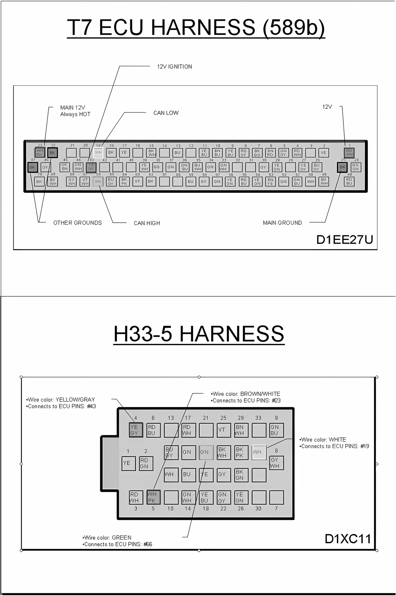
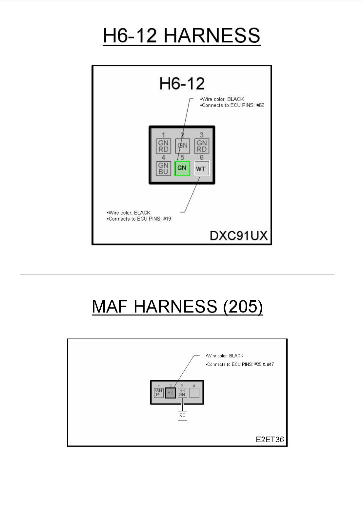
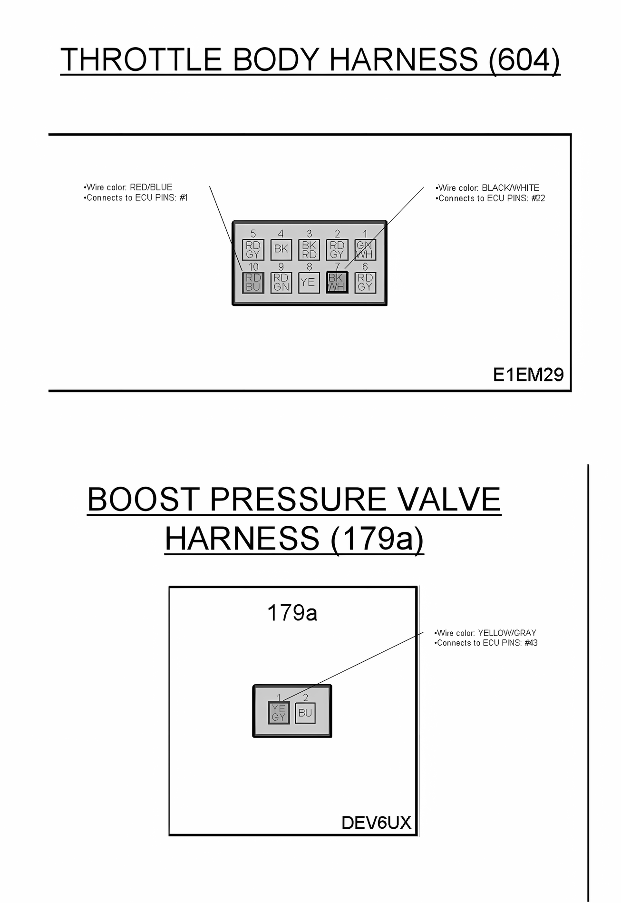

# Appendix II : Trionic 7 pinout

## 70 pin connector

| Pinnumber | Colour       | Description | Range    | In/out |
|----------|------------|------------------------------------------|---------|--------|
| 1         | Red/White    | +12V | +12V | In |
| 2         | Yellow       | Heating of rear lambda sonde | Ground | Out |
| 4         | Red/White    | Relay of A/C compressor | Ground | Out |
| 5         | Green/Gray   | Set switch cruise control | +54 | In |
| 6         | Brown/Red    | Combustion indicator cylinder 3 and 4 on 4 cylinder engine |  | In |
|           |              | Combustion indicator cylinder 2, 4 and 6 on 6 cylinder engine |  |  |
| 7         | Black/Orange | Ignition trigger cylinder 1 |  | Out |
| 8         | Red/Gray     | Ignition trigger cylinder 4 |  | Out |
| 9         | Yellow/Blue  | Voltage from pedal potentiometer P2 in throttle body |  | In |
| 10        | Brown/Blue   | Voltage from throttle potentiometer T1 in throttle body |  | In |
| 11        | Yellow/Blue  | Pressure transducer on intake manifold |  | In |
| 12        |              | Relay SAI (Secondary air injection) on 6 cylinder engine | Ground | Out |
| 13        | Blue         | Boost control valve | Ground | Out |
| 15        | Black/White  | Temperature sensor delivery pipe (IAT) |  |  |
| 16        |              | Optional wideband lambda input (spare AD input) |  | In |
| 17        | Yellow       | Crankshaft sensor |  |  |
| 18        | Black        | Crankshaft sensor |  |  |
| 19        | White        | CAN Low (CAN_L) | Data | In/Out |
| 20        |              | Fuel injector cylinder 6 | Ground | Out |
| 21        |              | Fuel injector cylinder 5 | Ground | Out |
| 22        | Black        | Ground for sensors |  |  |
| 23        | White/PK     | +12V, always connected |  |  |
| 24        | Orange/Green | Throttle actuator in throttle body |  |  |
| 25        | Black        | Ground |  |  |
| 26        | Blue/Gray    | Main relay engine management system | Ground | Out |
| 27        | Yellow/Gray  | Purge valve charcoal canister | Ground | Out |
| 28        |              |  |  |  |
| 29        | Yellow/Green | Brake switch, cruise control | +12V | In |
| 30        |              | Cruise control resume switch | +54 | In |
| 31        |              | Ignition trigger cylinder 5 |  | Out |
| 32        |              | Ignition trigger cylinder 6 |  | Out |
| 33        | Green/White  | Voltage from throttle potentiometer T1 in throttle body? |  | In |
| 34        |              | Lambda signal first lambda sonde (front) | 0-1 volt | In |
| 35        |              | Pressure sensor delivery pipe |  | In |
| 36        | Green/Blue   | Limp home relay controller | Ground | Out |
| 37        | Green        | EVAP shutoff valve | Ground | Out |
| 38        | Orange       | Knock indicator from DI on 4 cylinder engine |  | In |
|           |              | Knock indicator cylinders 1,3 and 5 on 6 cylinder engine |  |  |
| 39        | Yellow/White | Coolant temperature sensor signal |  | In |
| 40        |              | Optional EGT sensor input (PT100 thermo couple) |  | In |
| 43        | Yellow/Gray  | Ignition (+12V) |  |  |
| 44        | Green/White  | Fuel injector cylinder 2 |  | Out |
| 45        | GK/Brown     | Fuel injector cylinder 1 |  | Out |
| 46        | Gray         | Feed for temperature and pressure sensors in delivery pipe and EVAP pressure transducer |  | Out |
| 47        | Black        | Ground |  |  |
| 48        | Red/Blue     | Throttle actuator in throttle body |  | In/Out |
| 49        | Black/White  | Same as pin 69 (connected inside throttle body) |  |  |
| 50        | White        | Fuel pump relay | Ground | Out |
| 51        | Green/Blue   | Solenoid valve for turbo bypass valve | Ground | Out |
| 52        | Green        | Cruise control on/off switch | +54 | In |
| 53        | Brown/Yellow | Combustion indicator cylinder 1 and 2 for 4 cylinder engine |  | In |
|           |              | Combustion indicator cylinder 1, 3 and 5 for 6 cylinder engine |  |  |
| 54        | Yellow/Green | Ignition trigger cylinder 2 | Ground | Out |
| 55        | Red/Blue     | Ignition trigger cylinder 3 | Ground | Out |
| 56        | Yellow/Green | Voltage from pedal potentiometer P1 in throttle body |  | In |
| 57        | Green        | Lambda signal rear lambda sonde | 0-1 volt | In |
| 58        | Gray         | Signal ground for lambda sondes | Ground | In |
| 59        | Blue         | EVAP pressure transducer signal ? |  |  |
| 62        | Black        | Ground on 4 cylinder engine |  |  |
|           |              | Knock indicator for cylinder 2, 4 and 6 on 6 cylinder engine |  |  |
| 63        | Violet       | Brake light switch | +30 | In |
| 64        | Black/PK     | ABS speed reading | Pulse | In |
| 65        | Blue/Gray    | Air Mass Meter signal (might be Pink/White) |  | In |
| 66        | Green        | CAN High (CAN_H) | Data | In/Out |
| 67        | Violet/White | Fuel injector cylinder 3 |  |  |
| 68        | Gray/White   | Fuel injector cylinder 4 |  |  |
| 69        | Black/White  | Voltage feed for the potentiometers in the throttle body. Connected to T7 pin 49 inside throttle body. Pressure transducer on intake manifold |  |  |
| 70        | Black        | Ground for sensors |  |  |

For your reference some schematic images for several connectors are included here.

{width=98%}

{width=100%}

{width=100%}
