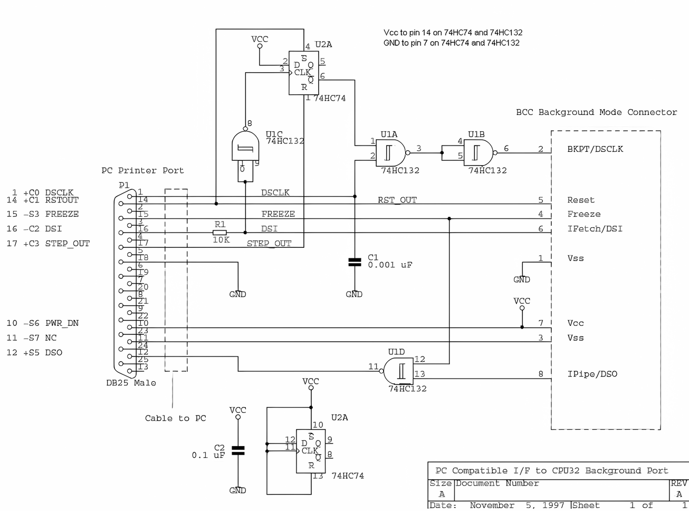

# Appendix III : BDM technical information

## General

BDM stands for Background Debug Mode.
This refers to the mode the Motorola microcontroller is forced into when activating the BDM interface.
This mode enables us to hold the processor in the program execution and read and write data from and to the memory inside the microcontroller and the memory connected to it.
In this way we can download and program the flash contents which gives us access to the binaries we like so much!
The BDM software you need can be downloaded from <http://www.xendus.se/bdm/bd32-122.zip>.

## Home build 2 chips design schema

An alternative to buying a BDM interface can be building one yourself.
This chapter will hand you all information needed to buy the components needed and the schema to build the interface.
The image below shows the schema for the 2 chip design.
There is also a 5 chip design and a GAL based design but these are more difficult to build at home.

{width=100%}

The table below shows the component list that you need to build the interface.
Of course a soldering iron, PCB etc. are things that you also need.

| Component                           | Amount  | Description                                     |
|-------------------------------------|---------|-------------------------------------------------|
| 74HC74                              | 1       | Dual JK Flip-Flop with Set and Reset            |
| 74HC132                             | 1       | Quad 2-input NAND Schmitt Trigger               |
| Capacitor 0.1 uF                    | 1       |                                                 |
| Capacitor 0.001 uF                  | 1       |                                                 |
| Resistor 10 kΩ                      | 1       |                                                 |
| LPT cable + connector               | 1 meter | Smart is to get PCB type with normal LPT cable. |
| 10 wire flat cable                  | 20 cm   |                                                 |
| 10 pin female header for flat cable | 1       |                                                 |

## Pin out

| Pinnumber | Pin name | Description | Remark |
|:-------:|:----------:|-------------------------------------|--------------|
| 1 | DS | Data strobe from target MCU. Not used in current interface circuitry |  |
| 2 | BERR | Bus error input to target. Allows development system to force bus error when target MCU accesses invalid memory |  |
| 3 | VSS | Ground reference from target |  |
| 4 | BKPT/DSCLK | Breakpoint input to target in normal mode; development serial clock in BDM. Must be held low on rising edge of reset to enable BDM |  |
| 5 | VSS | Ground reference from target |  |
| 6 | FREEZE | Freeze signal from target. High level indicates that target is in BDM |  |
| 7 | RESET | Reset signal to/from target. Must be held low to force hardware reset |  |
| 8 | IFETCH/DSI | Used to track instruction pipe in normal mode. Serial data input to target MCU in BDM |  |
| 9 | VCC | +5V supply from target.BDM interface circuit draws power from this supply and also monitors 'target powered/not powered' status |  |
| 10 | IPIPE/DSO | Tracks instruction pipe in normal mode. Serial data output from target MCU in BDM |  |

{width=31%}
