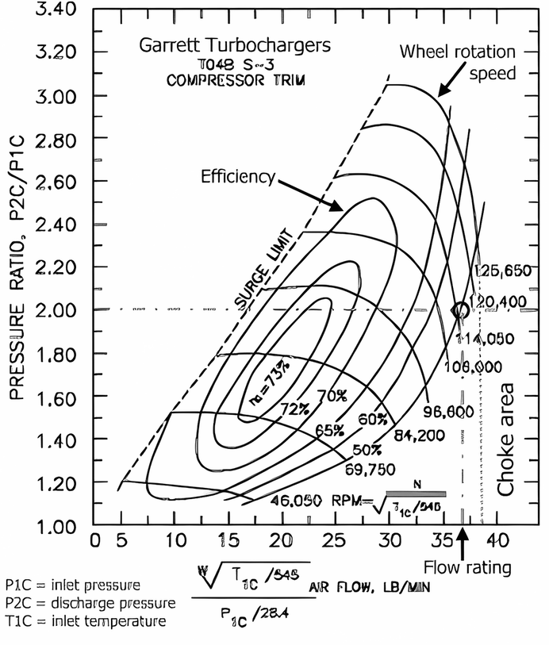
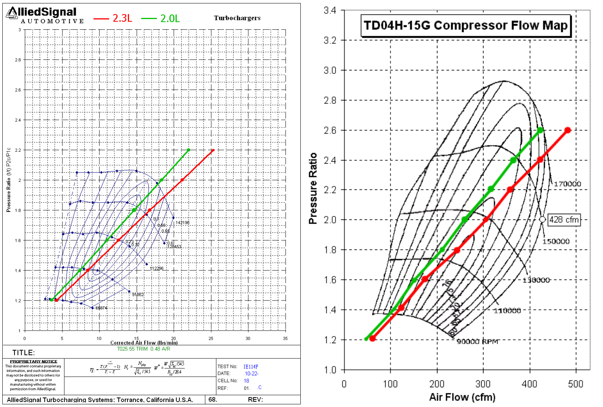
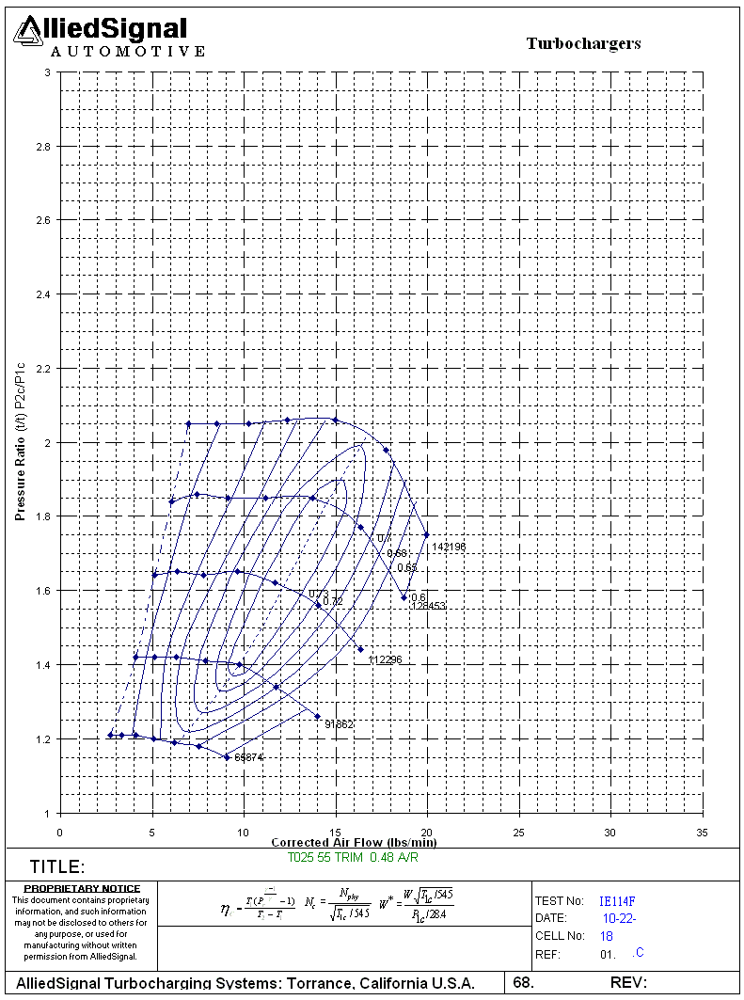
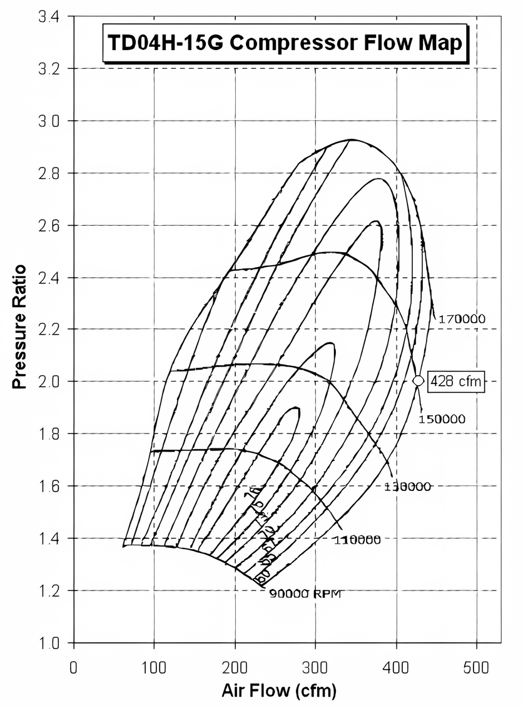
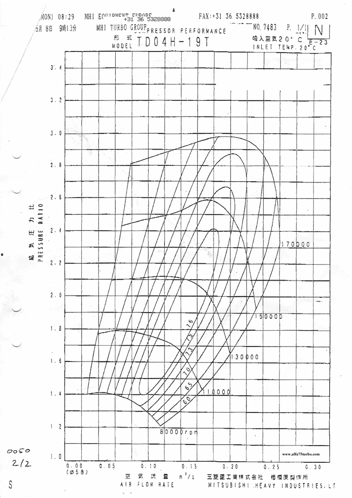
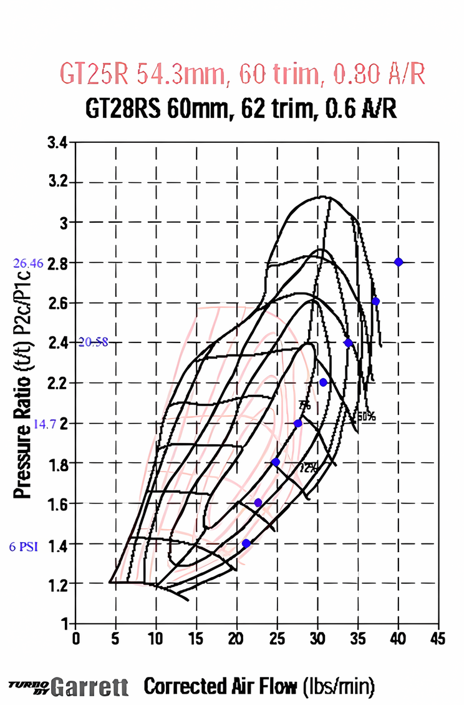
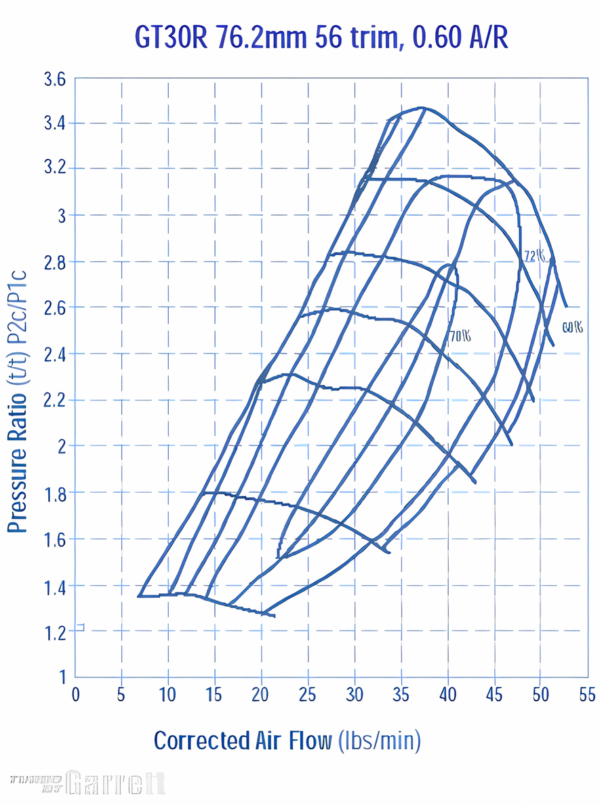

# Appendix IV : Turbo compressor maps {#appendix-iv}

Each turbo has its own characteristics.
These are determined by the size of the turbine housing, the size of the compressor wheel, the size of the turbine blades and many more parameters.
The most important identification of a turbocharger is by its compressor map.
This is a graphical representation of its efficiency.
In SAAB Trionic 5 cars there are 2 commonly used turbo chargers: the Garrett T25 for B204E, B204S, B204L, B234E and B234L engines and the Mitsubishi TD04-HL-15G/T (6cm2) for the B234R engines.

{height=1.5em} <http://www.automotivearticles.com/Turbo_Selection.shtml>

Terms to know:

- Compressor and turbine wheels.
  The turbine wheel is the vaned wheel that is in the exhaust gases from the engine.
  It is propelled by the exhaust gases themselves.
  The turbine wheel is connected to the compressor wheel by an axle.
  So, the compressor wheel will spin together with the turbine wheel.
  The compressor wheel also is vaned and these vanes compress the air and force it into the intercooler.
- Wheel “trim”.
  Trim is an area ratio used to describe both turbine and compressor wheels.
  Trim is calculated using the inducer and exducer diameters.
  As trim is increased, the wheel can support more air/gas flow.
- Compressor and turbine housing A/R.
  A/R describes a geometric property of all compressor and turbine housings.
  Increasing compressor A/R optimizes the performance for low boost applications.
  Changing turbine A/R has many effects.
  By going to a larger turbine A/R, the turbo comes up on boost at a higher engine speed, the flow capacity of the turbine is increased and less flow is wastegated, there is less engine backpressure, and engine volumetric efficiency is increased resulting in more overall power.
- Clipping.
  When an angle is machined on the turbine wheel exducer (outlet side), the wheel is said to be 'clipped'.
  Clipping causes a minor increase in the wheel's flow capability, however, it dramatically lowers the turbo efficiency.
  This reduction causes the turbo to come up on boost at a later engine speed (increased turbo lag).
  High performance applications should never use a clipped turbine wheel.
  All Garrett GT turbos use modern unclipped wheels.
- CFM = Cubic feet per minute.
- Lbs/minute = pounds (weight) per minute.
- M3/s = cubic meters per second.
- Corrected Airflow.
  Represents the corrected mass flow rate of air, taking into account air density (ambient temperature and pressure)

  Example:\
  Air Temperature (Air Temp) - 60°F\
  Barometric Pressure (Baro) - 14.7 psi\
  Engine air consumption (Actual Flow) = 50 lb/min

  $$
  \text{Corrected Flow} = \frac{\text{Actual Flow} \sqrt{[\text{Air Temp}+460]/545}}{\text{Baro}/13.95}
  $$

  $$
  \text{Corrected Flow} = \frac{50 * \sqrt{[60+460]/545}}{14.7/13.95} = 46.3 \text{ lb/min}
  $$
- Pressure Ratio\
  Ratio of absolute outlet pressure divided by absolute inlet pressure

  Example:\
  Intake manifold pressure (Boost) = 12 psi\
  Pressure drop, intercooler ($\Delta P_{\text{Intercooler}}$) = 2 psi\
  Pressure drop, air filter ($\Delta P_{\text{Air Filter}}$) = 0.5 psi\
  Atmosphere (Atmos) = 14.7 psi at sea level

  $$
  \text{PR} = \frac{\text{Boost} + \Delta P_{\text{Intercooler}} + \text{Atmos}}{\text{Atmos} - \Delta P_{\text{Air Filter}}}
  $$

  $$
  \text{PR} = \frac{12+2+14.7}{14.7-.5} = 2.02
  $$

## How to read compressor maps

A 2-dimensional pressure map looks like this.

{#fig-turbo-compressor-map width=53%}

The **curved lines** indicate the rotation speed (rpm) of the compressor wheel.
In the sample map above these values are 45050, 69750, 84200 up to 125650 rpm.
This is how fast a turbine wheel spins!!
The **elliptical circle** means the compressor's efficiency area.
It's marked by the percent sign.
The **horizontal axis** is the amount of air before turbo, (1 m3/s = 2118.88 cfm, 10 lb/min = 144.718 cfm).

The **vertical axis** is the pressure ratio, the ratio of air pressure leaving to the turbo to air pressure entering the turbo.
Pressure Ratio=The pressure at compressor exducer vs. the pressure at compressor inducer.
In another word, the ratio of the pressure of the air after compression vs. the pressure before compression.
As you can see, the pressure ratio depends on the ambient pressure.
For example, at sea level, a turbo boosts 14.7psi.
Ambient pressure is 14.7psi.
That's 2 pressure ratio (PR) on the compressor map.
Take that turbo to a higher elevation, the ambient pressure is less than 14.7psi.
If the turbo still boosts 14.7psi, the pressure ratio would be higher.
Now on the compressor map, you will see by moving up along a vertical line (to pump out the same cfm) and turbo efficiency has decreased as the elevation increases (PR increases).
Simply put, turbos lose performance and become less efficient as elevation gets higher.

### Choke area

The area to the right of the outer most elliptical circle is the least efficient area, the **choke area**.
It means when the compressor reaches certain rpm, the air moved by the compressor wheel in the diffuser area of the compressor housing is moving at or past the speed of sound.
When the air speed reach sonic speed, the amount of air flow increase is very small as compressor wheel rpm increases.
In plain words, the compressor has reached its limit.
You can try to pump more psi, have the wheel spin faster, but very little more air is pumped out the turbo compressor.
You can see now, the compressor housing will need to properly match the compressor wheel.
If you simply stuff a big wheel inside a small compressor housing, the diffuse area will be very small.
This causes the air inside the housing to move at higher speed.
That's why some of the so-called T28s which use a bigger compressor wheel inside the stock compressor housing does not produce good hp.

#### Compressor maximum flow

The max flow of a compressor is shown on the compressor map.
On the map, look for the intersection of maximum compressor wheel speed (rpm) and the least compressor efficiency curve.
Find that intersection.
The horizontal coordinate is the max flow.
The area to the right of maximum flow is the 'choke area'.
The vertical coordinate is the pressure ratio at which the compressor reaches that maximum flow.
From this boost level, as the boost increases, very little air flow is increased.
For example, if a compressor reaches its maximum flow at 2 PR or 1 atm pressure or 14.7psi, higher boost does not pump more air into the motor.
But higher boost may be needed to increase the manifold pressure for the motor to flow more air.
A 5 liter motor with this turbo needs 15psi of manifold pressure to flow a certain CFM.
A 3 liter motor with the same turbo will need much higher manifold pressure to flow the same amount of air although that turbo's compressor does not flow more air past 14.7psi.

#### Compressor maximum pressure

On the map, find the top-most point on the graph.
The vertical coordinate is the max pressure ratio.
For example, 2.8 pressure ratio at sea level is 1.8 times the atmospheric pressure, 1.8x14.7psi=26.46 psi.
Compressor max pressure is limited by compressor wheel speed.
It's physically impossible to boost higher than this maximum pressure for one particular turbo.
Plus the pressure drop in the intercooler system, the actual maximum boost reading from a boost gauge that's plugged into the intake manifolds maybe a few psi lower than this maximum pressure.

#### What the compressor map reads

Most manufactures rate their turbos at 1 bar (15 psi).
That's 2 pressure ratio.
On the map, draw a horizontal line from 2PR.
When the line intersects the right-most elliptical circle, the corresponding number on the x-axis is the maximum cfm the turbo can flow at 1 bar.
Use the TD04-15G's map for example, where the 2 PR line hits the right-most efficiency curve, it reads 428cfm as its flow rate at 15psi.

#### Comparing compressor maps

Well, compressor maps are really 3-dimensional maps.
Any compressor map looks a hill/peak in 3 dimensions.
Our compressor maps look like if you look at the hill directly from above vertically.
The elliptical lines of elevations are the efficiency curves.
Since in theory, we can always boost more and decrease turbo efficiency to get more cfm, let’s set the same Pressure Ratio and compare turbos at the same efficiency curves.

As a rule of thumb, a large turbo will be better at making a lot of pressure but will spool slower than a small turbo.
A small turbo will build boost fast but is less capable to make big boost pressure.

### Understanding information within the compressor map

1. The oblong ovals on the chart or “islands” as they are called represent the efficiency of the turbo in that range.
   As you can see on this map, the most efficient operation (73%) is in the very centre of the chart.
   This is general characteristic of most turbochargers.
   Without getting into the thermodynamics of adiabatic heat-pumps, we’ll just say that efficiency is a measure of how much excess heat the turbo puts into the compressed air coming out of the outlet.
   So intuitively, more efficient is better.

2. Wheel rotational speed is simply the rpm at which the compressor wheel is spinning.

3. The choke point, which is usually not indicated on flow maps, is the maximum flow rating the turbo is capable of regardless of pressure or efficiency.

4. Beyond the surge limit on the left of the plot, compressor surge occurs.
   In laymen’s terms, this phenomenon is caused by a back pressure wave entering the exit of the compressor housing and disrupting flow through the compressor wheel.
   Surge will kill turbos and is to be avoided at all costs.

### Surge Limit

To the left of the surge limit line on the flow map is the *surge area* where compressor operation can be unstable.
Typically, surge occurs after the throttle plate is closed while the turbocharger is spinning rapidly and the by-pass valve does not release the sudden increase in pressure due to the backed-up air.
During surge, the back-pressure build-up at the discharge opening of the compressor reduces the air flow.
If the air flow falls below a certain point, the compressor wheel (the impeller) will loose its "grip" on the air.
Consequently, the air in the compressor stops being propelled forward by the impeller and is simply spinning around with the wheel, which is still being rotated by the exhaust gas passing through the turbine section.
When this happens, the pressure build-up at the discharge opening forces air back through the impeller causing a reversal of air flow through the compressor.
As the back pressure eventually decreases, the impeller again begins to function properly and air flows out of the compressor in the correct direction.
This sudden air-flow reversal in the compressor can occur several times and may be heard as a repetitive "Whew Whew Whew" noise if the surge is mild (such as when the by-pass valve is set a little too tight) to a loud banging noise when surge is severe.
Surge should be prevented at all costs because it not only slows the turbocharger wheels so that they must be spooled back up again but because it can be very damaging to the bushings or bearings and seals in the center section.

## Selecting a different turbo charger

### Calculating your engine’s flow requirements

Now that you can read and understand a compressor flow map, its time to figure out how to match a turbo to your engine, this involves selecting the proper compressor and turbine wheels along with the right combination of housing A/R.
A mismatched turbo could not only result is extreme lag, but also wasted potential as a turbo can easily outflow an engine.
I.e. bigger is not always better.

The only real calculation that needs to be done is to determine how much air you engine is actually flowing.
This depends on a number of things including the RPM, absolute temperature (Rankin, equal to 460 + Fahrenheit temp), absolute manifold pressure (psi, equal to boost pressure plus atmospheric pressure), and lastly the engine volumetric flow or EVF in cfm.

First to calculate EVF use the following equation:

$$
\text{EVF} = \left(\frac{\text{engineCID}}{1728}\right) * \left(\frac{\text{RPM}}{2}\right)
$$

Engine CID = Engine displacement in cubic inches.\
Next we’ll use EVF to calculate the amount of air in lb/min the engine is flowing under boost and at temperature using this equation:

$$
N = \frac{P * \text{EVF} * 29}{10.73 * T}
$$

*Where N is the airflow in lb/min, P is the absolute pressure in psi, and T is the absolute ambient temperature in Rankin.*

Finally, multiply N by the volumetric efficiency of your engine (VE).
This compensates for the fact that upon every cycle of the engine, not all of the old air/fuel mix in the cylinders is forced out the exhaust.
Thus there is a difference between the actual airflow through and engine and the predicted airflow.
This discrepancy is equated to a VE.
There is literally thousands of hours worth of online reading about volumetric efficiencies for just about every production engine.
To get the most accurate results from this step I would suggest researching your engine and coming up with the most realistic VE possible as this does have a significant effect on engine flow.
If you are just messing around with compressor flow maps and need a value for VE just to experiment with, 85% efficiency is a nice conservative number for most modified turbocharged cars at high rpm (6500-7500).
Keep in mind though that on a forced induction setup VE can easily exceed 100% so again it will be very beneficial to research *your* engine.
For our SAAB engines these number apply.

| EVF / RPM | 2.0L engine (122 cubic inch) | 2.3L engine (140 cubic inch) |
|-----------|------------------------------|------------------------------|
| 1000 rpm  | 35.3                         | 40.6                         |
| 2000 rpm  | 70.6                         | 81.2                         |
| 3000 rpm  | 105.9                        | 121.8                        |
| 4000 rpm  | 141.3                        | 162.4                        |
| 5000 rpm  | 176.6                        | 203.1                        |
| 6000 rpm  | 211.9                        | 243.7                        |
| 7000 rpm  | 247.2                        | 284.3                        |

Since the amount of air to be flowed by the turbo is largest when RPM is at its top we will take the worst case scenario and get EVF \@ 7000 RPM.
We have to make an assumption on the ambient temperature which we will set at 20˚C.
This is 68˚ Fahrenheit which is (460 + 68) = 528 Rankin.
Now we can calculate the airflow of the engine in lb/min for any given boost level.
If we want to draw a line into the compressor map for our engines needs we need to calculate the needed airflow for several boost levels.

| Airflow / boost pressure | 2.0L lb/min | 2.0L cfm | 2.3L lb/min | 2.3L cfm |
|--------------------------|-------------|----------|-------------|----------|
| 0.2 bar (2.9 psi)        | 3.7         | 53.1     | 4.2         | 61       |
| 0.4 bar (5.8 psi)        | 7.3         | 106.1    | 8.4         | 122      |
| 0.6 bar (8.7 psi)        | 11          | 159.2    | 12.6        | 183      |
| 0.8 bar (11.6 psi)       | 14.7        | 212.2    | 16.9        | 244      |
| 1.0 bar (14.5 psi)       | 18.3        | 265.3    | 21.1        | 305      |
| 1.2 bar (17.4 psi)       | 22          | 318.3    | 25.3        | 366      |
| 1.4 bar (20.3 psi)       | 25.7        | 371.4    | 29.5        | 427      |
| 1.6 bar (23.2 psi)       | 29.3        | 424.4    | 33.8        | 488      |

This all results in 2 simple lines in the compressor map which indicate the maximum flow required from the turbo by our engine.

{width=91%}

Now we can clearly see where out engine leaves the compressor map and thus the limit for the combination of the two (engine and turbo) lies.
We also see that – even for the 2.3 litre engine – the TD04 can sustain a much higher boost pressure at higher rpms than the T25 can.
Even at 1.4 bar boost (pressure ratio = 2.4) the TD04 is within its limits and would flow approximately 420 cfm.
Would we have done the same with the T25 turbo we would most certainly be in the choke area and the turbo would be unable to get us the airflow that we required.

### Determining the Best Wheel Trim-Housing A/R Combination

With the flow rate you have just calculated, you can look at compressor maps of different turbo chargers to see which ones give you the air flow you need at the pressures and efficiencies that you want to run.

When selecting a turbo, it is important to do the above calculations for a number of different RPM’s and boost pressures because you will not always be at redline under full boost while driving you car.
Checking the turbo performance at various engine speeds and pressures will give the overall picture of how well the turbo is sized to your vehicle.

Matching a flow map to your engine flow requirements will allow you to pick the compressor wheel trim for your application.
However before you can go out and purchase that new turbo, you still have to settle on an exhaust wheel and turbine A/R.
The real determining factor in this selection is maintaining compressor wheel speed.
Remember the wheel RPM lines on the flow map?
Well a properly sized exhaust wheel/housing combination will keep the compressor wheel operating within the maximum and minimum wheel speeds on the map as often as possible.
Since different “hot side” combinations can affect your turbos performance, (i.e. a little more lag in return for more top end, or quicker spool up at the cost of overall power) the best thing to do is to contact a turbo manufacturer or distributor ([www.forcedperformance.com](http://www.forcedperformance.com), [www.turbochargers.com](http://www.turbochargers.com)) and they will be able to tell you the exact effects you can expect from all of the various hot side combos available for your turbo model.

## Garrett T25 specifications

Weight: 7,5kg\
Compressor diameter: 60mm\
Turbine diameter: 65mm and 59mm\
Bearing span: 37,8mm\
Moment of inertia: 5,4x10-5 kg/m2\
Oil flow: 1,7L/min / SAE30 / 90C / 2,75bar\
Compressor wheel: 54mm 55 trim, A/R 48\
Turbine wheel: 53.8mm 61 trim, A/R 49

{width=67%}

As you can see the T25 (trim 55) can flow 18 lbs of air per minute \@ pressure ratio = 2 and efficiency will be ~65%.
This 18 lbs/minute converts to about 260 cfm.
The maximum efficiency zone (73%) reaches up to pressure ratio 1.9.
This would be ~0.9 bar overpressure.
In terms of usage the T25 can take us up to ~1.1 bar boost pressure and bring up to 250 bhp.

## Mitisubishi TD04-15G specifications

{width=64%}

The TD04-15G from the 9000 Aero can flow more air than the “little” T25.
Looking at the map we can see that the TD04-15G can flow ~428 cfm \@ pressure ratio 2 and efficiency of 60%.
Also, the maximum efficiency zone (76% vs. 73% for the T25) reaches up to 1.9 pressure ratio with would be ~0.9 bar.
In terms of usage the TD04 can take us up to ~1.4 bar boost pressure.
The TD04 can bring up to ~330bhp.

## Mitsubishi TD04-19T specifications

{width=58%}

This TD04-19T compressor map has the air flow axis noted in m3/s.
1 m3 per second means 2118 cfm.
So this turbo can flow approximately 0.26 m3/s = 550 cfm \@ pressure ratio 2.3.
At the standard ratio of 2 it still flows 510 cfm which is more than a GT28RS.
The TD04-19T can bring up to ~380 bhp.

## Garrett GT28RS (GT2860R) specifications

{width=57%}

The GT28RS is frequently used in modified cars.
It can flow much more air than the TD04 and the T25.
If we look at the compressor map for the GT28RS (black lines) we see that this turbo is capable of flowing ~33 lbs/minute which is ~477 cfm at pressure ratio 2.
The maximum efficiency runs much higher than that.
Up to 1.4 bar boost pressure this turbo will run at 75% efficiency.
In terms of usage the GT28RS can run nicely up to 1.6 bar at an air flow rate of ~37 lbs/min = 535 cfm.
This is much more than the TD04-15G of course.
The GT28RS can bring up to ~350 bhp.

## Garrett GT30R specifications

{width=68%}

The GT30R (GT3071) is given for reference reasons only.
It can flow even more air than the GT28RS.
If we look at the compressor map we see that this turbo is capable of flowing ~45 lbs/minute which is ~650 cfm at pressure ratio 2.
The maximum efficiency runs up to 1.8 bar boost pressure.
In terms of usage the GT30R can run nicely up to 1.8 bar at an air flow rate of ~52 lbs/min = 750 cfm.
Even within the maximum efficiency zone this turbo will flow 40 lbs/minute which is more than the GT28RS will flow even at maximum.
The GT30R can bring up to ~500 bhp.

## Conclusion

Comparing the two compressor maps for TD04 and T25 we can clearly see that the TD04 can flow more air at a higher pressure ratio and with a higher efficiency.
Given the fact that the turbine blades are larger than in the T25, spool up will be a bit slower, but high end power will be much better.

Upgrading your turbo will affect more than meets the eye.
The VE map in the Trionic would probably need adjustments because the hardware in the airflow has been changed.
This means the volumetric efficiency also changes and thus the correction table needs changing too.
Also, when boost values rise, the intercoolers capacity for air flow comes into play.
You must make sure that the intercooler is not so restrictive that upgrading the turbo will result in a burst intercooler.
A high capacity cross flow intercooler would be a good option here.
And last but not least, upgrading the turbo charger means – that is the goal here – more air flow to the cylinders and thus more oxygen to burn.
If we upgrade the turbo we need to consider the injectors too.
If the injectors can’t flow the amount of fuel needed to burn the amount of oxygen pushed into the cylinders we would have gained nothing.

