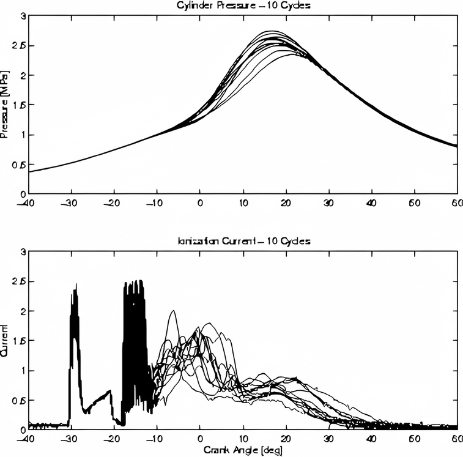
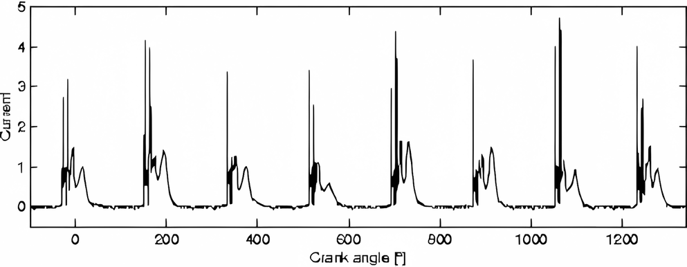
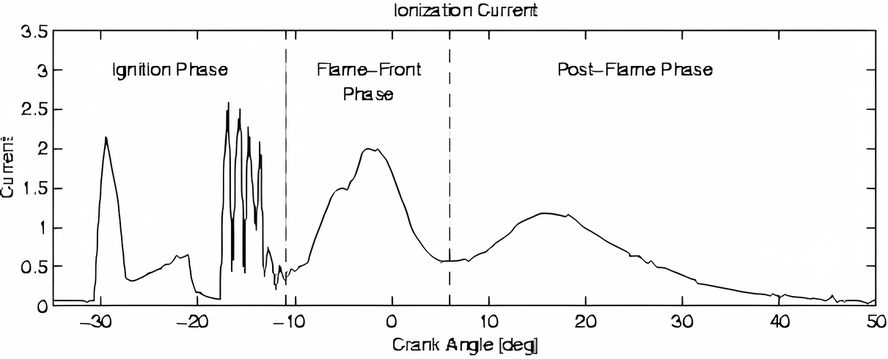
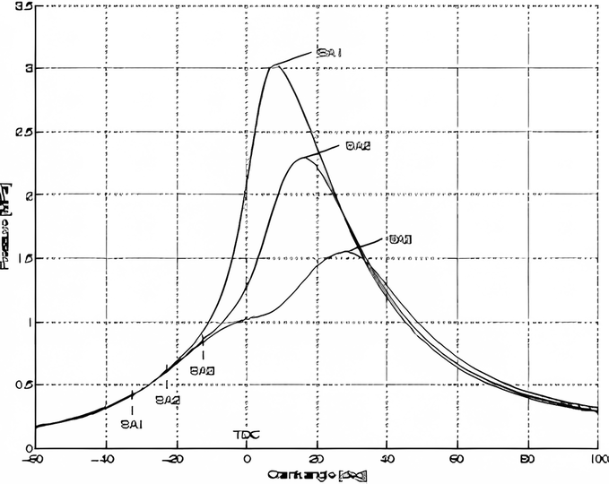
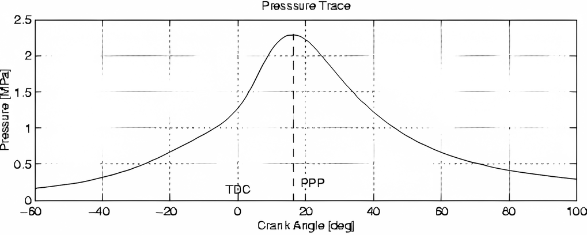
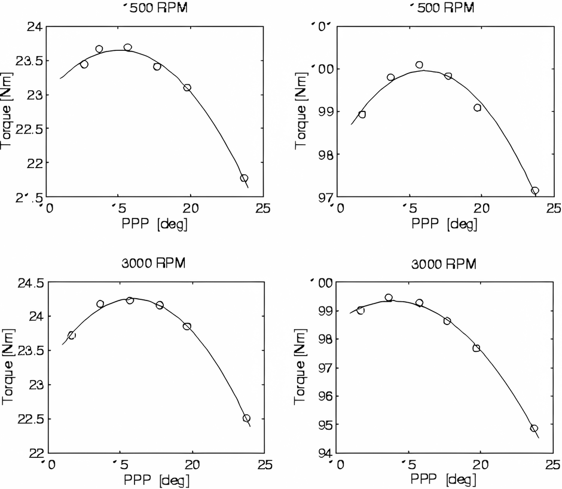

# Appendix VII: Knock and misfire detection

Trionic detects knocking and misfires by means of the ionization current that flows between the spark plug gaps.
This appendix will explain how this works.

{height=1.5em} <http://www.fs.isy.liu.se/~larer/Projects/main.html>

## Ionization current generation

In an ideal combustion reaction, hydrocarbon molecules react with oxygen and generate only carbon dioxide and water, e.g. isooctane gives

$$
C_8H_{18} + \frac{25}{2}O_2 \longrightarrow 8CO_2 + 9H_2O.
$$

In the combustion there are also other reactions present, that include ions, which go through several steps before they are completed.

$$
\begin{aligned}
CH + O &\longrightarrow CHO^+ + e^- \\
CHO^+ + H_2O &\longrightarrow H_3O^+ + CO \\
CH + C_2H_2 &\longrightarrow C_3H_3^+ + e^-
\end{aligned}
$$

These ions, and several others, are generated by the chemical reactions in the flame front.
Additional ions are created when the temperature increases as the pressure rises.

The processes creating the ionization current are complex and are also varying from engine cycle to engine cycle.
@fig-cycle-variations shows ten (10) consecutive cycles of the cylinder pressure and the ionization current operating at constant speed and load.

{#fig-cycle-variations width=58%}

As can be seen, the cycle-by-cycle variations are significant, which is a given problem in interpreting these signals.

## Ionization current sensing

{#fig-ion-current-cylinder width=76%}

Knock is a pressure oscillation in the cylinder with a frequency determined by the geometry of the combustion chamber.
The oscillation is present in the current measurement and can be extracted mainly by using a band pass filter in a well chosen time window of the current signal.
Knocking can destroy the engine.
When there is a misfire, then there are no resulting ions and hence no current which is easily detected.
Misfires can and will destroy the catalyst.

Ionization current interpretation can be used for both purposes, knock detection and misfire detection.

{#fig-ion-current-sensor-info width=71%}

### Detection

To detect the ions, a DC bias is applied to the spark plug, generating an electrical field.
The electrical field makes the ions move and generates an ion current.
A schematic illustration is shown in @fig-measuring-ion-current (a).
The current is measured at the low-voltage side of the ignition coil, and does not require protection from the high-voltage pulses in the ignition, @fig-measuring-ion-current (b).

{#fig-measuring-ion-current width=80%}

Measurement of the ionization current.
(a) The spark plug-gap is used as a probe.
(b) Measurement on the low voltage side of the ignition coil.

The ionization current is an interesting engine parameter to study.
It is a direct measure of the combustion result that contains a lot of information about the combustion, and several challenges remain in the interpretation of it.
Some of the parameters that affect the ionization current are: temperature, air/fuel ratio, time since combustion, exhaust gas recycling (EGR), fuel composition, engine load, and several others.

### Ionization Current Terminology

The ionization current typically has three phases: a phase related to ignition, a phase related to ions from the flame development and propagation, and a phase related to pressure and temperature development.
In @fig-ion-current-phases, the three phases of the ionization current are displayed.
Each of these phases has varying characteristics and they also mix together in complicated ways.
In the ignition phase, the ionization current is large, with reversed polarity.
Due to the high current in the ignition the measured signal shown in the figure is limited.
What can be seen in the image too is the ringing phenomenon in the coil after the ignition.

{#fig-ion-current-phases width=68%}

In the flame-front phase, the high level of ions associated with the chemical reactions in the flame produces one or more characteristic peaks.
The ions generated by the flame have different recombination rates.
Some ions recombine very quickly to more-stable molecules, while others have longer residual times.
The result is a high peak which after some time decays as the ions recombine.

In the post-flame phase the most stable ions remain, generating a signal that follows the cylinder pressure due to its effect on the temperature and molecule concentration.
Ions are created by the combination of the measurement voltage and the high temperature of the burned gases, since the temperature follows the pressure during the compression and expansion of the burned gases, when the flame propagates outwards and the combustion completes.
The ionization current thus depends on the pressure.

## Spark Advance and Cylinder Pressure

The spark advance is used to position pressure development in the cylinder such that the combustion produces maximum work.
Under normal driving conditions the mixture is ignited around 15 – 30˚ in crank angle before the piston has reached top dead center (TDC), and the pressure peak comes around 20 degrees after TDC.
In the graph below three different pressure traces, resulting from three different spark timings, are shown.
Earlier spark advance normally gives higher maximum pressures and maximum temperatures that appear at earlier crank angles.

{#fig-pressure-vs-timing width=52%}

Three different pressure traces resulting from three different spark advances.
The different spark advances are; **SA1**: spark advance 32.5˚ before top dead center (TDC), **SA2**: 22.5˚ before TDC, **SA3**: 12.5˚ before TDC.
The optimal spark advance is close to **SA2**.

The optimal spark advance for maximum output torque is close to **SA2** for the operating point in the figure, and the resulting peak pressure position lies around 17˚ after TDC.
With too early ignition timing the pressure rise starts too early and counteracts the piston movement.
This can be seen for the pressure trace with spark advance **SA1** where the pressure rise starts already at -20˚ due to the combustion.
There are also losses due to heat and crevice flow from the gas to the combustion chamber walls, and with an earlier spark advance the loss mechanisms start earlier reducing the work produced by the gas.
Higher pressures give higher temperatures which also decrease the difference in internal energy between the reactants and products in the combustion, thus resulting in lower energy- conversion ratios.
The heat loss mechanisms and the lower conversion ratio can be seen in @fig-pressure-vs-timing, at crank angles over 30˚, where the pressure trace from the **SA1** spark advance is lower than the others.

Too late ignition gives a pressure increase that comes too late so that work is lost during the expansion phase.
In @fig-pressure-vs-timing, the pressure increase for spark advance **SA3** starts as late as at TDC.
But work is also gained due to the later start of the effects mentioned above, which also can be seen in the figure.
The pressure trace from the spark advance, **SA3**, is higher than the others at crank angles over 30˚.
However, this gain in produced work can not compensate for the losses early in the expansion phase.

## Peak Pressure Concept

Thus, optimal spark advance positions the pressure trace in a way that compromise between the effects mentioned above.
To define the position of the in-cylinder pressure relative to TDC, the peak pressure position (PPP) is used, @fig-peak-pressure-position.
The PPP is the position in crank angle where the in-cylinder pressure takes its maximal value.
There also exist other ways of describing the positioning of the combustion relative to crank angle, e.g. based on the mass fraction burned curve.

{#fig-peak-pressure-position width=78%}

## Engine-tuning for efficiency

To be able to get the maximum torque from the engine at a given load point we have to investigate the torque development in different settings.
In @fig-ppp-vs-torque, mean values, over 200 cycles, of the PPP are plotted together with the mean value of the produced torque at four different operating points covering a large part of the road load operating range for the engine.
Two of the operating points have an engine speed of 1500 rpm with different throttle angles, and for the two other operating points the engine speed is doubled to 3000 rpm.
The PPP for maximum output torque in the figure lies around 15˚ATDC (after TDC) for all these operating points, , even though the spark advance differs a lot.

{#fig-ppp-vs-torque width=72%}

Note that the load and speed are changed over large intervals, and that the PPP for maximum output torque at the different operating points does not differ much.
The PPP versus torque curve is flat around the position for the maximum.
Therefore a spark schedule that maintains a constant PPP at 15˚ is close to optimum.
Considering only the work produced, this motivates that an optimal spark schedule maintains almost the same position for the peak pressure.
However, the optimal PPP changes slightly with the operating points.
The efficiency can thus be improved a little bit further by mapping the optimal PPP for each operating point, and provide these values as reference signal to the spark timing controller.
The peak pressure positioning principle can also be used for meeting emission standards.
