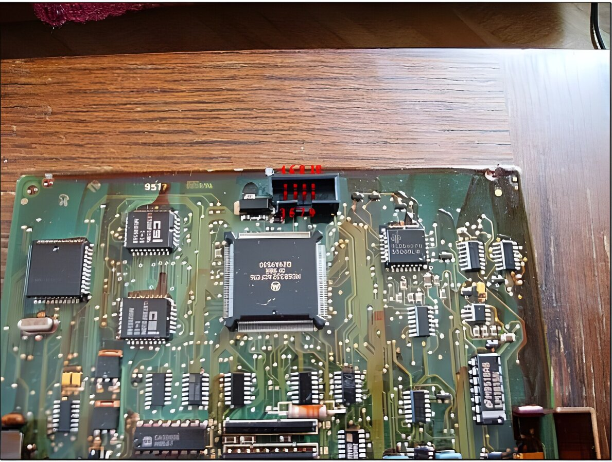
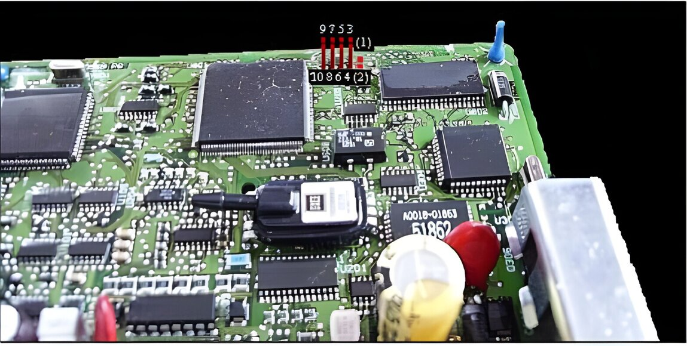
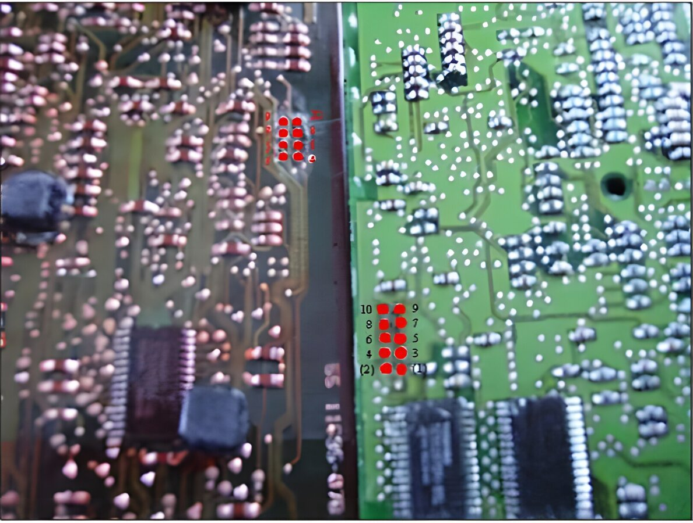

# Appendix X: How to connect the PD BDM programmer to a T5/T7 ECU

## Pin out

:::: {layout-ncol=2}
::: {}
The standard BDM pin out:

{width=48%}
:::
::: {}
The PD BDM/Willem pin out:

{width=48%}
:::
::::

Please note that pins 1 & 2 on a standard BDM connector are not connected and that the row of pins are shifted one pin upwards.
Pin 1 on the PD BDM/Willem is pin 3 on the standard BDM connector.

The BDM connector on the T5

{width=91%}

On the T5 ECU there are eight pads for soldering the pins for the BDM programmer.

The BDM connector on the T7

{width=88%}

Pay attention to that the BDM connectors are mirrored between the T5/T7 ECU.
On the T7 ECU the pads for pin 1 & 2 are present but shall not be used when using a PD BDM or Willem programmer.

The bottom side:

{width=91%}

On the other side of the PCB’s there are only the other side of the pins.
No bridging or something like that, just plain soldering.
